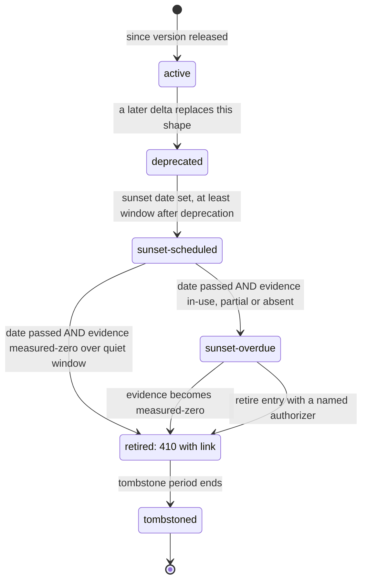
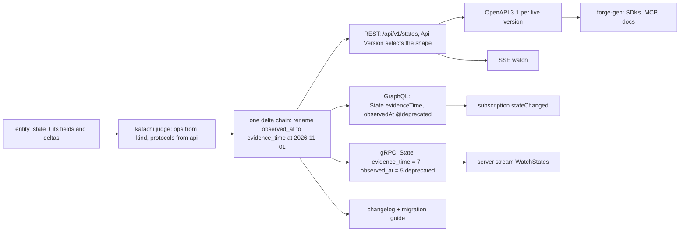
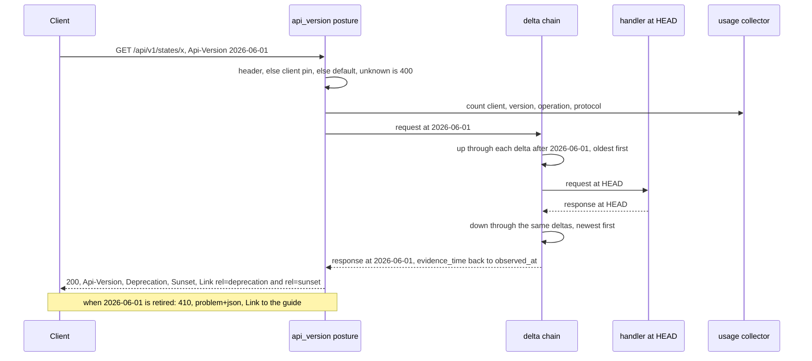
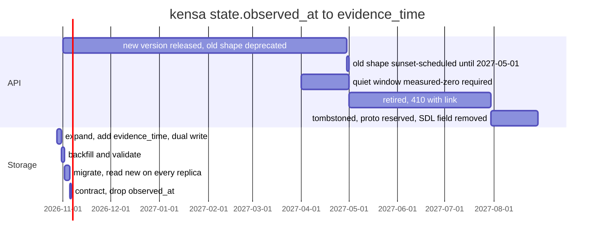
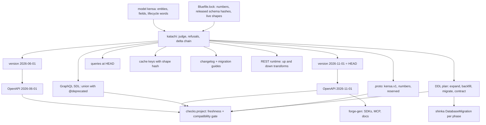

# API-EVOLUTION — the API is a versioned rendering of the one model

Status: DESIGN, 2026-10-23. Nothing below is built unless the tier ledger
(§17) says so. Paths are under `~/code/github/pleme-io/`. Line numbers were
read on 2026-10-23. The kensa paths were read on branch `kensa/event-envelope`
at `3c76c81`.

Decided context, not argued again here: `theory/BLUE-STRUCTURE.md` §6.5 (one
`model(...)`, every data surface is a rendering) and §6.6 (one `service(...)`
plus one `model(...)`); `blue/docs/SERVICE-ARCHITECTURE.md` (katachi judges the
model, haibi renders, forge-gen generates from OpenAPI);
`kensa/docs/live-compliance.md` §5.6 (kensa's model).

## 1. Destination

A blue service has one API, and that API is the model seen through time. Each
field says once how the API exposes it and when that exposure changed. A
version is a named set of deltas. Each delta is one entry from a closed
catalog of transforms, and each transform is written once in a bidama. So a
new version is a declaration, never a new handler. One model change moves
every rendering in lockstep: the SQL (by expand and contract), the queries,
the cache keys, REST and OpenAPI, GraphQL, protobuf and gRPC, the SDKs from
forge-gen, the changelog and the migration guide. A breaking change without a
version does not compile. A removal without a deprecation window does not
compile. A version retires only when its date has passed and the service has
measured no use of it. A gap in the measurement blocks the retirement. A
retired version still answers, with 410 and a link to its guide.

World facts that limit this: a client outside our build cannot be upgraded by
us. HTTP caches key on the URL and the `Vary` headers. Protobuf identifies a
field by its number on the wire. A GraphQL client chooses its own fields. The
rolling deploy runs old and new code at the same time. Postgres DDL takes
locks. Each of these shapes a rule below. None is a reason for a second source.

## 2. Ground

| Concern | What exists (path:line) | What does not exist |
|---|---|---|
| URL major version | kensa uses `/api/v1/...` on every route: `kensa/src/api/rest.rs:51`–`:80`, `kensa/src/attestation.rs:721`–`:727` (now includes `POST /api/v1/events`) | no `/v2`, no version below the major, no rule for when the major moves |
| Proto package version | `kensa/proto/kensa.proto:9` `package kensa.v1;` | no `reserved` and no `deprecated` option in the file (searched) |
| OpenAPI | hand-written `kensa/spec/openapi.yaml`, `openapi: 3.0.3` (`:1`), `info.version: 0.1.0` (`:4`) | the spec has no `/api/v1/whoami`, no `/api/v1/events` and no `/api/v1/attestations` path (searched). It already drifts from the routes. No `deprecated: true` anywhere |
| forge-gen | `forge-gen/src/manifest.rs:68` `SpecConfig { path, _version }`: one spec path. `_version` is parsed and unused (`init.rs:23` calls it "informational only"). Targets include SDKs, servers, MCP, `grpc-rust` (`registry.rs:421`), docs. kensa's `forge-gen.toml` points at `spec/openapi.yaml` and renders MCP, completions and docs | no notion of API versions, no per-version spec, no deprecation handling |
| GraphQL | kensa: hand-written `async_graphql` `SimpleObject`s in `kensa/src/api/graphql.rs:20`–`:93`, mounted at `/graphql` (`kensa/src/main.rs:477`) | no `@deprecated`, no subscription, no SDL rendered from a model |
| gRPC | kensa: `grpc` feature (`kensa/Cargo.toml:28`), tonic service `kensa/src/api/grpc.rs`, unary RPCs only (`kensa.proto:17`–`:31`). `main.rs:502` calls an undefined `shutdown_signal()` under the feature | no streaming RPC, no number discipline beyond the hand-written file |
| Live stream | kensa SSE: `/api/v1/attestations/stream` (`attestation.rs:727`) | not a model rendering |
| Deprecation / Sunset headers | none. `rg` for `Sunset`, `Deprecation`, RFC 8594 and RFC 9745 in `*.rs`, `*.b`, `*.rb`, `*.ts` outside vendor finds only unrelated enums (`narsil-mcp`, `caixa-clap`, daylight `sunset`) | no header, no `Link rel=deprecation`, no 410 for a retired version |
| Migrations | haibi `table_sql` renders `CREATE TABLE IF NOT EXISTS` plus `ALTER TABLE ... ADD COLUMN IF NOT EXISTS` per column (`blue/bidamas/haibi/haibi.b:343`–`:347`), tested at `:895`. shinka runs it (`shinka/src/crd/database_migration.rs:92`, `SafetySpec` `:942`: healthy cluster, retries, checksum) | no rename, no drop, no backfill, no phase. A field removed from `schema:` leaves its column. This is additive only, and safe only by accident |
| Expand / contract | lilitu does it by hand and by comment: `lilitu/services/rust/migration/src/m20260208_000001_remove_admin_users.rs:3`–`:12` ("expand phase ... DROP TABLE will happen in a future migration") | no typed phase, no gate that proves the contract is safe |
| lilitu GraphQL | Seaography is commented out (`lilitu/services/rust/Cargo.toml:93`–`:95`, pending SeaORM 2.0) | no generated GraphQL, no versioning |
| Client pinning, usage telemetry | none found | all of it |

Summary: pleme-io has a path major (`/api/v1`, `kensa.v1`) and additive DDL.
It has no versions below the major, no deprecation, no sunset, no usage data
and no compatibility check. kensa serves REST, GraphQL and gRPC from three
hand-written type sets, and its OpenAPI already lags its routes.

## 3. Research

Fetched on 2026-10-23 unless marked. No personal data was sent.

| Source | What it says | Verdict |
|---|---|---|
| Stripe, "APIs as infrastructure", https://stripe.com/blog/api-versioning | rolling versions "named with the date they're released"; an account is pinned on its first request; `Stripe-Version` overrides per request; each breaking change is a "version change module" that transforms data, and responses are built at HEAD and walked back through the modules to the target version; adding fields and endpoints is safe | **adopt** date names, pin on first authenticated request, per-request header, HEAD-only handlers. **adapt** the modules: ours are a closed catalog of transform kinds, not one module of code per change |
| Google AIP-180, https://google.aip.dev/180 | within a major: add is fine; "New required fields must not be added"; removing, renaming (remove plus add), retyping, changing defaults, changing default serialization and semantic changes break; the server keeps populating fields it populated | **adopt** as the breaking-change classifier in the judge |
| Google AIP-181, https://google.aip.dev/181 | alpha (no promise), beta (deprecation period set when marked, about 90 days), stable (no breaking change in the major; turndown by a formal process); emergency changes may break | **adapt**: a version and an operation carry a stability. Emergency is a typed entry with an authorizer |
| Google AIP-185, https://google.aip.dev/185 | major version at the end of the proto package and at the head of the REST path; never expose minor or patch; channel-based alpha and beta preferred; 180 days recommended for beta transitions | **adopt** the major in path and package. **adopt** 180 days as the default window. **skip** channels for now (open question §15) |
| Google AIP-127, https://google.aip.dev/127 | one protobuf definition serves gRPC and HTTP/JSON; path and body map to fields; bidi streaming has no HTTP mapping; streaming methods should have a non-streaming twin | **adapt**: our one definition is the model, not the proto; the rule "every stream has a unary twin" is adopted |
| RFC 8594, https://www.rfc-editor.org/rfc/rfc8594.html | `Sunset: <HTTP-date>`; a hint; after it, 4xx, 3xx or nothing, for example 410; `rel="sunset"` links to the retirement policy | **adopt** on every response of a sunset-scheduled version; **adopt** 410 after retirement |
| RFC 9745, https://www.rfc-editor.org/rfc/rfc9745.html | `Deprecation: @<epoch>` (structured date); deprecation does not change behaviour; `rel="deprecation"` links to human docs; Sunset "MUST NOT be earlier than" Deprecation | **adopt**. The judge makes the ordering a refusal, with a stricter floor (§9) |
| OpenAPI 3.1, https://spec.openapis.org/oas/v3.1.0 | `deprecated` on Operation and Parameter; `info.version` is the document's version | **adopt**; `info.version` carries the date version |
| JSON Schema 2020-12 validation §9.3, https://json-schema.org/draft/2020-12/json-schema-validation (not fetched this session) | `deprecated` annotation on a schema property | **adopt** for deprecated fields in OpenAPI |
| GraphQL October 2021, https://spec.graphql.org/October2021/ §3.13.3 | `@deprecated(reason)` on `FIELD_DEFINITION | ENUM_VALUE`; introspection `isDeprecated`, `includeDeprecated` defaults false; subscription is "a long-lived request that fetches data in response to source events" | **adopt** |
| GraphQL draft, https://spec.graphql.org/draft/ | adds `ARGUMENT_DEFINITION`, `INPUT_FIELD_DEFINITION`; never on a required argument or input field | **adapt**: emit on arguments only where the executor supports the draft |
| graphql.org caching, https://graphql.org/learn/caching/ | REST URLs are the cache identity; GraphQL has "no URL-like primitive", so expose a global `id` | **adopt**: GraphQL is not the cacheable-read surface; every GraphQL object gets an opaque global id |
| protobuf proto3, https://protobuf.dev/programming-guides/proto3/ | changing a number is unsafe; a deleted number "must" be reserved; reserve the name too for JSON and text; never reuse a reserved number; `deprecated = true` has little effect | **adopt** all of it, enforced by the number lock |
| gRPC-Web, https://github.com/grpc/grpc-web and https://grpc.io/docs/platforms/web/basics/ | browsers need a proxy (Envoy); "Client-side and Bi-directional streaming is not currently supported" | **adopt** as the reason gRPC is not the browser surface |
| Parallel change, https://martinfowler.com/bliki/ParallelChange.html | expand, migrate, contract; "Most database refactorings follow the parallel change pattern"; skipping contract leaves the code worse | **adopt** as the only shape of a destructive storage change |
| RFC 9457 problem details (not fetched this session) | `application/problem+json` error body | **adopt** for the 410 body |
| Media-type versioning (`application/vnd.x.v2+json`) | common elsewhere | **skip**: hard for clients and proxies, and it carries no date |

## 4. States

**An API element** is a version, an operation, or one field's old shape. Each
element is in exactly one state:

| State | Meaning | What a client sees |
|---|---|---|
| `active` | supported, no end announced | normal response |
| `deprecated` | a newer shape exists; behaviour unchanged (RFC 9745) | `Deprecation` and `Link rel=deprecation` |
| `sunset-scheduled` | deprecated, with a date after which it may stop | plus `Sunset` and `Link rel=sunset` |
| `sunset-overdue` | the date passed, but the usage gate is not met; still served | same headers; the operator sees the reason (`in-use` or `no-evidence`) |
| `retired` | gone; still answered | REST 410 with the guide link; GraphQL field error `GONE`; gRPC `FAILED_PRECONDITION` with a help link when a retired field is set |
| `tombstoned` | retired, and the protocol slot is closed | REST still 410 (forever, costs nothing); GraphQL field removed from SDL; protobuf number and name moved to `reserved` |

**Usage evidence** for an element over a window is its own state, never a
number read as zero:

| Evidence | Meaning | Gate |
|---|---|---|
| `measured-in-use` | coverage is complete and the count is above 0 | blocks retirement |
| `measured-zero` | coverage is complete and the count is 0 | allows retirement |
| `partial` | some periods have no collector heartbeat | blocks, reason `no-evidence` |
| `absent` | no heartbeat at all in the window (telemetry off, new service, collector down) | blocks, reason `no-evidence` |
| `unversioned` | requests arrived with no version (gRPC without metadata, anonymous REST with no pin) | counted against the default version; never against an older one |

**Trust.** The model is trusted (code review). The `Api-Version` header is
client input: an unknown version is refused with 400 and the list of live
versions; it never falls back to a default silently. A pin is trusted only for
an authenticated client identity. Usage counts are trusted only from the
service's own collector.



There is no edge from `Active` straight to `Retired`. A removal must pass
through `deprecated` and a full window (§9). Emergency removal (AIP-181) is an
`emergency(...)` entry with an authorizer and a reason. It enters `Retired`
directly, and the changelog says so.

## 5. Shape: the declaration

katachi (PROPOSED in SERVICE-ARCHITECTURE §6) owns the vocabulary. The syntax
below follows kensa's model in `live-compliance.md` §5.6. The exact blue
grammar is katachi's to settle.

```ruby
model("kensa") do
  api_policy(major: 1, window_days: 180, quiet_days: 30, tombstone_days: 90)
  version("2026-06-01")
  version("2026-11-01", stability: :stable)

  entity(:state, key: [:subject, :control], derived_from: :event,
         fields: {subject: :text, control: :text, status: :status,
                  last_index: :u64,
                  evidence_time: field(:timestamptz, renamed_from: :observed_at,
                                       since: "2026-11-01"),
                  expires_at: :timestamptz?},
         cache: {key: "state:{subject}:{control}", invalidate_on: :event},
         api: api(rest: true, graphql: {subscribe: true}, grpc: {stream: true}))
end
```

**Field lifecycle, in one place.** A field takes four optional words:

| Word | Meaning | Default |
|---|---|---|
| `since:` | the version where this field (or this name) first appears | the model's first version; required for any field that is new against the lock |
| `renamed_from:` | the old name; this is a `rename` delta at `since:` | none |
| `deprecated:` | the date this shape is deprecated without a replacement | for a delta: the release date of `since:` |
| `sunset:` | the earliest date the old shape may stop | `deprecated:` plus `window_days` |
| `removed:` | the version where the field leaves the API | none; requires an earlier `deprecated:` |

**A version is a named delta set.** `version(date)` declares the name and its
stability. Its deltas come from the field words that name it (`since:` with
`renamed_from:`, `removed:`) plus any explicit delta entry. Nothing is said
twice.

**The delta catalog.** Each kind is one transform in katachi, with `up`
(older request to HEAD) and `down` (HEAD response to older). Each kind knows
whether it breaks (AIP-180) and how it projects onto each protocol (§7).

| Kind | Breaking | Declared by | up / down |
|---|---|---|---|
| `add` (optional field) | no | `since:` alone | none; the field is visible at every version (Stripe and AIP-180) |
| `rename(a, b)` | yes | `renamed_from:` | move key `a` to `b` / `b` to `a` |
| `remove(a)` | yes | `removed:` | accept and ignore `a` from older requests / keep `a` in older responses until its sunset |
| `retype(a, codec)` | yes | `field(..., retyped_from: {type:, codec:})` | `codec.up` / `codec.down`; the codec is a named pair in a bidama |
| `default(a, old, new)` | yes | `field(..., default_was: v)` | fill `old` when absent / none |
| `split(a, [b, c], codec)` and `merge` | yes | explicit entry | codec pair |
| `enum_add(e, v)` | response enums only | `since:` on the value | map `v` to the declared fallback below `since:` |
| `semantic(name, up, down)` | yes | explicit entry, two named blue functions | the functions |

`semantic` is the escape hatch for a change no other kind expresses. It still
needs a version, both directions and a test. A kind that cannot go `down`
(`remove`, a lossy `retype`) declares what an older client gets.

**Protocol exposure** is the `api(...)` entry on the entity, with optional
per-operation overrides. §6 gives the defaults. Each protocol is configured off
alone at three scopes: `off(:graphql)` on the service, `graphql: false` on the
entity, `ops: {watch: {grpc: false}}` on the operation.

## 6. Protocols

Every API is served over REST, GraphQL and gRPC, each for its purpose, all
from the same model and the same delta chain.

| Protocol | Right tool for | Wrong tool for (and why) | Evolution mechanism |
|---|---|---|---|
| REST + OpenAPI | resource CRUD; cacheable reads (the URL is the cache identity, graphql.org caching); webhooks and ingest from third parties (they speak HTTP POST); binary downloads (PDF, CSV); the widest client reach; OpenAPI as forge-gen's input for SDKs, MCP and docs; SSE for a live feed | reads shaped by the client across many relations (many round trips or over-fetch); bidi streams (no HTTP mapping, AIP-127) | date versions through the delta chain; headers; 410 |
| GraphQL | reads the client shapes across relations in one call; live state by subscription ("a long-lived request ... in response to source events"); field-level deprecation and field-level usage data | HTTP caching (one POST endpoint, no URL identity); webhooks; binary downloads; high-volume ingest; untrusted clients without cost limits (depth and complexity limits are a default posture, on) | one evolving schema; old shapes as `@deprecated` fields until tombstone |
| gRPC + protobuf | service to service; streaming (server, client, bidi); strict typed contracts with wire-level evolution | browsers (gRPC-Web needs a proxy and has no client or bidi streaming); public third-party reach; CDN caching; webhooks | one package per major that only grows; new numbers; old numbers `deprecated` then `reserved` |

The purposes in the operator's brief hold against the sources, with two
corrections. First, gRPC "streaming" in a browser is server streaming only,
behind a proxy. Second, REST also carries the live feed (SSE, as kensa does
now). So GraphQL subscriptions are the live surface for GraphQL clients, not
the only live surface.

**Defaults by operation kind.** katachi derives the operation set from the
entity. A `derived_from:` entity has no write operations. A `retain: :forever`
entity has no update or delete. Each protocol is then on or off by kind:

| Operation kind | REST | GraphQL | gRPC |
|---|---|---|---|
| `get`, `list` | on (GET, cacheable, ETag, `Vary: Api-Version`) | on (query) | on (unary) |
| `create`, `update`, `delete` | on | on (mutation) | on (unary) |
| `action` (custom verb, for example `certify`) | on (`POST .../{id}:verb`) | on (mutation) | on (unary) |
| `ingest` (append from outside) | on | off | on (unary; client stream when `stream: true`) |
| `watch` (live state) | on (SSE) | on (subscription) when `subscribe: true` | on (server stream) when `stream: true` |
| `export` (PDF, CSV, OSCAL bundle) | on | off | off |

Every stream has a unary or a paged twin (AIP-127). The judge refuses a `watch`
with no `get` or `list` beside it.



## 7. One change, every rendering, in lockstep

Handlers are written once, at HEAD. A delta transforms once. Each protocol
inherits the same transform at a different point:

| Delta | REST | GraphQL | protobuf / gRPC |
|---|---|---|---|
| `add b` | present at every version | new field | new number from the lock |
| `rename a → b` at V | versions before V get `a` (via `down`); V and later get `b` | `b` added; `a` kept, `@deprecated(reason: "Use b. Sunset <date>.")`, resolved through the same `down` | `b` gets a new number; `a` keeps its number with `[deprecated = true]`; the server fills both (AIP-180) |
| `remove a` at V | absent from V | `@deprecated`, then `GONE`, then removed | `deprecated`, then `reserved <n>; reserved "a";` |
| `retype a` at V | `codec.down` below V | refused unless it comes with a new name (one name cannot carry two types in SDL) | refused unless it comes with a new name and number (same reason) |
| any delta | `Deprecation`, `Sunset`, `Link` headers on older versions | `isDeprecated` in introspection | `deprecation` and `sunset` keys in initial metadata (an adaptation: same names, lower case) |

**The lockstep date.** Each delta carries one sunset date. The old shape
retires on that date in all three protocols at once. A REST version's sunset is
derived: the earliest sunset among the deltas after it, because that version
shows those old shapes. Nobody writes a version's sunset by hand.

**Every rendering a model change touches:**

| Rendering | Renderer | What a delta does to it |
|---|---|---|
| SQL DDL + shinka `DatabaseMigration` | haibi | a storage plan: expand, migrate, contract (§11). Never a destructive statement in one step |
| queries (blue accessors, SeaORM for Rust-led) | haibi, sabi | read the HEAD column; during expand also write the old one |
| cache keys | haibi | key gains the entity's storage-shape hash: `state:{shape}:{subject}:{control}`. The cache holds the HEAD representation only; transforms run after the cache. Invalidation clears every shape the lock lists as live (two during a rollout) |
| JSON Schema, OpenAPI 3.1 | haibi | one document per live version, `info.version` = the date; deprecated properties marked |
| GraphQL SDL | haibi | union of live shapes with `@deprecated` |
| `.proto` | haibi + the number lock | new numbers; `deprecated`; `reserved` at tombstone |
| SDKs, MCP, docs | forge-gen from the HEAD OpenAPI | the SDK sends the version it was generated for; older SDKs keep working by their header |
| changelog, migration guide | katachi | one entry per delta, grouped by version; a guide per (pin, HEAD) pair |
| version index | kyuuji | `GET /api/versions` lists each version and its state; `GET /api/versions/{v}/guide` is the `Link` target |

**Field numbers live in `Bluefile.lock`**, under `api.numbers`, written only by
`blue lock`. The lock only grows. `blue lock` refuses to change or drop an
assigned number. A missing lock is seeded from the committed `.proto`
rendering, so a lost lock cannot renumber the wire.

**The compatibility gate.** The lock also pins a hash of each released
version's rendered schemas. At build, katachi renders every live version again.
If a released version's rendering changed, and the change is not a delta at a
newer version, the build is red. This catches the breaking change that nobody
annotated. The classifier is AIP-180.

## 8. A request at version N through the delta chain



The posture sits in the `shisei` stack after auth (SERVICE-ARCHITECTURE §5d),
because a pin belongs to an authenticated identity. Health, readiness and
metrics answer before it and have no version.

## 9. Compatibility rules: refusals at declaration

Each refusal names the entry and stops only that entry. Its siblings still
render.

| Bad declaration | Refused because | Scope |
|---|---|---|
| a breaking delta with no version (`renamed_from:` without `since:`, or `since:` naming an undeclared version) | AIP-180: breaking needs a version | that field |
| a released version's rendering changed with no newer delta | the compatibility gate (§7) | that version |
| `removed:` with no earlier `deprecated:`, or less than `window_days` after it | no removal without a window | that field |
| `sunset:` earlier than `deprecated:` plus `window_days` | RFC 9745 says Sunset is never before Deprecation; we also require the window | that field or delta |
| a new required field in a request, or a new field with no default | AIP-180 | that field |
| a field new against the lock with no `since:` | its version would be unknown | that field |
| `retype` that keeps the name while GraphQL or gRPC is on | one name, two types, is not expressible there | that field |
| a storage rename on a `sealed` or `retain: :forever` entity (kensa `event`) | the stored bytes are under a Merkle leaf; only the API name may change (`api_name:`) | that field |
| a write operation on a `derived_from:` entity | it has no write path | that operation |
| a `watch` with no `get` or `list` twin | AIP-127 | that operation |
| a lossy delta with no declared older-client behaviour | `down` must be total | that delta |
| a reused or changed protobuf number | protobuf wire identity | that field |
| GraphQL `@deprecated` on a required argument | GraphQL draft rule | that argument |

## 10. Supporting users

**Pinning.** katachi adds two framework entities to every model with an API,
each configured off alone: `api_client` (client id, pinned version, first seen,
last seen) and `api_usage` (day, client, version, protocol, operation, deprecated
field, count), plus `api_coverage` (period, replica, heartbeat). A client is
pinned on its first authenticated request to the newest stable version
(Stripe). It upgrades by sending a newer `Api-Version`, or by `POST
/api/clients/me:upgrade`. An anonymous request with no header gets the
service's `default_version`, and the response echoes it.

**Telemetry.** Prometheus gets bounded labels: `api_requests_total{version,
operation, protocol}` and `api_deprecated_use_total{element, protocol}`
through keisoku. Per-client counts go to `api_usage`, not to labels, so client
count never becomes label cardinality. Granularity is a world fact per
protocol: REST and gRPC know the version and the operation (and request
fields); GraphQL knows each selected field. A response field a REST or gRPC
client reads is never visible. So a REST or gRPC shape retires by version
usage, and a GraphQL shape retires by field usage.

**Headers, emitted by the posture, never by a handler.** For a deprecated
element: `Deprecation: @<epoch>` and `Link: </api/versions/<v>/guide>;
rel="deprecation"; type="text/html"`. When scheduled: `Sunset: <HTTP-date>` and
`Link: <...>; rel="sunset"`. Always: `Api-Version: <served version>`.

**The sunset gate.** An element retires when both hold: today is on or after
its sunset date, and its evidence over the last `quiet_days` is
`measured-zero`. `partial`, `absent` and `measured-in-use` keep it served, in
`sunset-overdue` with the reason. The operator can retire it anyway with
`retire(element, authorized_by:, reason:)`. That entry is recorded in the
changelog.

**The migration guide.** katachi renders it from the deltas between the
client's pin and HEAD: each delta, its kind, before and after examples
(generated from the `down` transform over a seed fixture) and the sunset date.
The guide is served at the `Link` target and rendered into the docs. A client
also sees its own list: `GET /api/clients/me` returns its pin and the deltas
it has not yet taken.

## 11. Expand and contract

Storage and API run on two clocks. Old API versions are served by `down`
transforms over HEAD data, so the database never keeps an old column for an
old API version. The database keeps an old column only while old code runs
(the rolling deploy). So the contract gate is about code and data, not about
clients.

| Phase | Storage | Code | Gate to leave the phase |
|---|---|---|---|
| expand | add the new column, nullable; no lock-heavy step | write both columns; read the old | migration applied (shinka status) |
| backfill | copy old to new in batches; then `NOT NULL` by `CHECK ... NOT VALID` and `VALIDATE` (Postgres practice; open question §15) | same | 0 rows where new is null and old is not |
| migrate | none | read the new; still write both | every running replica is on this release (observed, not assumed) |
| contract | drop the old column | write only the new | no rendered query names the old column; no replica of an older release runs; the drop is its own shinka migration, refused if any earlier gate is not green |



The storage contract finishes in November. The API old shape lives until May.
The two never wait on each other.

## 12. Model to renderings, with versions



## 13. Worked example: kensa renames `state.observed_at` to `evidence_time`

Why: `observed_at` on `state` is the time of the evidence behind the state,
not the time kensa observed anything. The name misleads.

**The whole declaration change** is one field line in §5:
`evidence_time: field(:timestamptz, renamed_from: :observed_at, since:
"2026-11-01")`, plus `version("2026-11-01")`. The `event` entity keeps its
stored `observed_at`, because it is sealed (`retain: :forever`, `leaf: :hash`).
If kensa wants the event API to say `evidence_time` too, that is
`api_name: :evidence_time, since: "2026-11-01"` on the event field. The storage
rename there is refused (§9).

**What renders:**

- REST. `GET /api/v1/states/{subject}/{control}` with `Api-Version:
  2026-06-01` returns `observed_at`, plus `Deprecation: @1793491200`, `Sunset:
  Sat, 01 May 2027 00:00:00 GMT` and both `Link`s. With `2026-11-01` it returns
  `evidence_time` and no deprecation headers. After 2027-05-01, if the last 30
  days measured zero requests at `2026-06-01`, that version returns 410 with
  `Link: </api/versions/2026-06-01/guide>; rel="sunset"`.
- GraphQL. `type State { evidenceTime: DateTime!  observedAt: DateTime!
  @deprecated(reason: "Use evidenceTime. Sunset 2027-05-01.") }`.
  `subscription { stateChanged(subject:) }` carries both fields. Retirement
  waits for zero selections of `observedAt`.
- gRPC. `message State { ... google.protobuf.Timestamp observed_at = 5
  [deprecated = true]; google.protobuf.Timestamp evidence_time = 7; }`. The
  server fills both until retirement. After the tombstone period: `reserved 5;
  reserved "observed_at";`. `WatchStates` is the server stream; `GetState` and
  `ListStates` are its unary twins.
- Storage. The four shinka migrations of §11. `state` is derived, so the
  backfill may also re-derive from the ledger instead of copying.
- Cache. The key moves from `state:{s1}:...` to `state:{s2}:...`. During the
  rollout, invalidation on `:event` clears both.
- Docs. The changelog gets one line under `2026-11-01`: "rename
  `state.observed_at` → `evidence_time` (breaking; old shape sunset
  2027-05-01)". The guide shows one before and after pair.

No handler changes. No hand-written OpenAPI, SDL or proto changes.

## 14. Phases, each ending green

| Phase | Work | Gate |
|---|---|---|
| P0 | this doc | review; the operator approves the destination |
| P1 | katachi lifecycle words, `version`, `api_policy`, delta catalog, refusals of §9 (pure blue) | each refusal has a test seen red on a broken entry, then green; siblings still render |
| P2 | per-version JSON Schema and OpenAPI 3.1; schema hashes and numbers in `Bluefile.lock`; the compatibility gate; changelog | a seeded unannotated rename turns `checks.project` red. kensa's hand spec is replaced by the rendering and gains the routes it lacks today |
| P3 | `api_version` posture: resolution, `up` and `down`, headers, 400 on unknown, 410 on retired, `/api/versions` | golden request and response pairs per version; `down(up(x)) = x` property test per invertible kind |
| P4 | `api_client`, `api_usage`, `api_coverage`; evidence states; the sunset gate | a test with no coverage keeps a past-sunset version served as `sunset-overdue: no-evidence` |
| P5 | GraphQL SDL from the model, `@deprecated`, field usage, subscriptions; kensa serves it (Rust-led) | introspection shows `isDeprecated`; a selection of a deprecated field is counted |
| P6 | `.proto` from the model and the lock; `deprecated`, `reserved`; server stream; kensa `grpc` feature builds (fix `shutdown_signal`) | renumbering attempt refused; `buf breaking` or an equal check passes against the last release |
| P7 | haibi storage planner: model diff to expand, backfill, migrate, contract migrations; shinka gates | a rename on ola-mundo runs all four phases; a drop before the gates is refused |
| P8 | kensa §13 for real | kensa serves both versions; headers seen on the wire |

## 15. Decisions

1. **Path major plus date versions in a header.** `/api/v1` and `kensa.v1`
   stay as the epoch (AIP-185). Below it, versions are dates in
   `Api-Version`, with a client pin. The major moves only when the model is
   redesigned past what deltas express. A new major is a new model namespace
   served beside the old.
   Rejected: a new URL path per breaking change (`/v2`, `/v3`). It copies every
   route, SDK package and proto package for each change, and clients must
   move everything at once. Rejected: semver in a header. A number says
   nothing about time, and the deprecation clock needs dates. Rejected:
   media-type versioning (§3).
2. **Handlers live at HEAD only; older versions are transforms.** (Stripe.)
   Rejected: one handler per version (code grows with versions). Rejected:
   one free-form module of code per change (Stripe's form). A closed catalog
   is checkable, testable and reusable; `semantic` stays as the typed escape.
3. **One delta date drives all three protocols.** REST versions, GraphQL
   deprecation and protobuf numbers derive from it. Rejected: per-protocol
   lifecycles. They drift, and a client of two protocols sees two answers.
4. **GraphQL and gRPC are unversioned unions; REST selects a version.**
   GraphQL clients choose fields, and protobuf evolves by numbers, so both
   carry old and new shapes side by side. REST needs selection because a JSON
   key cannot hold two shapes. Rejected: a versioned GraphQL endpoint per
   date (it defeats field-level deprecation and usage data).
5. **Storage and API run on separate clocks.** The DB contract waits for code
   and data, not for clients. Rejected: keep old columns until the API
   sunsets (months of dual writes, and storage then serves the API, not the
   model).
6. **Retirement needs the date and measured-zero usage; missing data
   blocks.** Rejected: date only (it breaks live clients we can see).
   Rejected: usage only (a client could hold a version forever without a
   date). Rejected: read missing data as zero (the probe lies, not the fleet).
7. **A retired version answers 410 forever.** That is behaviour configured
   off, not code deleted. The transforms stay, because the changelog and the
   guide render from them.
8. **Numbers in the lock, not in the declaration.** Rejected: an `n:` on
   every field (bookkeeping a machine does better). The lock only grows and
   is seeded from the committed `.proto`.

## 16. Open questions

| Question | Type |
|---|---|
| Can a blue-led service serve gRPC? It needs HTTP/2 framing | ours, not a world fact: HTTP/2 framing, HPACK and gRPC are protocol, written in blue (`docs/HTTP2.md`; HPACK and the frame codec are built); only readiness and TLS are host primitives. Rust-led until HTTP2.md P5 |
| Can a blue-led service serve GraphQL? No blue executor exists | ours: a GraphQL executor bidama, or Rust-led only (`async_graphql` dynamic schema, to measure) |
| Multi-replica coverage: is a period complete when every replica that took traffic sent a heartbeat? | ours, with a world fact inside: replicas come and go, so "every replica" needs the replica set at that time |
| Do we add AIP-185 channels (`v1beta`) for unstable surfaces? | ours; skipped until a surface needs it |
| `NOT NULL` on a large Postgres table without a long lock | world fact: Postgres lock behaviour by version; the `CHECK NOT VALID` then `VALIDATE` path is to measure on our Postgres |
| How long is the tombstone period, and does it differ per protocol? | ours; default 90 days |
| Should gRPC clients without version metadata be refused? | ours; today they count as `unversioned` against the default version |
| Does the window default (180 days) fit internal-only APIs? | ours; `api_policy` can tune it per model, never below a floor the judge sets |
| Does forge-gen take one spec per version or HEAD only? | ours; this design gives it HEAD, and per-version specs are docs and test inputs |

## 17. Bad states made unrepresentable

| Bad state | How it is refused | Scope |
|---|---|---|
| a breaking change with no version | delta kinds know they break; the judge needs `since:` on a declared version; the compatibility gate catches what was not annotated | that field, that version |
| a removal with no window | no edge from `active` to `retired` without `emergency(...)` | that field |
| a sunset before deprecation plus window | judge refusal | that delta |
| retirement on missing data | evidence is a sum type; only `measured-zero` opens the gate | that element |
| a handler written per version | handlers bind to HEAD types only; old shapes exist only as transforms | that service |
| a reused protobuf number | the append-only lock | that field |
| a destructive DDL statement in one step | haibi renders a drop only as a contract migration behind its gates | that column |
| a cache entry read with the wrong shape | the key holds the shape hash | that entity |
| deprecation headers that disagree with the docs | both render from the same delta | that element |
| an OpenAPI spec that lags the routes (kensa today) | the spec is a rendering; the freshness gate fails a stale one | that file |

## 18. Tier ledger

| Item | Tier | Evidence |
|---|---|---|
| `/api/v1` path and `kensa.v1` package | live | `kensa/src/api/rest.rs:51`, `kensa/proto/kensa.proto:9` |
| additive DDL (`ADD COLUMN IF NOT EXISTS`) | tested | `haibi.b:347`, test at `:895` |
| forge-gen from one OpenAPI to SDKs, MCP, gRPC-rust, docs | tested | forge-gen tests (`registry.rs:584`) |
| REST, GraphQL, gRPC served by kensa, hand-written | live (gRPC behind a feature that does not build: `main.rs:502`) | kensa routes and schema |
| hand-run expand and contract | live, by comment | lilitu `m20260208_000001` |
| lifecycle words, versions, delta catalog, refusals | design | none |
| per-version OpenAPI, SDL, proto from the model; number lock; compatibility gate | design | none |
| `api_version` posture, headers, 410 | design | none |
| pinning, usage telemetry, evidence states, sunset gate | design | none |
| storage planner (expand, backfill, migrate, contract) | design | none |
| kensa `observed_at` → `evidence_time` | design | none |
