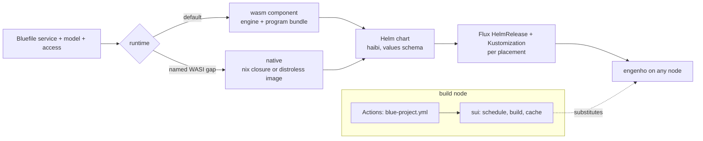

# BUILD-STACK — the default platform for a blue service, from Bluefile to a running node

Status: DESIGN, 2026-10-27; the runtime rung (§2) is decided, and its judge
and component are built, 2026-10-28. Nothing else is built unless §8 says so. It joins three
designs into one chain: `SERVICE-ACCESS.md` (what a service may touch),
`BUILD-ASSURANCE.md` (what a build proves, how fast, from which cache) and
theory `BLUE-EXECUTION.md` §IV (blue to wasm).

## 1. Destination

A blue service is one declaration. Compiling it produces, with nothing written
by hand: one **wasm component** that engenho runs on its wasm backend (the
default) or one **native** artifact (the typed fallback: a nix closure on an
engenho node, a distroless image on a foreign cluster), one **Helm chart**, and
the **Flux objects** for each place it runs. The build runs once, on the build node, and lands in the **sui** cache;
every other machine substitutes. **engenho** runs the chart on any node.
GitHub Actions is the trigger and the face; sui is the scheduler and the cache.
No Hydra, no hand-written YAML, no image with a shell, no service with a
writable disk.

## 2. The runtime rung (the standard; operator, 2026-10-28)

**A blue service's default runtime is a WASI preview 2 component on engenho's
wasm backend. Native is the fallback, and it requires a named WASI-capability
gap.** Native stays one typed field away: behaviour is configured off, never
deleted.

| Rung | When | What runs |
|---|---|---|
| **wasm** (default, no field) | every service whose `access` WASI can grant | blue's engine component (`crates/blue-lang-component`, built once per blue revision for `wasm32-wasip2`) plus the service's program bundle (`packages.service-<name>-component`); on engenho the pod will carry `runtimeClassName: wasm` and image `nix:<closure>` once the chart renders them (S4), and engenho's `kidou` preopens the bundle read-only at `/app` and derives the grants from `access` |
| **native** | `runtime: :native, because: :<gap>`, where the gap is real | the program as a native process: a nix closure on an engenho node, `mkHardenedImageSet`'s distroless image on a cluster that runs OCI |
| never | — | an image with a shell, a writable root filesystem, a service that reads or writes outside its declared `access` |

### 2.1 The decision rule: which access WASI grants, which forces native

The judge is `blue_lang_pkg::deploy::runtime` (`needs`, `runtime_of`). It reads
the service's `access` and its `host`, never a guess:

| Declaration | WASI grant | Rung |
|---|---|---|
| `:network`, `listen` | `wasi:sockets` TCP bind on each listen port | wasm |
| `:network`, `egress: ["host:port"]` | `wasi:sockets` connect and `wasi:http` outgoing to exactly those peers | wasm |
| `:filesystem`, `reads` / `writes` | `wasi:filesystem` preopens, read-only for reads, writable for writes | wasm |
| `:clock`, `:entropy`, `:environment` | `wasi:clocks`, `wasi:random`, `wasi:cli/environment` | wasm |
| `exec: [...]` or `:process` | none: WASI preview 2 has no process spawn or exec | native, `because: :process` |
| `host: "<package>"` | none: the program is a native host binary | native, `because: :host_program` |
| a device, GPU or kernel ABI (CONTAIN THE C) | none | native, `because: :device` (a world fact the access cannot show) |

The judge refuses each bad entry alone and names it:

- wasm while the service needs a gap: *"a service runs as a wasm component by
  default, and its access declares exec /bin/git: WASI preview 2 has no process
  spawn or exec; state `runtime: :native, because: :process`"*;
- `runtime: :native` with no `because`, an unknown gap, or a gap nothing in the
  service needs (a stale reason would keep a service native for nothing);
- `because` without `runtime: :native`.

This keeps FUEKI R1: the declaration states what the service needs; the rung
follows from it, and *where* it runs stays placement.

## 3. Everything is a Helm chart

engenho runs a chart on any node, so the chart is the one packaging unit for
every kind of workload. haibi already renders each service's chart, values
schema, config and migration into `deploy/<service>/`; the chart gains:

| Piece | wasm rung | native rung |
|---|---|---|
| workload (S4, design) | a Deployment with `pleme-lib.runtimeclass` (`runtimeClassName: wasm`), image `pleme-lib.wasm-component.image` (`nix:<closure>`), annotations `pleme-lib.wasm-component.annotations` (`blue.pleme.io/access`, `wasm.pleme.io/app`) | a Deployment of the nix closure or the image; annotation `blue.pleme.io/native-because` |
| access | `SERVICE-ACCESS.md` §4: NetworkPolicy egress, read-only volumes for `reads`, nothing writable unless `writes` names it | the same |
| values schema | generated, closed (`additionalProperties: false`) | the same |
| Flux | a `HelmRelease` and `Kustomization` per `placement`, rendered in the GitOps repo from the pinned service flake (`SERVICE-ACCESS.md` §5) | the same |

### 3.1 The vocabulary, and how it lowers (all nix-native)

The Bluefile describes everything; nothing below it is written by hand. Each word
lowers through `blue.lib.project` to substrate's nix (`lib/service/helm-build.nix`).

| Bluefile word or field | Describes | Lowers to |
|---|---|---|
| `service(name, {...})` | the program, port, probes, config | haibi's chart (values plus pleme-lib `include`s) |
| `access: {effects, egress, reads, writes, listen, exec}` | what it may touch (`SERVICE-ACCESS.md` §3) | pleme-lib access network policy and volumes; the engine posture; unit sandbox |
| `runtime: :native, because: :process` (absent: wasm) | the runtime rung (§2) | `packages.service-<name>-component` and the wasm workload, or the native workload; `checks.service-<name>-component-serves` runs the component under wasmtime |
| `schema: {...}` / `model(...)` | its data | DDL and the shinka migration |
| `cache: {...}`, `secrets: [...]` | bindings | pleme-cache values; pleme-lib typed secret refs |
| `supervision: {...}` | the OTP tree (§5.1) | the service runtime's supervisor; probes |
| `placement(name, {node: "plo"})` / `placement(name, {cluster: "...", namespace: "..."})` | where it runs, with per-place values | `mkHelmRender` with those values → engenho manifests (node) or a Flux HelmRelease/Kustomization (cluster) |
| `chart_library("pleme-lib", from: :helmworks)` | a library chart the chart uses | `mkHelmChart` vendoring it from the flake input; the dependency names a vendored path |

A word not in this table is a request for a new word, made in blue's Bluefile
vocabulary (`blue_lang_pkg::bluefile::WORDS`), never a hand-written nix or YAML file.

A node that runs no Kubernetes (a NixOS host) still runs the chart: engenho
renders it into its manifests directory (`pleme.engenho.helm.releases`). So one
artifact serves a cluster, a single node and a developer's tailnet alike.

## 4. Build and cache: sui with Actions, no Hydra

| Hydra's job | Here | Where |
|---|---|---|
| jobset evaluation | the plan of `checks.<system>.project` | `pleme-io/actions` `blue-build-plan` |
| build scheduling | sui's typed `BuildSite` dispatch, a dead builder a typed error in milliseconds | sui `docs/BUILDER-PLATFORM.md` |
| binary cache | the sui origin on the build node | `sui-cache-push`, pull on by default (`BUILD-ASSURANCE.md` §7) |
| status and history | GitHub check runs and step summaries | `koutei` writes them from every blue action |
| triggers | push, pull request, schedule | the reusable `substrate/.github/workflows/blue-project.yml` |

One build per change: a developer machine edits and dispatches, the build node
builds and pushes, every runner and host substitutes. A workstation of another
architecture never builds a service it does not run.

## 5. Defaults and cycles a service gets for free

From one `service(...)`: OTP-style supervision of every process the service
runs (below), the access posture and its renderings (§3), the
platform rung (§2), the chart and Flux objects, health, readiness and metrics,
the migration, the default assurance set and the blueshift floor
(`BUILD-ASSURANCE.md` §3, §4), the build plan budget, and the CI sentence. The
author writes the program and the declaration; every other file is a rendering,
and the `generated-tree` hook and `-fresh` checks refuse a hand edit of one.

### 5.1 Supervision is the default (operator, 2026-10-27)

What Erlang/OTP gives a BEAM service, a blue service gets with no
configuration: each request handler, worker and connection is its own
process with a private environment, a crash ends only that process, and a
supervisor restarts it under a policy. The pieces exist: `blue-lang-proc`'s
supervisor (one-for-one, one-for-all, rest-for-one, simple-one-for-one, max
restarts; per-process VM isolation) and the `saishikou` bidama, which holds
the restart policy as data. The gap is the wiring: no service depends on
`blue-lang-proc` yet (theory `BLUE-GAPS.md`), and the supervisor has no
restart window and no backoff (`SERVICE-ARCHITECTURE.md`, Supervision row).

| Default | Value | Configured by |
|---|---|---|
| tree | the service is the root; each listener, worker pool and binding (database, cache) a child | a `supervision` entry on `service(...)` |
| strategy | one-for-one for handlers, rest-for-one for a binding and what depends on it | the same entry |
| restarts | at most 5 in 60 s, exponential backoff from 100 ms, then the subtree fails upward | `saishikou` policy fields |
| a crash | the process ends, the error and its trace go to the structured log, the request gets a typed 500 | nothing; a `try` around a handler is refused (let it crash) |
| beyond the root | the OS supervisor (systemd, engenho, kubelet) restarts the whole service | the module trio and the chart probes |

Turning it off is a typed waiver on the entry, never a missing entry.

## 6. Decisions

| Question | Chosen | Rejected, and why |
|---|---|---|
| Default artifact | a wasm component on engenho's wasm backend | **a container image by default**: a filesystem, a libc and a process model the service never asked for, each a place a CVE lives |
| Who decides the rung | the judge, from `access` and `host`; the author states only the gap | **a free `platform` field**: an author picks native for convenience and nothing records why |
| How a service becomes a component | one engine component per blue revision, plus a per-service bundle the kubelet preopens read-only at `/app` | **a component compiled per service**: a full Rust build per service; **composition with a data plug**: a second toolchain (wac) for what a preopen does |
| The fallback's reason | a closed set of WASI gaps (`process`, `host_program`, `device`) | **free text**: a reason no judge can check goes stale silently |
| How access binds the artifact | import presence | **runtime checks only**: a refusal that exists only while the checker is right |
| Fallback | native with a named WASI gap; distroless when it is an image | **any base image**: the reason disappears and the base grows |
| Packaging unit | a Helm chart for every rung | **a NixOS module for hosts and a chart for clusters**: two renderings drift; engenho makes the chart run on a host |
| CI scheduler | sui behind Actions | **Hydra**: a second scheduler, cache and UI beside the ones the fleet already runs |
| Where builds run | the build node only | **every workstation**: each iteration builds twice, once for the wrong architecture |

## 7. Build order

| Step | Work | Gate |
|---|---|---|
| S1 | `runtime` and `access` on `service`, default wasm, native with a named gap | parse tests, each refusal alone (`deploy::service` tests) |
| S2 | blue engine to a WASI preview 2 component once per revision, cached in sui | a service component is the engine plus its program bundle; `checks.service-<name>-component-serves` |
| S3 | imports from `access.effects` | a component built under the default access has no filesystem import (inspect the module) |
| S4 | haibi chart for the wasm rung, on pleme-lib's `pleme-wasm-component` mode (helmworks H4) | rendered chart test (`checks.service-<name>-chart`) |
| S5 | Flux objects per `placement` in the GitOps repo | that repo's `-fresh` check |
| S6 | `blue-project.yml` adopted by every Bluefile repo, sui scheduling builds | a fresh runner builds with zero local Rust (`BUILD-ASSURANCE.md` B1) |
| S7 | kensa: the native rung today with its gap, and the path off it (FUEKI H1) | kensa's Bluefile states `runtime: :native, because: :host_program` |
| S8 | the service runtime runs every handler under `blue-lang-proc` with the §5.1 defaults; the supervisor gains a restart window and backoff | a handler that raises answers 500 and the next request succeeds; a crash loop backs off and fails upward (counted in a test) |

## 8. Tier ledger

| Item | Tier |
|---|---|
| haibi chart, values schema, migration, `-fresh` | built |
| capability → wasm import table | built (`blue-lang-waku`) |
| engine posture (`Load::posture`) | built |
| blue actions suite and `blue-project.yml` | built 2026-10-27 |
| `runtime` and `access` on `service`, the judge (§2.1) | built 2026-10-28 |
| blue engine as a WASI preview 2 component (`blue-lang-component`), per-service bundle, `-component-serves` | built 2026-10-28 |
| engenho `kidou` preopens the bundle at `/app` (`wasm.pleme.io/app`) | built 2026-10-28 |
| haibi wasm chart on pleme-lib's wasm mode (S4) | design: pleme-lib has no `wasm-component` or `runtimeclass` helper yet (helmworks H4), so a chart still runs the native image |
| Flux per placement | design |
| OTP supervisor (`blue-lang-proc`), restart policy as data (`saishikou`) | built, not wired into services |
| supervision as a service default, restart window and backoff | design |
