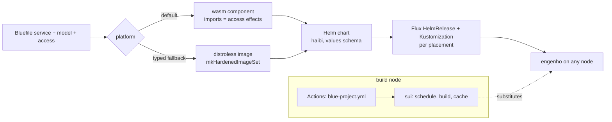

# BUILD-STACK — the default platform for a blue service, from Bluefile to a running node

Status: DESIGN, 2026-10-27. Nothing is built unless §8 says so. It joins three
designs into one chain: `SERVICE-ACCESS.md` (what a service may touch),
`BUILD-ASSURANCE.md` (what a build proves, how fast, from which cache) and
theory `BLUE-EXECUTION.md` §IV (blue to wasm).

## 1. Destination

A blue service is one declaration. Compiling it produces, with nothing written
by hand: one **wasm component** (the default) or one **distroless image** (the
typed fallback), one **Helm chart**, and the **Flux objects** for each place it
runs. The build runs once, on the build node, and lands in the **sui** cache;
every other machine substitutes. **engenho** runs the chart on any node.
GitHub Actions is the trigger and the face; sui is the scheduler and the cache.
No Hydra, no hand-written YAML, no image with a shell, no service with a
writable disk.

## 2. The platform ladder (the standard)

| Rung | When | What it guarantees |
|---|---|---|
| **wasm component** (default) | every blue service whose effects are all host imports | the module has an import only for each effect its `access` allows (`blue_lang_waku::Capability`, one import each in module `blue:host`); a filesystem the access refuses is not refused at runtime, it is absent from the module. Smallest artifact: the blue engine is built to wasm once per blue revision and cached, so a service adds its program and its imports |
| **distroless image** (typed fallback) | a `host` service (Rust today, FUEKI H1), or an effect wasm cannot carry (a GPU, a kernel ABI: CONTAIN THE C) | substrate `mkHardenedImageSet`: no shell, no package manager, non-root, read-only root, 0 CVEs by construction; the Bluefile states the reason: `platform: :distroless, because: "<typed reason>"` |
| never | — | an image with a shell, a writable root filesystem, a service that reads or writes disk outside its declared `access` |

The rung is a Bluefile fact, defaulted from the service: no `platform` means
wasm. A service that asks for distroless without a reason is refused alone,
like any other bad entry.

## 3. Everything is a Helm chart

engenho runs a chart on any node, so the chart is the one packaging unit for
every kind of workload. haibi already renders each service's chart, values
schema, config and migration into `deploy/<service>/`; the chart gains:

| Piece | wasm rung | distroless rung |
|---|---|---|
| workload | the runtime class of theory `WASM-STACK.md`'s umbrella, or engenho's native wasm backend | a Deployment of the image |
| access | `SERVICE-ACCESS.md` §4: NetworkPolicy egress, read-only volumes for `reads`, nothing writable unless `writes` names it | the same |
| values schema | generated, closed (`additionalProperties: false`) | the same |
| Flux | a `HelmRelease` and `Kustomization` per `placement`, rendered in the GitOps repo from the pinned service flake (`SERVICE-ACCESS.md` §5) | the same |

### 3.1 The vocabulary, and how it lowers (all nix-native)

The Bluefile describes everything; nothing below it is written by hand. Each word
lowers through `blue.lib.project` to substrate's nix (`lib/service/helm-build.nix`).

| Bluefile word or field | Describes | Lowers to |
|---|---|---|
| `service(name, {...})` | the program, port, probes, config | haibi's chart (values plus pleme-lib `include`s) |
| `access: {effects, egress, reads, writes, listen, exec}` | what it may touch (`SERVICE-ACCESS.md` §3) | pleme-lib access network policy and volumes; the engine posture; unit sandbox |
| `platform: :wasm` / `:distroless, because: "..."` | the artifact rung (§2) | the wasm component or `mkHardenedImageSet` image; the chart's workload kind |
| `schema: {...}` / `model(...)` | its data | DDL and the shinka migration |
| `cache: {...}`, `secrets: [...]` | bindings | pleme-cache values; pleme-lib typed secret refs |
| `supervision: {...}` | the OTP tree (§5.1) | the service runtime's supervisor; probes |
| `placement(name, {node: "plo"})` / `placement(name, {cluster: "...", namespace: "..."})` | where it runs, with per-place values | `mkHelmRender` with those values → engenho manifests (node) or a Flux HelmRelease/Kustomization (cluster) |
| `chart_library("pleme-lib", from: :helmworks)` | a library chart the chart uses | `mkHelmChart` vendoring it from the flake input; the dependency names a vendored path |

A word not in this table is a request for a new word, made in blue's Bluefile
vocabulary (`blue_lang_pkg::bluefile::WORDS`), never a hand-written nix or YAML file.

A node that runs no Kubernetes (a NixOS host) still runs the chart: engenho
renders it into its manifests directory (`pleme.engenho.helm.releases`). So one
artifact serves a cluster, a single node and a developer's tailnet alike.

## 4. Build and cache: sui with Actions, no Hydra

| Hydra's job | Here | Where |
|---|---|---|
| jobset evaluation | the plan of `checks.<system>.project` | `pleme-io/actions` `blue-build-plan` |
| build scheduling | sui's typed `BuildSite` dispatch, a dead builder a typed error in milliseconds | sui `docs/BUILDER-PLATFORM.md` |
| binary cache | the sui origin on the build node | `sui-cache-push`, pull on by default (`BUILD-ASSURANCE.md` §7) |
| status and history | GitHub check runs and step summaries | `koutei` writes them from every blue action |
| triggers | push, pull request, schedule | the reusable `substrate/.github/workflows/blue-project.yml` |

One build per change: a developer machine edits and dispatches, the build node
builds and pushes, every runner and host substitutes. A workstation of another
architecture never builds a service it does not run.

## 5. Defaults and cycles a service gets for free

From one `service(...)`: OTP-style supervision of every process the service
runs (below), the access posture and its renderings (§3), the
platform rung (§2), the chart and Flux objects, health, readiness and metrics,
the migration, the default assurance set and the blueshift floor
(`BUILD-ASSURANCE.md` §3, §4), the build plan budget, and the CI sentence. The
author writes the program and the declaration; every other file is a rendering,
and the `generated-tree` hook and `-fresh` checks refuse a hand edit of one.

### 5.1 Supervision is the default (operator, 2026-10-27)

What Erlang/OTP gives a BEAM service, a blue service gets with no
configuration: each request handler, worker and connection is its own
process with a private environment, a crash ends only that process, and a
supervisor restarts it under a policy. The pieces exist: `blue-lang-proc`'s
supervisor (one-for-one, one-for-all, rest-for-one, simple-one-for-one, max
restarts; per-process VM isolation) and the `saishikou` bidama, which holds
the restart policy as data. The gap is the wiring: no service depends on
`blue-lang-proc` yet (theory `BLUE-GAPS.md`), and the supervisor has no
restart window and no backoff (`SERVICE-ARCHITECTURE.md`, Supervision row).

| Default | Value | Configured by |
|---|---|---|
| tree | the service is the root; each listener, worker pool and binding (database, cache) a child | a `supervision` entry on `service(...)` |
| strategy | one-for-one for handlers, rest-for-one for a binding and what depends on it | the same entry |
| restarts | at most 5 in 60 s, exponential backoff from 100 ms, then the subtree fails upward | `saishikou` policy fields |
| a crash | the process ends, the error and its trace go to the structured log, the request gets a typed 500 | nothing; a `try` around a handler is refused (let it crash) |
| beyond the root | the OS supervisor (systemd, engenho, kubelet) restarts the whole service | the module trio and the chart probes |

Turning it off is a typed waiver on the entry, never a missing entry.

## 6. Decisions

| Question | Chosen | Rejected, and why |
|---|---|---|
| Default artifact | a wasm component | **a container image by default**: a filesystem, a libc and a process model the service never asked for, each a place a CVE lives |
| How access binds the artifact | import presence | **runtime checks only**: a refusal that exists only while the checker is right |
| Fallback | distroless with a typed reason | **any base image**: the reason disappears and the base grows |
| Packaging unit | a Helm chart for every rung | **a NixOS module for hosts and a chart for clusters**: two renderings drift; engenho makes the chart run on a host |
| CI scheduler | sui behind Actions | **Hydra**: a second scheduler, cache and UI beside the ones the fleet already runs |
| Where builds run | the build node only | **every workstation**: each iteration builds twice, once for the wrong architecture |

## 7. Build order

| Step | Work | Gate |
|---|---|---|
| S1 | `platform` field on `service`, default wasm, distroless with a reason | parse tests, each refusal alone |
| S2 | blue engine to wasm once per revision (theory `BLUE-EXECUTION.md` §IV), cached in sui | a service component is the engine plus its program |
| S3 | imports from `access.effects` | a component built under the default access has no filesystem import (inspect the module) |
| S4 | haibi chart for the wasm rung | rendered chart test |
| S5 | Flux objects per `placement` in the GitOps repo | that repo's `-fresh` check |
| S6 | `blue-project.yml` adopted by every Bluefile repo, sui scheduling builds | a fresh runner builds with zero local Rust (`BUILD-ASSURANCE.md` B1) |
| S7 | kensa: the host rung today with its reason, and the path off it (FUEKI H1) | kensa's Bluefile states `platform: :distroless` with the reason |
| S8 | the service runtime runs every handler under `blue-lang-proc` with the §5.1 defaults; the supervisor gains a restart window and backoff | a handler that raises answers 500 and the next request succeeds; a crash loop backs off and fails upward (counted in a test) |

## 8. Tier ledger

| Item | Tier |
|---|---|
| haibi chart, values schema, migration, `-fresh` | built |
| capability → wasm import table | built (`blue-lang-waku`) |
| engine posture (`Load::posture`) | built |
| blue actions suite and `blue-project.yml` | built 2026-10-27 |
| `platform` field, blue to wasm, wasm chart, Flux per placement | design |
| OTP supervisor (`blue-lang-proc`), restart policy as data (`saishikou`) | built, not wired into services |
| supervision as a service default, restart window and backoff | design |
