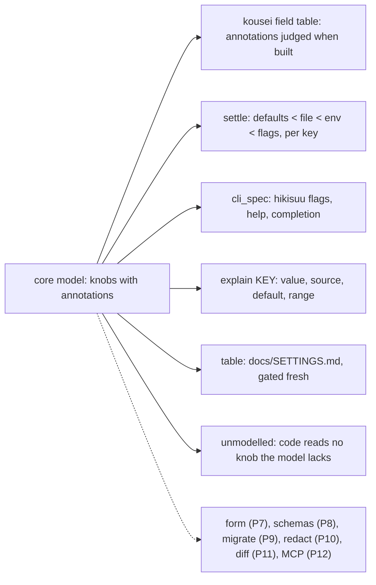
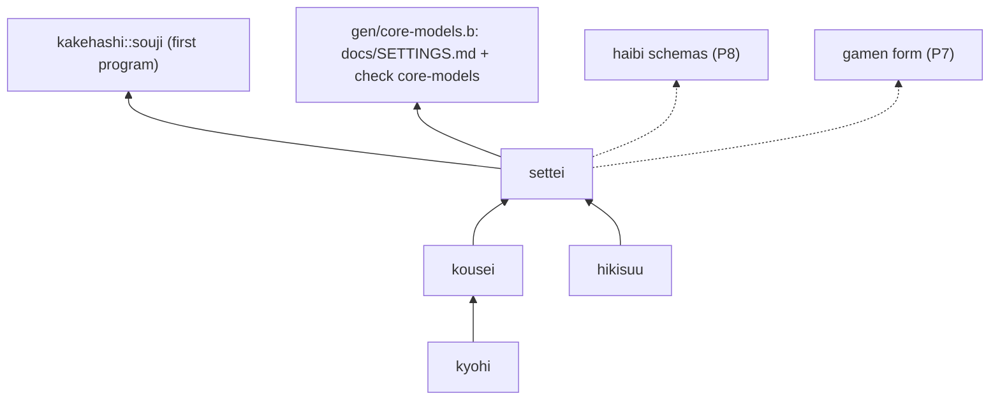

# CORE-MODEL — one model per program, every surface a rendering

Status: ⏳ in progress. Rungs 1 to 5 are built (§10). The rest is design.
The [Ledger](#ledger) at the end is the only place a state is claimed.
The doctrine is section 6.5a of BLUE-STRUCTURE in the pleme-io theory
(operator, 2026-11-13); its section 6.5 is the service case, and
`SERVICE-ARCHITECTURE.md` owns that case here.

Operator, 2026-11-13: *"every application has a core datastructure and then
metaprogramming generates as much as possible ... that core datastructure
should be fully configurable and we can macro/metaprogram our way into always
having shikumi/settei style features for configuration just by merit of core
datastructures and macros, and then create tools for every lateral case."*

## 1. Destination

A blue program (a CLI, a TUI, a service, a phone app, a bidama) states its
settings once, as a core model: a record of knobs, each with its type, default,
bounds, doc, unit, secret mark, version marks and the layers that may set it.
Every surface that repeats that shape is rendered from the model by words
built once in blue, for every program:

- the layering (defaults, then file, then environment, then flags), each bad
  value refused for its key alone;
- the command line: flags, help, completion for each shell, `--explain KEY`;
- the terminal settings form, with bounds, live validation and a diff before
  apply;
- the settings table in the docs, gated fresh;
- JSON Schema, the chart values schema and MCP tool inputs;
- the migration of an old config file across model versions;
- the all-variants tests, the properties drawn from bounds and the round trips;
- redaction of secrets in logs, `explain` and crash reports;
- `diff A B` of two configs and the change log of a running program.

A program author writes the model and the code. A setting that is not in the
model cannot be read, documented or set. A surface the words cannot yet render
is a word to build once in blue, never a hand-written file beside the model.

No world fact limits this destination. Every limit met so far is in our own
abstractions: hikisuu types a flag only as switch, int or text, and settei
refused a whole file for one bad key. Both are ours to change, and §10 changes
the second.

## 2. Ground (read from source, 2026-11-13)

| Piece | Where | What it already does | The gap |
|---|---|---|---|
| layering | `bidamas/settei` | defaults, file (YAML or JSON, `<APP>_CONFIG`, XDG, `~/.config`), env (`<APP>_<GROUP>__<KEY>`), aliases for renamed env names, a dotted-path read | a value is typed only by its default; one bad key refuses the whole record (`enforce`, all at once); no flag layer; no bounds, doc, unit, secret or version marks |
| entry judgement | `bidamas/kousei` | a field table (`field`, `required`), checks (`flag`, `text`, `one_of`, `int_in`, `list_of`), `record_whys`, `judge`: each entry refused alone, siblings stand | judges declaration entries, not settings; nothing renders from a table |
| command line | `bidamas/hikisuu` | one spec: typed flags (switch, int, text) with a floor, positionals, commands, help, completion for bash, zsh and fish through `__complete`, every fault in one `:usage` refusal (exit 64) | the spec is hand-written per program, a second copy of each setting the program also reads from settei |
| service model | `haibi::config_schema`, `values_schema` | JSON Schema and chart values schema from the flat `config:` defaults of a `service(...)` | types only, from the default; no bounds, docs or secrets |
| model vocabulary | `katachi` (PROPOSED, `SERVICE-ARCHITECTURE.md` §6) | design: entities, keys, relations, secret and public, cache, retention | none of it exists |
| version deltas | `API-EVOLUTION.md` | design: a delta catalog with up and down per change | config versions are not in it |
| metaprogramming | the language | `defmacro`, `quote`, `unquote`, `eval`, `macroexpand`, `gensym`, `read_forms`, `blue ast --resolved` | no word reads a program's forms for settings |
| generators | root `Bluefile` | `generate(name, output, program, inputs)` gives `packages.generated-<name>`, `checks.generated-<name>-fresh` and `nix run .#regen`; `check(name, program, inputs)` gives a flake check | none for settings |
| CLIs on hikisuu | `souji`, `heni` | a hand-written `cli` spec each | the flags are not settings: no file, no env, no explain |
| CLIs on settei | `kirikae`, `kernel/run.b`, `shisutemu` (`spawn_defaults`) | a defaults record each | no flags rendered from it |

Second probe for absence: `rg --no-ignore` over `bidamas/`, `gen/`, `crates/`
and `docs/` for `explain`, `unmodelled`, `knob`, `annotation` and
`settings table` found only blue's own `blue explain` (diagnostic codes) and
`explain-name` (name resolution). Neither reads a program's settings.

### 2a. The generators pleme-io already runs (survey, 2026-11-13)

Operator, 2026-11-13: *"really pay attention to everything we have ever done
in terms of autogen, forge-gen and so on, and consider those patterns and how
we can have the bluelang version of them."* The survey read each generator's
repository and skill on local checkouts (`rg --no-ignore`, no web). A row
marked † is reported from its docs and not re-measured here.

| Generator | Source of truth | Renders | Freshness proof | Worked | Hurt | Blue version, rung |
|---|---|---|---|---|---|---|
| forge-gen | `spec/openapi.yaml` + `forge-gen.toml` | SDKs, server stubs, gRPC, GraphQL, MCP, completions, docs, IaC | none found | one manifest fans out to many targets in parallel | its docs disagree with its registry; output reaches consumer repos by a sync script | the P8 schema is the OpenAPI component of a model; haibi renders the API (§6.5 rows), P8 and P12 |
| iac-forge + TOML resource specs | `resources/**/*.toml`, `FieldOverride` | an IR, then Terraform, Pulumi, Crossplane, Ansible, Pangea, Steampipe, Helm | backend invariants, `iac-forge drift` | a BLAKE3 source hash and a morphism chain on each artifact | † unknown keys in a spec are dropped silently (no `deny_unknown_fields`); a verify step ends in `\|\| true` | knob annotations judged by kousei (unknown annotation refused, built R1); `immutable` and `computed` join the vocabulary in P20 |
| arch-synthesizer typescape | Rust types, `core-taxonomy.toml`, `specs/*.lisp` | 20 AST domains; a `.typescape.yaml` leaf per repo | `pangea_render verify` (exit 4 on drift) | renders stayed byte-identical across a fix | a wall-clock field in the leaf churns; restated test counts drifted | the model is a blue value, so its identity is blue's b3 hash, with no clock in it; P18 |
| shikumi | a serde struct + `Default` | `schema::emit`: group, field, type, default, description, values | `assert_every_field_consumed`, `assert_no_unknown_keys`, `assert_no_unknown_env_vars` | the fold defaults → file → env → runtime with `Provenance{tier, source}` | a hand-mirrored nix surface missed a field (2026-10-07) | `settle` is the fold with `sources` (built R2); `unmodelled` and `unread` are `assert_no_unknown_keys` and `assert_every_field_consumed` (built R5) |
| settei | a defaults record | layering | settei's tests | env and file layers, aliases | one bad key refuses the whole record | extended in place (R1 to R3) |
| repo-forge | `repos.lisp` (`defrepo`), `archetypes.lisp` | boilerplate and region-merged files | `repo-forge check` | the boilerplate, hybrid and authored split | 131 hand copies of workflows, 74 drifted under a red gate nobody read | a generated file is always whole and always gated (`generate`, built R4); no region merge |
| macro farm (tatara-rust-ast) | `catalogs/pleme-derives.lisp` | derive crates, verifiers, reference docs | `docs_in_sync.rs` byte-compare | typed emission, token-stability tests | the skill describes an old authoring form | entry marks `description`, `since`, `owner` match the knob's `doc` and `since` |
| tatara-lisp `(def…)` domains | `specs/<thing>.lisp` over `TataraDomain` | typed values | parity tests | an unknown keyword is a typed error listing the legal set | † CI ran `--no-build`, so a gate never built | the refusal lists the legal settings (built R2, R3) |
| caixa (`defcaixa`) | `caixa.lisp` | chart, Flux bundle, NetworkPolicy, Process CR, flake, lacre hash | `caixa-validate.yml`, lacre | a closed `:kind` picks the renderer | † one kind unbuildable, guarded by `\|\| echo` | a program kind picks its mandatory set (§7a profiles) |
| pleme-doc-gen | `action.yml` files | per-action READMEs, catalogue | none that can fail | it can render itself | its own version disagrees with its manifest | `table` + `generate` + a fresh check that fails (built R4) |
| crossplane-forge | the TOML corpus + OpenAPI | a Go provider through a typed Go AST, CRDs, chart | `make verify` | typed emission | blocked per resource on vendor OpenAPI | inherits P8 |
| borealis toolgen (`defgotool`) | `:tool-spec (defgotool …)` | a Go module with `DO NOT EDIT` heads and adapter seams | none found for staleness | config fields `:ty` (with **Secret**) `:default`; flags `:ty :default :usage` | no re-forge check | the same shape as a knob: type, default, doc, secret; flags from fields (built R3) |
| substrate `mkModuleTrio` | a nix spec | NixOS, darwin and home-manager modules | kijun `trio/every-concept`, drvPath parity | each arm renders or refuses with a reason | its doc lags its enum support | the module options of a blue program from its model: P21 |
| gen / `Cargo.gen.lock` | `Cargo.toml` + `Cargo.lock` | the lock delta | `gen confirm`, an eval-time check | no IFD | lock churn on release | not a model rendering; blue's lock words stay as they are |
| pangea-forge arch_gen | `pangea-sim` + `ConfigField{name, ruby_type, required}` | Ruby architectures | invariants, no committed-vs-fresh check | a header that names its source | regenerated by hand only | `required` joins the vocabulary in P20 |
| helmworks values schema | schemars types | `values.schema.json` | `checks.values-schema-fresh` | a freshness check that fails | none seen | haibi's `values_schema` reads the model's bounds (P8) |
| haibi | `service(...)` + flat `config:` | chart, config, DDL, migration, schemas | `checks.service-<n>-fresh` | one declaration, every format | types from the default only | `config_schema` reads the knob model (P8) |
| kakehashi | blue programs over nix | rebuild plans, the fleet tools | their own tests | blue drives nix | the tools parse flags by hand (kijun, tehai, kirikae) | each moves onto a model (P13) |

**Convergent evidence (no shared ancestor found):**

- **The field vocabulary.** shikumi's emit, substrate's typed groups,
  helmworks' schemars, `defgotool` and iac-forge each reached `type`,
  `default`, `description`, bounds and an enum on their own; `defgotool`
  (`Secret` type) and iac-forge (`sensitive` flag) each reached a secret
  mark. That is the knob vocabulary of §4, which is forced, not chosen.
  iac-forge and pangea-forge add `required`, `immutable` and `computed`;
  they join in P20.
- **Defaults at the bottom of the fold.** shikumi, `defgotool`, the
  configplane skill and the module trio all put defaults lowest, then file,
  then environment, then the caller. `settle` takes the same order.
- **Render and diff.** helmworks, the macro farm, repo-forge, pangea_render
  and gen all prove freshness by rendering again and comparing. Blue's
  `generate` and its `-fresh` check are that pattern (R4).
- **One spec, many renderers.** forge-gen, iac-forge, caixa, arch-synthesizer,
  the module trio and pleme-doc-gen. The core model is that spec for a
  program's settings.
- **Provenance on every value or artifact.** shikumi's `Provenance`, iac-forge's
  `source_hash`, caixa's lacre, the typescape Merkle leaf. `settle` keeps a
  source per key (built); the artifact hash is P18.
- **The recurring failure: unknown keys accepted, or a gate that cannot fail.**
  iac-forge's dropped keys, an always-green catalogue job, a `--no-build`
  check, a `\|\| true`. The answers that worked are shikumi's
  `assert_no_unknown_keys` and tatara-lisp's keyword error. Blue holds both:
  an unknown annotation and an unknown file key are each refused (R1, R2),
  and every gate here was seen red before it went green.

**The generator interface this sets.** A blue generator is a word over the
model that returns text or a value, with no effect: `table(app, model)`,
`cli_spec(model, frame)`, later `json_schema(model)` and
`module_options(model)`. A repository declares where its output lives with
the existing `generate(name, output, program, inputs)`, and the existing
freshness check proves it. One registry of programs with models
(`gen/core-models.b`) feeds every such generator, so a new rendering is one
word in settei and one line in the registry, never a new pipeline.

**Decision: the core model lives in settei.** settei already owns a program's
settings and the layering; the model is settei's defaults record with
annotations. kousei's field table checks the annotations; hikisuu renders the
command line. No new bidama and no new name. katachi, when built, takes the
same knob vocabulary for a service's data fields (§8, D2).

## 3. Research

| Prior art | What it teaches | Adopt, adapt or skip |
|---|---|---|
| clap derive, <https://docs.rs/clap/latest/clap/_derive/index.html> | one struct gives the parser, help and completion; doc comments become help; `env = "X"` reads a variable under the flag | **adopt** the one-source rule and doc as help; **adapt**: the source is a blue value, not a Rust derive, so every other surface reads the same value |
| figment, <https://docs.rs/figment/latest/figment/>; shikumi (pleme-io, Rust) | providers merged in order; `Metadata` says which provider gave a value | **adopt** the order and the provenance: `settle` keeps a source per key, and `explain` prints it |
| serde attributes, <https://serde.rs/attributes.html> | `default`, `rename`, `alias`, `deny_unknown_fields`, `skip_serializing_if` on the field | **adopt** annotations on the field; **adapt** `alias` as settei's existing env aliases; **adopt** unknown keys refused, but per key, not per document |
| Pkl, <https://pkl-lang.org/main/current/language-reference/index.html> | constraints in the type (`Int(isBetween(0, 10))`), doc comments, `@Deprecated` with a replacement | **adopt** bounds and deprecation as annotations; **skip** a second configuration language: blue is the language |
| CUE, <https://cuelang.org/docs/concept/the-logic-of-cue/>, <https://cuelang.org/docs/tour/basics/constraints/> | types and values on one lattice; a constraint narrows; defaults marked | **adapt**: a knob is a type narrowed by bounds; the lattice is the layers' order. **Skip** unification over the whole document: blue judges per key so one fault cannot spread |
| Dhall, <https://docs.dhall-lang.org/> | typed, total configuration; imports by hash | **skip** for now: a blue config file is data read into a typed model, and blue's own identity hashes cover the code |
| Nickel, <https://nickel-lang.org/user-manual/contracts> | contracts on fields, checked lazily, with blame on the field that broke | **adopt** blame on the key: every refusal names the key, the layer and the range |
| JSON Schema 2020-12, <https://json-schema.org/draft/2020-12/json-schema-validation>, <https://json-schema.org/understanding-json-schema/reference/annotations> | `minimum`, `maximum`, `enum`, `default`, `description`, `deprecated`, `readOnly`, `writeOnly` | **adopt** as a rendering target (P8): each annotation maps to one keyword; `secret` maps to `writeOnly` |
| kconfig, <https://www.kernel.org/doc/html/latest/kbuild/kconfig-language.html> | `range`, `default`, `help` and `depends on` per symbol; menus rendered from the same file | **adopt** range and help per knob and the form rendered from the model (P7); **phase** `depends on` as a later annotation |
| OpenTelemetry semantic conventions, <https://opentelemetry.io/docs/specs/semconv/>, <https://opentelemetry.io/docs/specs/semconv/general/attribute-requirement-level/> | dotted, namespaced keys; a stability level and a requirement level per attribute | **adopt** dotted keys (`net.port`) and `since` and `deprecated` per key as the stability marks |

## 4. The annotation vocabulary

A knob is `settei::knob(default, annotations)`. Each annotation is a field of
kousei's table; an unknown or bad one raises `:bad_option` naming it, when the
model is built.

| Annotation | Meaning | Default when absent | Renders into |
|---|---|---|---|
| (default) | the value when no layer sets it | required, or nil with `type:` | layering, help, docs, explain, schemas |
| `type` | `:bool`, `:int`, `:float` or `:text` | the default's type | every layer's coercion, the flag kind, schemas |
| `min`, `max` | bounds of a number | none | refusals, the flag floor, docs range, properties, `minimum`/`maximum` |
| `choices` | the legal values | none | refusals, docs, completion (P6), `enum` |
| `doc` | one line a person reads | `""` | flag help, docs, explain, `description` |
| `unit` | what a number counts (`hours`, `bytes`) | none | docs, explain |
| `secret` | never printed | false | redaction in explain, docs and refusals; `writeOnly` |
| `since` | the model version that added it | none | docs, explain, migration (P9) |
| `deprecated` | why and what replaces it | none | a notice when set, docs, explain, `deprecated` |
| `set_by` | the layers that may set it (`:file`, `:env`, `:flag`) | all three | refusal of other layers; no flag rendered without `:flag` |

A model is a record whose values are knobs or groups (records of knobs).
Keys are dotted by group: `net.port`, env `APP_NET__PORT`, flag `--net-port`.

```
settings = {
  dry_run: settei::knob(false, {doc: "say what would go; delete nothing"}),
  min_age_hours: settei::knob(6, {min: 0, unit: "hours", doc: "keep a target/ written to within this many hours"}),
  net: {port: settei::knob(8080, {min: 1, max: 65535, doc: "the port to listen on"})}
}
```

## 5. States and trust

Each knob, at each layer, is in exactly one state:

| State | Meaning | What happens |
|---|---|---|
| absent | the layer says nothing for the key | the value below stands; the source does not change |
| set | the layer gives a legal value | the value and the source become this layer's |
| refused: wrong type | the value does not read as the knob's type | the value below stands; a refusal names the key, the layer, the type and the kept value |
| refused: out of range | the value reads but breaks a bound or the choices | as above, naming the range |
| refused: not settable | the layer is not in `set_by` | as above, naming the layers that may set it |
| refused: unknown key | the file names a key the model lacks | that key alone is refused; every knob still loads |
| deprecated | a deprecated knob is set | the value stands; one notice says why |

A refusal never spreads. One bad key leaves every other key loaded, so a typo
in one line of a file does not take a program down. On a command line a bad
flag is still a `:usage` refusal with exit 64 (hikisuu's contract): the person
typed it now and can fix it now. A bad file or environment value is a warning
on stderr and the run goes on with the kept value.

**Trust:** the model is code, reviewed with the program. The file is the
operator's, the environment is the supervisor's, and the flags are the
caller's. `set_by` says which of them may set a knob: a token may be
`set_by: [:file, :env]`, so it never appears in a shell history. A secret's
value never reaches help, docs, `explain` or a refusal text.

## 6. Diagrams

The model and its renderings:



One command line, through `settei::line`:

```mermaid
sequenceDiagram
    participant P as program main
    participant L as settei::line
    participant H as hikisuu
    participant S as settei::settle
    P->>L: argv, the file, the environment
    L->>S: defaults < file < env (no flags yet)
    S-->>L: config below the flags, refusals per key
    L->>H: outcome(args, spec rendered with those values as defaults)
    H-->>L: help, completion, usage refusal, or a parsed line
    L->>H: parse(args, spec with no defaults): which flags were given
    L->>S: settle again with the given flags
    S-->>L: config, sources, refusals, notices
    L-->>P: run with the record, warnings for file and env refusals; or usage, exit 64, for a bad flag
```

One knob through the layers:

```mermaid
stateDiagram-v2
    [*] --> Default
    Default --> File: the file sets a legal value
    Default --> Default: the file value is refused (kept)
    File --> Env: the env sets a legal value
    Default --> Env: the env sets a legal value
    File --> File: the env value is refused (kept)
    Env --> Flag: a flag sets a legal value
    File --> Flag: a flag sets a legal value
    Default --> Flag: a flag sets a legal value
    Flag --> [*]
    Env --> [*]
    File --> [*]
    Default --> [*]
```

Ownership:



## 7. Renderings

| Rendering (§6.5a row) | Word | State |
|---|---|---|
| config layering | `settle`, `line`, `command` | built (§10 R2) |
| CLI flags and help | `cli_spec` (hikisuu renders) | built (R3) |
| completions | hikisuu `__complete` and `script`, plus the settings after `--explain` | built (R3) |
| explain | `--explain KEY`, `explain` | built (R3) |
| docs table | `table`, `gen/core-models.b`, `checks.generated-settings-fresh` | built (R4) |
| all-variants test | `reads`, `unmodelled`, `unread`, `checks.core-models` | built (R5) |
| TUI form | `gamen::form(model, settled)` with live `why_not` and a diff before apply | P7 |
| JSON Schema, values schema, MCP inputs | `settei::json_schema(model)`; haibi's `config_schema` reads it | P8 |
| version migration | `migrate(doc, from, to)` over `since`, `deprecated` and a `renamed` annotation; a removed key refused alone | P9 |
| properties from bounds | a generator per knob from `min`, `max`, `choices`, through `isshou` | P10 |
| redaction | `redacted(model, record)` for logs and crash reports; `secret` already holds for explain, docs and refusals | P10 |
| diff and audit | `diff(model, a, b)` per key with sources; a change log of reloads through `nisshi` | P11 |
| MCP | one tool per knob read and the schema of P8 as the input | P12 |

**Lateral tools, each built once over the model:** `explain` (built),
`unmodelled` and `unread` (built), `table` (built), `diff`, `migrate`,
`redact`, `schema`, `form`, `fuzz` (values drawn from bounds and from just
outside them), `doctor` (every layer read and every refusal listed, no run),
`init` (a commented config file from the defaults), `complete` for values
(choices and enum knobs) and `lint` of a config file in CI.

## 7a. Mandatory supporting structures, and constraints as renderings

Operator, 2026-11-13: *"build into blue the mandatory supporting structures
so we can further blueshift into deep standards about the application that
can be held at build time and beyond, and how the constraints and
capabilities are also meta generatable."*

### The structures every blue program declares

A program that lacks one is refused by `blue check` with a typed code. The
set scales by COVERAGE.md's profiles: a `script` owes none, a `default`
program owes the first six, a service owes all eight. Each row extends a
gate that exists; none is a second gate beside it.

| # | Structure | Declared by | Gate it extends | Refusal when missing | Rung |
|---|---|---|---|---|---|
| M1 | core model (knobs) | `settei::knob` records (§4) | `checks.core-models`: `unmodelled`, `unread` | a knob read in code that the model lacks | **enforced (R5)** for each registered program; P14 moves it into the rule registry as a B-code for every program |
| M2 | capabilities | Bluefile `allow(...)` and `posture(reach:)`, closed by `blue_lang_waku::Capability` | `Load::posture` binds a refused capability as a refusal (SERVICE-ACCESS A0); `blue bundle` seals the record | a program with no declared ceiling | P15 |
| M3 | effects | `service(... access: {effects, egress, reads, writes, listen, exec})` | SERVICE-ACCESS §3: each field judged alone | a service that reaches a peer, path or port it did not declare | P15 |
| M4 | config | the core model; no raw `getenv` outside settei | settei's layering; the census ratchets | a `getenv` of the program's own prefix outside settei | P14 |
| M5 | errors and refusals | `kyohi`'s ledger (kind, exit status, retryable) | COVERAGE §3.3 obligations | a raised kind that is not in the ledger | P16 |
| M6 | tests and coverage | test blocks beside each definition | `gen/test-beside.b` (`level`, `waive`), COVERAGE R1 to R4, the heni ratio baseline | a definition no test reaches | enforced today by test-beside for the distribution; owned by TESTING.md T2 (the unit-test gate in every project) and T4 (the integration-point detector and its refusal code), not designed here |
| M7 | observability | `mitoshi/rogu`, `mitoshi/keisoku`, `mitoshi/tsuiseki` | SERVICE-ARCHITECTURE §2 batteries | a service with no log, metric or trace binding | P17 (service profile) |
| M8 | lifecycle and supervision | `saishikou`, blue's `Supervisor`, the module trio | SERVICE-ARCHITECTURE §6.6 | a service with no supervision policy | P17 (service profile) |

**One waiver grammar.** Inside a file: `# waive Bxxxx: <reason>` above the one
definition (DIAGNOSTICS.md, Waivers). For a whole program: the shape
test-beside and COVERAGE already share, `waive(<structure>, why, until)`, an
entry judged alone, with a stale waiver a finding. No third spelling.

### One annotation, every enforcement tier

Each annotation on a knob, and each capability and effect row, is held at
every tier where it can be held. The words that do it are generated from the
model; nobody writes a guard by hand.

| Annotation | Build | Load | Run | Deploy | Evidence |
|---|---|---|---|---|---|
| `type` | unrepresentable: a knob with a bad type does not build (`knob` raises) | refused at load, per key | the record holds the type | values schema `type` (P8) | the table in the release docs |
| `min`, `max`, `choices` | refused at build: a default out of range; properties drawn from the bounds (P10) | refused at load, per key, naming the range | `why_not` as a guard on a reload (P11) | values schema `minimum`, `maximum`, `enum` (P8) | the receipt of the property run |
| `set_by` | unrepresentable: no flag is rendered without `:flag` | refused at load: `not_settable` | the source of each value is kept (`sources`) | the chart exposes only knobs a file may set | the change log names who set what (P11) |
| `secret` | refused at build: no secret in a default shown by docs | redacted in refusals | redacted in `explain` today; logs and crash reports (P10) | values schema `writeOnly`; mounted from a secret, never a plain value (P8) | attested after: a release scan finds no secret value in rendered files |
| `deprecated`, `since` | refused at build: a removed key with no migration (P9) | a notice at load | `explain` says it | — | the changelog rendered from the marks (P9) |
| capability (M2) | refused at build: `Load::posture` and the bundle record | — | caught at run: a call outside the ceiling raises | kakoi or seccomp profile, systemd `SystemCallFilter` (SERVICE-ACCESS A2, A3) | the control mapping to OSCAL through kensa and a tameshi receipt (P18) |
| effect (M3) | refused at build: a peer with no binding | — | caught at run: the engine refuses the effect | NetworkPolicy from `egress`, RBAC from the access (SERVICE-ACCESS A2) | attested after, as above |

Tier words are the theory's: unrepresentable, refused at build, refused at
load, caught at run, attested after. The table is the destination. Built and
tested today: `type`, bounds and `choices` at build and load; `set_by` at
build, at load and in `sources`; `secret` in `explain`, docs and refusals;
the `deprecated` notice. Every other cell is design, phased in §10.

### Beyond build time

The model the build checked is also what the running program says about
itself and what the release proves:

- **Self-description.** `--explain KEY` is the first face (built). The MCP door
  (P12) serves every knob, its value, its source and its range, and the
  program's declared capabilities, from the same model.
- **Drift.** The declared capabilities and effects against the observed ones:
  a run's receipts (`blue run --receipts`) name every host call, so a call
  outside the declaration is a drift finding, and a declared capability no run
  uses is a narrowing to propose (P19).
- **Attestation.** The release seals the model, the rendered table, the
  capability record and the test receipts into one `shomei` statement, so a
  deployer verifies what the program declared without reading its code (P18).

## 8. Decisions

| # | Decision | Rejected, and why |
|---|---|---|
| D1 | The model is a blue value (a record of knob records), not a macro-generated struct | a `defmacro` that expands to a struct: the renderings need the annotations at run time, so the value is the source; a macro can add sugar later and still yield the same value |
| D2 | It lives in settei; knob annotations are kousei field checks | a new bidama: it would split one space (settings) in two; katachi takes the knob vocabulary for data fields when it is built |
| D3 | Per-key refusal in `settle`; the old `resolve` and `read` keep their all-at-once refusal | changing `resolve`: kirikae, kernel/run.b and shisutemu rely on a raise; behaviour is configured, never deleted, so the new path is beside it and a program opts in by declaring a model |
| D4 | A bad flag is still exit 64; a bad file or env value warns and the run goes on | warn on a flag too: the person typed it now, and hikisuu's contract is one refusal of the whole line |
| D5 | Flags render only for knobs with `:flag` in `set_by` | a flag for every knob: a secret set on a command line lands in shell history |
| D6 | `--explain KEY` is a flag the model owns, like hikisuu's `--help` | an `explain` command: a program without commands has positionals, and the word would be ambiguous; one spelling for every program |
| D7 | The flag layer is learnt by a second parse with no defaults, so a flag given at its default value still counts as given | comparing values with the default: `--min-age-hours 6` would read as absent |
| D8 | The all-variants check reads the resolved forms (`blue ast --resolved`) for reads off the settings parameter | a run-time proxy record: blue values are immutable and have no read hook; a doc convention: not checked |
| D9 | The docs page is one generated file for every program, from one registry | one file per program: N generate rows and N checks for one shape |

## 9. Open questions

| Question | Kind |
|---|---|
| A bool knob that defaults true has no flag to turn it off (hikisuu switches only set true) | ours: add `--no-X` to hikisuu for a bool knob |
| A list or map knob (hosts, labels) | ours: a `:list` type with an element type |
| The unmodelled check sees only top-level keys and only the named parameter | ours: follow the parameter into nested groups and through `let` |
| Where the config file path is printed in `explain` (the pure `line` sees the parsed file, not its path) | ours: carry the path into `line` |
| Hot reload of the file in a long-running service | ours: `settle` again on change, `diff` to log what moved |

## 10. Phases, each ending green

| Phase | Build | Gate, seen red first | Structure it enforces | State |
|---|---|---|---|---|
| R1 | `knob`, `knob?`, `knobs`, `defaults_of`, `range_text`, `why_not`, `fits?` | settei tests "a knob takes its type…", "a bad annotation is refused…", "knobs lists every knob…": red on unbound names, then green | M1: a knob's annotations | built |
| R2 | `settle`: per-key layering with sources, refusals and notices | settei tests "settle with nothing…", "the file overrides…", "a bad value is refused for its key alone…", "a deprecated knob…" | M4: config by layer | built |
| R3 | `cli_spec`, `line`, `explain`, `command` | settei tests "the command line is rendered…", "a line runs…", "a bad flag is a usage refusal…", "explain KEY…", "completion after --explain…" | M4: flags are knobs | built |
| R4 | `table`, `gen/core-models.b`, `generate("settings", "docs/SETTINGS.md", …)` | settei test "the settings table…"; `checks.generated-settings-fresh` | M1: documented | built |
| R5 | `reads`, `unmodelled`, `unread`, `check("core-models", …)` | settei test "unmodelled names…"; `checks.core-models` red when souji reads `opts[:verbose]` | **M1 enforced**: no knob outside the model | built |
| R6 | souji migrated: `settings` + `frame`, `cli` rendered, `main` through `settei::command` | souji's own tests unchanged and green; the same 13 command lines before and after | M1 and M4 for souji | built |
| P7 | TUI form in gamen | a form test: a bad value refused live, the diff shown before apply | — (a rendering) | design |
| P8 | JSON Schema from the model; haibi reads it for `config_schema` | the schema validates the defaults and refuses each refused value | deploy tier of M1 | design |
| P9 | migrations across versions | an old file migrated; a removed key refused alone | M1 across versions | design |
| P10 | properties from bounds; redaction for logs and crashes | a generated value outside the bounds is refused; a secret never reaches a log line | M1 bounds at build, `secret` at run | design |
| P11 | `diff` and the change log | two configs diffed per key with sources | run tier: who set what | design |
| P12 | MCP inputs and self-description | the tool schema equals the P8 schema | beyond build: self-description | design |
| P13 | move heni and the settei users (kirikae, kernel/run.b) onto models | each one's tests unchanged | M1 for each | design |
| P14 | the unmodelled read and a raw own-prefix `getenv` as B-codes in the rule registry, ratcheted | a fixture red on each code | **M1 and M4 enforced** for every program | design |
| P15 | a program with no `allow` ceiling, and a service with no `access`, refused by `blue check` | a fixture red on each | **M2 and M3 enforced** | design |
| P16 | a raised kind outside kyohi's ledger refused | a fixture red | **M5 enforced** | design |
| P17 | a service with no observability binding or supervision policy refused | a fixture red | **M7 and M8 enforced** (service profile) | design |
| P18 | the capability-to-control map (kensa, OSCAL) and the release statement (shomei, tameshi) | a release whose statement lacks the model is refused | attested after | design |
| P19 | drift: declared against observed capabilities from run receipts | a receipt with an undeclared host call is a finding | beyond build: drift | design |
| P20 | `required`, `immutable` (set at start only; a reload that changes it is refused) and `computed` (derived from other knobs, never set) join the vocabulary, as iac-forge and pangea-forge reached them | each refused at the tier §7a names, a fixture red first | M1 | design |
| P21 | `module_options(model)`: the module trio's typed options rendered from the model, replacing a hand-mirrored nix surface | the rendered options equal the model's knobs, gated fresh | M1 at deploy | design |

M6 (tests and coverage) is already enforced for the distribution by
`gen/test-beside.b` and the heni ratio baseline. Its next rungs are
TESTING.md T2 (the unit-test gate in every project) and T4 (the
integration-point detector, with a refusal code that forces a test of the
point's kind), and COVERAGE.md owns the obligations; this doc does not
design them again.

## Ledger

| Item | Tier | Evidence |
|---|---|---|
| the annotation vocabulary (R1) | tested | settei tests, red on unbound names before the words existed |
| per-key layering (R2) | tested | settei tests: a bad file, env and flag value each refused alone with its key and range, siblings loaded |
| flags, help, completion, explain (R3) | tested | settei tests, red first; souji test "settings: …" |
| docs table and its freshness gate (R4) | tested | `docs/SETTINGS.md` generated; `checks.generated-settings-fresh` |
| the all-variants check (R5) | tested | `checks.core-models` red on a souji read of `opts[:verbose]`, green without it |
| souji on its model (R6) | tested | 10 of 13 recorded command lines identical; the 3 that differ add only `--explain KEY` to help and completion |
| the mandatory structures M1 to M8 (§7a) | M1 tested for registered programs (R5); M6 enforced by test-beside; the rest design | §7a, P14 to P17 |
| the generator survey (§2a) | recorded | read on local checkouts 2026-11-13; rows marked † not re-measured |
| P7 to P21 | design | this doc |
