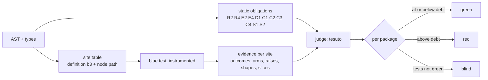

# COVERAGE: what blue can prove is untested, and forces

Status: DESIGN, 2026-11-10. Owner of the design: this file. It deepens
[`TESTING.md`](TESTING.md) section 7 (the hard block), which owns the levels,
waivers and the ratchet; this file owns WHAT is measured. The tier ledger at
the end is the only place a status is claimed.

Operator, 2026-11-10: *"if its not a script then it must force test
coverage"*, then *"we should have full AST control therefore we can detect
lack of coverage in every way imaginable, lets really see what we can
deterministically determine as lack of coverage and force those"*.

## 1. Destination

Blue owns its parser, its checker and its interpreter. So blue knows every
node a program has, and it can watch every node a test runs. A gap that a
machine can decide is never left to review: it is a finding, on by default,
at `enforce`, for every project and bidama. A script (one file run by
`blue run`, with no Bluefile) is exempt.

Two kinds of evidence decide a gap, and both are deterministic:

- **Static:** from the AST and the types alone, with no run. Blue knows
  which definitions, arms, raises, variants, flags and capabilities exist.
- **Dynamic:** from one run of the tests under an instrumented interpreter.
  Blue tests are hermetic: seeded randomness, no wall clock, declared
  capabilities. So the same tree gives the same evidence every time, and the
  evidence is cached by definition identity (H3).

Each obligation has a stable key: the b3 identity of its definition plus the
path of the node inside it. A key does not move when an unrelated line
moves, so a ratchet can hold it.

World-facts that bound this:

| # | World-fact | Consequence |
|---|---|---|
| W1 | Whether a test's expected value is RIGHT is not decidable | blue forces that a test can say no (mutation, slicing), never that it says the right thing |
| W2 | Equivalent mutants are undecidable in general | a survivor is a finding unless a solver proves equivalence (H6 seam) or a typed waiver names it |
| W3 | The number of paths grows exponentially with branches | path coverage is reported, never forced; branch and condition coverage are forced |
| W4 | Input spaces are infinite | properties sample them (H6); a sample is evidence of `tested-N`, never `proved` |

## 2. Ground (measured 2026-11-10)

| What | Where | Tier |
|---|---|---|
| A file or bidama with no test is refused | `check(name, file)`, `bidama-test-*` | live |
| A definition no test reaches is a finding at enforce, with a per-package ratchet | `gen/test-beside.b`, `tesuto::uncovered`, `checks.test-beside` (TESTING.md T1) | tested, gated, on blue's own bidamas only |
| Per-definition call counts | `blue test --coverage [--json]` | live |
| A test names its target | `test "n", {target: f}` (B0068, B0069) | live |
| Mutation caught ratio as a ratchet | `bidamas/heni`, `gen/heni-gate.b` | tested, gated |
| Properties drawn from typed doc examples | `blue_lang_check::properties` (H6) | tested |
| Test cache by definition identity | H3 rung 1 | tested |

Not measured anywhere yet: branches, arms, conditions, raises, variants,
loops, flags, assertion strength.

## 3. The obligations

Each row is one kind of gap. "Decided by" names the evidence; "Profile" is
where it is forced (section 4).

### 3.1 Reach

| Id | Obligation | Decided by | Profile |
|---|---|---|---|
| R1 | Every definition is reached by a test | dynamic: call recorder | default (T1, extended to every project) |
| R2 | Every public definition has a test that targets it directly, not only through a caller | static: `target:` or a direct call in a test body | default |
| R3 | Every `@doc` example runs as a doctest and holds | static plus run | default |
| R4 | No definition is reachable from neither an entry point nor a test | static: call graph | default (dead code is a finding, not a pass) |

### 3.2 Control flow

| Id | Obligation | Decided by | Profile |
|---|---|---|---|
| B1 | Every `if`, `unless` and ternary takes both outcomes | dynamic: branch recorder | default |
| B2 | Every `case`/`match` arm and every guard matches at least once; an `else` arm too | dynamic | default |
| B3 | Every pattern alternative and destructuring shape binds at least once | dynamic | default |
| B4 | Every `?` early return is taken once and passed once | dynamic | default |
| B5 | Every loop and recursion runs zero, one and several times where the AST allows zero | dynamic: iteration class per site | strict |
| B6 | Every `and`/`or` operand is shown to decide the outcome alone (MC/DC, as DO-178C level A requires) | dynamic: condition vectors per decision | strict |
| B7 | Every comparison in a branch is tested on both sides of its boundary (`x < 10` with 9 and 10) | static (the literal) plus dynamic (the values seen) | strict |

### 3.3 Errors and refusals

| Id | Obligation | Decided by | Profile |
|---|---|---|---|
| E1 | Every `raise` site is reached | dynamic | default |
| E2 | Every raised tag (a B-code, a typed refusal) has a test that expects it (`assert_raises`, `raises?`) | static: tags at raise sites vs tags in expectations | default |
| E3 | Every `rescue`/handler runs at least once | dynamic | default |
| E4 | A refused entry is tested to leave its siblings standing (scope-of-refusal law) | static: refusal sites in list-judging words; dynamic: a test with a bad and a good entry | default for words that judge lists |

### 3.4 Data and types

| Id | Obligation | Decided by | Profile |
|---|---|---|---|
| D1 | Every variant of a declared union is constructed in a test and consumed by a test | static: constructors and arms; dynamic: values seen | default |
| D2 | Every optional parameter is tested both given and absent; every nilable value both nil and present | dynamic: argument shapes per call site | default |
| D3 | Every collection parameter is tested empty and non-empty | dynamic | strict |
| D4 | Every distinct return variant of a definition is observed | dynamic | strict |

### 3.5 Configuration and effects

| Id | Obligation | Decided by | Profile |
|---|---|---|---|
| C1 | Every `enable`/`enabled` flag is tested in both states (behaviour configured off must still work, and off must do nothing) | static: boolean config fields; dynamic: both values seen | default |
| C2 | Every `level`/mode enum value is exercised | static plus dynamic | default |
| C3 | Every host capability a definition uses is exercised under a fake or a recorded replay (H4), never only live | static: capability analysis; dynamic: the fake answered | default |
| C4 | Every rendering (plist, YAML, chart, SQL) a definition emits is read by a consumer test | static: rendering sites (TESTING.md T4) | default |

### 3.6 Test strength

| Id | Obligation | Decided by | Profile |
|---|---|---|---|
| S1 | A test with no assertion is refused | static | default |
| S2 | A tautological assertion is refused (`assert true`, `x == x`, a literal compared with itself) | static | default |
| S3 | Every assertion depends on the code under test (a backward slice from the assertion reaches a definition outside the test) | dynamic: data-flow slice | default |
| S4 | Checked coverage: every executed statement of a definition feeds some assertion; executed but never checked is a finding | dynamic: slice | strict |
| S5 | Every mutant at every site is caught, or proved equivalent by the solver, or waived by name | dynamic: `heni`, incremental by identity | strict; default keeps the ratio ratchet |
| S6 | A test is deterministic: two runs give the same evidence | dynamic: the runner compares | default |

## 4. Profiles and posture

| Profile | Where | Forces |
|---|---|---|
| `script` | one file, `blue run`, no Bluefile | nothing |
| `default` | every project and bidama | R1-R4, B1-B4, E1-E4, D1-D2, C1-C4, S1-S3, S6 |
| `strict` | opted in per package: crypto, the P2P seam, the engine core, anything signed | default plus B5-B7, D3-D4, S4-S5 |

The levels (`off`, `audit`, `enforce`), waivers with a why and an until date,
and the per-package debt ratchet are the ones TESTING.md section 7 already
owns; each obligation id is one more row kind in that ratchet. A new
package starts at zero debt. Existing debt may shrink or hold, never grow.
A single site is waived only by `waive(<definition>, <obligation id>, why,
until)`; a waiver that covers nothing is stale and is a finding.

## 5. How it is measured

The recorder is the only new Rust: the interpreter tells it which site
evaluated and to what outcome. The site table, the judge, the profiles and
the report are blue (`tesuto`, `gen/test-beside.b`). Evidence is keyed by
definition identity, so a change re-measures only the definitions it
touched (H3 rung 3).

## 6. Decisions

| Decision | Chosen | Rejected, and why |
|---|---|---|
| Unit of coverage | AST sites keyed by definition b3 + node path | line coverage: no stable key, and a line can hold several decisions |
| Branch measure | decision outcome by default, MC/DC in strict | path coverage: exponential (W3) |
| Assertion strength | slicing in the default profile (S3), mutation as the strict profile and the existing ratio ratchet | mutation-complete by default: cost per push too high until H3 rung 3 makes it incremental |
| Where the judge lives | blue (`tesuto`) | Rust: business logic in Rust |
| How scripts are told apart | no Bluefile above the file | a header or flag: a second place to look |

## 7. Phases

| Phase | Builds | Gate (red run first) |
|---|---|---|
| CV1 | site table and recorder for B1, B2, B4, E1, E3; evidence in `--coverage --json` | a fixture with an untaken `else` reads red, then green |
| CV2 | the judge forces CV1's ids at enforce with the ratchet; TESTING.md T2 (every project, not only blue's bidamas) | blue's bidamas hold at recorded debt; a new untested arm in a fixture package fails |
| CV3 | static obligations R2, R4, E2, S1, S2, D1, C1 | each with a fixture that must fail |
| CV4 | slicing: S3 by default, S4 in strict | an assertion on a constant reads red |
| CV5 | strict profile: B5-B7, D3-D4, S5 incremental by identity; solver-proved equivalence (H6) | a strict package with a surviving mutant fails |

## 8. Tier ledger

| Item | Tier |
|---|---|
| R1 on blue's own bidamas | tested, gated (TESTING.md T1) |
| The obligation registry: every row below as data, with its evidence, detector, refusal and held debt | tested (`blue_lang_check::obligations`; DIAGNOSTICS.md "Obligations") |
| C3 for effect and seam points | tested, enforced on every door (B0083, B0084; TESTING.md T4) |
| C4 for `generate` programs, and the service and binding points | tested, enforced on every door (B0085, B0086, B0087) |
| R1 in every project with `packages` | tested, gated (`checks.test-beside`, TESTING.md T2) |
| S1, S2 | tested, enforced on every door (B0088, B0089); the corpus holds no debt |
| R2, E2 | tested, ratcheted (B0090 at 3413, B0091 at 194): `blue census` holds each count exactly until it reaches zero, then the rule is an error on every door |
| B1, B2, B4, E1, E3 (CV1, CV2) | tested, gated: `blue test --coverage` probes each arm of every `if`, `cond`, `case`, `?` and `rescue` of the file's definitions (`blue_lang_test::Arms`, the record `blue_lang_runtime::arms`, so a spawned process's arms count) and prints the untaken ones as `untaken`; `checks.test-beside` holds them at `unbranched: <pkg> <n>` debt, which may only shrink |
| S6 | the detector is built, the gate is not: `blue test --rerun N` fails a test whose verdict differs between runs (TESTING.md T8); the registry row `strength/deterministic` is design until a gate runs it |
| Every other obligation | DESIGN (a `design` row of the registry, with what blocks it) |
