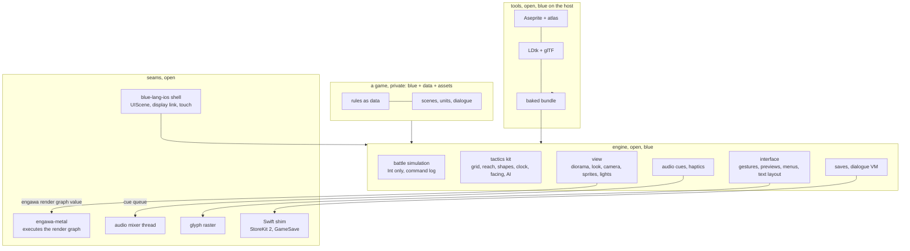
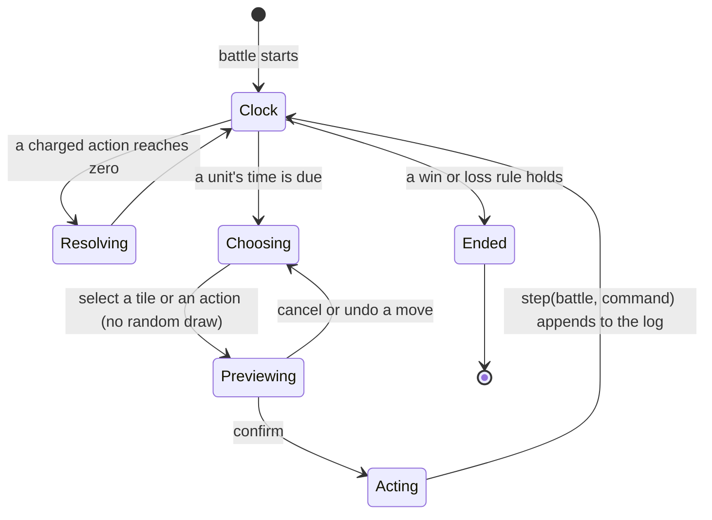

# ENGINE: an HD-2D tactics engine in blue

Status: DESIGN, 2026-11-10. Owner of the design: this file. It builds on
[`IPHONE.md`](IPHONE.md) (the placement, the shell and the pipeline) and on
[`P2P.md`](P2P.md) (the network a match runs on). The tier ledger at the end
is the only place a status is claimed.

Operator, 2026-11-10: *"lets make one engine, fully in bluelang"*, then
*"absorb the best of the best of game development for iOS especially related
to 2DHD and games like final fantasy tactics … and lets build and absorb all
the tools we need and deliver them in bluelang"*.

## 1. Destination

One engine, written in blue, makes HD-2D tactics games for iPhone: pixel-art
characters standing in lit, low-poly 3D dioramas, under a tilt-shift focus
band, bloom and a colour grade, on a height grid where time, height and
facing are the tactics. The engine's simulation, rendering description,
camera, input, interface, audio cues, saves, dialogue, AI and its asset
tools are blue. Rust stays only where the platform's ABI is irreducible: the
UIKit shell, the Metal executor of a render graph, the realtime audio
thread, and font rasterising. One Swift file exposes StoreKit 2 and GameSave
through C entry points. The engine ships compiled (blue's ahead-of-time
compiler, `chuuzou`), so the App Store rules on executable code hold and the
frame budget holds.

The engine is open source. A game (Aqui first) is private and holds only
blue sources, rules as data, and assets. The engine carries mechanics, never
another game's content: rules are data a game supplies.

World-facts that bound this:

| # | World-fact | Consequence |
|---|---|---|
| W1 | Metal, UIKit, CoreAudio and CoreText are platform ABIs | each is one Rust seam (CONTAIN THE C); StoreKit 2 and GameSave are Swift-only, so one Swift shim |
| W2 | iOS forbids JIT and downloaded code (App Review 2.5.2) | the shipped engine is compiled blue or interpreted blue inside the bundle; hot reload is for dev builds only |
| W3 | Interpreted blue runs 750x to 6,300x slower than Rust per unit of work (PERFORMANCE.md, 2026-11-10); `chuuzou` runs 0.98x to 1.61x of Rust | per-frame work in the interpreter stays small; turn work (AI, pathfinding) waits for `chuuzou` or is spread over frames |
| W4 | Floating point differs across compilers and CPUs | the battle simulation is integer only, so replays, rewind and peer lockstep are exact |
| W5 | The realtime audio thread must never wait | the mixer runs in Rust; blue sends it cues through a lock-free queue |
| W6 | A free Apple team gives 7-day installs; TestFlight needs a paid membership | device testing runs on the operator's iPhone 16 Pro Max now; TestFlight waits (IPHONE.md I5) |

## 2. Ground (measured 2026-11-10)

| What | Where | Tier |
|---|---|---|
| The iPhone shell: `frame(state, input) -> {state, draw}`, draw `clear` and `rect`, golden screenshot test | `crates/blue-lang-ios` (IPHONE.md I0, I1) | tested, landing |
| Render-graph IR: passes, resources, materials (WGSL), instanced draws, compile with cycle and writer checks | `pleme-io/engawa` v0.1.6 (public), ~74 tests | tested |
| Metal executor of engawa graphs, WGSL to MSL by naga | `asobi/crates/engawa-metal` (private), 17 tests | tested on device |
| HD-2D model: one `Diorama` value (tiles, sprites, lights), `Look` (palette, bloom, tilt-shift, grade, sun, climate), edit verbs with undo, timeline replay, camera rig, projection to an engawa graph | `asobi/crates/recanto` (private), 3,494 lines, 56 tests | tested, Rust |
| WGSL library for the look | `asobi/crates/recanto-render` (private) | tested, Rust |
| Touch to gesture to camera | `asobi/crates/recanto-input`, `asobi` (private) | tested, Rust |
| GGPO-style rollback, headless play session, versioned save codec | `asobi-net-rollback`, `asobi-play`, `asobi-save` (private) | tested, Rust |
| Ahead-of-time blue: checked Int, records, lists, recursion to a `no_std` Rust crate; no Float, strings, lambdas or maps; boards riscv32 and host64 | `native/bidamas/chuuzou`, `kiban` | tested |
| Blue bidamas a game uses: `ran` (seeded RNG), `ugoki` (easing, tween, spring), `kazu`, `suugaku` (vectors, matrices), `koubou` (2D and 3D geometry), `gurafu`, `gamen` (colour, UI trees), `deeta` (JSON), `baito`, `seikika` | `bidamas/` | tested |
| Replay of a run, properties from signatures, mutation ratchet | H4, H6 | tested |

Missing in blue: grid pathfinding, image and atlas tools, Aseprite, LDtk and
glTF loaders, audio, font layout, flat byte buffers, f32.

## 3. Research: what is absorbed

The four research reports of 2026-11-10 are summarised here, each row with
its source.

### 3.1 The HD-2D look

| Technique | Take | How, on an A18 Pro | Source |
|---|---|---|---|
| Pixel sprites as Y-axis billboards, foot pivot, point sampling with anti-aliased edges, fixed world size per art pixel | adopt | instanced quads, billboarding in the vertex shader; blue sends position, frame and facing only | Unreal Fest East 2018 report (automaton-media.com/devlog/report/20181023-78326) |
| Narrow-FOV camera, fixed pitch, yaw rotation, discrete zoom, snapped to the art-pixel grid | adopt | camera rig in blue (port of recanto `camera`) | Triangle Strategy interview (nintendoeverything.com) |
| Draw order opaque, alpha-tested sprites (depth write, no sort), sky, blended | adopt | keeps the tile-based GPU's hidden-surface removal | developer.apple.com, TBDR guide; WWDC20 10602 |
| Sun shadow map, sprites cast turned toward the light | adopt | Depth16 2048², one cascade fitted to the diorama, 4-tap PCF | dev.to HD-2D on DX12; Unity forum on Octopath shadows |
| Point lights (torches, carried light, spells) | adopt | forward, up to 16 per view, flicker in the shader; blue picks the lights | Unreal Fest East 2018 |
| Tilt-shift focus band (the signature) | adopt, with a strength setting | half-res circle of confusion, depth-weighted gather | PlayStation Blog, Dragon Quest III HD-2D interview |
| Bloom, lens flare, one fused grade (tonemap, LUT, vignette) | adopt | RG11B10F chain; one composite pass | en.wikipedia.org/wiki/HD-2D |
| Height fog, god rays, water, compute particles | adapt (cheap variants) | inline fog; half-res rays; blended water with a depth fade | Siliconera, Octopath developers |
| MetalFX spatial upscale, dynamic resolution | adopt | render at 60-75% of 2868x1320 | WWDC25 211 |
| Temporal upscale, frame interpolation, volumetric fog | skip for now | ghosting on sprite frame swaps; latency | WWDC25 211 |

### 3.2 Tactics systems

| System | Take | Shape | Source |
|---|---|---|---|
| Height grid with edge climbing, jump, gap, fall, water depth | adopt | a tile is `{h, depth, slope(N,E,S,W), surface, flags}`; a step is legal when the shared edge rises within Jump | FFT Battle Mechanics Guide v6.1 (BMG) 6.5; ffhacktics Slope_Type |
| Reach by Dijkstra over move cost, keeping the parent map for preview and AI | adopt | one search per unit per turn | BMG 6.5 |
| Time as the resource: a clocktick with charge timers, turn cost by what the unit did, a visible timeline | adopt as a rule kind | clock phases as data; a game chooses CT, phases or wait-time | BMG A.2, 1.1 |
| Panel versus unit targeting for charged actions | adopt | a target is `Unit` or `Panel` | BMG 2.3 |
| Range and area shapes with vertical tolerance, line of sight, arcs that grow with height | adopt | shapes as data | BMG 1.1, 2.1 |
| Facing that removes evade layers | adopt as a rule kind | front, side, back resolved from offsets | BMG 1.4 |
| Integer formulas, fixed modifier order, ties by unit index | adopt | formulas are blue functions over Int | BMG 1.2 |
| Job mixing, shared progression | adapt | loadout records; the numbers are the game's | BMG 6.3 |
| Enemy AI by scoring every reachable tile and target, random among the best, no lookahead | adopt | spread over frames | Into the Breach AI document (its programmer) |
| Rewind by snapshots and a command log | adopt | Tactics Ogre Reborn, Into the Breach reset | RPG Site |
| Move preview showing threatened tiles and the threats; attack preview with hit percent; a turn-order list; undo a move until the attack | adopt | UI words | Triangle Strategy tips (nintendo.com); FFT remaster reviews; Into the Breach |
| Previews never draw from the random stream | adopt (law) | previews are pure | fireemblemwiki.org RNG |

"Final Fantasy Resonance" (Square Enix and Lancarse, 2026-10-22) is HD-2D
but turn-based without a grid; its look is in 3.1, its battle system is not
the target.

### 3.3 iPhone engineering and tools

| Item | Take | Where it runs | Source |
|---|---|---|---|
| UIScene lifecycle (required by the iOS 27 SDK) | adopt | shell | TN3187 |
| CAMetalDisplayLink, 60 Hz default, 120 for scroll, 30 in menus, `CADisableMinimumFrameDurationOnPhone` | adopt | shell timing, blue policy | developer.apple.com, ProMotion; WWDC21 10147 |
| Thermal state and Low Power Mode drive quality | adopt | shell reads, blue decides | ProcessInfo |
| Mixer and decoders in Rust, cues in blue; `.ambient` session | adopt | seam | AVAudioSession; Defold's audio design |
| Core Haptics patterns as data | adopt | seam plays, blue authors | Core Haptics |
| Local saves; GameSave cloud saves; settings in key-value store | adopt | codec in blue, sync in the Swift shim | GameSave |
| StoreKit 2 non-consumable unlock | adopt (paid team) | Swift shim | Apple forums 719352 |
| Aseprite files, MaxRects atlas with edge extrusion, LDtk grids, glTF dioramas, ASTC for scenery only | adopt | offline, blue tools on the host | Aseprite spec; RectangleBinPack; ldtk.io; Khronos |
| Pixel fonts at integer scale, MSDF for scalable Latin, shaping | adopt | raster in Rust, layout in blue | Fusion Pixel; msdfgen; rustybuzz |
| Dialogue as a small VM (Yarn or Ink shape) | adopt | blue | Yarn Spinner; Ink |
| os_signpost zones from blue, MetricKit, GPU capture to a file | adopt | seam | Apple Instruments docs |
| Godot signals and composition; Bevy ordered schedules; Defold addressed messages and tiny runtime; LÖVE's three callbacks | adopt the idea | engine shape | engine docs |
| Dynamic typing for game logic; untyped string addresses | skip | | |

## 4. The architecture

**One frame.** The shell calls `frame(state, input)`. Blue folds the input
into the game state, advances the view, and returns the next state and one
engawa render graph as a value: the passes of the HD-2D pipeline (section
3.1) with the frame's sprite instances, lights, camera and look parameters.
The executor keeps pipeline states and the baked atlases resident; blue
sends only what changed in kind, never pixels.

**One turn.** The simulation is a pure function `step(battle, command) ->
{battle, events}` over Int only. The battle carries its random stream; a
command log plus the seed replays a battle exactly. Snapshots give rewind.
The same `step` runs under rollback or lockstep for a P2P match
(`P2P.md`), and peers compare the battle's canonical root each turn
(`seikika`).

**Speed.** Interpreted blue is enough for the per-frame view (measured
0.2-0.5 ms for a trivial frame). The simulation, reach and AI are turn work;
they are written in the Int-only subset that `chuuzou` compiles today, so
they become native code first. Float, strings, lambdas, maps and an iOS
board in `chuuzou` then compile the rest.

## 5. Decisions

| Decision | Chosen | Rejected, and why |
|---|---|---|
| Engine language | blue for every engine system; Rust only at platform seams | keeping asobi's Rust engine: two engines, and game logic in Rust |
| asobi's Rust engine | configured off, kept as the parity oracle while blue ports it | deletion: behaviour is configured off, never deleted |
| What `frame` returns | an engawa render graph value | draw commands: too narrow for HD-2D; blue calling Metal: puts the ABI in blue |
| Where shaders live | the WGSL library moves with engawa-metal into public `pleme-io/engawa`, as assets; a blue shader form that renders WGSL comes later | hand-written MSL per platform |
| Number model | Int (and fixed-point) for the simulation; Float for the view | Float everywhere: breaks replay and lockstep (W4) |
| Asset handling | baked offline by blue tools on the host into engine-ready bytes; the phone decodes nothing | decoding PNG and glTF on the phone in the interpreter (W3) |
| Rules | data a game supplies (clock kind, formulas, shapes, jobs) | fixed rules: one game's design inside the engine |
| AI | score every reachable tile and target, pick among the best, spread over frames | tree search: cost on a phone, and the evidence (Into the Breach) says scoring plays well |
| Test posture | the strict coverage profile (`COVERAGE.md`) for the simulation and the tactics kit; golden screenshots on the simulator and on the phone | |

## 6. Phases

Every phase ends green twice: a golden screenshot on the simulator in CI,
and a run on the operator's iPhone 16 Pro Max.

| Phase | Builds | Gate (red run first) |
|---|---|---|
| E0 | `frame` returns an engawa graph; engawa-metal and its WGSL move to public `pleme-io/engawa` after a `mekakushi` scan; textured, instanced, point-sampled sprites from a baked atlas | a sprite sheet animates in the golden and on the phone |
| E1 | the diorama in blue (port of recanto `Diorama`, `Look`, camera rig); the HD-2D passes: main, shadow, bloom, focus band, composite, spatial upscale | a test diorama matches its golden; 60 Hz on the phone |
| E2 | blue host tools: Aseprite reader, MaxRects packer with extrusion, LDtk and glTF readers, the baked bundle, wired into the iPhone pipeline | an Aseprite file edited on the Mac shows on the phone after one command |
| E3 | the tactics kit and the simulation: height grid, reach, shapes with vertical tolerance, line of sight, facing, the clock with charged actions, command log, snapshots, rewind | properties: replay equals live; rewind then replay equals live; reach agrees with a brute-force oracle |
| E4 | interface: gestures and camera (port of recanto-input), move and attack previews, turn-order list, text layout over a Rust glyph atlas, menus, safe areas | a full turn is playable by touch in the golden flow and on the phone |
| E5 | AI by scoring; the audio seam and cues; haptics | a battle against the AI plays to an end; a cue sounds on the phone |
| E6 | `chuuzou` gains an iOS board; the simulation and AI ship compiled; then Float, strings, lambdas and maps so the whole engine ships compiled | AI turn under 16 ms on the phone; the frame budget holds at 60 Hz |
| E7 | the diorama editor (recanto edit verbs and timeline in blue) running in the engine; hot reload in dev builds | an edit on the phone is replayed from its timeline |
| E8 | saves (local, then GameSave), Game Center, StoreKit 2 (paid team), localisation, accessibility | a save survives a reinstall |

## 7. Open questions

| Question | Type |
|---|---|
| The paid Apple membership for TestFlight and StoreKit | world-fact, operator decision (later in 2026-11) |
| Names for the engine's bidamas | ours, the `naming` procedure |
| A blue shader form that renders WGSL, versus WGSL as assets | ours, after E1 |
| Fixed-point width for positions in the simulation | ours, at E3 |

## 8. Tier ledger

| Item | Tier |
|---|---|
| Destination, research, decisions, phases | DESIGN |
| E0 to E8 | DESIGN |
