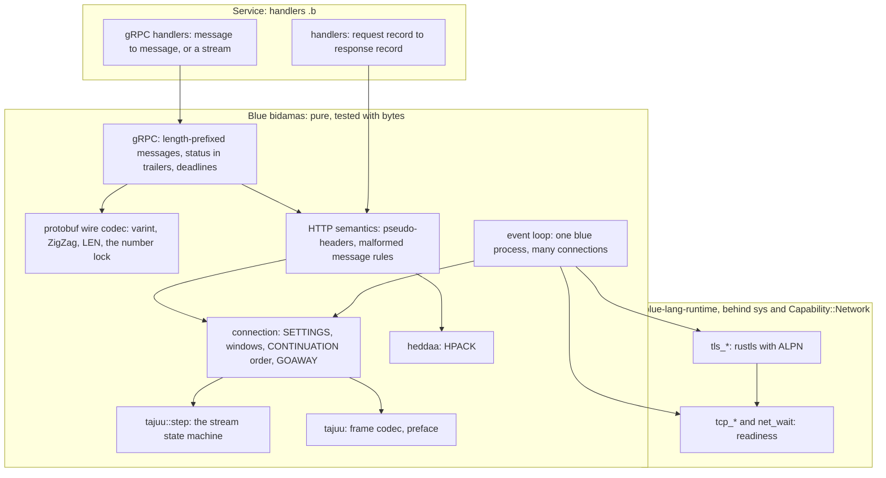
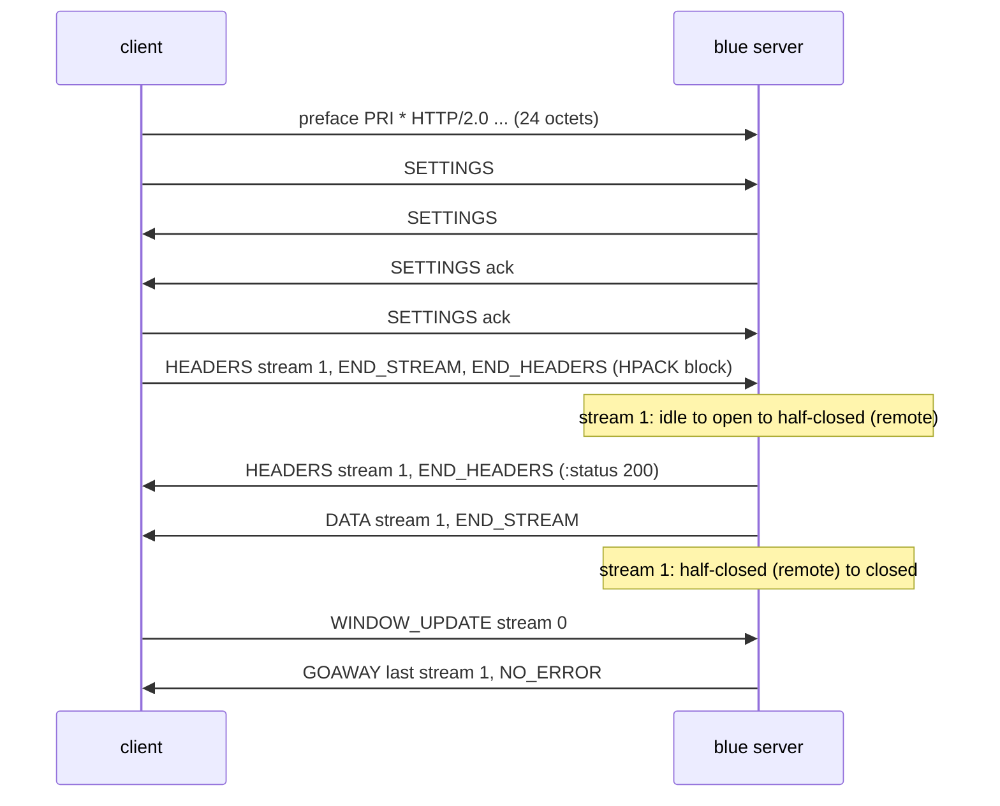
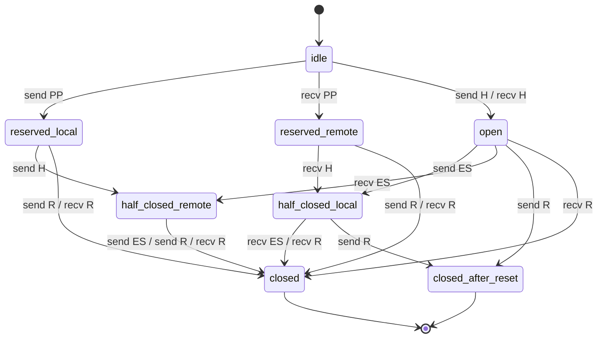
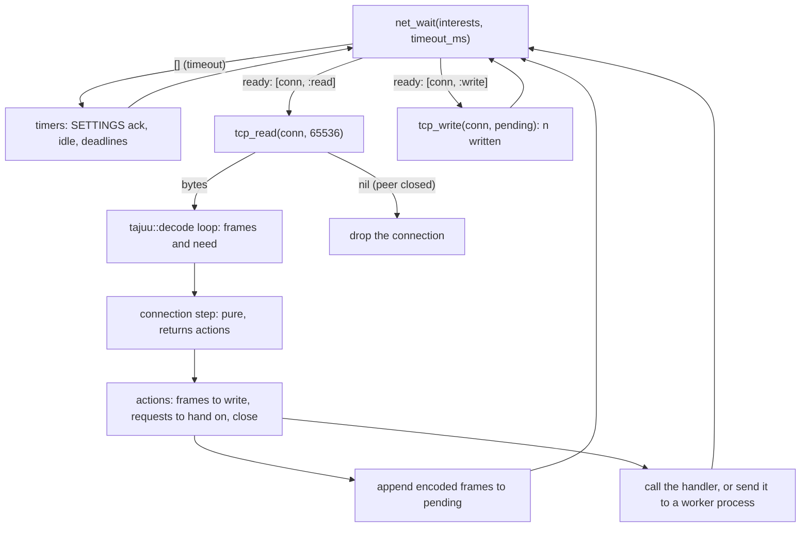

# HTTP2 — blue speaks HTTP/2 and gRPC itself

Status: DESIGN, 2026-10-23, with phase 1 built (§13). Paths are under
`~/code/github/pleme-io/`. Line numbers were read on 2026-10-23 at blue
`4bc6a5f` plus this change.

Operator, 2026-10-23: blue has its own HTTP/2 stack, with gRPC on it, built
in blue. "That should be the direction." The patterns are public: they live
in `blue/bidamas/`, and a primitive blue lacks goes into blue's runtime.

Decided context, not argued again here: `blue/docs/SERVICE-ARCHITECTURE.md`
(blue-led services; blue over a Rust host), `blue/docs/API-EVOLUTION.md`
(one model; gRPC as one rendering; the protobuf number lock),
`theory/BLUE-GAPS.md` "Network I/O status" (`:739`–`:781`) and "G11 status"
(`:820`–`:855`), and CONTAIN THE C in `pleme-io/CLAUDE.md`.

## 1. Destination

A blue-led service serves HTTP/2 and gRPC with no Rust HTTP stack. Every
protocol rule is a pure blue function that a test can call with bytes: the
frame codec, HPACK, the stream state machine, flow control, SETTINGS, the
connection preface, GOAWAY and RST_STREAM, the HTTP message rules, gRPC
framing and status, and the protobuf wire codec. The host gives blue two
things only. The first is readiness: one call that waits until some sockets
can be read or written, so one blue process multiplexes many connections
without a blocking read. The second is TLS with ALPN, the one audited crypto
seam. A malformed peer can never reach a handler. Each bad frame becomes the
RFC's error, with its scope, and the connection or the stream ends as the RFC
says. A new HTTP/2 extension is a frame type and a row in the tables, not new
engineering.

World facts that limit this: HTTP/2 over TLS needs ALPN `h2` (RFC 9113 §3.2).
The `h2c` Upgrade from HTTP/1.1 is deprecated (§3.1), so cleartext HTTP/2 is
prior knowledge only (§3.3). Browsers cannot speak gRPC without a proxy. TLS
needs a vetted crypto implementation, and every production-grade provider for
rustls today carries C or assembly.

## 2. Ground

| Concern | What exists (path:line) | What does not exist |
|---|---|---|
| Sockets | `crates/blue-lang-runtime/src/net.rs:1`–`:28`: NATS, HTTP/1.1, Postgres over std TCP, each call blocking with a timeout; `net/serve.rs:176` sets one listener non-blocking | no socket handle a program reads or writes; no wait over many sockets |
| Capability | `net.rs:5`: names granted only through `Capability::Network`; host names come from `sys` (`crates/blue-lang-runtime/Cargo.toml:47`), off in the wasm build | a per-socket grant |
| TLS | `BLUE-GAPS.md:775`: `https://` and TLS-only NATS are refused; no rustls in `Cargo.lock` | all of it |
| Processes | `crates/blue-lang-proc/src/lib.rs:373` `Supervisor`; `BLUE-GAPS.md:851`: the root is not preempted, and a blocking host call blocks the node | a socket that feeds a mailbox |
| Bytes | a byte is an Int in a list; `crypto.rs:198` `message_bytes` reads a string or a byte list | until this change, no text to bytes and back (now `text_bytes`, `bytes_text`, `stdlib.rs:570`, `:584`) |
| Bits | `bidamas/shinsuu`: `bit_at`, `shift_left`, `shift_right`, by arithmetic; blue has no bitwise operator | native bit operators |
| An HTTP server loop | `bidamas/kyuuji/kyuuji.b:201`, `while` over `http_next_request` | a loop over many connections |
| The verb graph | `docs/verbs/merged/verbs.tsv:2299` `sokketto?::wait(conns, opts) -> [ready conn]`, `:2296` `sokketto?::secure`, `:1181` `keiyaku?::frame` (length prefix), `:2204` `shinsuu::to_varint` | none of them built |
| Rust HTTP/2 in the fleet | kensa: `axum 0.8`, `tonic 0.12` behind the `grpc` feature (`kensa/Cargo.toml:28`, `:80`), `hyper 1.9.0`, `h2 0.4.20`, `rustls 0.23.46` in `kensa/Cargo.lock`; tend: `hyper 1.12.0` (server, http1), `h2 0.4.20`, `rustls 0.23.46` | a blue service on any of them |

Summary: blue can make one blocking request at a time. It cannot hold two
connections open and serve whichever speaks first, it has no TLS, and the
fleet's HTTP/2 is hyper and h2, reachable only from Rust-led services.

## 3. Research

Fetched on 2026-10-23. No personal data was sent.

| Source | What it says that matters | Taken as |
|---|---|---|
| RFC 9113, https://www.rfc-editor.org/rfc/rfc9113 | §3.4 the 24-octet preface then SETTINGS; §4.1 a 9-octet header, the reserved bit ignored, unknown types discarded; §4.2 FRAME_SIZE_ERROR, and it is a connection error for HEADERS, PUSH_PROMISE, CONTINUATION, SETTINGS and stream 0; §5.1 the state machine; §5.3.2 the RFC 7540 priority scheme deprecated, its fields still parsed; §6 every frame's rules; §7 the error codes | **adopt** all of it; the codec and the state machine are tested against these sections |
| RFC 7541, https://www.rfc-editor.org/rfc/rfc7541 | §4 table sizes (octets + 32), eviction, size updates at the start of a block; §5.1 N-bit prefix integers; §5.2 string literals; §6 the five representations; Appendix A, the 61 static entries; Appendix B, the 257-symbol canonical Huffman code; Appendix C, worked examples | **adopt**; the tables are copied from the RFC text, and C.1–C.6 are the tests |
| RFC 9110, https://www.rfc-editor.org/rfc/rfc9110 | fields and trailers (§6.5), status codes, methods | **adopt** as the message model that `heddaa` fields carry |
| gRPC over HTTP/2, https://github.com/grpc/grpc/blob/master/doc/PROTOCOL-HTTP2.md | a Length-Prefixed-Message is a 1-byte compressed flag and a 4-byte big-endian length; status goes in trailers even on success; Trailers-Only for an immediate error; `content-type: application/grpc`; DATA boundaries are not message boundaries; an RST_STREAM code maps to a gRPC status | **adopt** |
| Protobuf encoding, https://protobuf.dev/programming-guides/encoding/ | base-128 varints, little-endian groups of 7 bits; wire types VARINT, I64, LEN, SGROUP/EGROUP (deprecated), I32; ZigZag for `sint` | **adopt**; varint is `shinsuu::to_varint` in the verb graph |
| RFC 7301 (ALPN), https://www.rfc-editor.org/rfc/rfc7301 | the client offers protocol names in the TLS handshake and the server picks one | **adopt**: `h2`, with `http/1.1` as the fallback |
| rustls, https://docs.rs/rustls | the connection is sans-I/O (`read_tls`, `process_new_packets`, `write_tls`), so it runs over any non-blocking socket; the default crypto provider is aws-lc-rs, and ring is the other supported one | **adopt** rustls; the provider is an open question (§11) |
| hyper and h2 (the fleet's Rust stack) | the shape every mature stack agrees on: a codec, an HPACK context per direction, a connection state that owns streams and windows, and an event loop over a readiness API | **adopt the shape, not the code**: the same layers in blue |

## 4. States

| Thing | States | How each is told apart |
|---|---|---|
| bytes read so far | a frame and the rest; `need: n` (incomplete, not an error); refused | `tajuu::decode` returns `ok({frame:, rest:})`, `ok({frame: nil, need:})`, or a refusal |
| a refusal | connection error, stream error, local (this end must not send it) | `scope: :connection`, `:stream` or `:local`, the RFC code as the kind, and the stream id |
| a frame type | the ten of §6, or unknown | an unknown type decodes as `:unknown` with its code, for the caller to discard |
| an error code or setting | known (a keyword) or unknown (its number) | `tajuu::error_name(99)` is `99`; unknown settings are kept as numbers and ignored by the caller (§6.5.2) |
| a stream | idle, reserved (local), reserved (remote), open, half-closed (local), half-closed (remote), closed, closed after this end reset it | `tajuu::step`; the last state is the RFC's prose split of "closed" (§5.1): frames that arrive after this end sent RST_STREAM are discarded, not refused |
| a header field part | text, or the bytes it arrived as when they are not UTF-8 | a string or a byte list; HPACK allows any octets, so a decoder never refuses them |
| a header block | decoded, or a COMPRESSION_ERROR | the refusal ends the connection (RFC 9113 §4.3), because the tables are now out of step |
| the poll primitive | ready sockets; none ready before the timeout; refused (no network capability) | a list, `[]`, or a raise naming the capability |
| a TLS session | handshaking; open with ALPN `h2`; open with another or no ALPN; refused (bad certificate, bad name) | `tls_alpn(conn)` is `"h2"`, another string, or nil; a refused handshake raises with the reason |

## 5. Shape: what is blue and what is the host

**Policy, protocol and shape go in blue. Readiness and crypto go in the host.**
This narrows SERVICE-ARCHITECTURE §5a, where "protocols go in Rust" (RESP,
OTLP): for HTTP/2 the protocol moves into blue, by the operator's direction,
and only the two world-facing seams stay in Rust.

| Piece | Lives in | Why |
|---|---|---|
| Frame codec, preface | blue (`tajuu`) | bytes in, records out; every rule is a test |
| HPACK | blue (`heddaa`) | tables and codes are data; the RFC's examples are the tests |
| Stream state machine | blue (`tajuu::step`) | a pure transition function |
| Flow control, SETTINGS, GOAWAY, CONTINUATION order, stream-id rules | blue (phase 2, `tajuu`) | state a connection threads through pure steps |
| HTTP message rules (RFC 9113 §8) | blue (phase 2) | field checks |
| gRPC framing and status | blue (phase 5; `keiyaku?::frame` in the verb graph) | 5 bytes of prefix and a trailer table |
| Protobuf wire codec | blue (phase 5; varint in `shinsuu`) | arithmetic |
| Readiness | Rust host primitive | a fact about the kernel |
| TLS and ALPN | Rust host primitive (rustls) | crypto is the one audited seam |
| Text to bytes and back | Rust host primitive, pure (built: `text_bytes`, `bytes_text`) | UTF-8 needs the code points, which blue cannot read |

### 5a. A request's frames

An h2c (prior knowledge) GET with one response, as the frames cross the wire.

A gRPC unary call is the same exchange with `content-type:
application/grpc`, the request DATA carrying one Length-Prefixed-Message, and
the response ending in a trailers HEADERS frame with `grpc-status` and
END_STREAM, not on DATA.

### 5b. The stream state machine (RFC 9113 §5.1, Figure 2)

`tajuu::step(state, dir, kind, end_stream, stream)` is this diagram. END_STREAM
is a second event after the frame's own (§5.1), so one HEADERS frame can move
`idle` to `half_closed_local`. CONTINUATION never moves a state. PRIORITY is
legal in every state. The refusals follow §5.1 and §6: a frame other than
HEADERS or PRIORITY on an idle stream is a connection PROTOCOL_ERROR; a frame
other than WINDOW_UPDATE, PRIORITY or RST_STREAM on a half-closed (remote)
stream is a stream STREAM_CLOSED; DATA on a closed stream is a stream
STREAM_CLOSED (§6.1); HEADERS on a closed stream is a connection
STREAM_CLOSED (the MAY of §5.1, taken); a frame this end must not send is a
`:local` refusal.

### 5c. The poll loop

One blue process owns the loop. Each connection's state is a value; the
loop's only effects are `net_wait`, `tcp_read`, `tcp_write` and the clock.
So the whole protocol runs in tests with no socket: a test feeds bytes to the
connection step and reads the actions.

### 5d. The host primitives, proposed

Names follow the house's `http_*`, `nats_*`, `pg_*` builtins; `sokketto`
wraps them as verbs (`wait`, `read`, `write`, `secure`, the verb graph's
`:2282`–`:2300`). Behind `sys` and `Capability::Network`.

| Name | Returns | Notes |
|---|---|---|
| `tcp_listen(addr)` | a listener | non-blocking; port 0 picks one |
| `tcp_accept(listener)` | a connection, or nil when none is waiting | never blocks |
| `tcp_connect(addr, timeout_ms)` | a connection | raises when it cannot connect |
| `tcp_read(conn, max)` | a byte list; `[]` when nothing is ready; nil when the peer closed | the three cases are three values (okite D0004: nil is not `[]`) |
| `tcp_write(conn, bytes)` | how many bytes went out, 0 when the socket is full | the caller keeps the rest |
| `tcp_close(x)` | nil | closing twice is done |
| `net_wait(interests, timeout_ms)` | `[[handle, :read \| :write \| :closed], …]`, `[]` on timeout | interests are `[[handle, :read \| :write \| :both], …]`; level-triggered; `rustix::event::poll` (poll(2)), no other crate |
| `tls_server(conn, cert_path, key_path, alpn)` | a TLS connection | rustls `ServerConnection`, driven over the same non-blocking socket; `tcp_read`, `tcp_write`, `net_wait` take it as they take a plain one |
| `tls_client(conn, server_name, alpn)` | a TLS connection | webpki roots or a named CA file; a bad certificate or name raises |
| `tls_alpn(conn)` | `"h2"`, another protocol, or nil | nil when the peer negotiated none |

Keys never enter blue values: the server reads its key from a path, as
SERVICE-ARCHITECTURE requires of secrets.

## 6. Phase 1 as built

Two bidamas and two runtime words, all pure.

| Name | What | Tests |
|---|---|---|
| `heddaa` (ヘッダー) | HPACK: `encode_int`, `decode_int`, `huffman_encode`, `huffman_decode`, `huffman_size`, `encode_string`, `decode_string`, `table`, `insert`, `evict`, `resize`, `with_limit`, `lookup`, `encode`, `decode` | 12 blocks: C.1 integers, the Huffman code's completeness (Kraft sum = 1), C.4 strings, bad padding and EOS, Appendix A, the dynamic table, C.2.1–C.2.4, C.3 and C.4 threaded through one table each way, C.5 and C.6 with eviction at 256, decoder refusals with controls, size-update signalling, non-UTF-8 octets |
| `tajuu` (多重) | frames: `encode`, `decode`, `read_preface`, `preface`; codes: `error_code`, `error_name`, `setting_id`, `setting_name`; streams: `step` | 11 blocks: the preface in pieces, a round trip of every frame type (and an unknown one), hand-checked bytes, partial frames and the reserved bit, 28 malformed frames each with its code and scope, SETTINGS_MAX_FRAME_SIZE and its scope, encode refusing what decode refuses, every edge of Figure 2, 18 refused transitions, discard after reset |
| `text_bytes`, `bytes_text` | UTF-8 both ways; nil for bytes that are not UTF-8 | a runtime unit test and three conformance rows |
| `shinsuu` 0.1.1 | `be_bytes`, `be_value`, `hex_bytes`, `bytes_hex` | two blocks |
| `kyohi` 0.1.3 | `and_then`: the next step on a value, a refusal passed through | one block |

Every test block was seen red: `bidamas/heni/mutations/heddaa.json` (20
mutations) and `tajuu.json` (25) are each caught. The first heni run left one
survivor in each (padding of exactly 8 bits; padding equal to the payload
length; a 23-octet preface); each gained the test that kills it.

## 7. Phases, each ending green

| Phase | Work | Gate |
|---|---|---|
| P0 | this doc | review; the operator approves the destination |
| P1 | `heddaa`, `tajuu` codec and `step`, `text_bytes` and `bytes_text` (built) | RFC 7541 C.1–C.6 byte for byte; every §6 rule and §5.1 edge; heni catches every mutation |
| P2 | the connection, pure: SETTINGS exchange and ack, the two flow-control windows per stream and per connection, CONTINUATION order, stream-id parity and order, MAX_CONCURRENT_STREAMS, GOAWAY drain, PING, the §8 message rules, SETTINGS_MAX_HEADER_LIST_SIZE, the HPACK size-update rule after a SETTINGS change | scripted byte transcripts: the h2spec cases as blue tests, each seen red |
| P3 | `tcp_*` and `net_wait` in `blue-lang-runtime`; a blue h2c server and client | `checks.network`: `curl --http2-prior-knowledge` and `h2spec` against a blue server, failing when either tool is missing |
| P4 | `tls_*` over rustls; ALPN `h2` with `http/1.1` fallback to kyuuji | `curl --http2` over TLS and `h2spec -t`; a wrong certificate refused |
| P5 | protobuf wire codec (`shinsuu::to_varint`, ZigZag, LEN, fixed); gRPC framing and status; unary and server streaming | `grpcurl` and a Go gRPC client against a blue server; status and trailers seen on the wire |
| P6 | the `.proto` rendering of API-EVOLUTION P6 served by a blue-led service; kensa's gRPC surface moves to it | API-EVOLUTION §16's first question answered by a running service; `buf breaking` against the number lock |

## 8. Decisions

1. **The protocol is blue; only readiness and TLS are Rust.** Rejected: bind
   hyper and h2 behind a blue surface. It is the friendliest wrapper, not the
   lowest ABI, and each RFC rule would stay out of reach of blue tests and
   blue's verb graph. Rejected: a Rust HTTP/2 core with blue handlers (the
   kensa mode). It keeps blue-led services second-class, which
   SERVICE-ARCHITECTURE §5a calls a gap to close.
2. **One readiness word, `net_wait` over `poll(2)` through rustix.**
   Rejected: tokio (a runtime under a runtime, and blue-lang-proc already
   schedules). Rejected: mio (a wrapper over the same syscalls with more
   surface). Rejected: a thread per connection (blue values are not shared
   across threads, and every thread would need its own interpreter).
   Rejected: busy polling non-blocking sockets (burns a core while idle).
   epoll and kqueue can replace poll(2) under the same blue word.
3. **rustls, sans-I/O, over the same sockets.** Rejected: OpenSSL and
   native-tls (C libraries, the friendliest wrapper). Rejected: TLS in blue
   (crypto must be the audited seam).
4. **Prior knowledge for cleartext, ALPN for TLS; no `h2c` Upgrade.** RFC 9113
   §3.1 deprecates it.
5. **Pure steps that return the next state.** `heddaa::encode` and `decode`
   take a table and return the next one; `tajuu::step` takes a state and
   returns the next one. Rejected: mutable connection objects in the host.
   They would hide the protocol state from tests and from replay
   (`BLUE-GAPS.md:838`, crash traces).
6. **Refusals are data with a scope.** A decoder answers the RFC's code and
   whether it ends the stream or the connection, so the caller writes
   RST_STREAM or GOAWAY without a second table. Rejected: raising. The caller
   must tell `:stream` from `:connection`, and a raise loses the frame that
   follows.
7. **A field part is text or bytes, never refused for its octets.** HPACK and
   RFC 9113 §8.2.1 allow octets that are not UTF-8 in values; a decoder that
   refused them would put the HPACK tables out of step with the peer.
   Rejected: lossy conversion (the existing NATS payload rule,
   `BLUE-GAPS.md:776`).
8. **Two bidamas, named by the layer.** `heddaa` holds header fields, so the
   HTTP field rules of phase 2 join it. `tajuu` holds multiplexing: frames,
   streams and, in phase 2, the connection. Rejected: one `http2` bidama (a
   foreign name, and HPACK is used without frames by tests and by tools).
   Rejected: `asshuku` for HPACK. It is the verb graph's provisional space
   for byte codecs and archives, and HPACK is not one.
9. **The Huffman and static tables are copied from the RFC text, not typed.**
   `rg` read 257 rows from Appendix B and 61 from Appendix A; DuckDB checked
   the count and the Kraft sum (exactly 1.0); the C.4 and C.6 examples check
   the codes byte for byte.

## 9. Bad states made unrepresentable

| Bad state | How it is refused | Scope |
|---|---|---|
| a malformed frame reaching a handler | `tajuu::decode` returns a frame or a refusal, never a partial frame | that frame; the connection when §4.2 says so |
| a frame sent that the peer must refuse | `tajuu::encode` decodes what it wrote and raises on a refusal | that call |
| an illegal stream transition | `tajuu::step` has no edge for it | that stream, or the connection when §5.1 says so |
| HPACK tables out of step | encoder and decoder thread the table they return; a refused block ends the connection | that connection |
| a table larger than the peer allows | `resize` above `limit` raises; a size update above `limit` is refused | that call; that connection |
| a size update after a field | refused (RFC 7541 §4.2) | that block |
| a never-indexed field put in a table | the `never` option writes the §6.2.3 form, and the decoder marks it in `sensitive` | that field |
| bytes lost to UTF-8 conversion | a part that is not UTF-8 stays a byte list | that field |

## 10. Duplication this design retires

The Rust services' copies of HTTP/2 stay until each is touched. A blue-led
service inherits one stack. Inside blue, this change moved shared shapes to
their owners: big-endian integers and hex dumps to `shinsuu`, result chaining
to `kyohi::and_then`, and text to bytes into the runtime.

## 11. Open questions

| Question | Type |
|---|---|
| Which rustls crypto provider? aws-lc-rs (default, FIPS, C) or ring (C and assembly) | world fact: no pure-Rust provider is production-audited today; `rustls-rustcrypto` is to measure, not to ship |
| Is a byte list fast enough? Every byte is a boxed Int in a vector | ours: measure frames per second in P3; a native bytes value in the runtime is the likely answer |
| Huffman decoding walks one bit at a time through a map | ours: a 4-bit state table (the nghttp2 method) is the next step when P3 measures it |
| How does a handler run without stalling the loop? The root process is not preempted (`BLUE-GAPS.md:851`) | ours: `net_wait` also returns when the root's mailbox has a message, so handlers run in worker processes |
| poll(2) is O(n) per call | ours: measure at 1 000 connections; epoll and kqueue go under the same word |
| RFC 9218 priorities | ours: ignored at first; the §5.3.2 fields are already parsed |
| Which fields default to never indexed? | ours, guided by a world fact (RFC 7541 §7.1, CRIME-style attacks): `authorization` and short `cookie` values |
| gRPC for browsers | world fact: gRPC-Web needs a proxy (API-EVOLUTION §3); out of scope |
| Is the ENABLE_PUSH rule role-dependent? A client must refuse ENABLE_PUSH = 1 | world fact (§6.5.2); it needs the role, so it is P2's |

## 12. Tier ledger

| Item | Tier | Evidence |
|---|---|---|
| `text_bytes`, `bytes_text` | tested | `stdlib.rs` unit test, seen red; conformance rows in `spec/rows/strings.b` |
| `heddaa` HPACK | tested | 12 blocks; RFC 7541 C.1–C.6; 20 heni mutations caught |
| `tajuu` frame codec, preface, `step` | tested | 11 blocks; 25 heni mutations caught |
| `shinsuu` byte helpers, `kyohi::and_then` | tested | their blocks, seen red with heni |
| connection layer (P2) | design | none |
| `tcp_*`, `net_wait` | design | none |
| `tls_*` | design | none |
| gRPC, protobuf wire codec | design | none |
| a blue-led gRPC service | design | none |

## 13. What phase 2 needs

A connection value: our and the peer's SETTINGS (in force and pending ack),
both HPACK tables, the two windows per stream and per connection, the open
header block (stream, end_stream, fragments so far), the highest stream id
each side opened, the GOAWAY state, and the streams map. A `receive(conn,
bytes)` step that returns the next value and a list of actions; a `send`
step for responses. The h2spec cases as byte transcripts. No host primitive
is needed for any of it.
