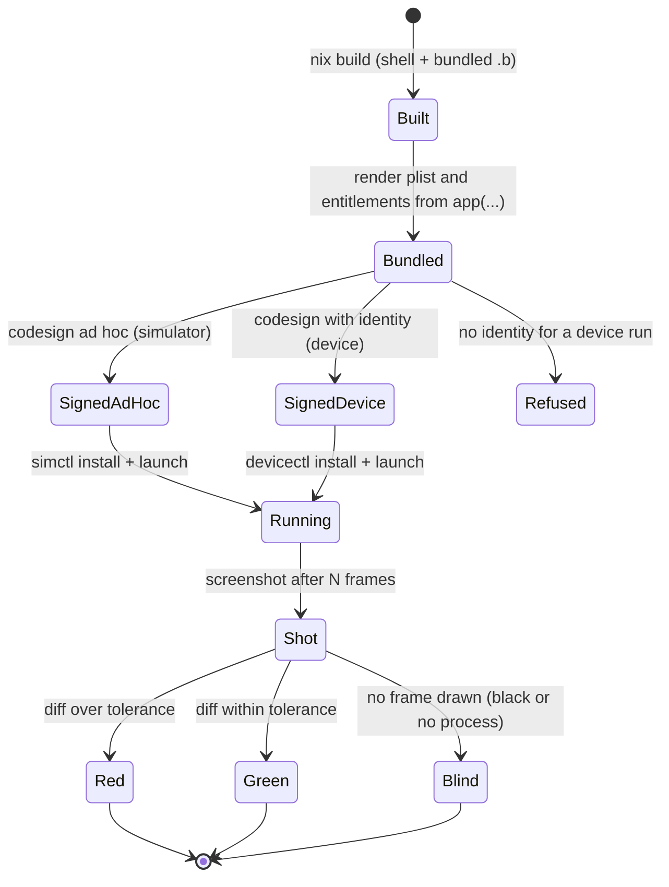
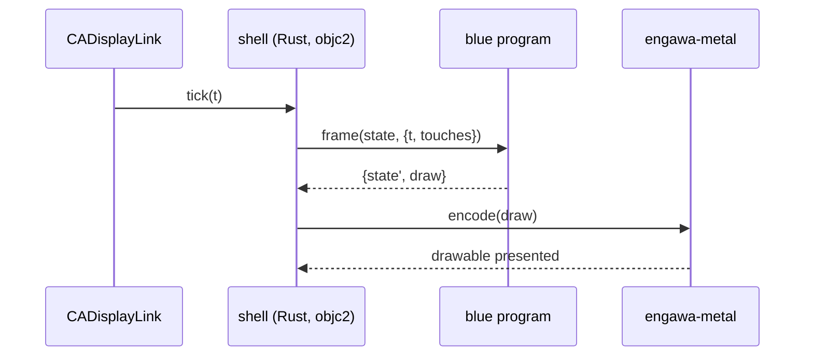

# IPHONE: a whole iPhone app in blue

Status: DESIGN, 2026-11-10. Owner of the design: this file. It refines
[`SUBSTRATE.md`](SUBSTRATE.md) layer 2 (L2.3 Mobile) and
[`FRONTEND-PLAN.md`](FRONTEND-PLAN.md) F15. The tier ledger at the end is the
only place a status is claimed.

## 1. Destination

An iPhone app is one blue program. The game loop, the scene, input handling,
the interface, the network and the save format are blue. One open Rust shell
runs every such app: it starts UIKit, owns the Metal layer and the display
link, gives touches to blue, and draws what blue returns. No app has Rust code
of its own.

One nix pipeline takes the program to the simulator, to a phone and to CI. The
pipeline is blue too: the bundle manifest, the entitlements and the deploy
steps are blue values, rendered to plist and run by blue. A screenshot of the
simulator is the test oracle, and a golden diff gates every change.

The framework, the shell and the pipeline are open source. A product (Aqui) is
a private repo that holds only blue sources and assets.

World-facts that bound this:

| # | World-fact | Consequence |
|---|---|---|
| W1 | iOS forbids executing code that the app did not ship (App Store Review 2.5.2) and forbids JIT outside the system browser | the interpreter, or compiled blue, ships inside the bundle; live edit is for dev builds only |
| W2 | UIKit and Metal are Objective-C ABIs | the shell speaks them through `objc2` (CONTAIN THE C: the lowest ABI, one seam) |
| W3 | a device install needs a signing identity; a free team gives 7-day profiles; TestFlight needs a paid Apple Developer membership | device and TestFlight phases wait on an operator decision |
| W4 | the simulator needs no signature beyond ad hoc, and renders Metal on the host GPU | all visual iteration and CI run on the simulator |
| W5 | iOS builds need macOS and Xcode | CI for a public repo runs on GitHub-hosted macOS runners (free for public repos); a private repo needs a self-hosted macOS runner |

## 2. Ground (measured 2026-11-10)

The Rust loop exists in `pleme-io/asobi` (private). Its stages:

| Stage | Where | Tier |
|---|---|---|
| Cross-compile `aarch64-apple-ios`, `aarch64-apple-ios-sim` | `substrate/lib/build/rust/ios-game-flake.nix` | tested |
| Bundle: typed Info.plist and entitlements | `asobi/crates/embarque` (`bundle.rs`, `plist.rs`, `entitlements.rs`) | tested |
| Ad hoc and device signing, `simctl`/`devicectl` deploy | `embarque/src/sim.rs` | tested (device: 2026-06-16) |
| Screenshot and golden diff | `embarque/src/main.rs`, `nix run .#integ-sim` | exists, run by hand only |
| CI | `substrate/.github/workflows/ios-game-ci.yml` | exists, never run |
| TestFlight | `actions/app-store-connect` | exists, never used |

The app shell is `asobi/crates/asobi-smoke` (UIApplication, scene delegate,
`CAMetalLayer`, `CADisplayLink`, UITouch). The Metal backend is
`asobi/crates/engawa-metal` over the public render-graph IR `pleme-io/engawa`.

Blue today: `blue-lang-host` embeds the interpreter in Rust with `#[host]`
blocks; `blue-lang-runtime` is pure Rust. Neither was built for an iOS target.
`blue-lang-wasm` has no import table. Blue has no ahead-of-time compiler (the
bytecode VM exists and is off for `blue run`). Blue has no iOS code.

## 3. Decisions

| Decision | Chosen | Rejected, and why |
|---|---|---|
| How blue runs on the phone | the native interpreter (`blue-lang-runtime` through `blue-lang-host`) linked into the shell; compiled blue later through H7 | a wasm engine: iOS forbids JIT, so it is an interpreter inside an interpreter, and blue-lang-wasm has no import table |
| The seam between blue and the shell | blue exports `init`, `frame(state, input) -> {state, draw}` and `event(state, ev) -> state`; `draw` is a value (a list of draw commands, later an engawa render graph) | blue calling Metal: puts the Objective-C ABI into blue and makes a frame unreplayable |
| Where the shell lives | `blue/crates/blue-lang-ios` (public), a placement host beside `blue-lang-wasm` | inside asobi: private, and a second copy per app |
| The Metal backend | `engawa-metal` moves from asobi to `pleme-io/engawa` (public) after a `mekakushi` scan | keep it private: then the open shell cannot draw |
| The pipeline | a blue bidama: the app spec, plist and entitlement rendering, sign, deploy, screenshot and diff are blue words over `proc`; nix builds and caches | keep embarque as the driver: business logic in Rust; embarque stays, configured off, as the parity oracle until the blue pipeline matches it |
| The app spec | a blue `app(...)` value (bundle id, version, min OS, orientation, capabilities) | `defgame` in tatara-lisp: a second language for the same fact |
| CI | the framework runs on GitHub-hosted macOS (public repo, free); a product repo runs on a self-hosted macOS runner pool on a fleet Mac | a Linux pod runner: cannot run Xcode |

## 4. States

A run of the pipeline is in exactly one state:

`Blind` is its own state: a black screen or a dead process is not a red diff
and never a green one. `Refused` names what is missing (an identity, a
profile) and stops only that run.

## 5. Flow of one frame

The shell keeps `state` as an opaque blue value. A recorded list of inputs
replays a session frame by frame (the H4 replay rule).

## 6. Phases

| Phase | Builds | Gate (red run first) |
|---|---|---|
| I0 | `blue-lang-runtime` and `blue-lang-host` build for both iOS targets in nix | a simulator process evaluates a bundled `.b` and prints its result to the console |
| I1 | `blue-lang-ios`: the shell, `frame`/`event` seam, draw commands `clear` and `rect` | a screenshot shows the colour and rectangle that the `.b` chose; golden diff in a test |
| I2 | the pipeline bidama: `app(...)`, plist and entitlement rendering, ad hoc sign, deploy, screenshot, diff | `blue` runs the whole simulator loop with no embarque; parity with embarque's plist |
| I3 | CI: a public workflow on hosted macOS for the framework; a self-hosted macOS runner pool for product repos | a pushed change runs the golden loop in CI |
| I4 | the engine surface as bidamas: touch gestures, text, sprites and atlases, save, rollback simulation (reuses the P2P netcode) | an example game in blue plays on the simulator |
| I5 | device deploy and TestFlight | the app runs on a phone; a TestFlight build uploads (W3) |
| I6 | speed: the VM, then ahead-of-time blue (H7) | a frame fits the 120 Hz budget on a phone |

## 7. Open questions

| Question | Type |
|---|---|
| Paid Apple Developer membership for TestFlight | world-fact, operator decision |
| Which fleet Mac hosts the private macOS runner pool | ours |
| Pixel diff in blue needs PNG decode: a host word or a bidama | ours |
| Is the interpreter fast enough for a 2D game frame before I6 | ours, measured at I1 |

## 8. Tier ledger

| Item | Tier |
|---|---|
| Destination and phases | DESIGN |
| I0 to I6 | DESIGN |
