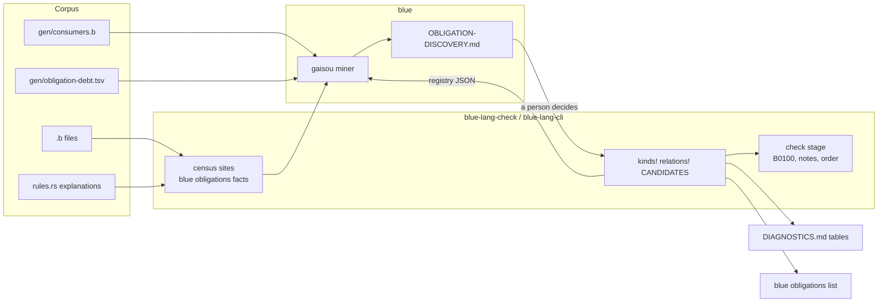
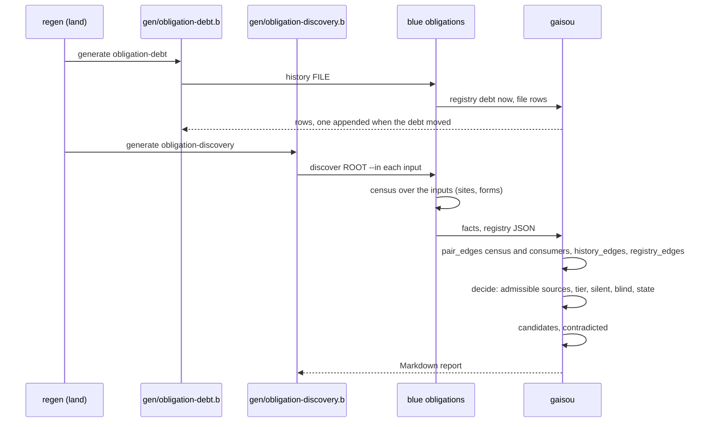

# The obligation graph

Blue's obligation engine (`crates/blue-lang-check/src/obligations.rs`, the
`obligations!` table) says what evidence a structure owes. This document adds
the layer above it: the relations between obligations, discovered from
evidence, and the obligations no row names yet. A discovered pattern becomes a
compiler fact the same way an obligation does: one registry row, configurable
off, rendered into every surface from that row.

The report a discovery run produces is
[OBLIGATION-DISCOVERY.md](OBLIGATION-DISCOVERY.md), generated and gated fresh.

## 1. Destination

Obligations are nodes of a typed graph. Edges are relations with evidence and
a tier. Blue keeps the graph current by itself: every change to the corpus
re-mines it, every edge carries the counts and the denominator that show it,
and nothing the miner finds is enforced until a registry row ratifies it.

The finished shape:

- every relation kind is one row of `kinds!`: the sources that may evidence
  it, the action a ratified edge takes in the check stage, and an `enabled`
  field;
- every decided edge is one row of `relations!`: ratified (a compiler fact),
  rejected (with why, never proposed again) or off (kept, ignored);
- every decided candidate obligation is one row of `CANDIDATES`, and a
  ratified one is a new row of `obligations!`;
- the miner is blue (`bidamas/gaisou`), its thresholds are knobs of a settei
  core model, and its report, the DIAGNOSTICS tables, `blue obligations list`
  and the check stage's behaviour are all read from the same rows;
- the report is byte-stable for a given corpus and fails its fresh check when
  the corpus moves, and a ratified edge the corpus stops showing fails the
  discovery check ("contradicted").

Beyond this change: more sources (heni mutation receipts, `blue test
--coverage` arm data, the git history of fixes paired with the codes they
cleared), more kinds (prerequisite chains, conflicts proven by a fix that
raises its partner on one site), and candidate obligations mined from test
shapes rather than waiver text (section 9).

## 2. Ground: what exists and what this reuses

| piece | where | reused as |
|---|---|---|
| obligation rows, codes B0083–B0099 | `obligations.rs`, `rules.rs` | the nodes; `held` and `ratchet` give each node's debt |
| the census | `blue census`, `crates/blue-lang-cli/src/census.rs` | source `census`: one site per top-level form, the codes it owes (findings and waivers) |
| the consumer sweep | `gen/consumers.b` refused rows | source `consumers`: one site per consumer file; consumer names are dropped at parse time, so the report holds counts only |
| ratchet and held history | git history of `rules.rs` and `obligations.rs` | source `history`: `gen/obligation-debt.tsv`, the debt per code, one row per change |
| rule explanations | `RULES[*].explanation` | source `registry`: a rule that hands a case to another (`… is B0090's`) |
| generate rows, fresh checks | `Bluefile`, `nix/project.nix` | `generate("obligation-debt", …)` and `generate("obligation-discovery", …)` |
| settei core models | `bidamas/settei`, `gen/core-models.b` | `gaisou::settings`, rendered into docs/SETTINGS.md and the settings schema |
| `blue reference` | `crates/blue-lang-cli/src/reference.rs` | `relation_kinds` and `relations` sections, rendered into DIAGNOSTICS.md |

Nothing here is a second checker. The waiver refusal runs where the
obligation waivers are applied (`pipeline.rs`), and the notes are the help
line every door already prints.



## 3. Relation kinds

| kind | direction | sources | evidence it reads | action when ratified |
|---|---|---|---|---|
| `implies` | a to b | census, consumers | at least `min_confidence`% of b's sites also owe a, with `min_support` sites | `order`: on one form a is reported first and b's help says "pay a first" |
| `co-occurs` | both | census, consumers | the sites owing both, over chance, at least `min_lift`% | `note`: the help names the other code and its law |
| `exclusive` | both | registry, census | 0 sites owe both while chance expects `min_expected`; or the registry hands a case of one to the other | `B0100`: a form that waives both is refused, and both waivers are dropped |
| `trades` | a to b | history | `min_support` changes paid a's debt and raised b's | `note` on a |
| `fixed-together` | both | history | `min_support` changes paid both | `note` on either |

A source a kind does not admit cannot evidence it: consumer rows are per file,
so they cannot show that two codes never meet on one form, and the miner drops
such an edge.

## 4. States and the trust model

An edge has a **tier**, from evidence, and a **state**, from the registry.

- `observed`: one source shows it.
- `corroborated`: `min_sources` (2) independent sources show it.
- For each admissible source that does not show it, the report says which:
  `silent` (the source holds both codes and shows no edge) or `blind` (the
  source lacks one of the codes). Absence of evidence is its own state, never
  "no relation".

States: `candidate` (mined, undecided), `ratified`, `rejected` (with why),
`off` (with why). A kind with two or more admissible sources is ratified only
when corroborated (`every_row_joins_two_node_codes_once_with_its_why`); a kind
with one admissible source (`trades`, `fixed-together`) can be ratified at
`observed`, and the row says so.

A ratified edge is checked against every run: when the corpus no longer shows
it, the report lists it under "Contradicted" and `blue obligations discover`
exits 1, so the generate row fails to build.

```mermaid
stateDiagram-v2
  [*] --> candidate: discovery mines an edge
  candidate --> ratified: a relations! row, tier allows
  candidate --> rejected: a relations! row with why
  ratified --> off: State::Off or kind enabled false
  off --> ratified: the row set back
  ratified --> contradicted: the corpus stops showing it
  contradicted --> rejected: the row is changed
  contradicted --> ratified: the corpus shows it again
  rejected --> [*]
```

## 5. Discovery



The run is deterministic: sites, codes and edges are sorted, counts are whole
numbers, and the paths read are exactly the generate row's inputs, so a
checkout run and the nix sandbox run give the same bytes. A generator reached
through the sandbox's symlinked inputs keeps its role (`roles_of` reads the
written path's ancestors before the resolved ones), which the census needs to
see B0085 and B0092 sites.

Commands:

- `blue obligations list [--json]`: the obligation rows, the kinds, the
  decided edges.
- `blue obligations facts [ROOT] [--in DIR]...`: the evidence as JSON lines.
- `blue obligations discover [ROOT] [--in DIR]... [--json] [--check FILE]`:
  the report; `--check` fails when FILE differs or a live row is contradicted.
- `blue obligations history [FILE] [--backfill]`: the debt history, appended,
  or rebuilt from git's first-parent history.

## 6. Settings

`gaisou::settings` is a settei core model (docs/SETTINGS.md): `min_support`
(3), `min_confidence` (90 percent), `min_lift` (300 percent), `min_expected`
(2), `min_sources` (2), `min_waivers` (5), `off` (kinds left unmined). Each is
read through settei, so `GAISOU_MIN_SUPPORT` or `~/.config/gaisou/gaisou.yaml`
changes a local run; the generated report uses the defaults.

## 7. Decisions

| decision | rejected alternative | why |
|---|---|---|
| the miner is a blue bidama, the facts and the check-stage actions are Rust | everything in Rust beside the checker | house style: the statistics are list work blue expresses; the census and the waiver pass already live in Rust |
| ratification is a hand-written row | auto-ratify above a threshold | a threshold is a belief about the corpus; a row is a reviewed decision, and a contradicted row fails the check |
| tiers count independent sources | a confidence score | a score hides which evidence is missing; `silent` and `blind` say it |
| sources are admitted per kind | every source for every kind | a per-file source cannot show a per-form exclusion |
| the history is a committed file, appended by its generator | read git in the generator | the nix sandbox has no git; the backfill is the one git read, and each later row is a function of the committed file and the registry |
| B0100 drops both waivers of an exclusive pair | drop only the one that covers nothing | the waiver set is the refused thing; the form re-states the one it owes |
| notes ride the existing help line | a new diagnostic per relation | a note changes no verdict; a new code per edge would multiply the registry |

## 8. First discovery run (2026-11-14)

Corpus: 15,259 top-level forms in 272 files (`bench`, `bidamas`,
`crates/blue-lang-cli/blue`, `examples`, `gen`, `kernel`, `nix`, `rules`);
49 consumer files with a refused row (names withheld); 86 changes in 97
history rows; 41 registry rules.

Ratified:

- `exclusive(B0090, B0095)`, corroborated: census 0 of 15,259 forms owe both
  where chance expects 2; the registry hands a definition no test calls from
  B0095 to B0090. B0100 now refuses a form that waives both.
- `trades(B0012, B0016)` 18 of 86 changes and `trades(B0015, B0016)` 10 of 86:
  paying an implicit reference or a non-canonical import raises an unused
  import. B0012's and B0015's help now names B0016.
- `fixed-together(B0012, B0015)` 20 of 86, `(B0056, B0057)` 4 of 86,
  `(B0056, B0058)` 4 of 86.
- candidate obligations `B0056` and `B0057` (unregistered debt, related to
  obligations): now the rows `doc/definition` and `doc/example`.

Rejected:

- `exclusive(B0056, B0085)` and `exclusive(B0085, B0090)`: population, not
  law. B0085 judges a generate program's first form, never a bidama
  definition.
- recurring waivers of B0083 (94), B0084 (22), B0085 (29): one template
  written the day the obligation landed; bulk debt, not a pattern.

Left as candidates (one source, the kind needs two): `implies(B0090, B0096)`
and `implies(B0056, B0096)` (6 of 6), `co-occurs(B0083, B0090)` (66 forms,
3x chance), `co-occurs(B0090, B0098)` (14, 3x), `exclusive(B0056, B0057)`
(expected 88, observed 0; the registry is silent), `exclusive(B0089, B0093)`
(registry only; the census is blind, B0089 has no sites).

## 9. Open questions

| question | kind |
|---|---|
| census-only codes (B0090, B0056, B0096) can never reach a second source for `implies` and `co-occurs`, since consumer rows hold only refused codes | ours: the consumer sweep could record ratcheted findings too |
| `exclusive(B0056, B0057)` is a staged obligation (no doc, then a doc with no example), not two exclusive ones | ours: a `stages` kind with the order a fix walks |
| candidate obligations from test shapes (a construct whose tests always take one form) | ours: needs a test-shape fact from the census |
| heni receipts and `blue test --coverage` arms as sources | ours: both are files the miner can read |
| a consumer's private rows cannot enter this public report except as counts | world fact: the repository is public |
| the nix sandbox has no git, so history is recorded, not re-read | world fact |

## 10. Phases

| phase | content | state |
|---|---|---|
| G1 | this document; relation registry, B0100, notes and order; `blue obligations` list, facts, discover, history; gaisou; both generate rows; settings; DIAGNOSTICS tables; first run decided | built |
| G2 | consumer sweep records ratcheted findings, so census-only edges can corroborate | design |
| G3 | heni receipts and coverage arms as sources; `stages` kind | design |
| G4 | candidate obligations from test shapes | design |

## 11. Tier ledger

| claim | tier |
|---|---|
| a ratified exclusive pair waived on one form is refused (B0100) | compile-time refusal, witness in RULES, unit tests red-then-green |
| a ratified note or order shows on every door that checks tests | enforced by the check stage, unit tests |
| the report is stale when the corpus moves | CI-caught: `checks.generated-obligation-discovery-fresh` |
| the debt history is current | CI-caught: `checks.generated-obligation-debt-fresh` |
| a ratified edge the corpus stops showing | CI-caught: discovery exits 1, so `packages.generated-obligation-discovery` fails to build; listed under Contradicted |
| a kind with two sources ratified on one | caught by a unit test over the rows |
| a ratified edge is true of code not yet written | belief: the tier is evidence about this corpus only |
