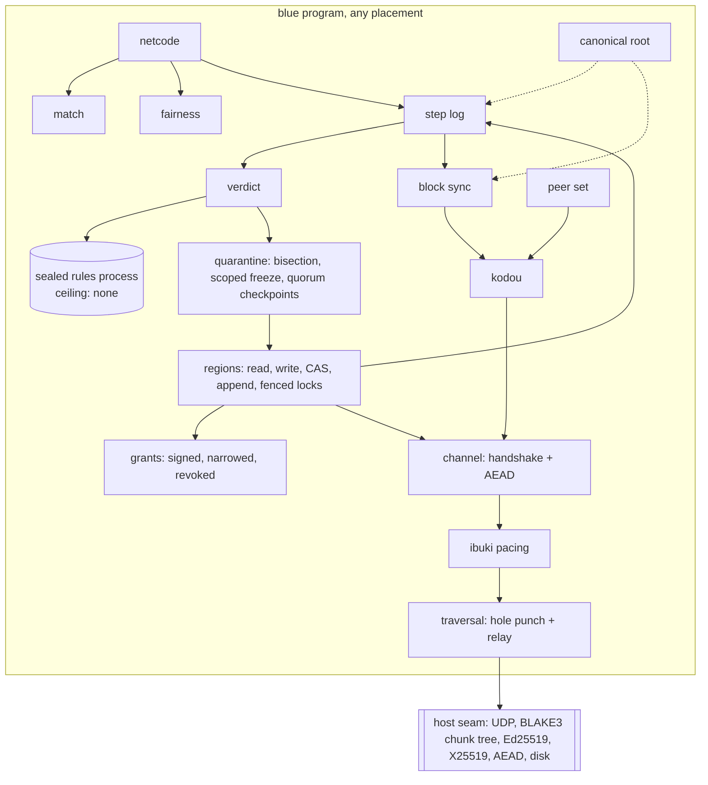
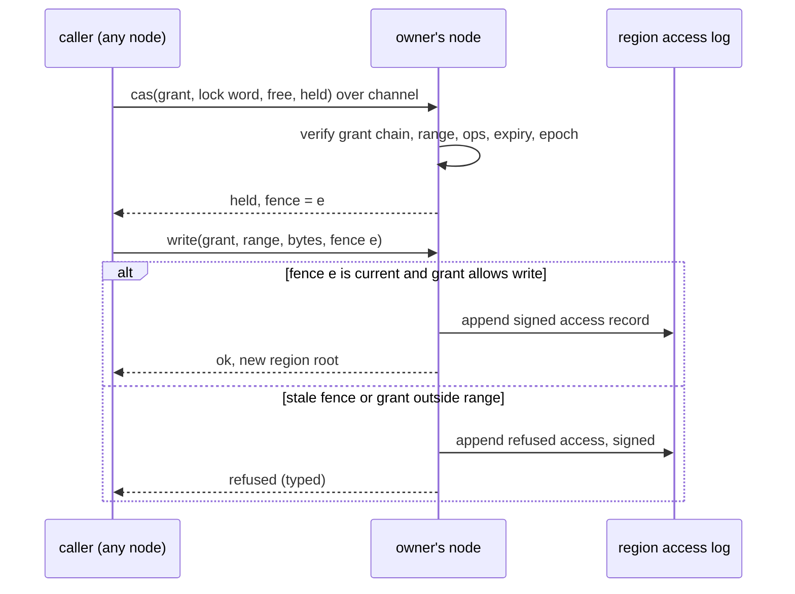
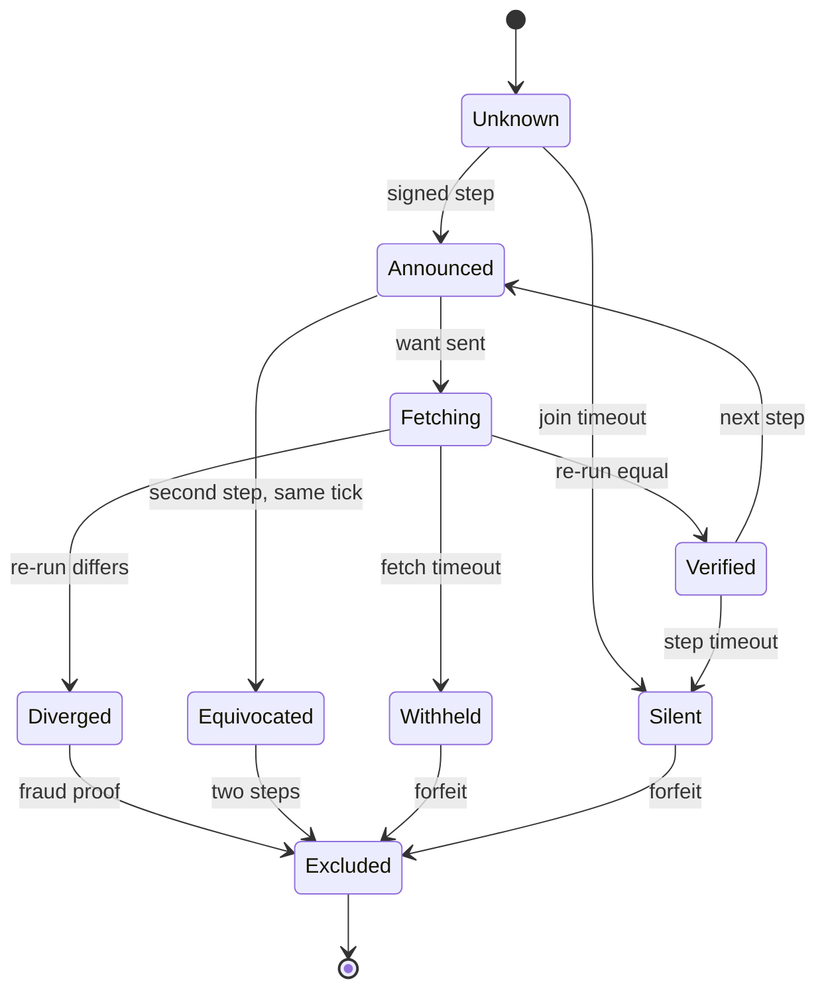

# P2P: a zero-server peer network in blue, and a game platform on it

Status: DESIGN, 2026-11-09, revised after an independent review the same day.
Owner of the design: this file. It refines [`SUBSTRATE.md`](SUBSTRATE.md)
layer 3 (phases L3.1 and L3.2) and the ibuki plane (`bidamas/ibuki`).
The tier ledger at the end is the only place a status is claimed.

## 1. Destination

Peers run blue programs that agree on shared state with no server. Every state
change is a pure blue transition `(state, input) -> state`. A peer signs its
step, runs the transition, and announces the new root. Other peers fetch only
the blocks they lack, verify each block against the root, re-run the
transition, and exclude a peer whose root does not match, with a signed proof.
The network is a set of separate blue libraries (bidamas). Any blue program
embeds them, on any placement: CLI, node service, WebAssembly component, mado
desktop, asobi mobile. A game is one consumer. The Aqui neighbourhood map mesh
and local-first apps are others.

**Blue is the platform, not a guest.** The protocols, gossip, pacing (LEDBAT is
already blue, `bidamas/ibuki`), block sync, the signed step log, matches,
commit-reveal, netcode and re-execution checks are blue. The rules of one game
run as a sealed blue process that a blue node spawns with an empty capability
ceiling ("blue hosts blue"). Rust supplies only what blue cannot: the
interpreter, the UDP socket, and primitives (BLAKE3 and its chunk tree, Ed25519,
X25519, an AEAD, disk bytes). When blue hosts its own
interpreter, the interpreter moves up the ladder too.

**Memory is a capability too.** A process registers a region of its state and
hands out grants: unforgeable, signed, narrowable, revocable rights to read,
write, compare-and-swap or append a byte range. The same grant works between two
processes on one machine and between peers across the network, with RDMA's
one-sided semantics and without RDMA's weak keys. Locks are fenced leases on a
region. This is the one abstraction under the game state, engenho's shared
cluster state and the Aqui mesh.

**Freeze only what was tampered with (operator ruling, 2026-11-09).** The system
is tamper-evident (every alteration changes a root), tamper-attributable (the
proof names the signer), and fault-scoped (a mismatch freezes the smallest unit
Merkle bisection can name: one region, one match or one peer). Everything else
keeps running. A rule that froze the whole network on any mismatch would hand
every attacker a stop button.

**Operator direction, 2026-11-09.** Every fleet node runs engenho in one
cluster, networked through these libraries; cluster state is shared with
eventual consistency and fenced locks. WASM/WASI with tatara-lisp and blue runs
on every platform, and blue goes to bare metal everywhere (BLUE-NATIVE). The
first consumer is Aqui, a P2P iPhone game; engenho nodes serve it as relays,
bootstrap peers and archivists.

World-facts that limit the design:

- **W1 NAT.** Direct connection succeeds in about 70% (libp2p DCUtR
  measurement, https://arxiv.org/abs/2604.12484) to 90% (iroh,
  https://docs.iroh.computer/concepts/holepunching) of setups. A zero-server
  network still needs a relay that any peer can run.
- **W2 Full state.** In lockstep and rollback every peer holds the whole state,
  so hidden information leaks to a modified client. Only commit-reveal (or
  mental poker) hides state, and only where a game is built around it.
- **W3 Determinism.** Re-execution proves nothing unless every peer computes the
  same bytes. Platform libm floats (`sin`, `cos`, `powf`), allocator byte
  counts and compiler instruction counts all differ between machines today.
- **W4 Last revealer.** In commit-reveal the last peer to reveal can abort after
  seeing the rest. Only a timeout with forfeit, and never a re-roll, bounds it.
- **W5 Two parties.** With two peers, a disagreement cannot say who lied: each
  holds a proof against the other. Arbitration needs a third verifier.
- **W6 Free keys.** A key costs nothing, so an open network faces sybil and
  eclipse attacks. Invite-only rosters avoid them; open lobbies need more.
- **W7 No absolute security.** Guarantees stop at the host OS, side channels and
  hardware. Hardware memory protection needs BLUE-NATIVE images and, at best,
  CHERI-class hardware. A bug in the rules is consistent, not absent. A device
  can read its own memory. A colluding quorum can sign a false checkpoint.
- **W8 RDMA hardware.** Real one-sided access without the remote CPU needs
  RoCE or InfiniBand NICs. Over ordinary networks the owner's node serves each
  operation, as eRPC does (https://www.usenix.org/conference/nsdi19/presentation/kalia).
- **W9 iPhone.** iOS limits UDP in the background, cellular networks sit behind
  carrier NAT, and App Store guideline 2.5.2 forbids downloading executable
  code, so Aqui's rules ship inside the app. Nearby phones can use Apple's local
  peer-to-peer networking as one more transport.

## 2. Ground: what exists today

Measured 2026-11-09 against blue main, tameshi and kensa. Paths are in blue
unless named. Rows marked "branch" are on an unlanded branch, not on main.

| Need | State | Where |
|---|---|---|
| UDP wire, MTU 1280, Flash token bucket, Tide ring | TESTED (Rust holds only the bucket and the ring) | `crates/blue-lang-runtime/src/wire/mod.rs` |
| LEDBAT pacing, Tide and Flash protocol words | TESTED, in blue | `bidamas/ibuki/ibuki.b` |
| announce / want / part / ack | TESTED, crash proofs only, explicit `host:port` peers, unauthenticated | `bidamas/kodou/kodou.b` |
| capability ceiling per process; a breach is fatal | TESTED | `crates/blue-lang-waku/src/capability.rs` |
| stepped clock, seeded entropy, loopback wire | TESTED | `crates/blue-lang-waku/src/provision.rs`, `runtime/src/provide.rs` |
| blue process under a frame ("blue hosts blue") | TESTED | `examples/docking`, `crates/blue-lang-proc/src/code.rs` (`spawn_code`) |
| two-party frame: the meet of two ceilings | TESTED as pure words; runtime rendezvous DESIGN | `bidamas/ibuki/ibuki.b` (`airlock_frame`) |
| moving a server and its state over Tide | TESTED | `crates/blue-lang-proc/src/node.rs` (`evict`, `accept`) |
| receipts naming `input_root` and `output_root` | TESTED, unsigned, `spawn_server` only | `crates/blue-lang-proc/src/receipt.rs` |
| `state_root` of a value | EXISTS but lossy: Str, Symbol and Keyword collapse; closures, NaN and Inf become null; Int and Str map keys collide | `crates/blue-lang-runtime/src/json.rs` |
| a second root: Merkle over Strand entries | TESTED, differs from the receipt root | `bidamas/ibuki/ibuki.b` (`state_root`) |
| `blue replay` of a crash trace | TESTED; not a `(state, input)` re-run | `crates/blue-lang-cli/src/replay.rs` |
| record and replay of any run, `net_wait` | branch `h4/replay-net-wait` | not on main |
| signed, hash-chained event log with replay into states | TESTED (22 tests) | `bidamas/isshou/nisshi` |
| Ed25519, Merkle, CT-style roots and proofs, hash chains | TESTED, in blue | `bidamas/shomei` |
| threshold signing (FROST, RFC 9591) | TESTED | tameshi `src/threshold/`, blue `fuuin` |
| last-writer-wins CRDT with roots and a step chain | TESTED; `written` accepts only `:put` and `:merge` | `bidamas/ibuki/ibuki.b` (Strand) |
| append-only storage | TESTED | `crates/blue-lang-runtime/src/storage.rs` (`append_log`, `read_log`) |
| block store keyed by hash | ABSENT (the mondou memo store is keyed per blue version) | `crates/blue-lang-mondou/src/store.rs` |
| X25519, AEAD | ABSENT from the host seam | `crates/blue-lang-runtime/src/crypto.rs` |
| peer set, discovery, NAT traversal, relay | ABSENT | none |
| matches, commit-reveal, lockstep, rollback | ABSENT | none |
| closed capability set, `Reach` meet, breach | TESTED, static name-level grants | `crates/blue-lang-waku/src/capability.rs`, `waku/src/lib.rs` (`Reach`) |
| capabilities as values: pass, narrow, revoke | DESIGN (HORIZON H15) | `docs/HORIZON.md` §H15 |
| a frame per bidama | DESIGN (H13); one frame per interpreter today | `docs/HORIZON.md` §H13, `runtime/src/lib.rs` (`Hold`) |
| live-byte accounting; bounds that only narrow | TESTED | `runtime/src/memory.rs`, `ExecutionBounds::meet` |
| processes share nothing; messages deep-copied | TESTED, doctrine | `crates/blue-lang-proc/src/mailbox.rs`, `docs/HORIZON.md` (isolation by immutability) |
| zero-copy ownership move | DESIGN, the variant only | `crates/blue-lang-bidama/src/beam.rs` (`Payload::LinearMove`) |
| regions, shared memory, CAS, leases, signed grants | ABSENT | none |

Corrections to the model this design started from: tameshi is an evidence and
attestation library, not a state engine; kensa admits deployments and does not
verify peers; no Fjall or RocksDB store exists; ibuki is the wire, pacing and the
Strand, not yet a gossip mesh. tameshi's `encrypted_chain.rs` is a home-made
BLAKE3 keystream and is not reused.

## 3. Research

| Prior art | Verdict | Why, for a blue platform |
|---|---|---|
| BLAKE3 verified streaming (Bao, iroh-blobs) | adapt | Verify each fetched range against the root. Blue implements the protocol; Rust exposes the chunk-tree primitive. https://github.com/oconnor663/bao |
| HyParView + Plumtree (iroh-gossip) | adapt, later | Partial views and a lazy-repair tree, in blue over kodou, for open lobbies. https://github.com/n0-computer/iroh-gossip |
| SWIM | adapt | Liveness for small rosters. https://www.cs.cornell.edu/projects/Quicksilver/public_pdfs/SWIM.pdf |
| Noise handshakes | adopt the pattern | Mutual authentication from static keys, then AEAD frames. https://noiseprotocol.org/noise.html |
| UDP hole punching with relay fallback (iroh, DCUtR) | adapt | The relay is a blue service any peer can run. https://github.com/libp2p/specs/blob/master/relay/DCUtR.md |
| GGPO / GGRS rollback | adapt | Input delay, prediction window (0 = lockstep), save/load/advance, checksum desync, local sync test, as a blue bidama. https://github.com/gschup/ggrs |
| Lockstep (Age of Empires) | adopt the model | https://www.gamedeveloper.com/programming/1500-archers-on-a-28-8-network-programming-in-age-of-empires-and-beyond |
| Commit-reveal with forfeit | adopt | Simultaneous moves and shared seeds; an abort forfeits, never re-rolls. |
| ECVRF (RFC 9381) | adapt | One-party verifiable draws. https://www.rfc-editor.org/rfc/rfc9381.html |
| Willow data model | adapt for persistent worlds | https://willowprotocol.org/ |
| Automerge, Loro | skip for rules | A CRDT merge accepts any write; rule-bound moves need a validated log. |
| wasmtime deterministic settings | adopt for the component placement | https://docs.wasmtime.dev/examples-deterministic-wasm-execution.html |
| iroh, libp2p, Hypercore as libraries | rejected | Their protocol logic lives in Rust or JavaScript and does not embed in a blue program on every placement. |
| RDMA memory regions and rkeys | adapt the shape, reject the key | Register a region, get a handle. An rkey is a guessable 32-bit bearer token (ReDMArk, https://www.usenix.org/conference/usenixsecurity21/presentation/rothenberger); the handle here is a signed grant. |
| RDMA memory windows | adopt the concept | A sub-range bound to one peer, with an epoch a rebind moves: the revocation primitive. https://man7.org/linux/man-pages/man3/ibv_alloc_mw.3.html |
| FaRM lock-and-version word | adapt | One word holds lock bit, version and fencing epoch; reads validate by version. https://pdos.csail.mit.edu/6.824/papers/farm-2015.pdf |
| seL4 untyped memory, Revoke | adopt the model | Regions retyped from a budget; revoking a grant revokes everything derived from it. https://sel4.systems/Info/Docs/seL4-manual-latest.pdf |
| CHERI bounds and monotonic narrowing | adapt as blue types | No hardware dependency. https://www.cl.cam.ac.uk/techreports/UCAM-CL-TR-987.pdf |
| Cap'n Proto capabilities | adopt the model | Capabilities as values in messages, promise pipelining, three-party handoff. https://capnproto.org/rpc.html |
| Biscuit | adopt the shape | Public-key verification, offline narrowing, revocation IDs. https://doc.biscuitsec.org/reference/specifications |
| Meadowcap area algebra | adopt | (range, mode, time) narrowing maps onto (byte range, operations, expiry). https://willowprotocol.org/specs/meadowcap/ |
| Macaroons | adapt for the hot path | HMAC chains between peers that already share a key. |
| Fencing tokens | adopt, required | A lease carries an epoch that only increases; the region refuses an older one. https://martin.kleppmann.com/2016/02/08/how-to-do-distributed-locking.html |
| Certificate Transparency witnesses | adopt | Gossiped signed heads defeat a split view. https://www.rfc-editor.org/rfc/rfc9162 |
| Optimistic-rollup bisection | adapt | Narrow a dispute to one step before re-running it. |
| Soft-RoCE, UCAN as dependencies | skip | Hardware keys never become authority; UCAN brings DID and JWT weight. |

## 4. The libraries

Each is its own bidama with its own Bluefile and tests, and no game words. A
library marked (new) gets its name from the `naming` skill before it is minted;
the words `link`, `reach` and `session` are already taken (`kodou::link`,
`ibuki::reach`, `runtime/src/session.rs`).

| Library | Owns | Extends |
|---|---|---|
| host seam (Rust) | UDP datagrams, `net_wait`, BLAKE3 chunk tree, Ed25519, X25519, an AEAD, disk bytes | `runtime/src/wire`, `runtime/src/crypto.rs`, H4 |
| canonical root (new) | one type-tagged encoding of a blue value and its root; a value with no encoding is refused | replaces the lossy `json::state_root` for this use; ibuki's root adopts it |
| ibuki | Tide and Flash pacing (blue LEDBAT) | `bidamas/ibuki` |
| kodou | announce / want / part / ack for any root, only behind an authenticated channel; part size derived from the layers below | `bidamas/kodou` |
| channel (new) | Noise-pattern handshake from shomei keys, AEAD frames, address validation | shomei, host X25519 and AEAD |
| peer set (new) | fixed rosters first; SWIM liveness; HyParView topics later | kodou |
| traversal (new) | hole punching, a relay protocol with quotas, the relay service | channel |
| block sync (new) | blocks keyed by root, verified range fetch, persisted through append storage | `runtime/src/storage.rs`, host chunk tree |
| step log | per-peer signed steps: match id, tick, `def_hash`, engine identity, previous head, inputs, R, R′ | `bidamas/isshou/nisshi` |
| verdict (new) | re-execution check; signed fraud and equivocation proofs scoped to (match, peer) | step log, sealed rules process |
| match (new) | roster, the two-party frame, agreed seed, timeouts | `ibuki::airlock_frame` |
| fairness (new) | commit-reveal rounds with forfeit; ECVRF draws | shomei |
| netcode (new) | lockstep and rollback over a sealed rules process | match, step log |
| grants (new) | capability values: issue, narrow, pass in messages, revoke by derivation and epoch; signed form for the wire | waku `Capability` and `Reach`, HORIZON H15, shomei |
| regions (new) | register a region from a byte budget; serve read, write, CAS and append ranges under a grant; fenced leases; access log | the live-byte account, `ExecutionBounds::meet`, mailbox copy boundary, step log |
| quarantine (new) | Merkle bisection of a mismatch to the smallest unit; freeze that unit only; quorum checkpoints | canonical root, step log, tameshi FROST |

A consumer takes only what it uses: a map mesh takes channel, peer set, block
sync and step log; a game adds match, fairness and netcode.

## 5. States and trust

**Trust model.** A peer is its Ed25519 key. A peer may say one thing: "in match
M, at tick t, after head H, with engine E running rules D, inputs I take root R
to root R′", signed. Inputs in one tick are ordered by the signing key. No peer
computes for another; every claim is re-run. A relay sees only AEAD ciphertext.

**Determinism.** The rules process runs under a determinism position: the
checker refuses platform float words in rules code (fixed-point words instead),
the step names the engine identity (blue version and bounds), and a run that
exhausts its budget is a reported mismatch, never fraud. Peers on different
engine identities do not judge each other.

States of one peer's view of another, in a match:

| State | Meaning | Exit |
|---|---|---|
| Unknown | no step yet | Announced, or Silent at the join timeout |
| Announced | a signed step seen, blocks missing | Fetching |
| Fetching | blocks arriving, each verified against R′ | Verified, Diverged, or Withheld at the fetch timeout |
| Verified | blocks complete, re-run root equal | Announced on the next step, Silent at the step timeout |
| Diverged | re-run root differs | Excluded, with a signed fraud proof |
| Equivocated | two signed steps for one tick with different roots | Excluded; the two steps are the proof, no re-run needed |
| Withheld | announced blocks not served in time | Excluded by forfeit |
| Silent | no step within the timeout | Excluded by forfeit |
| Excluded | proof or forfeit recorded for (match, peer) | final for this match only |

Bad states refused, each scoped to the fault:

- An unsigned step, or one without a match id and previous head, has no
  constructor in the step log, so an old or foreign step cannot be replayed.
- A block whose hash differs from its address is refused alone.
- A fraud proof is verified before it is gossiped, and it excludes one peer from
  one match. It never names a `def_hash`, so it cannot refuse the game for
  everyone.
- With two peers, a disagreement ends the match for both (W5). A match of three
  or more excludes the peer the others' re-runs agree against.

## 5a. Memory regions and grants

**Doctrine kept.** Blue's processes share nothing; mutable state lives in a
process and is reached only by message. A region keeps that rule. The owning
process registers it; the owner's node serves each operation as a message
against the region, checks the grant, and never runs the owner's program code.
So the access is one-sided for the caller (RDMA's property) and still a message
(blue's property). The same path serves a process on the same machine and a peer
over the channel.

**A grant** names: region id, byte range, operations (a subset of read, write,
cas, append), expiry, the region's epoch at issue, and a derivation chain. Each
step of the chain is signed (shomei Ed25519) and may only narrow range,
operations and expiry (Meadowcap's algebra; Biscuit's offline narrowing). On one
machine a grant is an unforgeable runtime value that the mailbox passes by
reference and never copies; across the network it is the signed chain. A grant
whose chain widens anything has no constructor.

**Operations.** `read(grant, range)`, `write(grant, range, bytes, fence)`,
`cas(grant, offset, expected, new, fence)`, `append(grant, bytes, fence)`.
Each one is checked against the grant, the region's bounds and the current
epoch, then recorded in the region's access log, which is a step log, so a
forged or out-of-range access is both refused and visible.

**Revocation.** Three ways, cheapest first: expiry; revoking one grant revokes
everything derived from it (seL4's derivation tree); moving the region's epoch
fails every grant issued before it (an RDMA memory-window rebind).

**Locks.** A lock is a CAS on one word holding lock bit, version and fencing
epoch (FaRM's layout). Taking it returns the epoch; every later write must carry
it, and the region refuses an older one. A lease that expires during a pause
therefore cannot corrupt the region (Kleppmann's fencing).

**Accounting.** A region is charged to the owner's live-byte account and can
only be carved from what the owner's frame allows, as `ExecutionBounds::meet`
narrows bounds today.

States of a region:

| State | Meaning |
|---|---|
| Registered | carved from the owner's budget, epoch 0, no grants |
| Granted | at least one live grant |
| Locked | a fenced lease is held |
| Frozen | a mismatch or a forbidden access was proven here; reads still served, writes refused, other regions unaffected |
| Revoked | epoch moved; older grants fail |
| Released | the owner freed it; every grant fails; bytes returned to the budget |

## 5b. Security patterns

Every pattern below freezes at most the unit it names.

| Pattern | Stops | Built from |
|---|---|---|
| Signed, hash-linked step log per peer | rewriting history, replaying old steps | step log |
| Equivocation proof | different views shown to different peers | two signed steps for one tick |
| Deterministic re-execution | a false state or an illegal move | verdict, sealed rules |
| Merkle bisection | a costly dispute: it shrinks to one step and one subtree | canonical root, quarantine |
| Fault-scoped freeze | one tamperer halting everyone | quarantine |
| Quorum checkpoints (k-of-n FROST) | a lone peer finalizing state; the rollback point for recovery | tameshi threshold, quarantine |
| Witness gossip of signed heads | a split view fed to one peer | kodou, CT-style witnesses |
| Code identity by `def_hash` | modified rules | match, sealed rules |
| Commit-reveal, VRF | rigged randomness, peeking at simultaneous moves | fairness |
| Grants on every region, access log | reading or writing state not granted | grants, regions |
| Owned cells | some hidden information beyond lockstep: a peer holds its cell, others get proofs | regions |
| App Attest on iPhone | modified clients joining; raises the bar only | the iOS placement |

## 6. Diagrams

Context: the libraries and the one host seam.



Main flow: one step, from input to a verified root on another peer.

```mermaid
sequenceDiagram
  participant A as peer A
  participant RA as A's sealed rules
  participant B as peer B
  participant RB as B's sealed rules
  A->>RA: state at R, inputs of tick t (ordered by key)
  RA-->>A: state at R'
  A->>A: sign {M, t, head H, engine E, rules D, I, R, R'}; append
  A->>B: announce R' (kodou over channel, Flash)
  B->>A: want missing blocks (Tide)
  A-->>B: parts, each verified against R'
  B->>RB: state at R, same inputs
  RB-->>B: state at R''
  alt R'' == R'
    B->>B: Verified
  else R'' != R'
    B->>B: signed fraud proof for (M, A); verified, then gossiped
  end
```

A fenced write to a remote region.



Lifecycle of one peer, as another peer sees it.



## 7. Decisions

| Decision | Chosen | Rejected, and why |
|---|---|---|
| Where protocol logic lives | blue bidamas | a Rust host with a blue guest: it would not embed in a blue program on every placement, and the house ladder puts it in blue |
| Transport | the existing wire plus blue protocols | iroh or libp2p as libraries: Rust-side protocol logic; QUIC brings TLS where a blue Noise-pattern handshake fits |
| Rules isolation | a blue process with an empty ceiling | a wasm sandbox per game: a second boundary blue already provides |
| State identity | one type-tagged canonical encoding and root | the JSON `state_root`: lossy, two states can share a root |
| Step log | extend `isshou/nisshi` | a new chain beside it |
| Anti-cheat | re-execution, signed fraud and equivocation proofs scoped to (match, peer) | kensa immunity entries: keyed by `def_hash`, unsigned, global |
| Floats in rules | refused by a check position; fixed-point words | platform libm: peers diverge |
| Two-player disputes | both lose the match | a referee peer: one peer becomes a server |
| Hidden information | commit-reveal per game design | none is possible in lockstep (W2) |
| Shared mutable memory | regions owned by a process, served by its node per grant | true shared memory between processes: breaks "share nothing" and blue's aliasing question is still open |
| Remote access key | signed, narrowable grants with epochs | RDMA rkeys: guessable bearer tokens with no cryptography |
| Response to tampering | freeze the smallest proven unit | freeze everything: a stop button for any attacker |

## 8. Open questions

| Question | Kind |
|---|---|
| Which AEAD (ChaCha20-Poly1305 or AES-GCM) and Noise pattern (IK or XX) | ours |
| Block size, and how a blue value maps onto blocks | ours |
| The type tags and order rules of the canonical encoding | ours |
| Relay quotas and who runs relays | ours |
| Sybil and eclipse resistance for open lobbies (W6) | ours, after invite-only rosters |
| Share of target home networks behind symmetric NAT | world-fact, to measure |
| Mobile limits on holding a UDP socket in the background (asobi) | world-fact |
| The time source for lease expiry across peers with skewed clocks | ours; the wall-clock bound is still DESIGN in the ibuki plane |
| Quorum size per match and per cluster | ours |
| The platform's name | ours, through the `naming` skill |
| Real RDMA NICs as an optional backend behind the same grant check | ours, later |

## 9. Phases

Each phase ends green and moves its ledger rows. Names marked (new) are minted
through the `naming` skill in the phase that builds them.

- **P0 Seam and root.** Host X25519, an AEAD and the BLAKE3 chunk tree as host
  words; the canonical encoding and root in blue, with a red run showing two
  different values never share a root. `net_wait` and record/replay land (H4).
- **P1 Channel and sync.** The handshake and AEAD frames; kodou for any root,
  only behind the channel, part size derived from the layers; block sync with
  verified fetch over append storage; a fixed roster. Gate: two peers on the
  tailnet sync a value by root, and a tampered block is refused alone.
- **P2 Grants and local regions.** Capability values (HORIZON H15) and a frame
  per bidama (H13); regions registered from the owner's byte budget, served on
  one machine under a grant; fenced CAS locks; the access log. Gate: a process
  reads and CASes another process's region only within its grant; a narrowed
  grant cannot widen; a stale fence and a revoked grant are refused; a refused
  access is in the log.
- **P3 Steps, verdict, quarantine.** The signed step log over nisshi; spawning
  the sealed rules process with a determinism position; re-execution; fraud and
  equivocation proofs; Merkle bisection; the fault-scoped freeze. Gate: in a
  fixed roster of three, a peer that lies about one root is excluded with a
  proof, only the region it touched freezes, and the other regions keep
  accepting writes.
- **P4 Remote regions and checkpoints.** Signed grants over the channel; remote
  read, write, CAS and append on the Flash lane; quorum checkpoints with FROST;
  witness gossip of heads. Gate: engenho nodes on the tailnet share one region
  with a fenced lock; a node that loses its lease cannot write; a split view is
  caught by a witness.
- **P5 Match, fairness, netcode.** The roster and two-party frame at run time,
  agreed seed by commit-reveal with forfeit, lockstep (prediction window 0).
  Gate: a two-player Aqui turn-based match between two iPhones on one network,
  replayable from its logs.
- **P6 Traversal.** Hole punching, Apple local peer-to-peer as a transport, and
  a blue relay service with quotas run on engenho nodes. Gate: two phones on
  different networks connect, directly or through a relay.
- **P7 Rollback and open play.** Prediction and resimulation, gossip topics for
  lobbies with sybil resistance, persistent worlds, real RDMA as an optional
  backend.

## 10. Tier ledger

| Item | Design | Exists | Tested | Live |
|---|---|---|---|---|
| wire, bucket, ring | ✅ | ✅ | ✅ | ❌ |
| ibuki pacing (LEDBAT) | ✅ | ✅ | ✅ | ❌ |
| `net_wait`, record and replay of any run | ✅ | branch | branch | ❌ |
| host X25519, AEAD, chunk tree | ✅ | ❌ | ❌ | ❌ |
| canonical root | ✅ | ❌ (lossy JSON root only) | ❌ | ❌ |
| kodou for any root, authenticated | ✅ | crash proofs, unauthenticated | crash proofs | ❌ |
| channel | ✅ | ❌ | ❌ | ❌ |
| peer set | ✅ | ❌ | ❌ | ❌ |
| block sync | ✅ | append storage only | append storage | ❌ |
| step log | ✅ | nisshi, unsigned receipts | nisshi | ❌ |
| verdict (re-execution, proofs) | ✅ | ❌ | ❌ | ❌ |
| match, fairness, netcode | ✅ | two-party frame words | two-party frame words | ❌ |
| traversal | ✅ | ❌ | ❌ | ❌ |
| grants (capability values) | ✅ | static name-level grants | static grants | ❌ |
| regions, fenced locks, access log | ✅ | ❌ | ❌ | ❌ |
| quarantine (bisection, fault-scoped freeze, quorum checkpoints) | ✅ | FROST in tameshi | FROST | ❌ |
