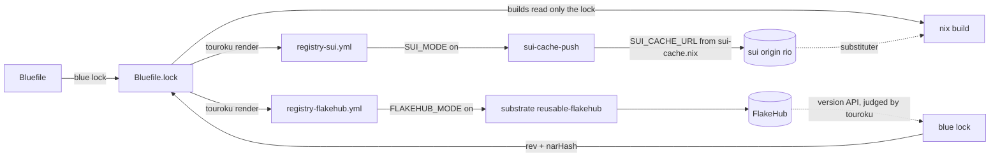

# Registry

A registry publishes a blue project and resolves it for other projects. In
blue, a registry is never the source of truth. The Bluefile and
`Bluefile.lock` are the truth. Each registry backend is a rendering of them,
and each backend is configured off on its own.

The judge is the `touroku` (登録, registry) bidama. It runs under the pure
rule frame, so it cannot reach the host. Rust carries bytes in and out:
`crates/blue-lang-pkg/src/registry.rs` (the judge door and the `FlakeHub`
seam), `crates/blue-lang-pkg/src/lock.rs` (`lock_with`), and
`crates/blue-lang-cli/src/registry.rs` (`blue registry`, the curl seam).

## Destination

One declaration publishes a project to every backend that the fleet uses,
and one lock resolves it from any of them. A backend that is down never
changes a build and never turns a pipeline red. The destination has four
backends:

| backend | role | state |
|---|---|---|
| `sui` | the fleet cache plane: the closure of each output, signed with the fleet uploader key | ✅ built (publish); ✅ `blue registry status` (resolve check) |
| `flakehub` | an optional public semver index and FlakeHub's cache | ✅ built (publish, resolve); off by default |
| `porto` | the fleet OCI registry (`sui/sui-registry`, binary `porto`) | ➖ row: refused as `not_built` |
| `github` | GitHub releases | ➖ row: refused as `not_built` |

## Decisions

1. **The lock is the truth; a backend is a rendering.** Rejected: FlakeHub
   (or sui) as the resolver of record. A backend has outages (FlakeHub auth
   has answered 401 since 2026-07-18), so a build that asks it can fail for a
   reason outside the project.
2. **One word, `registry(backend, spec)`, one entry per backend.** It has the
   shape of `image`, `workload` and `service`. Rejected: a field on
   `package`. `package` holds identity, and a backend list there cannot be
   configured off entry by entry.
3. **Visibility is declared once, in `package(name, version, visibility)`.**
   The values are `public`, `unlisted` and `private`. An undeclared
   visibility reads as `private`. A registry spec that names `visibility` is
   refused, so the value is never set twice. Each backend renders the
   package's value and no other. A private package therefore cannot render
   with public visibility. The products-private / patterns-public rule
   (blackmatter-pleme `doctrine-index.md`) lives in this same field: a
   `kensa_*` product package declares `:private`, and a pattern bidama
   declares `:public`. Rejected: a visibility on each registry entry (two
   places can disagree), and a default of public (an omission would publish).
4. **sui is the primary backend.** It is the only fleet cache plane (attic was
   retired 2026-07-31). Publishing renders a workflow that builds each output
   with `pleme-io/actions/nix-build` and pushes its closure with
   `pleme-io/actions/sui-cache-push`. The rendering names no origin and no
   key. The runner host exports `SUI_CACHE_URL` and
   `SUI_CACHE_SIGNING_KEY_FILE`, which pleme-io/nix
   `modules/pleme/nixos/github-runners.nix` derives from
   `lib/sui-cache.nix` (`origins.rio`, `uploaders.ci`). So the one typed
   source stays the only source. Rejected: a hostname or a key in the
   Bluefile, or in the rendered workflow.
5. **FlakeHub is an optional index, behind the reusable workflow.** The
   rendering calls `pleme-io/substrate/.github/workflows/reusable-flakehub.yml`,
   which runs only when the repo variable `FLAKEHUB_MODE` is `on`. Rejected: a
   second FlakeHub job written by blue. The reusable is the one place the
   publish logic lives.
6. **The private path stays the git source.** A private bidama is a `source`
   over SSH, pinned in the lock and fetched with the org's git credentials.
   Private FlakeHub is one optional backend, off by default. It adds only a
   semver index and FlakeHub's cache. The trade-off: FlakeHub private needs a
   paid org plan and a FlakeHub credential on every consumer, and the git
   path needs neither.
7. **The judgment is blue; the bytes are Rust.** `touroku` judges entries,
   renders workflows, reads a FlakeHub answer and reads a sui probe. Rust only
   runs `curl`, `nix flake prefetch` and `nix path-info`. Rejected: the
   judgment in Rust beside `deploy::image_of`.

## The entry

```ruby
package("blue-repository", "1.0.0", :public)

registry(:sui, {outputs: ["default"]})
registry(:flakehub, {tag: :rolling})
```

| backend | field | meaning | default |
|---|---|---|---|
| both | `enabled` | `false` keeps the entry declared and renders its job with `if: false` | `true` |
| both | `output` | the committed workflow file | `.github/workflows/registry-<backend>.yml` (set by the `registry` word) |
| `sui` | `outputs` | the flake packages whose closures sui serves | required |
| `flakehub` | `tag` | `:rolling` (each push to `main`) or `:semver` (each `v*` tag) | `:rolling` |
| `flakehub` | `directory` | the flake directory | `"."` |
| `flakehub` | `plan` | `:free` or `:paid`; a private package needs `:paid` | `:free` |

Each entry is judged alone. A bad entry is refused with a kind (`invalid`,
`world`, `not_built`, `unknown_backend`), and its siblings stand.

## Publish flow

1. `blue lock .` records each spec in `Bluefile.lock` under
   `manifest.registries`, and the visibility under `manifest.visibility`.
2. `blue registry render --write` (or `nix run .#regen`) writes each standing
   backend's workflow. It prints each refusal and writes the rest.
3. `nix/project.nix` lowers each entry to `packages.registry-<backend>` and
   `checks.registry-<backend>-fresh`. The check fails when the committed
   file differs from the rendering. The pre-push gate regenerates projects
   that declare registries.
4. The pushed workflow runs. The sui job runs only when the repo variable
   `SUI_MODE` is `on`. The FlakeHub job runs only when `FLAKEHUB_MODE` is
   `on`.

The flake description that FlakeHub shows comes from the flake's own
`description`. The catalogue gloss does not yet reach it (see "What
remains").

## Resolve flow

A `source` whose url is `flakehub:<org>/<project>/<range>` resolves in
`blue lock`:

1. `touroku::flakehub_request` names the endpoint
   `https://api.flakehub.com/version/<org>/<project>/<range>` (FlakeHub docs,
   "Flake discovery": `/version/:org/:project/:version-req`).
2. The CLI seam GETs it with `curl`. It sends no email address, in no header
   and no User-Agent. With a credential file it adds `--netrc-file`.
3. `touroku::flakehub_pin` judges the status and the body. A 200 answer gives
   `version`, a 40-hex `revision` and `pretty_download_url`. A yanked
   version, a foreign org or project, or a short revision is refused.
4. `nix flake prefetch` pins the exact tarball. The fetched rev must equal
   the FlakeHub revision, or the entry is refused as `disagrees`.
5. The lock records the pin: `url` (as declared), `rev`, `narHash`, `version`,
   `fetch` (FlakeHub's immutable `locked.url`) and `storePath`.

Builds read only the lock. They never ask FlakeHub.

`blue registry status` reads the lock and probes the sui origin that
`SUI_CACHE_URL` names with `nix path-info --store`. For each pin it prints
`warm` (the origin serves it), `cold` (builds fetch it) or `absent` (no
origin, or no answer: builds fetch and build locally). It never fails.

## Private FlakeHub

- **Credential by file, never literal.** The seam reads the file that
  `BLUE_FLAKEHUB_NETRC` names, else `/nix/var/determinate/netrc` when it
  exists. `determinate-nixd login` writes that file, with `machine` rows for
  `flakehub.com`, `api.flakehub.com` and `cache.flakehub.com` (FlakeHub docs,
  "Authentication"). `nix flake prefetch` uses nix's own netrc setting.
- **A missing or refused credential refuses that one entry.** 401 and 403 are
  `credentials`; 404 is `absent` and names the credential file, because
  FlakeHub answers 404 for a private flake that the caller cannot see.
- **World fact:** FlakeHub serves private flakes only on a paid org plan
  ("Private flakes are available only on paid plans", FlakeHub docs,
  "Visibility"). A private package with a `flakehub` entry and no
  `plan: :paid` is refused as `world`.

## The lock invariant

Whatever the backend, the lock holds an exact `rev` and `narHash` for each
source, or the source is listed under `refused` with its reason. `confirm`
counts a refused source as accounted for, so the lock stays fresh.

## Off switches

| switch | effect |
|---|---|
| no `registry` entry | nothing is rendered, nothing publishes (the default) |
| `enabled: false` | the entry stays declared; its job renders with `if: false` |
| repo variable `SUI_MODE` not `on` | the sui job does not run (the default) |
| repo variable `FLAKEHUB_MODE` not `on` | the FlakeHub job does not run (the default) |
| `lib/sui-cache.nix` `retired`, `originReachable` | runners stop exporting the origin; `sui-cache-push` warns and the job stays green |

## Failure behaviour

| failure | behaviour |
|---|---|
| FlakeHub down or 5xx during `blue lock` | the entry keeps its locked pin; with no pin it is listed under `refused`; other sources pin as usual |
| FlakeHub 401/403/404 | the entry is refused with its kind; the file is not |
| sui origin down or overloaded at publish | `sui-cache-push` reports a typed `reason` and a warning; the job is green |
| sui origin absent at build | nix falls through to the next substituter, or builds locally |
| no uploader key on the runner | `sui-cache-push` reports `no signing key`; the job is green |
| a refused registry entry | `blue registry render --write` writes the standing ones and prints the refusal; the nix render of the refused one fails, naming it |

## Diagram



## What remains

| row | state |
|---|---|
| `porto` backend (OCI registry for charts and images) | ➖ refused as `not_built` |
| `github` releases backend | ➖ refused as `not_built` |
| the catalogue gloss as the FlakeHub description | ➖ flakehub-push reads the flake's `description`; the reusable has no input for it |
| `source` lowered in `nix/project.nix` (fetchTree over the pin) | ➖ the engine still refuses `source`; the lock already holds `fetch` and `narHash` |
| a sui probe inside `blue lock` | ➖ `blue registry status` does it on demand |
