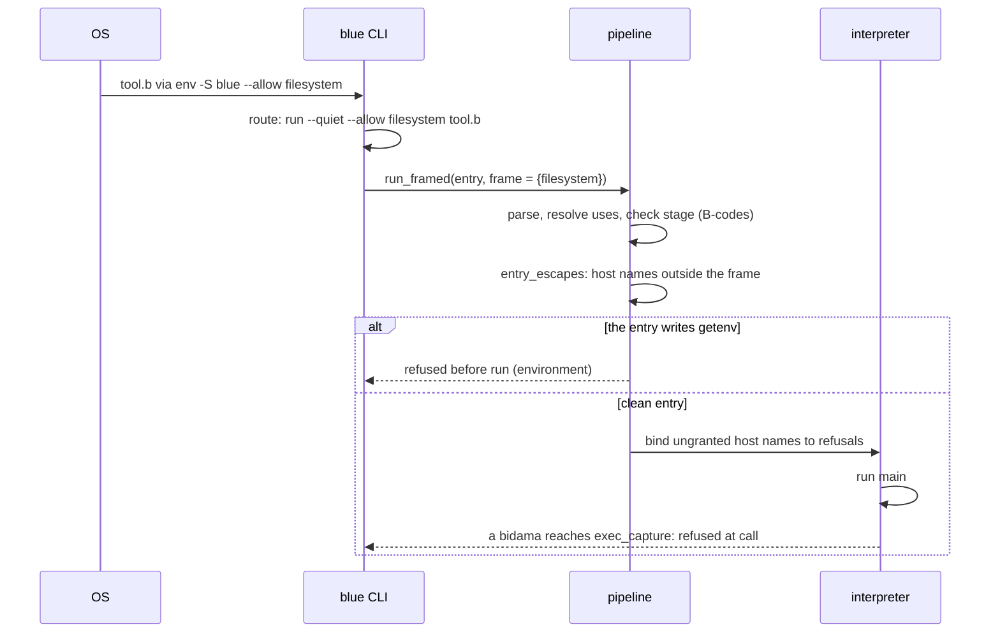
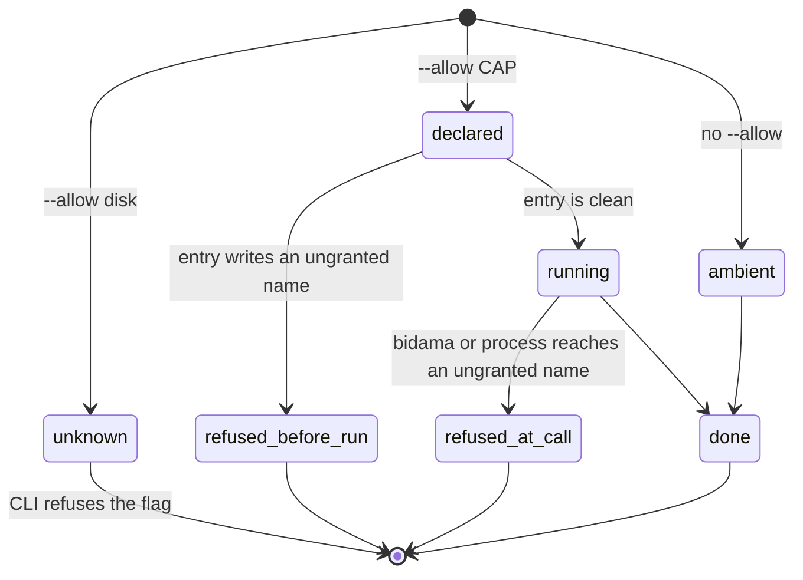

# Safety first: blue's posture, row by row

Operator, 2026-10-24: *"the default posture for bluelang and blue scripting is
safety first, fully leveraging rust based safety"*.

This document turns that sentence into a matrix. Each row is one guarantee
that Rust gives. Each row says what blue does today (measured, with
`file:line`), the gap, the gate that closes it, the seal tier, and the
default with its off switch. A gate is on by default. An off switch is
explicit and local. Behaviour is configured off, never deleted.

## 1. Destination

Every blue program and every blue script is safe by default. A bad state is
refused at the earliest door that can see it: the parser, then the check
stage, then the runtime. Every effect outside the program is a declared
capability, granted at the root and narrowed for each script, each bidama and
each process. Nothing a program does can corrupt memory, race on shared
state or abort the process: Rust under the runtime is the trusted base, and
the base has one audited `unsafe` seam per foreign ABI. A script gets the same
gates as a project. An unsafe operation is possible, but it is written down,
named in the file and visible to a reader and to `blue check`.

World-facts that limit this destination:

- WASI has no subprocess spawn at any preview level. `Process` has no WASI
  lowering (`crates/blue-lang-waku/src/capability.rs:110`).
- A Linux shebang passes everything after the interpreter as ONE argument.
  A script that declares flags in its shebang needs `env -S` (coreutils 8.30
  and later, and macOS `env`).
- A dynamic language cannot prove purity of a higher-order call without an
  effect system. `map(f, xs)` may write if `f` writes.
- A Rust panic in a native function unwinds through the evaluator. A
  `panic = "abort"` profile would make it uncatchable. The workspace sets no
  `panic` profile today (`Cargo.toml`), so it unwinds.

Every other limit in this document is phrased in blue's own abstractions, so
it is ours to dissolve (MIRAGEM).

## 2. Ground: what exists

Measured on `origin/main` at `6f1bb37` (2026-10-24), plus the two gates this
document lands.

- **One check stage on every door.** `run`, `test`, `check`, the hosted loader
  and every bidama build call `check_stage`
  (`crates/blue-lang-runtime/src/pipeline.rs:458`). An error-severity rule
  stops a program before it runs. 53 B-codes exist (`docs/DIAGNOSTICS.md`).
- **A closed capability set.** `blue_lang_waku::Capability` has six host
  effects: process, filesystem, environment, clock, network, entropy
  (`crates/blue-lang-waku/src/capability.rs:116-137`,
  `host_effects` at `:428`). The set has no `Other(String)` arm.
- **Pure sessions.** `blue eval`, `repl` and `serve` bind every ungranted host
  name to a refusal (`crates/blue-lang-runtime/src/session.rs:744`).
  `--allow` widens the frame. A process the session spawns gets the same
  frame (`crates/blue-lang-runtime/src/lib.rs:138`).
- **Ambient `blue run`.** Before this document, `blue run` and `blue FILE`
  installed the whole `sys` layer (`lib.rs:114`) with no frame. A script
  reached every host capability.
- **Bounds.** Call depth 100 000 (`ExecutionBounds::DEFAULT`, `lib.rs:249`),
  refused as a catchable error. Parse depth 256
  (`crates/blue-lang-syntax/src/parse.rs:688`). Steps unbounded by default;
  sessions take `--budget`; project rules run under 10 000 000 steps
  (`crates/blue-lang-runtime/src/project_rules.rs:53`).
- **Share-nothing processes.** Each process owns its interpreter. A message is
  deep-copied, and a function or host handle is refused on send
  (`crates/blue-lang-proc/src/mailbox.rs:130`, `:215`).
- **Unsafe Rust.** 18 crates. Four hold `unsafe` in non-test code:
  `blue-lang-kiwari` (59 occurrences, one seam,
  `src/lib.rs:18` `#![deny(unsafe_code)]`, `src/ts.rs:13` the one
  `#[allow]`, `tests/seam.rs` the gate), `blue-lang-runtime`
  (`src/alloc.rs:114`, the counting `GlobalAlloc`), `blue-lang-wasm` (three
  `extern "C"` exports, `src/lib.rs:76,84,123`) and `blue-lang-cli`
  (`src/repl.rs:340`, the SIGINT handler, under a module `deny`). No
  workspace `[lints]` table exists. Only kiwari denies `unsafe_code` at its
  crate root, so 17 of 18 crates accept a new `unsafe` block silently.
- **Absence.** Another agent writes `docs/ABSENCE.md` (an `Option` bidama and
  a nil checker rule) in parallel. This document points at it and does not
  redesign it.

## 3. Research: Rust's guarantees, adopted or adapted

| Rust mechanism | blue's decision | why |
|---|---|---|
| `Option<T>`, no null | adapt: `docs/ABSENCE.md` | blue has `nil`; the Option bidama and its rule own the row |
| `Result` + `#[must_use]` | adapt: refusals as data (`kyohi`), B0038, B0053 | blue raises; a dropped value is the must-use bug |
| exhaustive `match` | adapt: a closed-set `case` rule | blue's `case` compares with `==` and has no enum type yet |
| immutable by default | adopt: persistent values | already true of every blue value |
| `&mut` uniqueness | skip | no blue value is mutable, so there is nothing to alias |
| bounds-checked index | adopt (memory) / adapt (semantics) | `nth` out of range is `nil`, so the semantic row is absence |
| checked overflow (debug) | adopt | every integer operator raises on overflow |
| no implicit coercion | adopt for operators, adapt for calls | gradual types check typed regions only |
| `unsafe` blocks | adapt: capabilities | a blue program has no raw memory; its "unsafe" is host effect |
| `#![forbid(unsafe_code)]` | adopt for blue's own crates | one seam per foreign ABI, like kiwari |
| `Send` / `Sync` | adopt as share-nothing | processes copy; handles and functions refuse to cross |
| panic vs `Result` | adapt | a fault is a typed, catchable refusal, never an abort |
| `Cargo.lock` + checksums | adapt: `Bluefile.lock` | records ranges and source NAR hashes, not bidama content |
| `secrecy` crate (ecosystem) | adapt | a secret is an opaque value read from a file |
| `Command::arg` / bound SQL params | adopt | `exec_*` has no shell; `pg_query` binds `$1…` |

## 4. The matrix

Tiers, weakest to strongest: **open** (no gate), **runtime-refused**,
**checked-at-expansion**, **parse-rejected**, **unrepresentable**. A cell
reads "today → after the gate". ✅ marks a row already sealed at its target
tier. ⚠️ marks a partial seal. ❌ marks an open row.

| # | Guarantee | blue today | Gate | Tier today → target | Default (off switch) |
|---|---|---|---|---|---|
| 1 | No null | ❌ `nil` everywhere; `nth`, `get`, `to_int` answer `nil` | `docs/ABSENCE.md`: Option bidama + nil rule | open → checked-at-expansion | on (`# waive <code>`) |
| 2 | Must-use results | ⚠️ B0038 swallowed-error; **B0053 discarded-value (landed)** | B0053 for first-order words; a refusal-list rule next | checked-at-expansion | on (`# waive B0053: reason`) |
| 3 | Exhaustive match | ❌ `case` falls through to `nil` | closed-set `case` rule | open → checked-at-expansion | on (`else` arm, or waive) |
| 4 | Immutability, no aliasing | ✅ values are persistent; `set!` rebinds a name, never a value | none needed | unrepresentable | n/a |
| 5 | Bounds-checked indexing | ✅ memory: no raw index exists; ⚠️ semantics: `nth` out of range is `nil` | row 1 owns the `nil` | unrepresentable (memory) | n/a |
| 6 | Integer overflow, numeric conversion | ✅ `+ - * abs floor` raise on overflow; `/` by zero raises; `to_int` of a huge float is `nil` | `to_int` → row 1 | runtime-refused | on, no off |
| 7 | No implicit coercion | ⚠️ operators refuse mixed types; `4 == 4.0` is true; call types are checked only inside typed definitions (B0003–B0005) | call-site checks from any caller when the argument is a literal | runtime-refused → checked-at-expansion | on |
| 8 | `unsafe` ⇔ declared capability | ⚠️ sessions pure by default; **`blue run --allow` and shebang `--allow` (landed)**; an undeclared run is still ambient | default flip for scripts, then `posture(reach:)` for bidamas | checked-at-expansion (entry) + runtime-refused (bidama, process) | declared: on; undeclared: ambient until phase 3 (`--allow host`) |
| 9 | Memory safety of the host seam | ⚠️ 1 of 18 crates denies `unsafe_code` at its root | workspace `unsafe_code = "deny"`, one `#[allow]` per seam, one seam test | unrepresentable for kiwari → unrepresentable for every crate | on (`#[allow(unsafe_code)]` at a named seam) |
| 10 | No data races | ✅ share-nothing processes; copy on send; handles refuse to cross | none needed | unrepresentable | n/a |
| 11 | Panic vs typed refusal | ⚠️ blue faults are catchable; a Rust panic in a native function is not a blue error | one unwind seam at the native-call boundary → `:internal` refusal | open → runtime-refused | on |
| 12 | Resource bounds | ⚠️ depth bounded; steps unbounded by default; no memory or wall-clock bound | `max_alloc_bytes`, `max_wall_ms` bounds; on for doors that run code they did not write | runtime-refused | off for `run` (it removes working behaviour), on for sessions and rules |
| 13 | Supply chain | ⚠️ `Bluefile.lock` holds `bluefile_b3`, version ranges and source NAR hashes; B0019 needs-mismatch | the lock records each resolved bidama's b3; the loader refuses a mismatch | runtime-refused at load | on (`blue lock` rewrites) |
| 14 | Secrets | ❌ a secret is a plain string; `pg_connect` takes a password in the URL | a secret bidama (named through `naming`): read from a file, opaque, redacted on print, refused on send | open → unrepresentable (print) + checked-at-expansion (literal) | on (`# waive`) |
| 15 | Injection | ⚠️ `exec_*` has no shell; `pg_query` binds params; `sh_exec` and `pg_execute` take text | rule: `sh_exec` / `pg_execute` with an interpolated argument | checked-at-expansion | on (`# waive`) |
| 16 | Blue scripting parity | ⚠️ a script gets the check stage's errors; no warnings, no project rules, ambient capabilities | shebang `--allow` (landed); project rules on `run`; default flip | checked-at-expansion | on |
| 17 | Module privacy: a package cannot rebind a name outside itself | ✅ runtime: definitions keyed `pkg/name`; ✅ check: a bidama definition never changes an importer's bare builtin call (B0012 only for listed flat-era names, inside their window) | `docs/NAMESPACES.md` | unrepresentable (runtime) + checked-at-expansion | on, no off; the flat-era refusal goes off per name when its `legacy_names` window closes |
| 18 | Session-mistake hard blocks | ✅ B0061 undeclared-option, B0062 argument-kind, B0063 nullary-as-function, B0064 unformatted-producer (`write_program`); ✅ `gen/retired.b`: a retired word ships its `legacy_names` fixer (prepush); ✅ `blue test` scrubs the inherited git environment and writes only under the temporary root | registry witnesses, spec rows `safety.B0061*`–`safety.B0064*`, `crates/blue-lang-cli/tests/hermetic.rs` | checked-at-expansion (codes), runtime-refused (test writes) | on; `# waive <code>: reason`; `BLUE_TEST_ENV=inherit`, `BLUE_TEST_WRITES=anywhere` |

**Count:** 16 rows. Sealed at their target tier today: 4 (rows 4, 5, 6,
10; row 5 for memory, its `nil` half belongs to row 1). Partly sealed: 9
(rows 2, 7, 8, 9, 11, 12, 13, 15, 16). Open: 3 (rows 1, 3, 14).

**Rows in flight with other owners.** Each owner adds its own row here, with
the same columns, when its gate lands. This document does not land them.

- Namespace leaks: a bidama definition that shadows a builtin (the measured
  case: a package `def` shadowed `read`).
- Build hygiene: generated-file conflicts, gate speed, `gen` version skew,
  formatter drift across consumers.

## 5. Row notes (measurements)

**Row 1, null.** `nth(5, [1, 2])` is `nil`, `get({a: 1}, :b)` is `nil`,
`to_int("12x")` is `nil`; built-in `first([])` raises. B0047 fixes the nil
test spelling only. The design and the rule are `docs/ABSENCE.md`.

**Row 2, must-use.** blue raises errors, so the `Result` that Rust drops does
not exist as a value. Two must-use bugs remain. A catch-all that ignores its
error is B0038 (`crates/blue-lang-check/src/form_rules.rs:212`). A call to a
word that only returns a value, written as a statement, is dead: blue values
do not change, so `assoc(m, :a, 1)` alone on a line does nothing. B0053
(`form_rules.rs:283`, registry `rules.rs:1082`) refuses it for 23 first-order
words. `map`, `filter` and `reduce` are excluded: their function may write.
Census at landing: 0 hits in 355 `.b` files, so no ratchet. A refusal list
from `kyohi::check` that nobody reads is the next case.

**Row 3, exhaustive match.** `case v when 1 … end` with no matching arm is
`nil` (measured). `match` (tatara) has no blue spelling. The gate needs a
closed set to be exhaustive over: a `model(...)` enum, the kyohi ledger
kinds, or a keyword list the file declares. The rule then refuses a `case`
over that set that misses a member and has no `else`.

**Row 4, immutability.** `ys = xs; ys = append(ys, [2])` leaves `xs` as `[1]`
(measured). `set!` rebinds a name, and a name a forked process inherited is
sealed and refuses it (`docs/REFERENCE.md`, `set!`). There is no mutable
blue value, so aliasing has nothing to break. Channels and host handles are
the only stateful values, and row 10 keeps them inside one process.

**Row 6, numbers.** Measured: `9223372036854775807 + 1` raises "integer
overflow in `+`"; `* 2` and `abs(min)` raise the same way; `floor(9.9e300)`
raises; `1 / 0` and `1.0 / 0` raise "division by zero" (stricter than IEEE
754); `to_int(1.0e300)` is `nil`. Decision: keep checked arithmetic, never
wrap and never promote to a bignum.

**Row 7, coercion.** Measured: `"a" + 1`, `1 + "a"`, `"a" + "b"` and
`1 < "a"` raise a type mismatch; `1 == "1"` is false; `4 == 4.0` is true
(numeric equality crosses Int and Float); truthiness is Ruby's (`0`, `""`
and `[]` are true). A typed definition called with a string from an untyped
`main` fails at run time, not at check time: B0005 checks a call only inside
a typed caller.

**Row 8, capabilities.** The landed gate: `blue run --allow CAP` and
`blue --allow CAP FILE` (`crates/blue-lang-cli/src/script.rs:36`,
`repl.rs:46`). `CAP` is `none`, `host`, or one label. With the flag, the run
builds the session frame (`session::frame_granting`) and
`pipeline::run_framed` (`pipeline.rs:194`) does two things. First, a host
name the entry file writes outside the frame stops the program before
anything runs (`entry_escapes`, `pipeline.rs:229`). Second, every ungranted
host name is bound to a refusal (`lib.rs:161`), so a bidama or a spawned
process that reaches it is refused where it calls it. Without the flag the
run is ambient, as before. Two gaps stay open. A refusal is a normal error,
so `rescue _` can swallow it (measured in
`crates/blue-lang-cli/tests/allow.rs`). And a bidama cannot yet declare its
own reach: `posture` takes only `when`
(`crates/blue-lang-pkg/src/bluefile.rs:76`).

**Row 9, host memory.** blue has no pointer and no raw buffer; all memory is
Rust's. The four seams are listed in §2. The gate is one workspace lint table
plus `#[allow(unsafe_code)]` at each seam and a test like kiwari's
`tests/seam.rs`, so a new `unsafe` anywhere is a compile error.

**Row 10, races.** Each process owns its `Vm` and its `Interpreter`; a
message is deep-copied; a function or host handle is refused on send
(`crates/blue-lang-proc/src/lib.rs`, `mailbox.rs:130,215`). Host threads
(`net/serve.rs`, `session/protocol.rs`) are Rust, so Rust's `Send` and `Sync`
check them.

**Row 11, panics.** blue faults (depth, fuel, type, overflow, a raise) are
catchable and typed. `catch_unwind` appears only in `blue-lang-syntax` tests
(totality). A panic in a native function therefore ends the run with a Rust
message, not a blue error with a kind.

**Row 12, resources.** Call depth refuses at 100 000 (measured: "call depth
budget of 100000 exceeded in `r`"). Steps are unbounded on `run` on purpose
(`lib.rs:241-251`: a default step bound removed working simulations). The
counting allocator (`alloc.rs`) measures for `blue profile`; nothing bounds
memory or time.

**Row 13, supply chain.** `Bluefile.lock` records `bluefile_b3` and each
source's NAR hash (`crates/blue-lang-pkg/src/lock.rs:118,127`), and a bidama's
`needs` as version ranges. The load path skips a copy whose version is
outside the locked range. Two copies at the same version with different
content are not told apart.

**Row 14, secrets.** No secret type exists. `pg_connect` takes a password in
the URL's userinfo. `ed25519_keypair` returns the secret as hex text. kensa's
Rust side reads `password_file` and refuses a literal; blue has no such
word.

**Row 15, injection.** `exec_capture`, `exec_check`, `exec_ok?` and the
`exec_with_*` words call `Command::new(cmd)` with an argument vector and no
shell. `sh_exec` runs `sh -c TEXT` (`crates/blue-lang-runtime/src/sys.rs:208`).
`pg_query` sends `$1…` parameters (`net/pg.rs:163`); `pg_execute` sends text
(`net/pg.rs:200`). `http_request` refuses `https`. `path_join` does not refuse
`..`.

**Row 16, scripts.** `blue FILE` is `blue run --quiet FILE` (`script.rs`), so a
script gets every error-severity rule of the check stage, exactly as a
project does. Compared with `blue check`, a script run does not print
warnings (B0002, B0045), does not run the project's `rule(...)` rows, and
does not check `test` blocks (`Checking::WithTests`, `pipeline.rs:1208`).
Before this document a script also had every host capability with no way to
say less. Now the shebang states it:

```text
#!/usr/bin/env -S blue --allow filesystem --allow environment
```

## 6. States and trust

A run is in one of these capability states:

- **ambient**: no `--allow`. Every host capability. Today's default.
- **declared**: `--allow` names a set. The frame is that set.
- **refused-before-run**: the entry file writes a name outside the frame. No
  effect has happened.
- **refused-at-call**: a bidama or a process reaches a name outside the
  frame. Effects before the call have happened.
- **unknown capability**: `--allow disk`. The CLI refuses the flag and names
  the legal values.

Trust: the root (the person or the nix wrapper that starts `blue`) grants
capabilities. A script narrows them in its own shebang. A bidama cannot
widen them. A spawned process inherits the frame and cannot widen it
(`Waku::narrow` has no widening method).

## 7. Diagrams

The layers, with the trusted base at the bottom:


A script run with a declared capability:



The capability lifecycle of one script:



## 8. Decisions

**D1. Where a script declares its capabilities: the shebang, as `--allow`.**
One spelling for the CLI and the script; the reader sees it on line 1.
Rejected: an in-file `capabilities(...)` form (a second declaration path and
a manifest word inside program code; it can come later as sugar that lowers
to the same frame). Rejected: an environment variable (invisible in the file,
and ambient for every child).

**D2. Static check over the entry file, runtime refusal for the rest.**
The entry file is what the author wrote, so a host name there is refused
before any effect. Rejected: the static check over the whole resolved
program. It refuses a pure use of a bidama that holds an unrelated host word,
which is collateral scope (UNREPRESENTABILITY §II.2.1).

**D3. The default for an undeclared script stays ambient now.** Rejected:
pure by default today. Every working script that reads a file would stop, so
the refusal is bigger than the fault. The flip happens through a ratchet
(phase 3): `blue check` counts undeclared scripts that reach the host, and
the default becomes "declared" when the count is zero.

**D4. B0053 covers first-order words only.** Dropping `assoc(…)` is dead by
construction. Dropping `map(f, xs)` is not, because `f` may write (22 such
lines existed at landing, all for effect). Rejected: purity inference over
every function (needs an effect system). Rejected: warning severity (`run`
does not print warnings, so a warning does not reach a script's author).

**D5. Overflow raises.** Rejected: wrapping (silent), bignum promotion
(changes the value domain). Same as Rust's debug build and blue's measured
behaviour.

**D6. Blue's own crates deny `unsafe_code` at the workspace.** One
`#[allow]` per foreign ABI, one seam test. Rejected: `forbid` (it cannot be
allowed at a seam). Rejected: a per-crate attribute (it drifts; 17 of 18
crates lack it today).

**D7. A refusal stays catchable for now.** A refused capability is an error
with a kind. Rejected for now: an uncatchable refusal (it changes how
supervisors and `rescue` work). The open question below owns it.

## 9. Open questions

- **Q1 (ours).** Should a capability refusal escape `rescue _`? B0038 already
  makes a silent catch-all explicit; the stronger answer is a refusal kind
  that only a named `rescue :refused` catches.
- **Q2 (ours).** How a bidama's declared reach composes with the root's
  frame. `posture` takes only `when` today (`bluefile.rs:76`).
- **Q3 (world-fact).** WASI has no subprocess spawn; `Process` stays a blue
  import with no WASI lowering.
- **Q4 (world-fact).** A shebang flag needs `env -S` on Linux.
- **Q5 (ours).** The closed set for row 3: a `model(...)` enum, or any
  keyword list the file declares.

## 10. Phases, ranked by bug classes closed per effort

| Phase | Work | Classes closed | Effort |
|---|---|---|---|
| 0 ✅ | B0053 discarded-value; `run --allow` + shebang `--allow` | dead updates; undeclared host reach in declared scripts | landed |
| 1 | workspace `unsafe_code = "deny"`, four seam `#[allow]`s, one seam test | a stray `unsafe` in any blue crate | one commit |
| 2 | injection rule: `sh_exec` / `pg_execute` with interpolation | shell and SQL injection from data | one rule |
| 3 | `docs/ABSENCE.md` (in flight, other owner) | the nil class | owned elsewhere |
| 4 | script default flip: census of undeclared host-reaching scripts → 0, then "declared" is the default | ambient authority in scripts | ratchet over the fleet |
| 5 | native panic seam → `:internal` refusal | aborts from native code | one seam + totality test |
| 6 | bidama content hash in `Bluefile.lock` | same-version substitution | lock schema bump |
| 7 | secret bidama + literal rule | secrets printed, sent or committed | one bidama + one rule |
| 8 | closed-set `case` rule | missed variants | needs a declared set |
| 9 | memory and wall-clock bounds for untrusted doors | runaway memory and time | two bounds |
| 10 | call-site type checks from untyped callers | literal type mismatches at run time | checker work |

## 11. Tier ledger

| Item | Tier | Evidence |
|---|---|---|
| this matrix | DESIGN | this file |
| B0053 discarded-value | TESTED | registry witness, spec rows `safety.B0053*`, census 0 of 355 files |
| `blue run --allow`, shebang `--allow` | TESTED | `crates/blue-lang-cli/tests/allow.rs` (6 red before the change, 7 green after), `script.rs` unit test |
| rows 4, 5 (memory), 6, 10 | EXISTS | measured behaviour cited above |
| rows 1, 3, 9, 11–15 gates | DESIGN | phases 1–10 |
