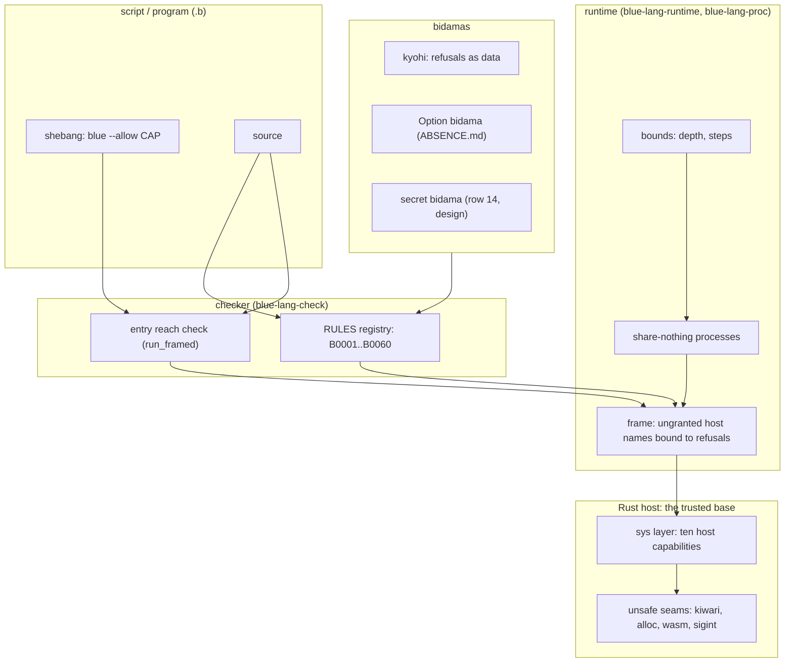
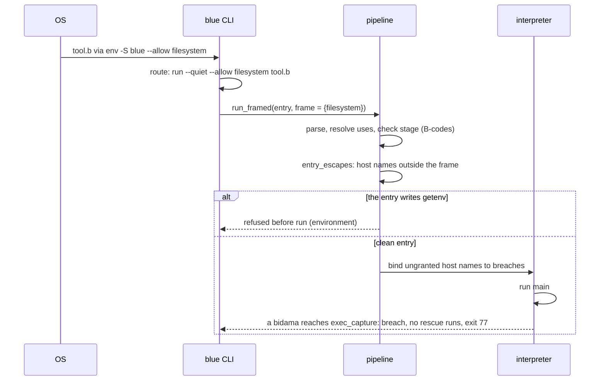
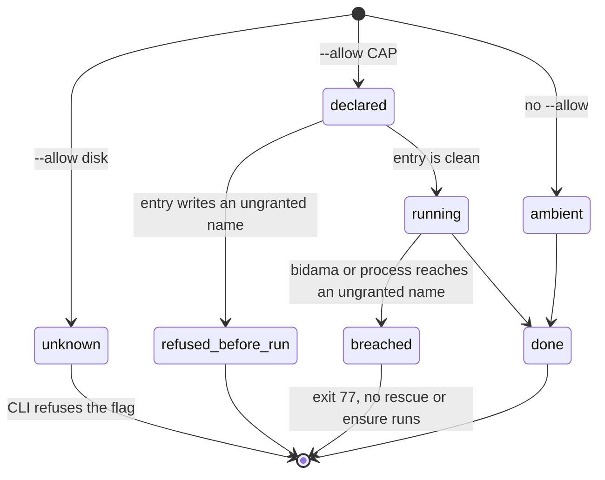

# Safety first: blue's posture, row by row

Operator, 2026-10-24: *"the default posture for bluelang and blue scripting is
safety first, fully leveraging rust based safety"*.

This document turns that sentence into a matrix. Each row is one guarantee
that Rust gives. Each row says what blue does today (measured, with
`file:line`), the gap, the gate that closes it, the seal tier, and the
default with its off switch. A gate is on by default. An off switch is
explicit and local. Behaviour is configured off, never deleted.

## 1. Destination

Every blue program and every blue script is safe by default. A bad state is
refused at the earliest door that can see it: the parser, then the check
stage, then the runtime. Every effect outside the program is a declared
capability, granted at the root and narrowed for each script, each bidama and
each process. Nothing a program does can corrupt memory, race on shared
state or abort the process: Rust under the runtime is the trusted base, and
the base has one audited `unsafe` seam per foreign ABI. A script gets the same
gates as a project. An unsafe operation is possible, but it is written down,
named in the file and visible to a reader and to `blue check`.

World-facts that limit this destination:

- WASI has no subprocess spawn at any preview level. `Process` has no WASI
  lowering (`crates/blue-lang-waku/src/capability.rs:110`).
- A Linux shebang passes everything after the interpreter as ONE argument.
  A script that declares flags in its shebang needs `env -S` (coreutils 8.30
  and later, and macOS `env`).
- A dynamic language cannot prove purity of a higher-order call without an
  effect system. `map(f, xs)` may write if `f` writes.
- A Rust panic in a native function unwinds through the evaluator. A
  `panic = "abort"` profile would make it uncatchable. The workspace sets no
  `panic` profile today (`Cargo.toml`), so it unwinds.

Every other limit in this document is phrased in blue's own abstractions, so
it is ours to dissolve (MIRAGEM).

## 2. Ground: what exists

Measured on `origin/main` at `6f1bb37` (2026-10-24), plus the two gates this
document lands.

- **One check stage on every door.** `run`, `test`, `check`, the hosted loader
  and every bidama build call `check_stage`
  (`crates/blue-lang-runtime/src/pipeline.rs:458`). An error-severity rule
  stops a program before it runs. 53 B-codes exist (`docs/DIAGNOSTICS.md`).
- **A closed capability set.** `blue_lang_waku::Capability` has thirteen host
  effects: process, filesystem, environment, clock, network, entropy,
  comm-flash, comm-scavenger, mpc-threshold, storage-append, audio-out,
  audio-in, display (`crates/blue-lang-waku/src/capability.rs:116-145`,
  `host_effects` at `:600`). The set has no `Other(String)` arm. One
  capability implies another: filesystem holds storage-append
  (`Capability::implied` at `:564`).
- **Pure sessions.** `blue eval`, `repl` and `serve` bind every ungranted host
  name to a refusal (`crates/blue-lang-runtime/src/session.rs:744`).
  `--allow` widens the frame. A process the session spawns gets the same
  frame (`crates/blue-lang-runtime/src/lib.rs:138`).
- **Ambient `blue run`.** Before this document, `blue run` and `blue FILE`
  installed the whole `sys` layer (`lib.rs:114`) with no frame. A script
  reached every host capability.
- **Bounds.** Call depth 100 000 (`ExecutionBounds::DEFAULT`, `lib.rs:249`),
  refused as a catchable error. Parse depth 256
  (`crates/blue-lang-syntax/src/parse.rs:688`). Steps unbounded by default;
  sessions take `--budget`; project rules run under 10 000 000 steps
  (`crates/blue-lang-runtime/src/project_rules.rs:53`). Live bytes
  (2026-10-30): `max_alloc_bytes` for `run` and `test`, unbounded by
  default; `guest_max_alloc_bytes` for sessions, live evaluation, project
  rules and Bluefiles, 1 GiB by default
  (`crates/blue-lang-runtime/src/memory.rs`). A project's own (2026-10-31):
  `bounds({steps:, call_depth:, alloc_bytes:, dispatch_steps:})` in its root
  Bluefile, each key optional and each a positive integer. `blue lock`
  records them in the capabilities record, and `blue run`, `blue test` and an
  appliance hold the program to the lesser of each and the operator's
  (`crates/blue-lang-pkg/src/bounds.rs`, `ExecutionBounds::meet`). Per
  dispatch (2026-10-31): `dispatch_steps` bounds the steps one message's
  handler in a `spawn_server` may take, met with the server's own
  `spawn_server(h, s, {dispatch_steps: n})` (or `[:server, h, s, opts]` under
  a supervisor), so each only narrows. A bounded server parks once at each
  boundary, so the node reads its VM's step count there; a dispatch is the
  steps charged from that boundary to the next. Past the bound the process
  exits `[:runaway, "execution budget exhausted: steps per dispatch (limit
  n)"]`, the exit a step bound gives a process, which links, monitors and a
  supervisor see; its `%state` is put back to the state before that message,
  so its receipt's `output_root` and a supervised restart start from there
  rather than from its first state, and a restart empties the mailbox as any
  restart does. The node checks the count at each slice end and at each
  boundary, so the decision is exact (refused exactly when the count passes
  the bound) and a refused handler runs at most one quantum (1000 steps)
  past it before it stops; what it sent in that window was sent. Absent, no
  server parks and nothing is checked (`crates/blue-lang-proc/src/node.rs`
  `dispatch_held`). An evicted server is accepted under the accepting
  node's bound; its own spawn option does not travel in the image.
- **Share-nothing processes.** Each process owns its interpreter. A message is
  deep-copied, and a function or host handle is refused on send
  (`crates/blue-lang-proc/src/mailbox.rs:130`, `:215`). A process spawned
  `{scheduling: :idle}` (2026-10-31) runs its slices on a thread of its own
  that first asks the OS for its lowest priority. The node does not wait for
  that thread: it runs its other processes while the idle slice waits for a
  core. Like every process it acts only while the program waits: a word it
  calls between the program's waits holds until the next one. The idle
  process still owns its interpreter, and each word it calls
  names it through the thread it runs on, so its tape, host count and memory
  account stay its own and a crash replays from its tape alone
  (`crates/blue-lang-proc/src/node.rs` `launch`, `fly`). `IdleLane::Held`
  keeps the earlier shape, the node waiting for each idle slice, for a node
  whose whole interleaving must replay (`slice_idle`). An evicted process
  crosses as data only, and its image runs under the accepting node's frame,
  never more (`crates/blue-lang-proc/src/image.rs`). A server's state is
  refused unless it copies as a message does. A plain process (2026-10-31)
  crosses as its VM frames in plain data (tatara-lisp-eval 0.4.13
  `Vm::parked`): a function is the index of its entry in the code the image
  carries, a native function is its name, and a host handle, a promise or a
  tree-walker closure in the frames is refused by name before anything moves
  (`crates/blue-lang-proc/src/node.rs` `continuation`, `parking`). The
  accepting node rebuilds the frames against the code it compiles itself and
  refuses, by name, frames whose chunk fingerprint differs or that hold a
  native it does not register (`resume`). Its tape (2026-11-01) travels in
  the same image, as `blue-image` version 4: the arrival's tape starts with
  the carried entries, and the accepting node records their count, their
  BLAKE3 hash and the image's name. A crash there writes `blue-trace`
  version 4, which `blue replay` runs from the process's start through the
  carried entries on one node, and refuses by name, before it runs, when
  the first entries are not the ones that came, cut or edited
  (`crates/blue-lang-proc/src/trace.rs` `check_carried`). A server's tape
  starts at its last boundary, which it reaches on the new node, so a
  server's image carries none and its trace needs none. An image without a
  tape, from an older blue or a tape past its bound, still arrives with its
  trace marked truncated, and so does a process whose tape would not fit the
  send ring or the frame limit: the move goes on with the image it had
  before tapes travelled (`depart_over`). Version 1 to 3 images and
  version 3 traces keep their bytes. From a held node (2026-11-01) the
  same image carries the process's mailbox journal and its count of host
  calls beside its tape, as `blue-image` version 5. On a held node the
  arrival's journal and count start from them, and the node records the
  count of journal messages that came, the host-call count, a BLAKE3 hash
  over both and the image's name; a carried message the journal later
  drops takes its count and hash with it (`CarriedAccount::dropped_oldest`).
  A crash there writes `blue-trace` version 5, whose journal and
  `frame.host_io` cover both nodes, and the arrival's receipt is
  `blue-receipt` version 4, whose `host_io` counts both and whose
  `carried` block names what came. `blue replay` refuses, by name and
  before it runs, a trace whose journal or count is shorter than what came,
  or whose carried part hashes to another value (`check_carried_account`);
  `blue receipt verify` refuses a receipt whose count is smaller than what
  came, and its name refuses any other edit (`receipt::check`). Two moves
  compose: the last image names everything before it. A version 4 image
  carries no journal or count and arrives as before. A server
  (2026-11-01) brings its account too, as `blue-image` version 6: its
  journal, its host-call count and the root of the state its incarnation
  began with on the first node (`account.input_root`), with no tape, since
  its tape starts at its last boundary and replay starts there. A server's
  count never travels without that root, so its receipt cannot sum the
  calls of an incarnation whose `input_root` begins on the node it moved to:
  a held node with no state root (none the runtime builds) keeps a server's
  account node-local, and a journal the send ring cannot hold stays behind
  with the count and the root, as a plain process's tape does. A crash
  after the move writes `blue-trace` version 5, the same `carried_account`
  block with no `carried` tape, checked and refused by name as a plain
  process's is. The incarnation's receipt is `blue-receipt` version 5:
  version 2 or 3 with `carried` `{host_io, image, input_root}`, whose
  `input_root` is the root it brought, its `output_root` the state after
  its last message on the node it ended on, and its `host_io` the sum.
  `blue receipt verify` refuses a carried root that is not the receipt's
  `input_root` and a count smaller than what came (`receipt::check`). A
  second move hands on the root the first node gave. Version 1 to 5 images,
  version 4 receipts and every unheld move keep their bytes. Tests:
  `crates/blue-lang-proc/tests/nomad.rs`
  (`a_held_plain_process_that_moves_carries_its_journal_and_host_calls_into_the_trace_and_receipt_of_its_crash`,
  `a_trace_whose_carried_journal_or_host_count_was_cut_or_edited_is_refused_by_name_and_not_replayed`,
  `two_moves_compose_into_one_carried_journal_and_host_count_named_by_the_last_image`,
  `a_carried_message_the_accepting_nodes_journal_drops_takes_its_count_and_hash_with_it`,
  `an_unheld_move_carries_no_account_and_writes_the_trace_it_wrote_before`,
  `a_held_server_that_moves_carries_its_journal_host_calls_and_input_root_into_the_trace_and_receipt_of_its_crash`,
  `a_moved_servers_trace_or_receipt_whose_carried_part_was_cut_or_edited_is_refused_by_name`,
  `two_moves_of_a_server_compose_into_one_account_that_begins_on_the_first_node`,
  `a_held_server_whose_journal_the_send_ring_cannot_hold_moves_without_it_and_counts_only_where_it_ends`,
  `a_server_that_crashes_on_the_node_it_moved_to_replays_from_its_last_boundary_there`),
  `crates/blue-lang-cli/tests/nomad.rs`
  (`a_moved_plain_processs_bluecrash_holds_the_journal_and_host_calls_of_both_wires_and_refuses_a_cut_journal`,
  `a_moved_plain_processs_receipt_counts_the_host_calls_of_both_wires_and_verify_refuses_a_cut_count`,
  `a_moved_server_writes_a_bluecrash_that_replays_from_its_last_boundary_on_the_node_it_reached`,
  `a_moved_servers_receipt_begins_at_the_state_it_had_on_the_wire_it_left_and_verify_refuses_another`),
  and the `image` and `receipt` units.
- **Unsafe Rust.** 18 crates. Five hold `unsafe` in non-test code:
  `blue-lang-kiwari` (59 occurrences, one seam,
  `src/lib.rs:18` `#![deny(unsafe_code)]`, `src/ts.rs:13` the one
  `#[allow]`, `tests/seam.rs` the gate), `blue-lang-proc` (2026-10-31: two
  calls, `setpriority` and `getpriority` with darwin's per-thread
  `PRIO_DARWIN_THREAD`, which rustix does not expose; `src/lib.rs`
  `#![deny(unsafe_code)]`, `src/seam.rs` the one `#[allow]`, compiled on
  apple targets only, `tests/seam.rs` the gate; Linux sets nice 19 per thread
  through rustix with no `unsafe`), `blue-lang-runtime`
  (`src/alloc.rs:305`, the counting `GlobalAlloc`, and `:148`, the store
  through an account's interrupt wire), `blue-lang-wasm` (three
  `extern "C"` exports, `src/lib.rs:76,84,123`) and `blue-lang-cli`
  (`src/sigint.rs`, the SIGINT handlers of `repl` and `run`, under a module
  `deny`; an inherited ignore stays ignored). No
  workspace `[lints]` table exists. kiwari and proc deny `unsafe_code` at
  their crate roots, so 16 of 18 crates accept a new `unsafe` block silently.
- **Absence.** Another agent writes `docs/ABSENCE.md` (an `Option` bidama and
  a nil checker rule) in parallel. This document points at it and does not
  redesign it.

## 3. Research: Rust's guarantees, adopted or adapted

| Rust mechanism | blue's decision | why |
|---|---|---|
| `Option<T>`, no null | adapt: `docs/ABSENCE.md` | blue has `nil`; the Option bidama and its rule own the row |
| `Result` + `#[must_use]` | adapt: refusals as data (`kyohi`), B0038, B0053 | blue raises; a dropped value is the must-use bug |
| exhaustive `match` | adapt: a closed-set `case` rule | blue's `case` compares with `==` and has no enum type yet |
| immutable by default | adopt: persistent values | already true of every blue value |
| `&mut` uniqueness | skip | no blue value is mutable, so there is nothing to alias |
| bounds-checked index | adopt (memory) / adapt (semantics) | `nth` out of range is `nil`, so the semantic row is absence |
| checked overflow (debug) | adopt | every integer operator raises on overflow |
| no implicit coercion | adopt for operators, adapt for calls | gradual types check typed regions only |
| `unsafe` blocks | adapt: capabilities | a blue program has no raw memory; its "unsafe" is host effect |
| `#![forbid(unsafe_code)]` | adopt for blue's own crates | one seam per foreign ABI, like kiwari |
| `Send` / `Sync` | adopt as share-nothing | processes copy; handles and functions refuse to cross |
| panic vs `Result` | adapt | a fault is a typed, catchable refusal, never an abort |
| `Cargo.lock` + checksums | adapt: `Bluefile.lock` | records ranges and source NAR hashes, not bidama content |
| `secrecy` crate (ecosystem) | adapt | a secret is an opaque value read from a file |
| `Command::arg` / bound SQL params | adopt | `exec_*` has no shell; `pg_query` binds `$1…` |

## 4. The matrix

Tiers, weakest to strongest: **open** (no gate), **runtime-refused**,
**checked-at-expansion**, **parse-rejected**, **unrepresentable**. A cell
reads "today → after the gate". ✅ marks a row already sealed at its target
tier. ⚠️ marks a partial seal. ❌ marks an open row.

| # | Guarantee | blue today | Gate | Tier today → target | Default (off switch) |
|---|---|---|---|---|---|
| 1 | No null | ❌ `nil` everywhere; `nth`, `get`, `to_int` answer `nil` | `docs/ABSENCE.md`: Option bidama + nil rule | open → checked-at-expansion | on (`# waive <code>`) |
| 2 | Must-use results | ⚠️ B0038 swallowed-error; **B0053 discarded-value (landed)** | B0053 for first-order words; a refusal-list rule next | checked-at-expansion | on (`# waive B0053: reason`) |
| 3 | Exhaustive match | ❌ `case` falls through to `nil` | closed-set `case` rule | open → checked-at-expansion | on (`else` arm, or waive) |
| 4 | Immutability, no aliasing | ✅ values are persistent; `set!` rebinds a name, never a value | none needed | unrepresentable | n/a |
| 5 | Bounds-checked indexing | ✅ memory: no raw index exists; ⚠️ semantics: `nth` out of range is `nil` | row 1 owns the `nil` | unrepresentable (memory) | n/a |
| 6 | Integer overflow, numeric conversion | ✅ `+ - * abs floor` raise on overflow; `/` by zero raises; `to_int` of a huge float is `nil` | `to_int` → row 1 | runtime-refused | on, no off |
| 7 | No implicit coercion | ⚠️ operators refuse mixed types; `4 == 4.0` is true; call types are checked only inside typed definitions (B0003–B0005) | call-site checks from any caller when the argument is a literal | runtime-refused → checked-at-expansion | on |
| 8 | `unsafe` ⇔ declared capability | ⚠️ sessions pure by default; **`blue run --allow` and shebang `--allow` (landed)**; **a breach is fatal: no `rescue` or `ensure` sees it (landed)**; **the wire's two channels are their own capabilities, `comm_flash` and `comm_scavenger` (landed)**; **the Flash rate is the host's, a typed bound refused as a catchable `:rate_limited` (landed)**; **both channels have an in-process loopback provider (landed)**; **threshold signing is its own capability, `mpc_threshold`, with a seeded provider (landed)**; **an append-only log store is its own capability, `storage_append`, held by `filesystem`, with an in-memory provider (landed)**; **sound out, sound in and a display canvas are three capabilities, `audio_out`, `audio_in` and `display`, each with a pure provider, and a host without the device answers a named refusal (landed)**; **eviction over the Tide (`evict`, `accept`) sits in `comm_scavenger` (landed)**; **`bpf(2)` and perf events are their own capability, `kernel_bpf`, with no pure provider, and off Linux each word answers a named refusal (landed)**; an undeclared run is still ambient | default flip for scripts, then `posture(reach:)` for bidamas | checked-at-expansion (entry) + runtime-fatal (bidama, process) | declared: on; undeclared: ambient until phase 3 (`--allow host`) |
| 9 | Memory safety of the host seam | ⚠️ 3 of 22 crates deny `unsafe_code` at their roots (kiwari, proc, senses) | workspace `unsafe_code = "deny"`, one `#[allow]` per seam, one seam test | unrepresentable for kiwari and proc → unrepresentable for every crate | on (`#[allow(unsafe_code)]` at a named seam) |
| 10 | No data races | ✅ share-nothing processes; copy on send; handles refuse to cross | none needed | unrepresentable | n/a |
| 11 | Panic vs typed refusal | ⚠️ blue faults are catchable; a Rust panic in a native function is not a blue error | one unwind seam at the native-call boundary → `:internal` refusal | open → runtime-refused | on |
| 12 | Resource bounds | ⚠️ depth bounded; steps unbounded by default; **live bytes bounded per evaluation and per process (landed: `max_alloc_bytes`, `guest_max_alloc_bytes`)**; **a project bounds its own steps, depth and live bytes with `bounds(...)`, met with the operator's, so it narrows and never widens (landed)**; **a server's steps per message with `dispatch_steps`, in `bounds` and at spawn, met (landed)**; no wall-clock bound | `max_wall_ms` bound; on for doors that run code they did not write | runtime-refused | memory: off for `run` and `test` (`max_alloc_bytes: null`; it removes working behaviour), 1 GiB for sessions, live evaluation, rules and Bluefiles (`guest_max_alloc_bytes`; `null` lifts it); a project's `bounds`: none until it declares them (drop the word) |
| 13 | Supply chain | ⚠️ `Bluefile.lock` holds `bluefile_b3`, version ranges and source NAR hashes; B0019 needs-mismatch | the lock records each resolved bidama's b3; the loader refuses a mismatch | runtime-refused at load | on (`blue lock` rewrites) |
| 14 | Secrets | ❌ a secret is a plain string; `pg_connect` takes a password in the URL | a secret bidama (named through `naming`): read from a file, opaque, redacted on print, refused on send | open → unrepresentable (print) + checked-at-expansion (literal) | on (`# waive`) |
| 15 | Injection | ⚠️ `exec_*` has no shell; `pg_query` binds params; `sh_exec` and `pg_execute` take text | rule: `sh_exec` / `pg_execute` with an interpolated argument | checked-at-expansion | on (`# waive`) |
| 16 | Blue scripting parity | ⚠️ a script gets the check stage's errors; no warnings, no project rules, ambient capabilities | shebang `--allow` (landed); project rules on `run`; default flip | checked-at-expansion | on |
| 17 | Module privacy: a package cannot rebind a name outside itself | ✅ runtime: definitions keyed `pkg/name`; ✅ check: a bidama definition never changes an importer's bare builtin call (B0012 only for listed flat-era names, inside their window) | `docs/NAMESPACES.md` | unrepresentable (runtime) + checked-at-expansion | on, no off; the flat-era refusal goes off per name when its `legacy_names` window closes |
| 18 | Session-mistake hard blocks | ✅ B0061 undeclared-option, B0062 argument-kind, B0063 nullary-as-function, B0064 unformatted-producer (`write_program`); ✅ `gen/retired.b`: a retired word ships its `legacy_names` fixer (prepush); ✅ `blue test` scrubs the inherited git environment and writes only under the temporary root; ✅ a Bluefile check under `blue test`, and a generator under `blue run`, reads only its declared inputs, as the nix sandbox gives them | registry witnesses, spec rows `safety.B0061*`–`safety.B0064*`, `crates/blue-lang-cli/tests/hermetic.rs`, `crates/blue-lang-cli/tests/declared_inputs.rs` | checked-at-expansion (codes), runtime-refused (test writes, undeclared inputs) | on; `# waive <code>: reason`; `BLUE_TEST_ENV=inherit`, `BLUE_TEST_WRITES=anywhere`, `BLUE_INPUTS=checkout` |
| 19 | No silent re-entry of a lazy value (ROADMAP ruling R3) | ⚠️ a `force` that re-enters its own `delay` recurses until the call-depth budget (100,000) refuses it: loud, but not a cycle error naming its path (measured 2026-11-06) | a blackhole state in `force`: re-entry raises `:cycle` with the path of forces | checked-at-runtime (budget) → checked-at-runtime (named cycle) | on, no off |

**Count (2026-11-06):** 19 rows. Sealed at their target tier today: 6 (rows
4, 5, 6, 10, 17, 18; row 5 for memory, its `nil` half belongs to row 1).
Partly sealed: 10 (rows 2, 7, 8, 9, 11, 12, 13, 15, 16, 19). Open: 3 (rows 1,
3, 14).

**Rows in flight with other owners.** Each owner adds its own row here, with
the same columns, when its gate lands. This document does not land them.

- Namespace leaks: a bidama definition that shadows a builtin (the measured
  case: a package `def` shadowed `read`).
- Build hygiene: generated-file conflicts, gate speed, `gen` version skew,
  formatter drift across consumers.

## 5. Row notes (measurements)

**Row 1, null.** `nth(5, [1, 2])` is `nil`, `get({a: 1}, :b)` is `nil`,
`to_int("12x")` is `nil`; built-in `first([])` raises. B0047 fixes the nil
test spelling only. The design and the rule are `docs/ABSENCE.md`.

**Row 2, must-use.** blue raises errors, so the `Result` that Rust drops does
not exist as a value. Two must-use bugs remain. A catch-all that ignores its
error is B0038 (`crates/blue-lang-check/src/form_rules.rs:212`). A call to a
word that only returns a value, written as a statement, is dead: blue values
do not change, so `assoc(m, :a, 1)` alone on a line does nothing. B0053
(`form_rules.rs:283`, registry `rules.rs:1082`) refuses it for 23 first-order
words. `map`, `filter` and `reduce` are excluded: their function may write.
Census at landing: 0 hits in 355 `.b` files, so no ratchet. A refusal list
from `kyohi::check` that nobody reads is the next case.

**Row 3, exhaustive match.** `case v when 1 … end` with no matching arm is
`nil` (measured). `match` (tatara) has no blue spelling. The gate needs a
closed set to be exhaustive over: a `model(...)` enum, the kyohi ledger
kinds, or a keyword list the file declares. The rule then refuses a `case`
over that set that misses a member and has no `else`.

**Row 4, immutability.** `ys = xs; ys = append(ys, [2])` leaves `xs` as `[1]`
(measured). `set!` rebinds a name, and a name a forked process inherited is
sealed and refuses it (`docs/REFERENCE.md`, `set!`). There is no mutable
blue value, so aliasing has nothing to break. Channels and host handles are
the only stateful values, and row 10 keeps them inside one process.

**Row 6, numbers.** Measured: `9223372036854775807 + 1` raises "integer
overflow in `+`"; `* 2` and `abs(min)` raise the same way; `floor(9.9e300)`
raises; `1 / 0` and `1.0 / 0` raise "division by zero" (stricter than IEEE
754); `to_int(1.0e300)` is `nil`. Decision: keep checked arithmetic, never
wrap and never promote to a bignum.

**Row 7, coercion.** Measured: `"a" + 1`, `1 + "a"`, `"a" + "b"` and
`1 < "a"` raise a type mismatch; `1 == "1"` is false; `4 == 4.0` is true
(numeric equality crosses Int and Float); truthiness is Ruby's (`0`, `""`
and `[]` are true). A typed definition called with a string from an untyped
`main` fails at run time, not at check time: B0005 checks a call only inside
a typed caller.

**Row 8, capabilities.** The landed gate: `blue run --allow CAP` and
`blue --allow CAP FILE` (`crates/blue-lang-cli/src/script.rs:36`,
`repl.rs:46`). `CAP` is `none`, `host`, or one label. With the flag, the run
builds the session frame (`session::frame_granting`) and
`pipeline::run_framed` (`pipeline.rs:194`) does two things. First, a host
name the entry file writes outside the frame stops the program before
anything runs (`entry_escapes`, `pipeline.rs:229`). Second, every ungranted
host name is bound to a breach (`blue_lang_runtime::refuse_host_names`), so a
bidama or a spawned process that reaches it ends where it calls it. Without
the flag the run is ambient, as before.

A breach is fatal (2026-10-30). It raises `EvalError::Fatal` (kind
`capability-breach`, tatara-lisp-eval 0.4.12), and `EvalError::is_catchable`
is false for it on both executors, so no `rescue`, `rescue _`, `x rescue y`
or `ensure` runs. `blue run` prints `capability breach: …` and exits 77
(`EX_NOPERM`). A process that breaches exits `[:fatal, message]`: its links
and monitors see that reason, and its supervisor drops it from its children
and never restarts it, so a `one_for_all` sweep leaves it down
(`blue-lang-proc` `ExitReason::Fatal`, `is_restartable`). Tests:
`crates/blue-lang-cli/tests/allow.rs` (`no_rescue_swallows_a_breach`,
`a_breach_in_a_spawned_process_ends_it_and_its_monitor_sees_why`) and
`blue-lang-proc`'s `a_fatal_child_is_*`.

**The lattice (2026-10-30).** The root states its ceiling with
`allow(%i[…])`, the manifest spelling of `--allow`. `blue lock` joins the
floors over the closure the root's `use` forms reach and checks
`⋁ floors ⊑ allow ∨ provided` (`blue_lang_bidama::resolve`,
`crates/blue-lang-pkg/src/capabilities.rs`). A breach writes no lock and names
its path, one row per package and capability. A verified lock carries a
`capabilities` record (ceiling, providers, `unit`, the join, each floor, and
under definition floors each definition row); `blue bluefile --confirm` checks
the record against the Bluefile offline, and nix's project engine refuses a
Bluefile that declares `allow` or `virtualize` with no record. A root that
declares neither locks as before.

**Definition floors (2026-10-30).** What a floor counts is the root's
`floors(:definition | :package)`, `:definition` when undeclared. Under
`:definition`, `blue lock` checks every root file as `blue run` would (test
blocks dropped) with every package it loads, lowers it to the tree the
evaluator runs, and walks from the root's own forms, and from each form that
runs when its file loads (a bare call, a value, a macro), along every
definition a form names (`blue_lang_mondou::reach::form_reach`). A package's
floor is the host capabilities its reached forms name on their own, so a pure
caller of one pure word in a package that also holds a host word inherits
nothing. A declared `reach(%i[…])` bounds what the reached definitions may
name and is refused when they name more. A breach names the definitions from
the root: `[app] -> [porta::fetch] -> [rede::get: needs 'network'] violates
ceiling []`, or `[app::main: needs 'clock']` when the root's own definition
names it. The record's `definitions` map each reached definition that names a
host capability (`rede::get`, or `rede` for code at its top level) to what it
names, and `--confirm` holds each package's floor to exactly the join of its
rows. A quoted form is code here: `eval(quote read_file(p) end)` counts, which
the whole-package reading (waku's free names) never counted. Code the lock
never read, such as a dependency edited after it, is the hold's: the run
breaches and exits 77. A root file whose program does not load refuses the
lock, never counts as empty. A compiled-in package is read like any other
here; under `:package` it stays the empty leaf it was.

`floors(:package)` keeps the whole-package reading, configured on rather than
deleted: a package's floor is every host capability its code names (test
blocks aside), or its declared `reach`, which `blue lock` refuses when it
misses one, and a breach names packages:
`[app] -> [porta] -> [rede: needs 'network'] violates ceiling [filesystem, clock]`.
A record written before `unit` existed reads as `package`, so its lock is
stale under the default until relocked. Measured on the case that ranked it
first (`theory/IBUKI.md` §VI): a root that imports `tesuto` only for
`raises?` locks under `allow([])`, where whole packages refuse it for
tesuto's filesystem and environment. Tests: `tests/lattice.rs`
(`a_root_that_reaches_only_a_pure_word_resolves_under_allow_none`,
`a_root_that_reaches_the_host_word_is_refused_with_the_definitions_on_the_way`,
`an_evaled_host_word_is_counted_when_written_and_stopped_by_the_hold_when_the_lock_never_read_it`,
`counting_whole_packages_reproduces_the_package_verdicts`,
`a_root_that_imports_tesuto_only_for_raises_no_longer_inherits_its_disk_and_environment`,
`a_compiled_in_package_is_followed_by_definition_and_a_leaf_by_package`),
`capabilities.rs` (4 more), mondou `reach.rs`
(`each_form_names_its_own_host_words_and_the_definitions_it_names_and_nothing_further`).

**Providers (2026-10-30).** `virtualize(cap, {using: …})` binds a capability
to a pure provider (`blue_lang_waku::Provision`,
`crates/blue-lang-runtime/src/provide.rs`), so a floor that needs it resolves
under a ceiling that withholds it, with no fork of the leaf. `using` names
the provider and its settings sit beside it: `:clock {using:
:deterministic_stepped, at_ms:, step_ms:}`, `:entropy {using: :seeded_prng,
seed:}`, and `:filesystem {using: :in_memory_overlay}` (an isolated tree on an
empty base: no read or write reaches the host) or `{using: :null_sink}` (every
write dropped, every read finds nothing). The lock records the provider as
the kebab-case label (`deterministic-stepped`). An unknown `using` is refused
with the legal ones named. The settings are a map because blue refuses a
keyword entry in a call without a `**` spread (spec row
`maps.spread.call.entries_need_a_spread`). `:comm_flash {using: :loopback}` and
`:comm_scavenger {using: :loopback}` carry the wire's frames in process, and
`:mpc_threshold {using: :seeded, seed:}` draws every threshold key and nonce
from a stream keyed by the seed, `:storage_append {using: :in_memory}`
keeps the append-only logs in memory, `:audio_out {using: :recording_sink}`
keeps every clip played, `:audio_in {using: :seeded_noise, seed:}` captures a
stream keyed by the seed and `{using: :monitor}` captures what the recording
sink holds, and `:display {using: :framebuffer}` keeps each canvas in memory
(all below).
Process, network and environment have no provider (`Provision::kinds_for`). `Provisions::disjoint_from`
refuses a whole-program provider for a capability `allow` also grants, but
`blue lock` does not call it yet.

**The wire (2026-10-30).** The dual-pulse wire is two host capabilities split
from `network`, so a frame may hold one channel without the other and without
TCP: `comm-flash` (`flash_open`, `flash_put`, `flash_next`, `flash_stats`,
`flash_close`) and `comm-scavenger` (the seven `tide_` words), over one UDP
socket (`crates/blue-lang-runtime/src/wire.rs`). A Bluefile and `--allow`
name them `comm_flash` and `comm_scavenger` (`Capability::host_named` reads
the label or its snake case). The host border enforces the framing (0x02
Flash, 0x01 Tide with an 8-byte send stamp), the 1280-byte MTU (a frame past
it raises and is not sent), a Flash inbox of 256 frames that drops past it,
and a Tide send ring and inbox bounded in frames and bytes that evict their
oldest. `kodou` paces Flash by ibuki's token bucket and Tide by ibuki's
LEDBAT controller; the host holds the Flash rate (below). Tests:
`crates/blue-lang-cli/tests/wire.rs`
(`a_frame_without_comm_flash_breaches_with_77_and_sends_nothing`: under
`--allow comm_scavenger --allow clock` the listener hears the one Tide
control frame and no Flash frame, the run exits 77; under `--allow none` it
hears nothing; `blue lock` refuses
`[wire-breach] -> [kodou::link: needs 'comm-flash'] violates ceiling [clock, comm-scavenger]`).

**The Flash rate is the host's (2026-10-30).** Each wire's Flash send path
holds a token bucket with the rate and burst ibuki's bucket models
(`crates/blue-lang-runtime/src/wire.rs`, `Bucket`): `flash_bytes_per_second`
bytes a second and one second's worth at once, a typed bound in `BlueConfig`
(a BOUND, never a preference; default 16384, `wire::DEFAULT_FLASH_RATE`). It
reads the frame's clock: a whole-program clock provider when the hold has one
(peeked, never stepped), else the host's wall clock; a scoped clock is a
package's, not the frame's. A send past it raises `:rate_limited` with
`{bytes:, rate:, burst:, wait_ms:}` and sends nothing. The refusal is
catchable on purpose: a rate refusal is not a capability breach (the program
holds the capability and only asked too fast), so a sender can wait
`wait_ms` and send again; the fatal path stays for a capability the frame
withholds. Under a real clock the host reads its clock a moment after kodou's
bucket did, so at the margin it can refuse a frame the bucket passed;
`kodou::emit` waits the host's `wait_ms` once and resends. The bucket is per
wire, as kodou's is per link, so a program that opens n wires may spend n
times the rate until a per-app bound exists (`theory/IBUKI.md` §VI.2). With
no whole-program clock provider the rate reads the host's clock, so the wire,
like any network capability, lets a program observe elapsed time. Tests:
`crates/blue-lang-cli/tests/wire.rs`
(`a_direct_flash_put_burst_past_the_rate_is_refused_by_the_host_and_the_refusal_is_catchable`,
also under `flash_bytes_per_second: 2560`;
`kodou_s_bucket_and_the_host_s_rate_agree_on_every_send_of_the_same_schedule`;
the paced test asserts `refused` 0), `wire.rs` unit tests, spec rows
`wire.flash_put.past_the_rate_*`.

**The loopback provider (2026-10-30).** `virtualize(:comm_flash, {using:
:loopback})` and the same for `:comm_scavenger` bind the wire words to an
in-process queue (`Provision::Loopback`, `wire::LoopbackNet`): `flash_open`
and `tide_open` bind a virtual `ip:port` (port 0 picks the next free one from
49152), a frame goes to the queue of the link bound there or nowhere, a name
is never resolved, and an empty inbox answers nil at once. Framing, the MTU,
the rings and the Flash rate are the socket's own code. A loopback word
refuses a host socket, so a Flash frame never leaves through a socket a Tide
grant opened. Both channels of one hold share one queue; each interpreter has
its own, like the other providers. Tests: `crates/blue-lang-cli/tests/wire.rs`
(`a_program_under_loopback_and_allow_none_sends_and_receives_in_process_and_touches_no_socket`:
the program binds the address a test socket holds, which only an in-process
link can, and neither that socket nor a second one hears a frame;
`the_paced_flash_program_replays_over_the_loopback_with_the_schedule_it_had_over_udp`).

**Threshold signing (2026-10-31).** `mpc-threshold` holds the nine
`threshold_` words (`crates/blue-lang-runtime/src/threshold.rs`): a trusted
dealer (`threshold_deal`), the three rounds of distributed key generation
(`threshold_dkg_start`, `threshold_dkg_exchange`, `threshold_dkg_finish`), the
two signing rounds (`threshold_commit`, `threshold_sign`), aggregation
(`threshold_aggregate`), and a share's export and import. The protocol is RFC
9591 FROST over Ed25519 through `frost-ed25519` 3, the crate and the byte
encodings tameshi 0.1.8's `threshold` module uses, so tameshi reads every
share and group blue deals and blue signs with shares tameshi deals. The
module names no item that holds or interpolates a whole key (no
`keys::reconstruct`, `keys::split` or `SigningKey`). A share is a map whose
secret is a host handle, so printing it shows `secret: foreign`;
`threshold_share_export` is the one word that prints it. Nonces are a handle
that signs once, for the message and the share that made them. The aggregate
is an ordinary Ed25519 signature, checked under the group key before it is
answered, so `ed25519_verify` and `shomei::verify?` check it with no
capability. `virtualize(:mpc_threshold, {using: :seeded, seed:})`
(`Provision::Seeded`) binds the same words to a BLAKE3 stream keyed by the
seed, so a run deals and signs the same way twice and reads no host entropy.
Tests: `crates/blue-lang-cli/tests/synod.rs`
(`a_threshold_word_outside_a_hold_without_mpc_threshold_is_a_fatal_breach_no_rescue_sees`:
under `--allow none` and under `--allow entropy --allow network` the run
exits 77 and no rescue sees the breach;
`a_two_of_three_group_signs_with_any_two_shares_and_one_share_alone_cannot`;
`the_seeded_provider_signs_the_same_signature_twice_with_no_host_entropy`;
`the_lock_records_the_mpc_threshold_bundle_and_refuses_it_past_a_ceiling`;
the tameshi round trips and the DKG run), spec rows `threshold.*`, and the
`fuuin` bidama's tests.

**The append-only store (2026-10-31).** `storage-append` holds two words
(`crates/blue-lang-runtime/src/storage.rs`): `append_log(log, record)` adds one
record, a line of text, to the end of a log and creates the log and its
directories; `read_log(log)` answers every record in order. Nothing in the
bundle truncates, overwrites or removes, so a program that only keeps a log no
longer needs the whole disk. A record holding a newline raises `:bad_option`, an
absent log `:not_found`, and a log whose last record is torn (no final newline)
`:parse_error` on read and on append, so a torn record is never grown into a
wrong one. **The lattice:** `filesystem` implies `storage-append`
(`Capability::implied`). A frame `--allow`, `allow` or an appliance's record
grants closes over it (`Reach::closed`), so `--allow filesystem` grants both and
lists both in a receipt, `append_file` keeps working under `filesystem`, and no
program that ran before loses a word. `blue lock` verifies a floor against the
closed ceiling and records the ceiling as declared, so `allow(%i[filesystem])`
over a floor of `storage-append` is a fresh lock, while `allow(%i[storage_append])`
over a floor of `filesystem` is refused. A provider does not close:
`virtualize(:filesystem, …)` provides no log words, so under `allow([])` they
stay withheld; virtualize `:storage_append` too.
`virtualize(:storage_append, {using: :in_memory})` (`Provision::InMemory`)
keeps each interpreter's logs in memory, so nothing reaches the host disk.
Tests: `crates/blue-lang-cli/tests/storage.rs`
(`a_program_held_to_storage_append_appends_and_reads_and_a_write_or_rm_is_a_fatal_breach_no_rescue_sees`:
under `--allow storage_append` a `write_file` or `rm` reached through a package
exits 77 and no rescue sees it;
`a_filesystem_grant_still_appends_with_append_file_and_with_the_log_words`;
`the_in_memory_provider_appends_and_reads_with_no_host_disk`;
`the_lock_records_the_storage_append_bundle_and_refuses_it_under_a_ceiling_without_it`),
`storage.rs` unit tests, the waku lattice test
`a_grant_of_the_filesystem_holds_the_append_only_store_and_never_the_reverse`,
and spec rows `storage.*`.

**The senses (2026-10-31).** Three host bundles reach the devices a program
hears, speaks and draws through. `audio-out` holds `play_audio(clip)` and
`audio_out_format`; `audio-in` holds `capture_audio(frames, format)` and
`audio_in_format`; `display` holds `canvas_open`, `canvas_clear`,
`canvas_fill_rect`, `canvas_text`, `canvas_present`, `canvas_pixel` and
`canvas_close` (`crates/blue-lang-runtime/src/audio.rs`, `display.rs`). A clip
is `{rate:, channels:, samples:}`, the samples interleaved numbers from -1.0 to
1.0; a format is `{rate:, channels:}`. The words check every argument before
they reach a device, so a bad clip, count, format, size, color or handle is
`:bad_option` on every host. **The host routes follow CONTAIN THE C.**
`crates/blue-lang-senses` denies unsafe code at its root and allows it in one
module, `seam.rs`, which `tests/seam.rs` holds to one. On darwin the seam
loads AudioToolbox with `dlopen` and plays and captures through AudioQueue,
reading the default device's rate and channels through AudioObject; on Linux
it loads ALSA's `libasound.so.2` and uses `snd_pcm_*`, moving at most one
period per `snd_pcm_writei` or `snd_pcm_readi`. No `-sys` crate, no
bindgen, no wrapper such as cpal. `BLUE_AUDIO_LIBRARY` names the library to
load (a NixOS store path, say). A canvas is drawn on the CPU; `canvas_present`
sends the frame over a Unix socket (`$BLUE_CANVAS_SOCKET`, else
`$XDG_RUNTIME_DIR/garasu/canvas.sock`) to a canvas server, in the protocol
`garasu-canvas/1`: one JSON header line per message (`open` with width,
height and title; `present` with `format: "rgb8"` and `bytes`, then the
pixels; `close`), one JSON reply line each. The blue process links no GPU
stack: the canvas server holds the GPU in its own process. Linking garasu
(wgpu, winit, glyphon) in process was measured on 2026-10-31 at blue `cd4c183`:
the release `blue` grew from 20 973 744 to 25 706 128 bytes (+22.6 %) and a cold
release build from 155 s to 260 s with two jobs, past the 10 % budget, so the
socket is the route and no feature flag carries the other. The senses as built
make the release `blue` 21 380 896 bytes (+1.9 %) and leave its cold build at
152 s. The canvas server is garasu's `garasu-canvas` binary (garasu `01dfb5a`;
the protocol is written down in garasu `docs/canvas-protocol.md`), which presents
each frame through garasu's renderer; `garasu-canvas --headless` keeps frames in
memory for a host with no display.
**Absence is a named refusal.** A host whose audio library does not load
answers `:unsupported`, one with no output or input device `:not_found`, and a
device that stalls past the clip's length plus two seconds `:timeout`;
`audio_out_format` and `audio_in_format` answer nil. No canvas server listening
answers `:not_found` naming the socket. **The providers.**
`virtualize(:audio_out, {using: :recording_sink})` keeps every clip played (at
most 4 194 304 samples, the oldest dropped first) and reaches no device.
`virtualize(:audio_in, {using: :seeded_noise, seed:})` answers samples from a
BLAKE3 stream keyed by the seed, each a 16-bit step, so a run captures the same
samples twice. `virtualize(:audio_in, {using: :monitor})` answers what the
run's recording sink holds, in order, then silence, as a sound server's monitor
source does; with no recording sink it raises `:not_found`. The virtual
devices report 48 kHz stereo. `virtualize(:display, {using: :framebuffer})`
keeps each canvas in memory; `canvas_pixel` reads what was last presented.
Tests: `crates/blue-lang-cli/tests/senses.rs`
(`every_sense_word_under_a_hold_without_its_bundle_is_a_fatal_breach_no_rescue_sees`:
each of the eleven words reached through a package under `--allow none` and
under the other two senses exits 77 and no rescue sees it, and named in the
entry file it is refused before anything runs;
`the_virtual_senses_play_into_a_sink_a_monitor_reads_back_and_a_framebuffer_shows_what_was_drawn`;
`a_host_with_no_audio_system_and_no_canvas_server_answers_each_word_with_a_named_refusal`;
`the_lock_records_each_sense_and_refuses_it_under_a_ceiling_without_it`),
`crates/blue-lang-senses/tests/` (the seam, absence, and the canvas protocol
against an in-test server; `alsa.rs` plays a stereo clip through nixpkgs'
libasound into an ALSA `file` device over `null` and captures one from the
device's input file, sample for sample and longer than the device buffer, and
answers a card that is not there with `:not_found`; the flake's `alsa` check
runs it on Linux with `BLUE_REQUIRE_ALSA`, so a libasound that does not load
is red, never a skip; `device.rs` plays a silent clip on a real speaker and
captures a tenth of a second from a real microphone, each ignored unless run
with `--ignored`), the `audio.rs` and `display.rs` unit tests, and spec rows
`senses.*`.

**Scoped providers (2026-10-30).** `for: %w[rede]` beside `using` binds the
provider only for the named packages and every package they `use`. In the
lattice it comes out of those packages' floors before the join; a package
outside it that needs the capability still breaches, with its path:
`[app] -> [porta::fetch: needs 'clock'] violates ceiling [] (clock is
virtualized only for [rede] and what they use)` (`[porta: needs 'clock']`
under `floors(:package)`). A `for:` that names a package the root does
not reach is refused. At run time the program is checked as written; then
`Hold::rebind_scoped` moves the capability's host names that a file of a
served package writes onto `%provided/<name>`, which only the provider binds
(`uses::rename_written`, keyed by the file each top-level form came from, so
quoted data keeps its symbols). The same name written by the root or an
unscoped package gets the frame: the host if `allow` grants it, else a breach.
The entry file is refused before it runs for a withheld name it writes unless
its own package is served. A scoped provider may share its capability with
`allow`.

**The hold `blue run` applies.** Inside a project that declares `allow` or
`virtualize`, `blue run` holds the program to it with no flag: withheld names
breach, provided names reach their provider, and every spawned process gets
the same hold with its own provider state. `--allow` narrows it further and
never widens it, and keeps the project's providers: `--allow none` still runs
a leaf its project virtualizes. A project Bluefile that does not read refuses
the run: `capabilities::hold_for` fails closed, never holds to nothing.
Tests: `crates/blue-lang-cli/tests/lattice.rs` (19, among them
`a_project_bluefile_that_does_not_read_refuses_the_run_instead_of_running_ambient`),
`capabilities.rs` (16), `provide.rs` (6), `provision.rs` (5), `uses.rs`
(`a_package_reaches_*`, `renaming_*`, `quoted_data_*`).

**Appliances (2026-10-30).** `blue bundle FILE --runner blue-appliance -o
OUT` seals the compiled program and the lock's verified record onto the
runner (`blue_lang_pkg::appliance`, `crates/blue-lang-appliance`). The
runner verifies the payload's BLAKE3 seal, builds the hold from the record
alone and takes no flags. A lock with no record makes a pure appliance:
every host name is a breach, so here an undeclared program is pure, never
ambient. A withheld name the entry writes refuses the bundle, and one
reached later breaches and exits 77. nix builds one per Bluefile `app`
(`nix/bundle.nix`). Tests: `crates/blue-lang-appliance/tests/appliance.rs`
(6), `crates/blue-lang-cli/tests/bundle.rs` (2), `appliance.rs` units (8).

**The crash journal (2026-10-30).** A held process that exits fatal writes
its trace, supervised or not, as `<crash_hash>.bluecrash` into
`BLUE_TRACE_DIR` (`blue-lang-proc` `node::written`; the name is the next
note's). The trace is `blue-trace` version 3, or version 4 for a process
whose tape began on another node, or version 5 for one whose journal and
host-call count began on another held node (`trace.rs`; versions 1 and 2
still read): it names the
spawned definition's `def_hash` as the engine hashes it, `@doc` included
(`blue_lang_mondou::def_hash::identify`), the hold (granted, provided and
withheld capabilities, each provider with its `for` scope,
`blue_lang_proc::Frame`),
a breach on the tape as a `fatal` entry, and a mailbox journal: the last
messages the process took and the first still waiting, each at most
`BLUE_CRASH_JOURNAL` long (default 8, `node::DEFAULT_JOURNAL`; `0` turns the
journal off and the trace is as before). `blue replay` runs it under the
recorded hold: a name the hold withholds answers only with the breach its
tape recorded, so the breach replays as the same breach at the same tape
entry, and a tape that says a withheld name answered diverges by name. Tests:
`crates/blue-lang-cli/tests/crash_journal.rs`
(`a_breach_under_allow_none_writes_a_bluecrash_that_replays_as_the_same_breach`,
`the_mailbox_journal_holds_the_unconsumed_messages`,
`a_bluecrash_whose_tape_says_a_withheld_name_answered_does_not_replay`) and
`crates/blue-lang-proc/tests/held.rs`
(`an_unsupervised_fatal_exit_is_written_as_a_bluecrash`,
`an_unsupervised_crash_that_is_not_fatal_is_kept_but_not_written`,
`a_breach_replays_as_the_same_breach_at_the_same_tape_entry`,
`the_journal_keeps_the_last_taken_and_the_first_waiting_within_its_bound`,
`a_journal_configured_off_or_an_unheld_node_keeps_no_mailbox`,
`a_version_1_trace_is_still_read_and_replayed`).

**Execution receipts (2026-10-30).** `blue run --receipts DIR` writes one
receipt for the run and one for each process incarnation as it ends (off
without the flag). A receipt is canonical JSON (keys sorted, no whitespace)
named `<blake3 hex>.receipt.json` by the hash of its bytes
(`blue_lang_runtime::receipt`): the `def_hash` (the run's is `%run`, a
definition of every top-level form and the call to `main`), the exit, the
providers as the lock records them (a scoped one with `for`), and the frame
block, exactly `{"granted":[…],"withheld":[…],"host_io":n}`
(`Hold::frame_summary`). `host_io` counts calls through granted host names:
`Hold::bind` puts a counting shim over each granted name and none over a
withheld name or a provider (a whole-program provider's names, a scoped
one's `%provided/<name>`), so a pure frame counts 0 by construction, and the
node tells the ledger (`blue_lang_proc::HostIo`) which process runs. A
capability a scoped provider shares with `allow` is granted: code outside
the scope reaches the host and is counted. A run with no hold
runs under the top so its calls are counted. A plain process that moved
from a held node counts the calls it made there too, and its receipt is
version 4 with a `carried` block; a moved server's is version 5, whose
`input_root` is the state its incarnation began with on the first node
(the share-nothing note above).
`blue receipt verify FILE` recomputes the name and refuses any edit. Tests:
`crates/blue-lang-cli/tests/receipts.rs`
(`a_pure_frames_receipts_count_no_host_io_and_list_every_withheld_capability`,
`a_granted_run_counts_each_host_call_and_each_process_its_own`,
`receipt_verify_passes_then_fails_after_a_one_byte_edit`),
`crates/blue-lang-proc/tests/held.rs`
(`each_held_incarnation_hands_its_receipt_with_its_own_host_io`), and the
runtime's `tests::held::*` (with
`a_scoped_provider_binds_its_alias_uncounted_and_leaves_the_host_name_counted`)
and `receipt::tests::*`.

**State roots and the `def_hash` word (2026-10-31).** A `spawn_server`
incarnation's receipt is `blue-receipt` version 2: version 1 with
`input_root`, the state it began with, and `output_root`, the state after
the last message its handler returned from, each `b3:` and the BLAKE3 hash
of the state's canonical JSON (`blue_lang_runtime::json::state_root`, the
text `json_canonical(json_stringify(state))` gives in blue). A server that
moved from a held node begins at the state it had on the first node, in a
version 5 receipt (the share-nothing note above). Every other
receipt stays version 1, byte for byte, so no receipt a run wrote before
changes its name. `blue receipt verify` reads both and refuses a version 1
with a root, a version 2 without both, a root that is not a hash, and any
other version (`blue_lang_proc::receipt::check`). `def_hash(f)` answers the
`def_hash` the node's identities give the definition `f` is bound under,
the same table a trace and a receipt read, so a program states the identity
its receipts carry: ibuki's Strand names `def_hash(step)` when its caller
names none. It reaches no host capability, so it runs under `--allow none`;
the call memo treats its callers as volatile, since its answer covers `@doc`
text the memo's key does not. `blue run`, `test`, `profile` and `trace`
identify their program; a session and an appliance do not, and there the
word answers nil. Tests:
`crates/blue-lang-cli/tests/receipts.rs`
(`the_def_hash_word_answers_the_hash_the_servers_receipt_records`,
`a_server_receipt_binds_its_state_before_its_first_message_and_after_its_last`,
`receipt_verify_reads_versions_1_and_2_and_refuses_a_root_out_of_place`,
`the_strand_record_names_the_def_hash_its_step_process_receipt_records`),
`blue_lang_proc::receipt::tests` (a receipt without roots is the version 1
bytes), the `fn.def_hash.*` rows in `spec/rows/functions.b`, and ibuki's
test "a Strand names the engine's def_hash of step when the caller names
none".

**Step counts (2026-10-31).** `blue run --receipts DIR --receipt-steps`
writes each receipt as `blue-receipt` version 3: version 1 or 2 with
`steps`, the steps the incarnation's VM charged (its yields and parks
included, the unit `bounds({steps:})` holds a process to) or the evaluation
steps the run's own interpreter spent. Without the flag every receipt keeps
its version 1 or 2 bytes, because a count moves with the code blue emits: a
field on every receipt would rename every receipt at each compiler change.
The memo is off under the flag, so a count is the evaluation's, never a
cache's. `blue receipt verify` reads versions 1, 2 and 3 and refuses a count
on version 1 or 2, a version 3 without one, a count that is not a
non-negative integer, a version 3 with one root, and any other version.
Tests: `crates/blue-lang-cli/tests/receipts.rs`
(`with_receipt_steps_each_receipt_counts_the_steps_its_run_or_incarnation_spent`,
`receipt_verify_reads_versions_1_2_and_3_and_refuses_a_count_or_root_out_of_place`),
`crates/blue-lang-proc/tests/dispatch.rs`
(`a_receipt_counts_the_steps_an_incarnation_spent_alike_for_alike_runs`,
`a_refused_incarnations_receipt_ends_on_the_state_before_the_refused_message`),
and `blue_lang_proc::receipt::tests` (version 1 and 2 bytes kept, version 3
with and without roots, each refusal).

**Breach assertions and test evidence (2026-10-30).** A test proves a
refusal with `assert_panics expr`: the harness turns the function
`(lambda () expr)` back into code as `spawn` does
(`blue_lang_proc::code::spawn_code`), runs it in a fresh interpreter held to
a pure frame (`session::pure_frame`, its processes held too) and passes only
when that child ends on `EvalError::Fatal` of kind `capability-breach` with
its own `HostIo` at 0. The child is where the breach ends, so the test
outlives it; no `rescue` inside the child sees it. `blue test --allow CAP`
holds the tests themselves, as `blue run --allow` holds a program, so a
breach a test reaches outside `assert_panics` ends that test. A test declares
the controls it verifies and its target (`test "…", {satisfies:
[:nist_ac_6], target: f}`), and `blue test --facts` writes the frame block
(`Hold::frame_summary`) with the tally and steps for tameshi, and each test's
controls, target `def_hash` and own `def_hash` beside it
([`TESTING.md`](TESTING.md), "Declared controls"). Tests:
`crates/blue-lang-cli/tests/compliance.rs` (4) and the harness's
`assert_panics_*`.

**Crash forensics (2026-10-30).** Version 3 of the trace is canonical JSON
named by the BLAKE3 hash of its bytes, `<crash_hash>.bluecrash` (`.json` for
an exit that is not fatal), so the same crash is the same file and an edit
is refused by name (`blue crash`, `blue replay`). It adds a `violation`
block (`blue_lang_proc::violation`): `LatticeCeilingBreach` for a fatal exit
whose tape ends on a breach, with the host name, the capability, the tape
entry and the breaching call's span, its enclosing definition and, when the
run identifies (`blue run`), its file, line and column
(`blue_lang_proc::Places`); `ThermodynamicCycleExhaustion` for a runaway.
Three other classes a forensic reader names are refused on read, each with
why: no exit produces them (`theory/IBUKI-FORENSICS.md`). It also writes the
receipt's frame block (`frame`), which makes the file one tameshi 0.1.7's
`incident ingest` accepts, with tameshi's digest equal to the crash hash; a
version 2 file has no `frame` and tameshi refuses it. `blue crash dump`
prints the violation, the coordinate, the hold, the exit and the mailbox
(`--json`); `blue crash bisect` delta-debugs the messages the process took
against deterministic replay and writes the reduced trace under its own
hash; `blue crash immunize` writes a test beside the target
(`crates/blue-lang-cli/blue/crash.b`, `write_program`) that spawns it, sends
it the bisected messages and asserts it took them, declaring `satisfies:
[:nist_ir_4]`. The test is red on the crashed code and green once it is
fixed, under the hold it prints (`blue test --allow none FILE`): a test
cannot declare a hold, and run unheld the breach cannot happen, so the lock
reads green on the unfixed code (pinned in the test below). **What a trace
holds:** under a granted frame the tape records each host call's result,
which can be an environment variable's value or a file's contents; a
replay needs those values, so they are written in plain text. A pure or
`--allow none` frame records no host value (each call is a breach). Redacting
the tape would trade replay for secrecy; that is not built (row 14). Tests:
`crates/blue-lang-cli/tests/crash_forensics.rs`
(`a_breach_writes_a_version_3_bluecrash_named_by_its_crash_hash`,
`dump_prints_the_violation_its_coordinate_the_hold_the_exit_and_the_mailbox`,
`bisect_reduces_a_five_message_mailbox_to_the_one_poison_message`,
`immunize_writes_a_lock_that_is_red_on_the_crashed_code_and_green_once_fixed`,
`a_trace_named_by_a_hash_its_content_no_longer_has_is_refused`),
`crates/blue-lang-proc/tests/forensics.rs`
(`a_breach_names_the_place_of_its_call_when_the_node_has_the_files`,
`a_runaway_is_a_thermodynamic_cycle_exhaustion`,
`a_version_2_trace_reads_with_its_violation_read_off_the_tape`,
`a_trace_is_written_under_its_crash_hash_and_the_same_crash_is_the_same_file`),
and the units in `violation.rs`, `bisect.rs` and `receipt.rs`
(`a_place_is_read_once_and_only_inside_its_own_file`).

**Row 9, host memory.** blue has no pointer and no raw buffer; all memory is
Rust's. The four seams are listed in §2. The gate is one workspace lint table
plus `#[allow(unsafe_code)]` at each seam and a test like kiwari's
`tests/seam.rs`, so a new `unsafe` anywhere is a compile error.

**Row 10, races.** Each process owns its `Vm` and its `Interpreter`; a
message is deep-copied; a function or host handle is refused on send
(`crates/blue-lang-proc/src/lib.rs`, `mailbox.rs:130,215`). Host threads
(`net/serve.rs`, `session/protocol.rs`) are Rust, so Rust's `Send` and `Sync`
check them.

**Row 11, panics.** blue faults (depth, fuel, type, overflow, a raise) are
catchable and typed. `catch_unwind` appears only in `blue-lang-syntax` tests
(totality). A panic in a native function therefore ends the run with a Rust
message, not a blue error with a kind.

**Row 12, resources.** Call depth refuses at 100 000 (measured: "call depth
budget of 100000 exceeded in `r`"). Steps are unbounded on `run` on purpose
(`lib.rs:241-251`: a default step bound removed working simulations).

Live bytes are bounded through the counting allocator (`alloc.rs`,
`memory.rs`). An evaluation is charged what its thread allocates and has not
freed, on an account of its own (`alloc::charged_to`). Each blue process has
its own account and its spawner's bound, and a message's copy is charged to
its receiver (`blue_lang_proc::Meter`). The allocation that passes the bound
sets the root's interrupt, so the tree-walker halts at its next step. The run
then ends in a fatal `memory-exhausted` that no `rescue` catches, exit 1. A
process exits `Runaway("memory-exhausted: …")` at the end of its slice; its
links, monitors, supervisor and crash trace see it. Tests:
`crates/blue-lang-runtime/tests/memory_bound.rs`, `crates/blue-lang-cli/tests/cli.rs`.

The allocator never fails an allocation, since that aborts. So one native call
that asks for more than the machine has still aborts. A binary without
`alloc::Counting` bounds nothing. The forensic class (`SpatialMemoryExhaustion`)
waits for blue-lang-proc's violation module. Nothing bounds wall-clock time.

**Row 13, supply chain.** `Bluefile.lock` records `bluefile_b3` and each
source's NAR hash (`crates/blue-lang-pkg/src/lock.rs:118,127`), and a bidama's
`needs` as version ranges. The load path skips a copy whose version is
outside the locked range. Two copies at the same version with different
content are not told apart.

**Row 14, secrets.** No secret type exists. `pg_connect` takes a password in
the URL's userinfo. `ed25519_keypair` returns the secret as hex text. kensa's
Rust side reads `password_file` and refuses a literal; blue has no such
word.

**Row 15, injection.** `exec_capture`, `exec_check`, `exec_ok?` and the
`exec_with_*` words call `Command::new(cmd)` with an argument vector and no
shell. `sh_exec` runs `sh -c TEXT` (`crates/blue-lang-runtime/src/sys.rs:208`).
`pg_query` sends `$1…` parameters (`net/pg.rs:163`); `pg_execute` sends text
(`net/pg.rs:200`). `http_request` refuses `https`. `path_join` does not refuse
`..`.

**Row 16, scripts.** `blue FILE` is `blue run --quiet FILE` (`script.rs`), so a
script gets every error-severity rule of the check stage, exactly as a
project does. Compared with `blue check`, a script run does not print
warnings (B0002, B0045), does not run the project's `rule(...)` rows, and
does not check `test` blocks (`Checking::WithTests`, `pipeline.rs:1208`).
Before this document a script also had every host capability with no way to
say less. Now the shebang states it:

```text
#!/usr/bin/env -S blue --allow filesystem --allow environment
```

## 6. States and trust

A run is in one of these capability states:

- **ambient**: no `--allow`. Every host capability. Today's default.
- **declared**: `--allow` names a set. The frame is that set.
- **refused-before-run**: the entry file writes a name outside the frame. No
  effect has happened.
- **breached**: a bidama or a process reaches a name outside the frame.
  Effects before the call have happened; nothing after it runs. The run
  exits 77, or the process exits `[:fatal, message]`.
- **unknown capability**: `--allow disk`. The CLI refuses the flag and names
  the legal values.

Trust: the root (the person or the nix wrapper that starts `blue`) grants
capabilities. A script narrows them in its own shebang. A bidama cannot
widen them. A spawned process inherits the frame and cannot widen it
(`Waku::narrow` has no widening method).

## 7. Diagrams

The layers, with the trusted base at the bottom:



A script run with a declared capability:



The capability lifecycle of one script:



## 8. Decisions

**D1. Where a script declares its capabilities: the shebang, as `--allow`.**
One spelling for the CLI and the script; the reader sees it on line 1.
Rejected: an in-file `capabilities(...)` form (a second declaration path and
a manifest word inside program code; it can come later as sugar that lowers
to the same frame). Rejected: an environment variable (invisible in the file,
and ambient for every child).

**D2. Static check over the entry file, runtime refusal for the rest.**
The entry file is what the author wrote, so a host name there is refused
before any effect. Rejected: the static check over the whole resolved
program. It refuses a pure use of a bidama that holds an unrelated host word,
which is collateral scope (UNREPRESENTABILITY §II.2.1).

**D3. The default for an undeclared script stays ambient now.** Rejected:
pure by default today. Every working script that reads a file would stop, so
the refusal is bigger than the fault. The flip happens through a ratchet
(phase 3): `blue check` counts undeclared scripts that reach the host, and
the default becomes "declared" when the count is zero.

**D4. B0053 covers first-order words only.** Dropping `assoc(…)` is dead by
construction. Dropping `map(f, xs)` is not, because `f` may write (22 such
lines existed at landing, all for effect). Rejected: purity inference over
every function (needs an effect system). Rejected: warning severity (`run`
does not print warnings, so a warning does not reach a script's author).

**D5. Overflow raises.** Rejected: wrapping (silent), bignum promotion
(changes the value domain). Same as Rust's debug build and blue's measured
behaviour.

**D6. Blue's own crates deny `unsafe_code` at the workspace.** One
`#[allow]` per foreign ABI, one seam test. Rejected: `forbid` (it cannot be
allowed at a seam). Rejected: a per-crate attribute (it drifts; 17 of 18
crates lack it today).

**D7. A breach is fatal (operator, 2026-10-30; replaces "a refusal stays
catchable").** A capability breach is not an error a program handles: no
`rescue` catches it and no `ensure` runs, the run exits 77, a process exits
`[:fatal, …]` and its supervisor never restarts it. Rejected: a refusal
that only a named `rescue :refused` catches (code that names it can still
swallow it). Rejected: restarting a breached child (the same code breaches
again; a restart spends intensity and then kills innocent siblings).

## 9. Open questions

- ~~**Q1 (ours).** Should a capability refusal escape `rescue _`?~~ Closed
  2026-10-30 by D7: a breach escapes every `rescue`.
- ~~**Q2 (ours).** How a bidama's declared reach composes with the root's
  frame.~~ Closed 2026-10-30: floors join and must fit under `allow` widened
  by `virtualize` (row 8 note, "The lattice"). The over-approximation it left
  open, a floor that counts the whole package, closed the same day: floors
  count the definitions the root reaches (mondou's reach), and a declared
  reach bounds them (row 8 note, "Definition floors"); `floors(:package)`
  keeps the whole-package reading.
- **Q3 (world-fact).** WASI has no subprocess spawn; `Process` stays a blue
  import with no WASI lowering.
- **Q4 (world-fact).** A shebang flag needs `env -S` on Linux.
- **Q5 (ours).** The closed set for row 3: a `model(...)` enum, or any
  keyword list the file declares.

## 10. Phases, ranked by bug classes closed per effort

| Phase | Work | Classes closed | Effort |
|---|---|---|---|
| 0 ✅ | B0053 discarded-value; `run --allow` + shebang `--allow` | dead updates; undeclared host reach in declared scripts | landed |
| 1 | workspace `unsafe_code = "deny"`, four seam `#[allow]`s, one seam test | a stray `unsafe` in any blue crate | one commit |
| 2 | injection rule: `sh_exec` / `pg_execute` with interpolation | shell and SQL injection from data | one rule |
| 3 | `docs/ABSENCE.md` (in flight, other owner) | the nil class | owned elsewhere |
| 4 | script default flip: census of undeclared host-reaching scripts → 0, then "declared" is the default | ambient authority in scripts | ratchet over the fleet |
| 5 | native panic seam → `:internal` refusal | aborts from native code | one seam + totality test |
| 6 | bidama content hash in `Bluefile.lock` | same-version substitution | lock schema bump |
| 7 | secret bidama + literal rule | secrets printed, sent or committed | one bidama + one rule |
| 8 | closed-set `case` rule | missed variants | needs a declared set |
| 9 | memory and wall-clock bounds for untrusted doors | runaway memory and time | two bounds |
| 10 | call-site type checks from untyped callers | literal type mismatches at run time | checker work |

## 11. Tier ledger

| Item | Tier | Evidence |
|---|---|---|
| this matrix | DESIGN | this file |
| B0053 discarded-value | TESTED | registry witness, spec rows `safety.B0053*`, census 0 of 355 files |
| `blue run --allow`, shebang `--allow` | TESTED | `crates/blue-lang-cli/tests/allow.rs` (6 red before the change, 7 green after), `script.rs` unit test |
| capability lattice in `blue lock`, providers, the project hold | TESTED | `tests/lattice.rs` 6/6, `capabilities.rs` 7, `provide.rs` 5, `provision.rs` 4 |
| definition floors, `floors(:package)` | TESTED | `tests/lattice.rs` 19/19 (7 red with the default flipped to `:package`, 4 red with `floors(...)` ignored), `capabilities.rs` 16, mondou `reach.rs` 7; cargo mutants over the lattice code, 61 mutants: 7 missed on the first run: 4 closed by tests (a top-level value, a compiled-in package for both units, a declared ceiling with no record), 2 in a bound check since removed (its replacement, mutated to revisit, hangs on the mutual-recursion fixture), 1 equivalent (a guard on the root's own forms); 5 unviable |
| a project's own bounds, `bounds(...)` | TESTED | `tests/bounds.rs` 6/6 (run, test, `--allow`, a spawned process, a bound past the operator's, the lock and `--confirm`), `blue-lang-appliance` 2 (sealed and applied, steps and live bytes), `bounds.rs` 7; each red with its site reverted: the hold, the test door, the node of a run and of a test, the appliance hold, the meet, the record, `consistent`, the runner's counting allocator, the word |
| a step bound per dispatch, `dispatch_steps` | TESTED | `blue-lang-proc` `tests/dispatch.rs` 10 (a refused message and the next from the state before it, a monitor's runaway, the meet four ways, a handler within its bound, absent as before, a refusal at the boundary, the receipt's roots, no parks without a bound, refused options), `tests/bounds.rs` the Bluefile key met with the spawn option, `bounds.rs` 8; red before the change (5 of 6, the Bluefile key, the flag) and each red with its site reverted: the meet in the node and in `ExecutionBounds`, the node's wiring, the kept state at restart, the state put back at the refusal, the bound gate on the boundary park |
| steps in receipts, `--receipt-steps` | TESTED | `tests/receipts.rs` 2, `blue-lang-proc` `tests/dispatch.rs` 2, `receipt::tests` 3; red before the change (the flag unknown) |
| a breach is fatal (D7) | TESTED | tatara-lisp-eval `no_catch_sees_a_fatal_error_on_the_walker`, `no_handler_sees_a_fatal_error_on_the_vm` (cargo mutants: 7 of 7 caught); `allow.rs` 8/8; `blue-lang-proc` `a_fatal_child_is_*` |
| rows 4, 5 (memory), 6, 10 | EXISTS | measured behaviour cited above |
| rows 1, 3, 9, 11–15 gates | DESIGN | phases 1–10 |
