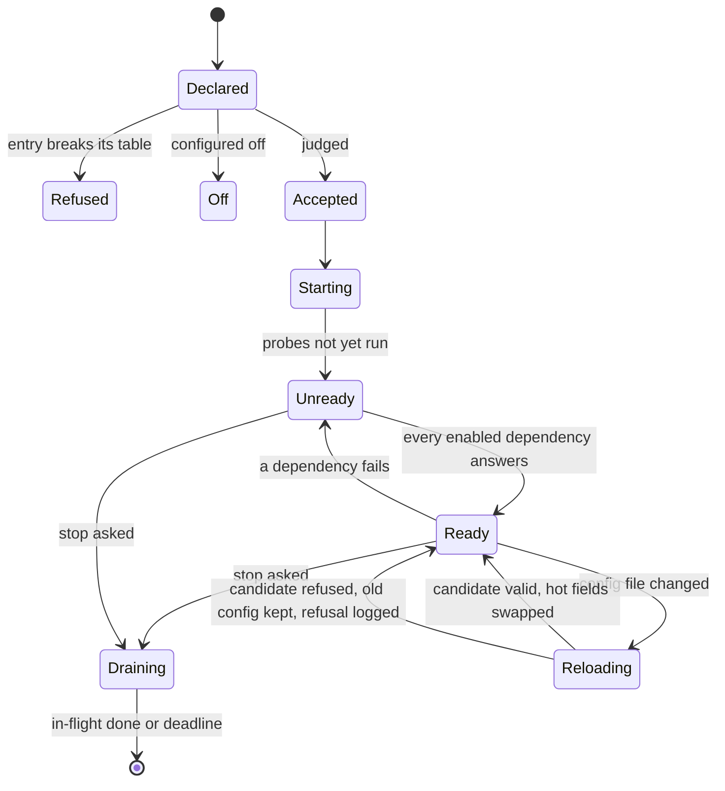
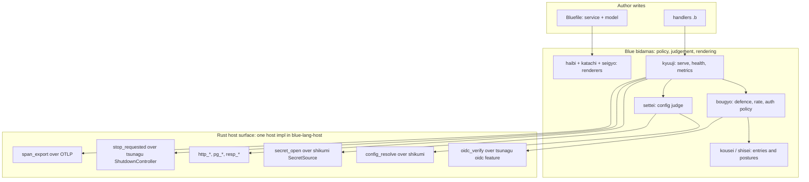
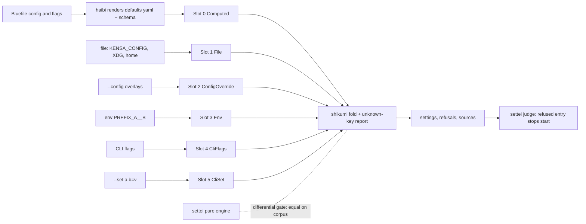
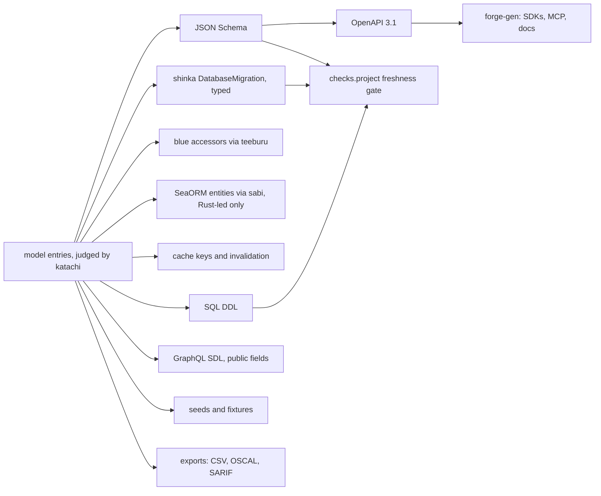
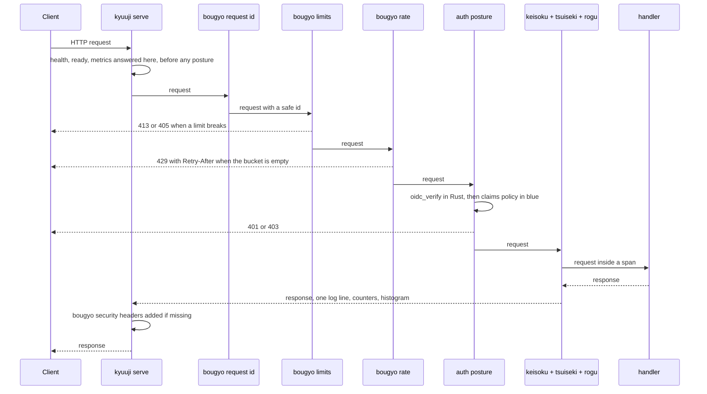
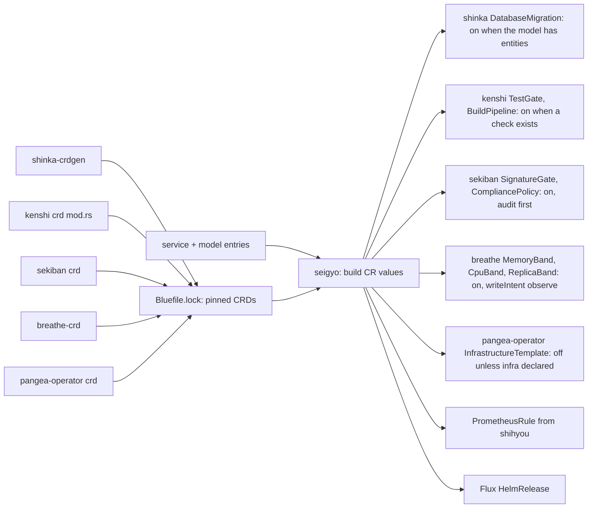
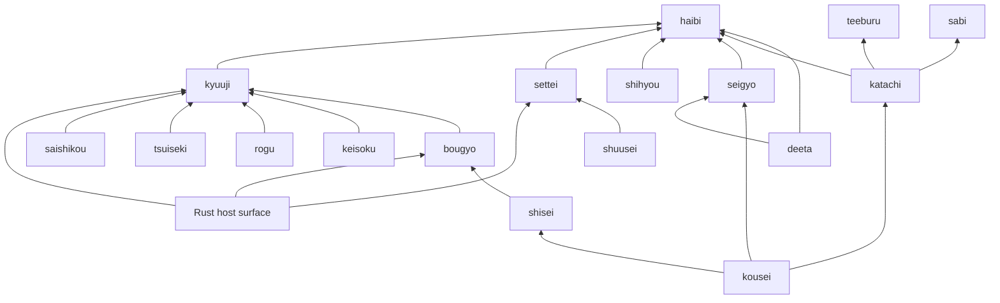

# SERVICE-ARCHITECTURE — the default blue service

Status: DESIGN, 2026-10-23. Nothing below is built unless the tier ledger (§12)
says so. Paths are under `~/code/github/pleme-io/`. Line numbers were read on
2026-10-23. What a service may touch (effects, peers, paths, ports, programs),
and how each layer enforces it, is `SERVICE-ACCESS.md`.

## 1. Destination

A blue service gets every service concern by default. These concerns include
config tiers, secrets, health, readiness, metrics, logs, traces, shutdown,
supervision, retry, rate limits, auth, caching, migrations, API types, SLOs,
introspection, hot reload and each controller's custom resource. Each concern
is one declaration entry. It is on by default. You can configure it off or tune
it alone, and it is refused alone when it is wrong. No concern is ever deleted.
The author writes one `service(...)` and one `model(...)` in the Bluefile, and
then writes the handlers. All other files are renderings of those two
declarations. Where the work needs Rust (a socket, a signal, RS256, the RESP
protocol), blue calls one Rust host primitive that the fleet already trusts. A
service does not write its own copy. **Blue is the source, and every other
format is a rendering of it.** This covers Helm charts and values schemas,
JSON Schema, GraphQL and OpenAPI, SQL DDL, seeds and fixtures, the service
process, controller CRs, nix and CI. A stale rendering is a red build, and a
hand-written rendering is a defect.

World facts that limit this: Kubernetes takes YAML or JSON objects that its
apiserver checks against each CRD's structural schema. Postgres takes SQL.
Signals, sockets and TLS come from the kernel. Each of these is a renderer
target or a host primitive. None of them is a reason to write a second source.

## 2. Ground

The table lists each concern with its Rust home, its blue state and the gap.
"Dup" counts the independent copies in pleme-io's Rust (agent survey on
2026-10-23, excluding vendored code).

| Concern | Rust today (path:line) | Blue today | Gap |
|---|---|---|---|
| Config tiers | `shikumi/src/overlay.rs:95` six slots: Computed → File → ConfigOverride → Env → CliFlags → CliSet. `TieredConfig` `shikumi/src/tiered.rs:1200`. Unknown-key report `tiered.rs:1344`. `ConfigArgs` `shikumi/src/cli.rs:102`. kensa goes through `tameshi/src/config.rs:102`, a thin `ProviderChain` wrapper with no CLI slot and no unknown-key report | `settei` reimplements defaults → file → env in blue (`bidamas/settei/settei.b`): `__` nesting, `<APP>_CONFIG`, XDG discovery, unknown keys refused. haibi renders `config/<name>.yaml` and its schema | There are two engines with the same env grammar and different strictness. settei has no CLI slot, no `--set` and no overlays |
| Secrets by file | `shikumi/src/secret.rs:116` `SecretSource` (file, sops, op, akeyless, command). kensa has its own `read_secret` at `kensa/src/main.rs:565` | Declarations carry `*_file` paths. kensa refuses a literal (`kensa/src/config.rs:135`) | No blue primitive reads a secret. A secret becomes a plain string |
| Health, ready, metrics | `tsunagu/src/axum.rs:81` `health_router` (30 repos). About 75 repos hand-roll routes, with paths that differ: kensa `/health`, shinka `/healthz` (`shinka/src/health.rs:72`) | `kyuuji::answer` answers health before the handler. `kyuuji` `/metrics` has request counters and a latency histogram. `keisoku` has counter, gauge and histogram | No readiness distinct from liveness. No dependency checks (db, cache) |
| Logs | `tsunagu/src/tracing_init.rs:92`, `shidou/src/tracing_init.rs:35`, `pleme-observability/src/tracing.rs:87`: 3 crates. About 130 repos call `tracing_subscriber::fmt` directly | `rogu`: one JSON line per call on stderr | None for logs. The Rust side has three overlapping crates |
| Traces | `pleme-observability/src/tracing.rs:87` (OTel) | `tsuiseki`: spans and lineage, in process | No export. No trace id from the request id |
| Graceful shutdown | `tsunagu/src/shutdown.rs:63` `ShutdownController` (SIGTERM and SIGINT). 31 files call `with_graceful_shutdown`. `samba/src/worker.rs:90` handles `ctrl_c` only. kensa calls an undefined `shutdown_signal()` under `grpc` (`kensa/src/main.rs:502`) | `kyuuji::serve_once` polls with `wait_ms`, so a drain point exists | No primitive tells blue "a stop was asked". No drain |
| Supervision | The OS supervisor (systemd, launchd, kubelet) through the substrate trio (`substrate/lib/module-trio.nix:77`) | `blue-lang-proc` `Supervisor` (`crates/blue-lang-proc/src/lib.rs:373`), one-for-one, one-for-all and rest-for-one, max restarts | No restart window and no backoff (caixa has a window, this crate does not) |
| Retry, backoff | `tend/src/backoff.rs:132` (crate-private). 23 repos have their own | `saishikou::retrying` has a fixed wait. `kirikae` has `backoff_ms` | Two blue halves. Neither has jitter |
| Rate limit | `samba/src/bucket.rs:76` `LeakyBucket`. 21 repos have their own | `bougyo` limits request size and method only | No rate posture |
| Request defence | none shared | `bougyo` headers, request id and limits. `shisei` posture stack | None. This is the model to copy |
| Auth (OIDC) | `kensa/src/oidc.rs:67` `Verifier` (RS256, JWKS). 15 repos verify JWTs with no shared crate | none | No primitive and no posture |
| Introspection | `kanshou/crates/kanshou/src/server.rs:19` (Unix socket, 11 repos) | kousei's judgement returns accepted, off and refused, but nothing serves it | No surface |
| Hot reload | `shikumi/src/store.rs:37` `ConfigStore`, `watcher.rs:970`, `hotswap.rs:45` validate-then-swap | none | No reload |
| Feature flags | `enabled` fields in each service (`kensa/src/config.rs:70`) | `flags:` in the Bluefile, `settei::flag` | None for flags. A flag has no owner or expiry |
| Data model | SeaORM entities by hand (lilitu), `kensa/src/config.rs:102` | flat `schema:` map. haibi `table_sql` (`haibi.b:321`), `ddl_in` (`:360`). `teeburu` insert and latest | No `model(...)` word (the Bluefile words are listed at `crates/blue-lang-pkg/src/bluefile.rs:1055`). No keys, relations, secret, public, cache or retention |
| Migrations | shinka operator, `shinka/src/crd/database_migration.rs:72` | haibi `migration` (`haibi.b:664`) emits a `DatabaseMigration` | The CR is built from string lines, not as a typed value. Only CREATE statements, with no plan for model changes |
| Cache | none shared. Valkey is declared in kensa only (`kensa/src/config.rs:102`) | haibi `cache_values` (`:127`) mounts the secret | No RESP client. No keys or invalidation from the model |
| API generation | `forge-gen/src/commands/generate.rs:201` (OpenAPI → SDK, MCP, docs) | none | Blue does not render OpenAPI, GraphQL or JSON Schema for the API |
| SLO, alerts | `helm-forge/src/template_gen.rs:92` | `shihyou` rules and dashboard, rendered into the chart (`haibi.b:729`) | None. Exists in blue |
| Values schema | `helm-forge/src/values_schema.rs:95` | haibi `values_schema` (`:232`) | Two renderers (blue and Rust) of one kind of artifact |
| Controller CRs | Each controller derives its CRD from Rust: shinka `shinka/src/bin/shinka-crdgen.rs:42` (gated by a freshness test), kenshi `kenshi/src/crd/mod.rs:47` (BuildPipeline, TestGate, Promotion, DeploymentPipeline and more), sekiban `sekiban/src/crd/` (CompliancePolicy, Certification, SignatureGate), breathe `breathe/breathe-crd/src/lib.rs` (MemoryBand, CpuBand, ReplicaBand, RequestBand, AppBand, BreathePosture and more), pangea-operator `pangea-operator/pangea-operator/src/crd/` (InfrastructureTemplate, PangeaNamespace and more) | haibi renders `DatabaseMigration` (string lines) and `shihyou` renders a `PrometheusRule` (a value) | No CR is checked against its CRD schema. kenshi, sekiban, breathe and pangea-operator CRs are not rendered at all |
| Embedding | `crates/blue-lang-host/src/lib.rs:226` `Program`, `#[host]` macro (`blue-lang-host-macros/src/lib.rs:10`). kensa embeds a pure engine (`kensa/src/attestation.rs:98`) | `sys` primitives (`crates/blue-lang-runtime/src/sys.rs:61`) and `net` (`http_*`, `pg_*`, `nats_*`, `net.rs:247`) | No service host surface (shutdown, secret, config, OIDC, RESP) |

Second probe. The survey found two unwired bundles. `pleme-service-foundation`
(`pleme-service-foundation/src/bootstrap.rs:34`) has two copies that differ in
every file. `libraries/rust/crates/pleme-health` has 0 users. Neither one is a
base to build on. tsunagu (30 users) is the de facto shared Rust runtime, and
this design extends it.

## 3. Research

These sources bound the design. I cite them from known specs. I did not fetch
them again this session.

| Source | Use |
|---|---|
| JSON Schema draft-07, https://json-schema.org/draft-07/schema | adopt: haibi already emits draft-07 |
| OpenAPI 3.1, https://spec.openapis.org/oas/v3.1.0 | adopt: its schemas are JSON Schema 2020-12, so the model renders once to both |
| Kubernetes structural schema, https://kubernetes.io/docs/tasks/extend-kubernetes/custom-resources/custom-resource-definitions/#specifying-a-structural-schema | adopt: this is the check a rendered CR must pass at build, not at apply |
| Kubernetes probes, https://kubernetes.io/docs/tasks/configure-pod-container/configure-liveness-readiness-startup-probes/ | adopt: liveness and readiness are separate states |
| Twelve-Factor config, https://12factor.net/config | adapt: env is one tier, not the only tier |
| Prometheus naming, https://prometheus.io/docs/practices/naming/ | adopt: kyuuji's names already follow it |
| OpenID Connect Core 1.0, https://openid.net/specs/openid-connect-core-1_0.html, RFC 7519 | adopt: issuer, audience and expiry checks in Rust, with policy in blue |
| GraphQL spec, https://spec.graphql.org/October2021/ | adapt: a projection of the model's public fields |

## 4. States and trust

**Config precedence.** shikumi's six slots are the one order: Computed
(rendered defaults) → File → ConfigOverride → Env → CliFlags → CliSet. A higher
slot wins. The order is a property of the slot (`overlay.rs:104`), not of push
order. Blue does not define a second order.

**Each setting is in one of these states:** default, set by a named slot,
refused (unknown key, wrong type, literal secret), or pending (a
restart-class field changed on reload). shikumi's `extract_with_sources`
(`provider.rs:1997`) names the slot. A refused setting does not fall back to its
default. kensa's `from_env` does that today (`kensa/src/config.rs:244`), and this
design forbids it.

**Secrets.** A declaration holds a reference (`*_file`, or a shikumi
`SecretSource`), never a value. The host primitive returns an opaque handle
(`Value::Foreign`, as `net.rs:407` does for sockets). Blue can pass the handle
to a host primitive. It cannot render, log or interpolate the handle. Only the
Rust side reads the bytes.

**Absence is a state.** No config file is not an error. It means the
Computed slot only. No database URL means the data surfaces are off. It does
not mean a failed connection. No cache entry means no cache binding. A readiness
check that has not run yet answers `unknown` (503 with the reason). It never
answers ready. A controller whose CRD is not pinned makes its entry `blind` at
build, and the entry is refused with that reason. The other entries still
stand.

**Trust.** The Bluefile is trusted. It is code review's domain. Env and CLI are
operator input. They are trusted to choose values, but not to add keys. Request
input is untrusted. It passes the posture stack (§5d) before it reaches a
handler. A JWT is trusted only after the Rust verifier checks the signature,
issuer, audience and expiry, and the blue `auth` posture accepts its claims.
A controller trusts only CRs that its own schema admits. Blue checks the same
schema at build, so a bad CR never reaches the apiserver.



## 5. Shape

### 5a. Blue over a Rust host

There are two run modes. Both use the same bidamas.

- **Blue-led (the default).** The `blue` binary is the host. It already links
  `sys` and `net` (`crates/blue-lang-cli/Cargo.toml:16`). The service is a `.b`
  program. ola-mundo runs this way. A new service writes no Rust.
- **Rust-led.** A Rust binary embeds blue through `blue-lang-host`. It uses
  blue for judgement and Rust for heavy I/O. kensa runs this way. Use this mode
  only when a concern needs Rust that the blue host surface lacks. Then the
  surface grows in blue's host crate, so every blue-led service gets it.



The rule for each concern: **policy and shape go in blue, while bytes, crypto,
signals and protocols go in Rust.**

| Concern | Lives in | Why |
|---|---|---|
| Config tiers | Rust engine (shikumi) with the blue judge | shikumi has six slots, overlays, sources, secrets and reload. 107 repos use it |
| Secrets | Rust (shikumi `SecretSource`) | bytes must not enter blue values |
| Health, ready, metrics text | blue (kyuuji) | pure text over `http_*` |
| Logs | blue (rogu) | one JSON line. No Rust need |
| Trace export | Rust (OTLP) | protocol |
| Shutdown signal | Rust (tsunagu) | kernel signals |
| Supervision policy | blue (saishikou policy), executed by `blue-lang-proc` | the policy is data, and restart is runtime |
| Retry, backoff | blue (saishikou, with kirikae's `backoff_ms` merged in) | arithmetic plus `sleep_ms` |
| Rate limit | blue (bougyo `rate` posture) | a leaky bucket is arithmetic over `now_ms` |
| OIDC | Rust verify (kensa's `Verifier` lifted into tsunagu), blue claims policy | RS256 and JWKS fetch are crypto and network |
| Cache client | Rust (RESP in Rust, CONTAIN THE C) | protocol |
| HTTP/2 and gRPC | blue (`heddaa`, `tajuu`), over Rust readiness and TLS | operator, 2026-10-23: the protocol is blue; `docs/HTTP2.md` |
| Cache keys | blue (from the model) | shape |
| Migrations, CRs, schemas | blue renderers | shape |
| Introspection | blue stance, served over kanshou's socket protocol | the stance is data, and the socket is Rust |
| Hot reload | Rust (shikumi `ConfigStore`), blue swaps at a safe point | file watch is OS |

### 5b. Config: blue is the source, shikumi is the engine

Decision. The Bluefile `config:` and `flags:` entries are the source. haibi
renders them into the Computed slot (`config/<name>.yaml`) and its JSON Schema.
It already does this. A setting is text, an integer, true/false, a list of
text, nil (unset: the program keeps its own default) or a map of settings.
The chart passes a nested setting as `<PREFIX>_<KEY>__<KEY>`, the separator
shikumi and settei read back; a list goes as JSON, and nil goes not at all. At run time, one host primitive, `config_resolve(app)`,
runs shikumi's six slots and returns `[settings, refusals, sources]`. settei
keeps its pure judge (`file_tier`, `env_tier`, `coerce`) as the reference
semantics and as the engine on hosts without shikumi (wasm, a pure test run).
A differential gate runs the same corpus through both engines and fails on
any difference. kiwari's differential against blue's parser is the precedent.
settei's own discovery is configured off when the host offers
`config_resolve`. It is not deleted.

Why not blue reimplements: settei already does, and it lacks CLI, `--set`,
overlays, source tracking, secrets and reload. Closing that gap means writing
shikumi a second time. That breaks "solve once" for a capability that 107 Rust
repos keep current. Why not "Rust only, no settei": a pure blue test (ola.b's
`test` blocks) needs config semantics with no host, and the ladder keeps
vocabulary on both rungs. The differential turns the duplicate judge into one
checked fact.



### 5c. One model, every data surface

`model(...)` is a new Bluefile word. Each entity is one entry: fields and
types, key, relations, indexes, `secret`, `public`, `cache` (key shape, TTL,
what invalidates it) and `retention`. Today's flat `schema:` lowers into model
entries, so it stays valid (BLUE-STRUCTURE §6.5).

```
model("greetings", {
  key: "id",
  fields: {text: "text", created_at: "timestamptz?"},
  public: ["text", "created_at"],
  cache: {ttl_s: 60, invalidated_by: [:insert]},
  retention: {days: 90}
})
```



### 5d. A request through the default stack

`shisei::stack` puts the first layer outermost (CATALOG `shisei::stack`). The
default order is fixed by data, not by each service.



When the stop signal arrives, `kyuuji` stops accepting requests and readiness
answers 503. In-flight requests finish up to the drain deadline, and then
the process exits 0.

### 5e. One declaration, each controller's CR

Each controller owns its schema. It derives its CRD from Rust
(`CustomResourceExt`, as `shinka-crdgen` does). `blue lock` pins each CRD a
service uses into `Bluefile.lock`, as it pins sources. The proposed `seigyo`
bidama builds each CR as a blue value and checks it against the pinned
`openAPIV3Schema` at build. It then renders the CR as YAML. A CR that fails
is refused alone. Its siblings still render.



Helm template holes (`{{ .Values.database.host }}`) are a problem. A CR value
with a hole is not a final object. A hole becomes a typed value,
`hole(path, type)`. seigyo checks a hole's type against the schema at the
field where it sits, and haibi checks the same path against
`values.schema.json`. So the hole is checked twice, and both checks come from
one declaration.

### 5f. Every target format is a rendering

| Target | Renderer today | Gap |
|---|---|---|
| Helm chart | `bidamas/haibi/haibi.b:768` `files_with` | CR templates are string lines |
| values.schema.json | `haibi.b:232` | helm-forge renders the same kind in Rust |
| config defaults + schema | `haibi.b:100`, `:811` | none |
| SQL DDL | `haibi.b:321`, `:360` | no ALTER plan |
| seeds | `haibi.b:398` `insert_sql` | not driven by a model |
| shinka DatabaseMigration | `haibi.b:664` | untyped, not schema-checked |
| PrometheusRule, dashboard | `shihyou`, `haibi.b:729` | none |
| Other controller CRs | none | seigyo |
| JSON Schema for the API | none | katachi → haibi |
| OpenAPI | none | from the model's JSON Schema, consumed by forge-gen |
| GraphQL | none | design |
| Rust types | `bidamas/sabi/sabi.b:197` `struct` | not wired to the model |
| DuckDB SQL | `kueri` | none |
| nix | the Bluefile engine (`BLUE-STRUCTURE.md` §5.5) | as that doc tracks |
| CI | pleme-io/actions in blue (`action.yml` + `run.b`) | not rendered from the service |
| catalog entry | `ola-mundo/Bluefile` `generate("catalog", ...)` | none |
| the service process | `blue` host + kyuuji | host surface (§5a) |

## 6. Packaging

Every concern ships as a bidama. Existing ones come first. A new name is
PROPOSED until the naming check (`naming` skill) passes.

| Bidama | Owns | State | Honest gap |
|---|---|---|---|
| `haibi` | lowering of `service()` to chart, config, DDL, migration, catalog | exists | renders CRs as strings. No model input |
| `kousei` | entry judgement: accepted, off, refused | exists | none |
| `shisei` | posture stack and its order | exists | no default order for the full stack |
| `bougyo` | headers, request id, limits. Gains `rate` and `auth` postures | exists | no rate posture, no auth posture |
| `settei` | config judge, pure engine, fallback discovery | exists | no `config_resolve` path. No differential gate |
| `kyuuji` | serve, health, metrics. Gains readiness and drain | exists | no readiness, no drain |
| `keisoku` | counters, gauges, histograms | exists | not wired to kyuuji's metrics |
| `rogu` | JSON logs | exists | no request id field by default |
| `tsuiseki` | spans | exists | no export, no trace id from the request id |
| `saishikou` | retry and backoff policy (absorbs `kirikae::backoff_ms`) | exists | no jitter, no restart window |
| `shihyou` | SLO rules and dashboards | exists | none |
| `teeburu` | Postgres access | exists | no typed accessors from the model |
| `shuusei` | amending declared data: overlays on declarations | exists | not used by services yet |
| `deeta` | JSON and YAML | exists | none |
| `sabi` | Rust source from blue data | exists | not fed by the model |
| `nisshi` | append-only audit log | exists | not a default entry |
| `katachi` (PROPOSED) | the `model(...)` vocabulary and judge: entities, keys, relations, secret and public, cache, retention | design | all of it |
| `seigyo` (PROPOSED) | typed CR values checked against pinned CRDs, with typed Helm holes | design | all of it |

Host surface: one `#[host]` impl in blue's host crate, behind a `service`
feature that `blue-lang-cli` enables. It offers `config_resolve`,
`secret_open`, `stop_requested`, `oidc_verify`, `resp_*` and `span_export`.
This is design. None of these functions exists yet.



What a new service author writes:

```
package("svc", "0.1.0")
service("svc", {program: "svc.b", repository: "ghcr.io/pleme-io/svc", port: 8080})
model("things", {key: "id", fields: {name: "text"}, public: ["name"]})
```

That is the whole Bluefile. Each concern in §2 is on by default. To turn one
off, write one entry, for example `off(:rate)` or `off(:breathe)`. To tune one,
write its field, for example `slo: {latency_ms: 250}`. The handlers in
`svc.b` are the only other source file.

## 7. Phases, each ending green

| Phase | Work | Gate |
|---|---|---|
| P0 | this doc | review. The operator approves the destination |
| P1 | `config_resolve` and `secret_open` over shikumi. settei's differential corpus | the differential is red on one seeded mismatch, then green. ola-mundo `checks.project` is green |
| P2 | `seigyo`: pin shinka's CRD, port haibi `migration` to a typed value | ola-mundo and kensa `deploy/` are byte-identical after regen. A seeded bad field is refused alone |
| P3 | `katachi` and `model(...)`. Flat `schema:` lowers into it | DDL is byte-identical for ola-mundo and kensa |
| P4 | JSON Schema and OpenAPI from the model, consumed by forge-gen | forge-gen generates from the rendered spec in CI |
| P5 | `stop_requested`, readiness, drain. bougyo `rate`. `oidc_verify` (lift kensa's `Verifier` into tsunagu) and the auth posture | a SIGTERM test drains in-flight requests. Rate and auth have red-then-green tests |
| P6 | RESP in the Rust host. Cache keys from the model | a key changes when the model changes. Invalidate-on-insert test |
| P7 | kenshi, sekiban and breathe entries through seigyo | each CR is checked against its pinned CRD. Each entry configured off alone |
| P8 | hot reload through `ConfigStore`. Stance served over kanshou | a refused reload candidate keeps the old config |

## 8. Decisions

1. **Config: shikumi is the engine, and blue is the source and the judge.**
   Rejected: settei grows to full parity (that writes shikumi twice).
   Rejected: drop settei (pure runs and wasm lose config semantics). The
   differential gate holds the two judges equal.
2. **Blue-led is the default run mode, and Rust-led is the exception.**
   Rejected: a Rust host per service (kensa's shape for everyone). That puts
   Rust in every service, against the ladder, and it duplicates host code per
   service. A missing capability grows the one host surface.
3. **Controller CRs are typed values checked against each controller's own
   generated CRD, pinned in the lock.** Rejected: string templates (today's
   haibi, unchecked). Rejected: blue mirrors each CRD by hand (a second owner
   of each schema).
4. **Policy in blue, and bytes in Rust (§5a table).** Rejected: everything in
   blue (RS256, RESP and signals are world facts). Rejected: everything in Rust
   (that is the current fleet, with 31 shutdown copies and 15 JWT copies).
5. **Lift shared Rust pieces into tsunagu, not a new crate.** tsunagu has 30
   users. Rejected: revive `pleme-service-foundation`. It has two diverged
   copies and 0 users.
6. **One model word, with its renderers in haibi.** Rejected: a separate DDL,
   API and cache declaration per surface (that is the drift BLUE-STRUCTURE
   §6.5 forbids).

## 9. Open questions

| Question | Type |
|---|---|
| How does a model change become a migration (ALTER, backfill, a destructive change gated)? | ours |
| Does haibi's values schema replace helm-forge's, or does one render through the other? | ours |
| Health paths: `/healthz` + `/readyz` (haibi's default) or `/health` + `/ready` (kensa)? Default `/healthz`, with `probe` overriding it, until the fleet picks one | ours |
| Can the apiserver's CEL rules (`x-kubernetes-validations`) be checked at build without a cluster? | world fact (CEL is checked by the apiserver. An offline CEL evaluator must match its version) |
| Does a JWKS fetch at start make readiness depend on the IdP? | world fact (the IdP can be down). Design: cache the last good keys, and set readiness to `unknown` while there are none |
| Where does a blue-led service get TLS? | world fact (needs a TLS stack in Rust). Today a mesh or ingress terminates it |
| Do the sekiban default modes (audit before enforce) exist in its CRD? | ours, to measure. I did not find a mode field in `sekiban/src/crd/` |

## 10. Bad states made unrepresentable

| Bad state | How it is refused | Scope |
|---|---|---|
| A secret literal in a declaration | `*_file` or `SecretSource` only. A string at a secret field is refused | that entry |
| A secret value in a log or a response | `secret_open` returns `Value::Foreign`. Rendering it is a type error | that call |
| An unknown config key, from file, env or CLI | shikumi's unknown-key report becomes a settei refusal | that key |
| Broken config falls back to defaults | there is no `unwrap_or_default` path. A refusal stops the start | the process start |
| A hand-written chart, DDL, schema or CR beside the model | the freshness gate (`checks.<system>.project`) | that file |
| A CR its controller would reject | seigyo checks it against the pinned CRD | that CR |
| A field that is both secret and public | katachi refuses the field | that field |
| A cache key not derived from the model | keys exist only as model renderings | that entity |
| An unbounded restart loop | `max_restarts` and a restart window are required in the policy | that child |
| Ready before dependencies answer | readiness starts `unknown`, never ready | that probe |
| A pure judge that does I/O | the judge runs with no `sys` (kensa's engine shape, `attestation.rs:98`) | that bidama |

## 11. Duplication this design retires

Graceful shutdown (31 files), JWT verify (15 repos), rate limiters (21), backoff
(23), tracing init (3 crates), layered config loaders (3) and health route
shapes (about 75). These are the Rust survey counts from 2026-10-23. A blue
service inherits one copy of each. The Rust fleet keeps its own copies until
each repo is touched.

## 12. Tier ledger

| Item | Tier | Evidence |
|---|---|---|
| `service()` → chart, config schema, values schema, DDL, migration, SLO | tested | ola-mundo and kensa `checks.project` (freshness gate) |
| settei defaults → file → env | tested | settei tests, `ola.b` |
| shikumi six slots, secrets, reload | tested | shikumi tests (in its repo) |
| kyuuji serve, health, metrics | tested | `kyuuji.b` tests |
| bougyo, shisei postures | tested | CATALOG test counts |
| blue embedded in Rust (pure) | live | kensa attestation plane |
| `config_resolve`, `secret_open`, `stop_requested`, `oidc_verify`, `resp_*`, `span_export` | design | none |
| differential settei ≡ shikumi | design | none |
| `model(...)`, katachi | design | none |
| seigyo, typed CRs, pinned CRDs | design | none |
| OpenAPI, GraphQL from the model | design | none |
| rate and auth postures, readiness, drain | design | none |
| hot reload, introspection for blue | design | none |
