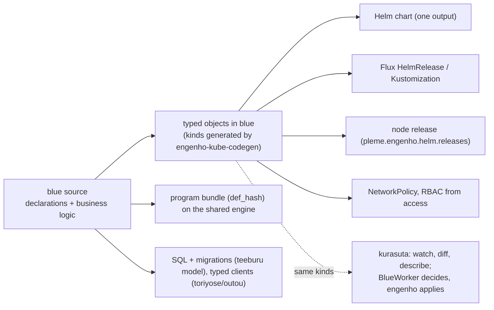
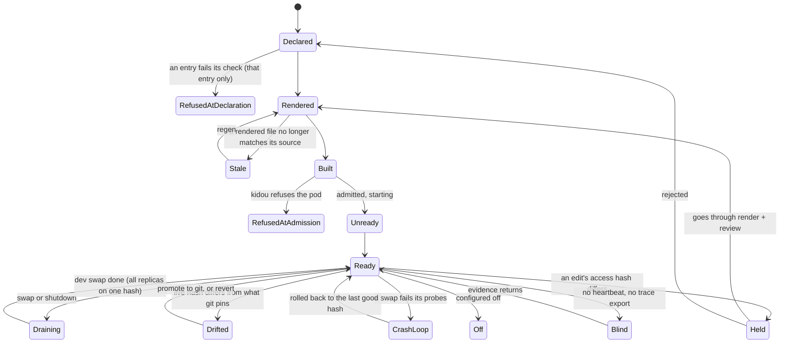

# SUBSTRATE — blue as the one language of the whole stack

Status: ⏳ in progress, 2026-11-09. Layer 1 serves one component on engenho.
The rest of this doc is design. The state of each part is in the
[Ledger](#ledger) at the end.

The operator's direction, 2026-11-08 and 2026-11-09: build bottom up. The
business logic of everything is blue. Everything it requires (the Helm stack,
the Kubernetes objects, the libraries) is rendered from it. blue is one
language, in the way Darklang is one language. Reuse what exists as much as
possible. This doc owns that direction. Each part has its own doc:
`BUILD-STACK.md`, `SERVICE-ARCHITECTURE.md`, `SERVICE-ACCESS.md`,
`SERVICE-DATA.md`, `DATA-FRAMEWORK.md`, `STDLIB.md`, `FRONTEND-PLAN.md` and
`HORIZON.md`. Where a ruling exists, this doc follows it (§7).

## 1. Destination

A person writes one thing: blue. A program declares what it is (a service, a
frontend, an appliance, a reconciler) and what it holds (its data model, its
routes, its queues, its schedules, its secrets, its peers, its authority) in
blue, beside the code that is its behaviour. Everything else is a rendering of
that one source and is never edited by hand: the wasm component, every
Kubernetes object, the Flux objects that place it, the SQL and migrations of
its data, the typed clients of its peers, the frontend bundle for each
placement. On engenho the program runs as a WASI component in-process, holds
only what its declaration grants, and reads the Kubernetes API through the same
typed kinds engenho itself uses, so a reconciler is a blue program like any
other. During development an edit is live without a deploy step, against
traces of real requests; what a cluster runs for good is still what git
pins. The same declarations render to a browser, a phone, a desktop and a local
appliance; and two blue systems that meet over the ibuki wire prove to each
other, with tameshi receipts and shomei signatures, what they ran and what they
saw, with no server between them.

**World-facts that bound it:** the Kubernetes API, its OpenAPI schema and its
discovery document (plural names and scope are only in discovery) are fixed
upstream; WASI 0.2 gives a component only the imports its host links; a
browser runs wasm only through JavaScript and the DOM; iOS forbids executing
downloaded code, so an iOS placement ships its engine and bundle inside the
app; a signature proves who signed, never that the signer was honest. Every
other limit below is ours to remove.

## 2. Ground: what exists

The [Ledger](#ledger) at the end lists each piece and its state, measured on
2026-11-09. Layer 1 has the most code. Layers 2 and 3 have their primitives,
but no placement shell and no application.

## 3. Research

Cited from prior knowledge on 2026-11-09; each row is re-read at review before
a phase adopts it.

| Prior art | What it proves | Decision |
|---|---|---|
| Darklang (darklang.com) | one language with handlers, datastores, workers and crons; deployless edits; trace-driven development | ADOPT the construct set, the dev-time live loop and traces; SKIP its hosted cloud and structured editor |
| Kubernetes OpenAPI v3 + discovery | kind schemas (OpenAPI) and plural/scope (discovery) | ADOPT both, as engenho-kube-codegen already does |
| kube-rs, controller-runtime | list/watch/reconcile/status | ADAPT through engenho's `Controller::tick` + `BlueWorker`; no second loop |
| Helm 3 | the install format Flux and engenho consume | ADAPT: a chart is one output of typed objects (§7), not the source |
| Flux | GitOps placement | ADOPT, rendered from `placement(...)`, beside the node arm |
| WASI 0.2, wasi-http | a component holds only linked imports | ADOPT as the M2 target; until then kidou grants are the enforcement |
| SpinKube, runwasi | wasm on Kubernetes via RuntimeClass | ADOPT the RuntimeClass contract; SKIP the shim (engenho runs components in-process) |
| Unison | content-addressed code makes swaps cheap | ADAPT via `def_hash` (HORIZON H3) for the dev loop |
| OpenTelemetry OTLP | the common trace wire | ADOPT for tsuiseki export |

## 4. The model

### 4.1 One source, typed objects, many outputs



The center of layer 1 is **one typed set of Kubernetes kinds visible in blue,
generated by the generator engenho already has** (`engenho-kube-codegen` over
the vendored OpenAPI plus discovery). blue does not get a second generator: the
same codegen emits blue records beside the Rust types. `render.rs`, haibi and
every placement emit through those records; a reconciler reads through them.

### 4.2 The constructs

| Declaration | Behaviour lives in | Renders to |
|---|---|---|
| `service(...)` | `kyuuji` handlers | Deployment/Service objects, chart, Flux or node release |
| `model` (its own bidama) | queries over the model | SQL DDL, migrations, data API (`DATA-FRAMEWORK.md`) |
| `shigoto` schedule | a handler per firing; `claim` holds a lease so one replica fires; `missed`/`backfill` cover scale-to-zero and swaps | a supervised timer in the service |
| `taiki`/`messeeji` queue | a handler per message | NATS JetStream objects, supervised consumers |
| secret | `himitsu` record read through shikumi `SecretSource` | cofre `SecretRef` in the declaration |
| peer | calls through the generated client | the client; the NetworkPolicy egress rule |
| `placement(...)` | — | Flux objects for a cluster, or a node release |
| reconciler | a blue `BlueWorker` decision over typed kinds | a watch in engenho; RBAC for exactly its kinds |

### 4.3 Host seams (the only Rust)

Rust stays where blue cannot reach a world-fact: the wasmtime host and WASI
links (`wasm_backend.rs`), sockets and TLS, the Kubernetes transport and watch
(`engenho-kube-client`), crypto, and the OS shells of layer 2. The pattern is
`BlueWorker`: blue decides, Rust applies. Each seam is one crate behind one
capability in `blue-lang-waku/src/capability.rs`.

### 4.4 Reuse: every piece extends what exists

Rule: no construct, phase or placement starts a primitive while a row below is
the near-miss; a new word comes only after `blue arika word` and `blue arika
like` find nothing (`ARIKA.md`); a shape seen twice is promoted, and the
reuse census holds it.

| Need | Extends | Not |
|---|---|---|
| Kubernetes kinds | `engenho-kube-codegen` (emit blue records too) | a second generator, hand-typed kinds |
| Kubernetes reads, watch, reconcile | `engenho-kube-client`, `Controller::tick`, `BlueWorker`, `kurasuta` verbs | a new client or loop; vigy (a native host runtime, not reachable from a component) |
| routes, handlers | `kyuuji` | a second router |
| data model | the model bidama (`DATA-FRAMEWORK.md`), `teeburu` (`model`/`evolve`/`judge`); SQL rendered from `kueri`'s typed tree | hand SQL; a second model beside the bidama; `kueri` as the model (it renders the SQL, it does not hold the shape) |
| schedules | `shigoto`, ASYNC timers, engenho `cron.rs` | a CronJob per schedule |
| queues | `taiki`/`messeeji` spaces over `net/nats.rs` | a new broker client |
| secrets | cofre `SecretRef` (declared), shikumi `SecretSource` + `himitsu` (read) | blue's own parallel `SecretRef` |
| typed peer APIs | `toriyose/outou`, `katachi`, `seigyo` | hand clients |
| retry, supervision | `saishikou`, `blue-lang-proc` | ad-hoc retries |
| loop liveness | `shinchoku` | a new probe |
| config, every entry judged alone | `kousei`, `settei` | ad-hoc parsing |
| render to files | `render.rs` typed objects, haibi as its blue face | Go-template strings |
| node admission, grants | `kidou`, waku capabilities | a second policy engine |
| traces | `tsuiseki` + OTLP | a new tracer |
| caching | mondou `Store` domains (HORIZON H3) | a cache per feature |
| views on every placement | `gamen`, `ugoki`, `kyasshu`, `burauza` | a view layer per placement |
| wire, peers | `ibuki`, runtime `wire` | a new transport |
| signatures, receipts | `shomei`, tameshi, receipts v2 | a new crypto layer |
| tests, laws, differentials | `tesuto`, `okite`, `heni`, `happa` | per-feature harnesses |

## 5. States and trust



- **Absence is a state** (`Blind`), never `Ready` and never refused.
- **Authority today is kidou's runtime grant**; link-time imports from `access`
  are the M2 target (`imports.rs`). An edit is held when its `access` hash
  differs from the running one; it is never compared by imports, because every
  service shares one engine.
- **Git stays the truth for what a cluster runs** (`SERVICE-ACCESS.md` §5–6).
  A live dev swap moves the service to `Drifted` until it is promoted (a commit
  that pins the new hash) or reverted; Flux would otherwise undo it.
- **Partial swaps:** a swap completes when every replica reports the new hash;
  until then the service is `Draining`, and a failed replica rolls the whole
  set back.

## 6. The dev loop: an edit goes live

```mermaid
sequenceDiagram
  participant Dev as person
  participant Blue as blue (check, def_hash, render)
  participant Store as sui (bundles by hash)
  participant K as kidou on engenho
  participant Pods as replicas
  Dev->>Blue: edit a handler
  Blue->>Blue: check; access hash unchanged?
  Blue->>Store: push bundle (content hash)
  Blue->>K: offer hash for service S (dev lane)
  K->>Pods: drain, swap at a request boundary
  Pods-->>K: all replicas on the new hash (else roll back)
  K-->>Dev: Drifted; traces (OTLP) tagged with the hash
  Dev->>Blue: promote: commit pins the hash; Flux/node release agrees
```

## 7. Decisions (and where existing law wins)

| Decision | Why; alternatives rejected |
|---|---|
| Typed objects are the source; Helm is one output | the review showed the better alternative already exists (`render.rs`); Go-template strings are the `format!`-of-a-target-syntax the house bans, and `hole(path, type)` (`SERVICE-ARCHITECTURE.md` §5e) shows the fight they cause. The chart stays an output because Flux and nodes consume it |
| pleme-lib and haibi's string templates are **configured off** per chart as typed rendering covers them, never deleted | retirement is a flag, not a deletion; pleme-lib serves 122 charts, so this is fleet-wide and per chart |
| Kinds come from `engenho-kube-codegen` | a second generator in blue (two sources of one schema) |
| Reconcilers use `BlueWorker` + `Controller::tick` | vigy (native host runtime, ticks only); a Rust operator per CRD (moves logic out of blue) |
| Writes reach clusters through GitOps; blue reads, watches, diffs and decides | `STDLIB.md` §4.18 rules kurasuta has no writes; engenho applies what a `BlueWorker` decides on the node it runs |
| Secrets: cofre `SecretRef` declared, shikumi read | blue's parallel `SecretRef` (two owners of one secret reference) |
| The engine stays nix, written once in the blue repo | ROADMAP R1; blue drives nix through kakehashi, it does not replace the engine |
| The data model is its own bidama | a ruling of 2026-11-09, newer than the `model(...)` Bluefile word in `SERVICE-ARCHITECTURE.md` §5c; that doc follows it |
| CRDs: a controller's CRD stays derived from its Rust types; a blue reconciler's CRD from its blue kinds | `SERVICE-ARCHITECTURE.md` §5e; one owner per CRD |
| Placement has two arms: a node (engenho release) and a cluster (Flux) | `BUILD-STACK.md` §3.1 |
| Deployless is a dev lane with a `Drifted` state, promoted by commit | pushing to the cluster directly (Flux reverts it; review is skipped) |

## 8. Open questions

| Question | Kind |
|---|---|
| Long-lived connections across a swap | ours: drain or pin per connection |
| The browser loader: generated or one fixed loader | ours |
| iOS live edit: dev builds only | world-fact (App Store rules) |

## 9. Phases

Each phase names the row of §4.4 it extends and a red run that must fail
without it. L1.1 and L1.2 are built; the [Ledger](#ledger) holds their evidence.

### Layer 1: cloud on engenho

- **L1.3 Typed rendering replaces string templates, per chart, configured.**
  The greeter chart renders its objects from the records with pleme-lib
  configured off for it. Red: re-enabling a hand template for an object the
  records render fails the freshness check; the count of hand-kept templates on
  the greeter path is zero and ratcheted.
- **L1.4 `placement(...)` → Flux and node release.** Red: a placement naming an
  undeclared cluster or node is refused alone; Flux on ryn reconciles the
  rendered HelmRelease.
- **L1.5 A blue reconciler.** A `BlueWorker` decision over the typed kinds on
  engenho, with RBAC rendered from the kinds it names. Red: a decision naming a
  kind outside its declaration is refused before apply; a kidou-style test
  shows the Rust side applies nothing it was not told.
- **L1.6 Constructs.** `shigoto` schedules (with `claim`), `taiki` queues, the
  secret read path, typed peer clients. Red per construct: a schedule with two
  replicas fires once (claim), a missed firing during a swap is backfilled, a
  secret value never prints (`himitsu`), a peer call to an undeclared peer is
  refused.
- **L1.7 Dev loop and traces.** Bundle swap under kidou in a dev lane, the
  `Drifted` state, promotion by commit, OTLP export keyed by hash. Red: an edit
  whose `access` hash differs is held; a swap where one replica fails rolls the
  set back.

### Layer 2: every placement

- **L2.1 Browser, L2.2 Desktop (mado), L2.3 Mobile (asobi).** All render the
  same `gamen` views, `ugoki` motion and `kyasshu` store; a placement adds a
  host seam, never a view layer. Red: one program whose receipts differ between
  two placements fails H8's parity gate, naming the row.

### Layer 3: high-assurance local

- **L3.1 Envision**, as typed design entries with trust models (local-first
  sync, offline collaboration, provable appliances, peer attestations). Gate:
  each entry names the primitives of §4.4 it uses and the bad state it makes
  unrepresentable; an entry naming a primitive that does not exist is refused
  by review.
- **L3.2 Build** on `ibuki`, `wire`, `shomei`, tameshi and receipts v2: rings
  charged to the app allocation, a live chain writer, receipts exchanged over
  the wire. The Aqui neighborhood map mesh is the first application. Red: a
  chunk whose hash does not match the root it claims is refused; a chunk signed
  by a key that does not own the coordinate is refused.

## Ledger

The state of each piece, measured on 2026-11-09. A path that starts with
`engenho-` is in the engenho repository.

✅ built and tested · ⏳ in progress · ❌ not built

| Item | State | What makes it true |
|---|---|---|
| `service(...)` with `access`, `runtime`, `schema`, `cache`, `slo` | ✅ built | `crates/blue-lang-pkg/src/deploy/service.rs` and its 22 tests |
| Runtime rung: wasm by default, native with a named reason | ✅ built | `runtime_of` in `crates/blue-lang-pkg/src/deploy/runtime.rs`, tested in `deploy/service.rs`; `BUILD-STACK.md` §2 |
| One shared engine component (wasip2) | ⏳ in progress | `crates/blue-lang-component` builds. The conformance `component` column agrees with `cli` on 167 of 180 rows; 13 rows are pending |
| haibi renders chart, values schema, config, DDL, migration, SLO | ✅ built | `bidamas/eigyou/haibi/haibi.b`, 22 tests. It writes Go-template lines over pleme-lib helpers |
| `workload(...)` renders typed objects (Deployment, Service, Kustomization) | ✅ built | `crates/blue-lang-pkg/src/deploy/render.rs`, 4 tests |
| engenho runs WASI P2 pods in-process | ✅ built | `engenho-kubelet/src/wasm_backend.rs`, tested with a probe component |
| kidou admits pods and turns `access` into runtime grants | ✅ built | `engenho-kubelet/blue/kidou/kidou.b` |
| Typed Kubernetes kinds in Rust, from vendored OpenAPI v1.34.0 | ✅ built | `engenho-kube-codegen`, `engenho-types/vendor/openapi/v1.34.0` |
| Kubernetes client with watch, controller loop, the "blue decides, Rust applies" seam | ✅ built | `engenho-kube-client` (`KubeClient`, `Watcher`), `engenho-controllers/src/controller.rs` (`Controller::tick`), `engenho-blue/src/lib.rs` (`BlueWorker`) |
| L1.1 a component serves on engenho | ✅ built | engenho e2e `engenho-kubelet/tests/wasm_backend_blue_component.rs` runs the real component. Live on 2026-11-09: ola-mundo's pod is `Running` with `runtimeClassName: wasm`; `GET /` and `/metrics` answer 200 |
| L1.2 Kubernetes kinds as blue records, from engenho-kube-codegen | ✅ built | `bidamas/kurasuta/kinds/kinds.b`, generated by engenho-kube-codegen, 35 tests |
| `kurasuta` reads: `list`, `get`, `need`, `watch` | ❌ not built | `bidamas/kurasuta/kurasuta.b` defines no word yet. Writes stay with GitOps (`STDLIB.md` §4.18) |
| L1.3 typed rendering replaces string templates, per chart | ❌ not built | haibi still writes template lines, and pleme-lib (96 hand-written helpers, 122 of 153 charts) stays on. Done when the greeter chart renders from the records with pleme-lib configured off for it |
| L1.4 `placement(...)` to Flux and to a node release | ⏳ in progress | A node takes a chart without Flux through the fleet option `pleme.engenho.helm.releases`. blue has no `placement` word (`crates/blue-lang-pkg/src/` holds none), so it renders neither arm |
| L1.5 a blue reconciler | ⏳ in progress | `BlueWorker` and kidou decide in blue on a node. No reconciler over the typed kinds exists, and nothing renders RBAC from the kinds it names |
| Imports derived from `access` (link-time authority) | ⏳ in progress | `crates/blue-lang-waku/src/imports.rs` derives the import table. Nothing writes it into a `.wasm`, and every service shares one engine (`nix/service.nix`). kidou's runtime grant enforces `access` today |
| Routes and handlers | ✅ built | `bidamas/eigyou/kyuuji/kyuuji.b`, 34 tests |
| Data model to SQL and migrations | ⏳ in progress | `teeburu` `model`, `evolve` and `judge` (`bidamas/chozou/teeburu/teeburu.b`, 15 tests). The model as its own bidama does not exist (`DATA-FRAMEWORK.md`) |
| Schedules | ⏳ in progress | Node-time timers `after` and `sleep_until` exist (ASYNC A1). No `shigoto` bidama exists |
| Queues and messages | ⏳ in progress | The NATS client (`crates/blue-lang-runtime/src/net/nats.rs`) and JetStream `sutoriimu` (5 tests) exist. No `taiki` or `messeeji` bidama exists |
| Secrets | ❌ not built | No `himitsu` bidama and no secret read word exist. Declarations carry `*_file` paths |
| Typed peer APIs | ⏳ in progress | `toriyose/outou` renders GraphQL from a blue schema. `katachi` and `seigyo` do not exist |
| Retry and restart | ⏳ in progress | `saishikou::retrying` (fixed wait, 4 tests) and the `blue-lang-proc` `Supervisor`. No restart window, backoff or jitter |
| Request traces | ✅ built | `bidamas/mitoshi/tsuiseki`: spans, and the OTLP export test "an exporting span POSTs OTLP JSON to /v1/traces" |
| L1.6 constructs | ⏳ in progress | The schedule, queue, secret, peer and retry rows above |
| L1.7 dev loop: a deployless edit, the `Drifted` state, traces keyed by hash | ❌ not built | Done when an edit whose `access` hash differs is held, and a swap where one replica fails rolls the set back |
| Layer 2: `frontend(...)` and the shared views | ✅ built | `crates/blue-lang-pkg/src/deploy/frontend.rs`; `gamen` (60 tests), `ugoki` (23), `kyasshu` (16); the zero-import `crates/blue-lang-wasm` |
| Layer 2: `burauza` | ⏳ in progress | `bidamas/burauza/burauza.b`, 4 tests |
| L2.1 to L2.3: DOM capability, element tree, hydration; desktop and mobile shells | ❌ not built | `FRONTEND-PLAN.md`. Done when one program gives equal receipts on two placements (HORIZON H8) |
| Layer 3 primitives: the runtime `wire`, `ibuki`, `shomei`, receipts v2, `def_hash`, appliances | ✅ built | `bidamas/ibuki/ibuki.b` (22 tests), `bidamas/shomei/shomei.b` (33 tests), `crates/blue-lang-runtime/src/receipt.rs`, `crates/blue-lang-appliance/tests/appliance.rs` |
| L3.1 high-assurance designs as typed entries | ❌ not built | No entry exists |
| L3.2 rings charged to an app allocation, a live chain writer, receipts over the wire | ❌ not built | Done when a chunk with a wrong root hash, or one signed by a key that does not own the coordinate, is refused |
