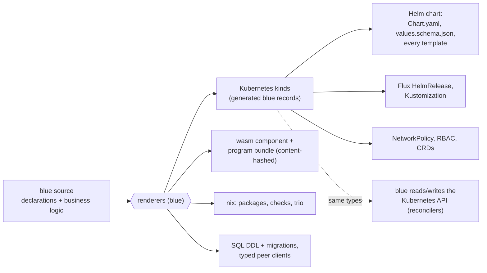
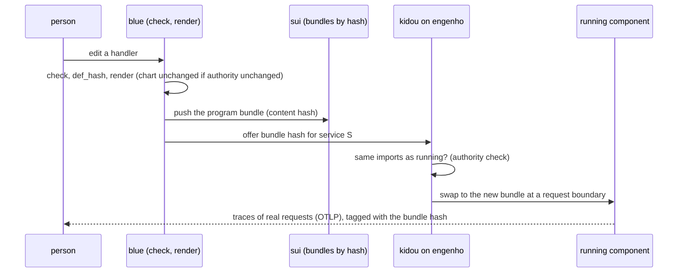

# SUBSTRATE — blue as the one language of the whole stack

Status: DESIGN, 2026-11-09, at blue `3345779c` (v0.0.172) and engenho `1523893`.
The operator's direction, 2026-11-08 and 2026-11-09: build bottom up; the
business logic of everything is blue, and everything it requires (the Helm
stack, the Kubernetes objects, the nix packaging, the libraries) is rendered
from it; blue is "Darklang-style", one singular language. This doc owns that
direction. `BUILD-STACK.md`, `SERVICE-ARCHITECTURE.md`, `SERVICE-ACCESS.md`,
`FRONTEND-PLAN.md`, `IBUKI.md`, `theory/FUEKI.md` and `HORIZON.md` own their
parts and point here for the whole.

## 1. Destination

A person writes one thing: blue. A program declares what it is (a service, a
frontend, an appliance, a reconciler) and what it holds (its data model, its
routes, its queues, its schedules, its secrets, its peers, its authority), in
blue, beside the code that is its behaviour. Everything else is a rendering of
that one source and is never edited by hand: the wasm component, the Helm
chart and every Kubernetes object in it, the Flux objects that place it, the
nix that builds it, the SQL and migrations of its data, the typed clients of
its peers, the frontend bundle for each placement. On engenho the program runs
as a WASI component in-process, holds only what its declaration grants, and
can itself read and write the Kubernetes API through the same typed kinds the
renderer uses, so a reconciler is a blue program like any other. An edit is
live without a separate deploy step: the program's definitions are content
hashes, and a deploy is the running component swapping to the new hashes
under the authority it already holds, with traces of real requests to develop
against. The same declarations render to a browser, a phone, a desktop and a
local appliance; and two blue systems that meet over the ibuki wire prove to
each other, with tameshi receipts and shomei signatures, what they ran and what
they saw, with no server between them.

**World-facts that bound it** (real limits, typed, not ours to dissolve):
the Kubernetes API and its OpenAPI schema are fixed by upstream; WASI 0.2
gives a component only the imports its host links; a browser runs wasm only
through JavaScript glue and the DOM; iOS forbids executing downloaded code, so
an iOS placement ships its engine and program bundle inside the app; a
signature proves who signed, never that the signer was honest.
Every other limit below is phrased in our own abstractions and is ours to remove.

## 2. Ground: what exists (measured 2026-11-09)

Tiers: BUILT = code and a test on main; PARTIAL; DESIGN = doc only; ABSENT.

### Layer 1: blue on engenho

| Piece | Tier | Evidence |
|---|---|---|
| `service(name, spec)` with `access`, `runtime`, `schema`, `cache`, `slo` | BUILT | `crates/blue-lang-pkg/src/deploy/service.rs` |
| Runtime rung: wasm by default, native needs a named reason | BUILT | `BUILD-STACK.md` §2, `deploy/runtime.rs` |
| The engine as one wasip2 command component | BUILT (41 lines, no crate tests; the per-service `-component-serves` check runs it) | `crates/blue-lang-component/src/main.rs` |
| haibi renders chart, values schema, config, DDL, migration, SLO | BUILT | `bidamas/eigyou/haibi/haibi.b` |
| `workload(name, spec)` renders a typed Deployment + Service | BUILT (Rust) | `crates/blue-lang-pkg/src/deploy/render.rs` |
| engenho runs WASI P2 pods in-process (wasmtime) | BUILT, tested on a probe component, never on the blue component | `engenho/engenho-kubelet/src/wasm_backend.rs`, `tests/wasm_backend.rs` |
| kidou (blue, in engenho) admits a pod, turns `access` into grants | BUILT | `engenho/engenho-kubelet/blue/kidou/kidou.b` |
| A blue component pod running on engenho | ABSENT | no release sets `runtime.component.closure` (`BUILD-STACK.md` §8) |
| Kubernetes objects: Deployment in three places | PARTIAL, triplicated | `deploy/render.rs` (Rust), haibi templates (blue), `helmworks/charts/pleme-lib/templates/` (96 hand-written files) |
| NetworkPolicy, RBAC, CRDs, Flux objects from blue | ABSENT | `SERVICE-ACCESS.md` §9, `BUILD-STACK.md` §8 |
| blue reading and writing the Kubernetes API | ABSENT | no bidama or host word; `STDLIB.md` names "kube-rs → kurasuta plus vigy" as a plan only |
| nix packaging of a service | HAND-WRITTEN nix that lowers Bluefile facts | `nix/service.nix` (369 lines), `nix/project.nix` |

### Constructs ("one language owns the stack")

| Construct | Tier | Evidence |
|---|---|---|
| HTTP route and handler | BUILT as words (kyuuji), not a declaration | `FRONTEND-PLAN.md` §1 |
| Data model → SQL, migrations | `schema` BUILT; one `model(...)` DESIGN | `service.rs`; `SERVICE-ARCHITECTURE.md` §12; `theory/BLUE.md` §V.32 |
| Queue and worker | PARTIAL: NATS client only | `crates/blue-lang-runtime/src/net/nats.rs` |
| Cron and schedule | ABSENT | — |
| Config | BUILT (`config`, `flags`, settei) | `theory/FUEKI.md` G2, G4 |
| Secret | PARTIAL (`SecretRef`; `secret_open` DESIGN) | `deploy/mod.rs`; `SERVICE-ARCHITECTURE.md` §12 |
| Service-to-service call | PARTIAL (HTTP client; no typed binding; `https://` refused) | `net/http.rs` |
| Deployless edit | ABSENT (every change: freshness, nix build, release) | `BUILD-STACK.md` §7 |
| Request traces | PARTIAL (tsuiseki spans in process, no export) | `SERVICE-ARCHITECTURE.md` |

### Layer 2: placements

`frontend(...)` parses; gamen, kyasshu, ugoki and the zero-import
`blue-lang-wasm` are BUILT; burauza (PWA) PARTIAL; DOM capability, element
tree, HTML renderer and hydration DESIGN; desktop (mado) and iOS/Android
(asobi) shells DESIGN (`FRONTEND-PLAN.md` F15; `BLUE-FRONTEND.md` §10).

### Layer 3: high-assurance local

The ibuki wire (framing, Flash bucket, Tide LEDBAT, rings, binary payloads
since v0.0.169), the ibuki bidama (22 tests), shomei Ed25519/BLAKE3 (33 tests),
receipts v2, `def_hash`, appliances with bounds and threshold signing, and the
Bluefile `receipt(...)` → tameshi lowering are BUILT. Charging the wire rings
to an app's allocation is DESIGN; a live tameshi chain writer is PARTIAL
(`IBUKI.md` §VII; `theory/FUEKI.md` D2–D5).

## 3. Research: prior art that bounds the design

Cited from prior knowledge on 2026-11-09; each row is re-read at review before
a phase that adopts it.

| Prior art | What it proves | Decision |
|---|---|---|
| Darklang (darklang.com) | one language with built-in HTTP handlers, datastores, workers and crons; deployless edits; trace-driven development from real requests | ADOPT the construct set, deployless and traces; SKIP the hosted cloud and the structured editor |
| Kubernetes OpenAPI v3 (`/openapi/v3`, kubernetes.io API reference) | every kind's schema, machine-readable | ADOPT as the one source of blue's Kubernetes kinds (generated, never hand-typed) |
| kube-rs and controller-runtime | list/watch/reconcile/status, server-side apply, finalizers | ADAPT: the loop shape becomes blue words; the HTTP and watch plumbing is one Rust host seam |
| Helm 3 (helm.sh) | the packaging and install interface Flux and engenho consume | ADAPT: keep the chart as the delivery format, render every template from blue; no hand-kept library chart |
| Flux (fluxcd.io) | GitOps placement: HelmRelease, Kustomization | ADOPT, rendered from `placement(...)` |
| WASI 0.2 and the component model, wasi-http (wasi.dev) | a component holds only the imports its host links | ADOPT: imports derived from `access`, so authority is a link-time fact |
| SpinKube, runwasi (spinkube.dev) | wasm workloads on Kubernetes through a RuntimeClass | ADOPT the RuntimeClass contract (already rendered); SKIP the containerd shim, engenho runs components in-process |
| Unison (unison-lang.org) | content-addressed definitions make deploy a hash swap | ADAPT through `def_hash` (HORIZON H3) for deployless |
| OpenTelemetry OTLP (opentelemetry.io) | the common trace wire | ADOPT for tsuiseki export |
| wasmCloud lattice | a peer mesh of components | SKIP: the ibuki wire is the mesh, with receipts |

## 4. The model

### 4.1 One source, three kinds of artifact

The center of layer 1 is **one typed set of Kubernetes kinds in blue,
generated from the upstream OpenAPI schema**. The renderer emits them as the
chart, the Flux objects and every policy object; a reconciler uses the same
records to call the API. `deploy/render.rs`'s typed Deployment, haibi's
templates and pleme-lib's 96 hand-kept templates collapse into that one set.

### 4.2 The constructs

Each is a Bluefile declaration (judged alone, refused alone) whose behaviour is
blue code beside it, and whose renderings are listed once:

| Declaration | Behaviour lives in | Renders to |
|---|---|---|
| `service(...)` | handlers (kyuuji words) | component, chart, Deployment/Service, Flux |
| `route(...)` | a handler definition | the service's router; OpenAPI and typed client for peers |
| `model(...)` | queries over the model | SQL DDL, migrations, data API (`theory/BLUE.md` §V.32) |
| `queue(...)`, `worker(...)` | a handler per message | NATS JetStream stream/consumer objects, supervised worker processes |
| `schedule(...)` | a handler per tick | a supervised timer in the service, never a separate CronJob |
| `secret(...)` | `secret_open` at use | ExternalSecret or SOPS object; the grant in `access` |
| `peer(...)` | calls through the typed client | the client, the NetworkPolicy egress rule |
| `placement(...)` | — | Flux HelmRelease and Kustomization per cluster |
| `reconciler(...)` | a blue reconcile function over generated kinds | RBAC for exactly the kinds it names, a watch in the host seam |

### 4.3 Host seams (the only Rust)

Rust stays where blue cannot reach a world-fact: the wasmtime host and WASI
links (engenho `wasm_backend.rs`), sockets and TLS, the Kubernetes HTTP and
watch transport, crypto (already one seam), and the GPU and OS shells of
layer 2. Each seam is one crate behind one capability in
`blue-lang-waku/src/capability.rs`; the policy above it is blue (kidou is the
pattern).

### 4.4 Reuse: every piece extends a library that exists

The operator's rule for this whole design: maximize reuse. No construct, phase
or placement starts a new primitive while one in the table below is the
near-miss; a new word is written only after `blue arika word NAME` and
`blue arika like FILE` find nothing (`theory/ARIKA.md`), and a shape that
appears a second time is promoted, not copied (the reuse census holds it).

| Need | Extends | Not |
|---|---|---|
| routes, handlers, HTTP serve | `kyuuji` | a second router |
| data model, SQL, migrations | `kueri`, `teeburu`, the `model(...)` of `theory/BLUE.md` §V.32 | hand SQL, a second ORM |
| config and every declaration judged alone | `kousei` entries, `settei` | ad-hoc config parsing |
| secrets | `cofre` (`SecretRef`), `secret_open` | a new secret store |
| reconcile loops, ticks, schedules | `vigy` (`defvigy`), `blue-lang-proc` supervision | a new loop or a CronJob |
| progress and liveness of a loop | `shinchoku` | a new probe |
| chart, values schema, every rendered file | `haibi` over the generated kinds | pleme-lib by hand, a second renderer (`deploy/render.rs` folds in) |
| admission and grants on the node | `kidou`, `blue-lang-waku` capabilities | a second policy engine |
| traces | `tsuiseki` + OTLP export | a new tracer |
| caching of check, test, render | mondou `Store` (`blue check v1`, … domains, HORIZON H3) | a cache per feature |
| frontend views, styles, offline | `gamen`, `ugoki`, `kyasshu`, `burauza` | a new UI stack per placement |
| wire, peers, local sync | `ibuki`, the runtime `wire` | a new transport |
| signatures, hashes, receipts | `shomei`, tameshi, receipts v2 | a new crypto layer |
| nix from blue | `kakehashi` | more hand nix in `nix/service.nix` |
| tests, laws, mutation | `tesuto`, `okite`, `heni`, `happa` (differentials) | per-feature harnesses |

Each phase in §9 names the row it extends; a phase that cannot is a finding to
record here before it builds.

## 5. States and trust

```mermaid
stateDiagram-v2
  [*] --> Declared
  Declared --> Refused: a declaration fails its check (that entry only)
  Declared --> Rendered: renderers emit; freshness checks hold
  Rendered --> Built: nix builds component + bundle
  Built --> Admitted: kidou admits; grants = access
  Admitted --> Running
  Running --> Running: live edit (bundle hash swap, authority unchanged)
  Running --> Held: live edit asks for more authority
  Held --> Rendered: authority change goes through render + review
  Running --> Blind: no heartbeat / trace export stops
  Blind --> Running: evidence returns
  Refused --> Declared: fixed
```

- **Absence is its own state.** A service with no evidence is `Blind`, never
  `Running` and never `Refused`.
- **Authority is a link-time fact.** A component's imports derive from
  `access`; kidou grants nothing beyond them. A live edit swaps the bundle,
  never the imports, so it cannot widen authority; asking for more holds the
  edit and sends it through render, review and a new component.
- **Who may say what.** The Bluefile says what a program may do; the
  render is a pure function of it and is checked fresh; kidou is the one judge
  on the node; a reconciler's RBAC is rendered from the kinds it declares, so
  it cannot touch a kind it did not name.
- **Bad states made unrepresentable, scoped to the fault:** a hand-edited
  rendered file fails its freshness check; a declaration with an unknown field
  is refused alone; a Kubernetes kind not in the generated set does not
  construct.

## 6. The main flow: an edit goes live

## 7. Decisions

| Decision | Alternatives rejected, and why |
|---|---|
| Generate blue's Kubernetes kinds from the upstream OpenAPI schema | hand-typed kinds (drift, the triplication we have); YAML strings (no types, `format!` of a target syntax is banned) |
| Keep Helm as the delivery format, render every template | drop Helm (Flux and engenho consume charts today; throwing that away buys nothing); keep pleme-lib by hand (the duplication this doc exists to end) |
| Schedules are timers inside the supervised service | Kubernetes CronJob per schedule (a second runtime, a second authority surface) |
| Deployless = bundle hash swap under unchanged imports | rebuild the component per edit (minutes; the Darklang loop needs seconds); allow live authority change (breaks the link-time authority guarantee) |
| One capability per host seam | a general "host" escape (hides authority from kidou and the ledger) |
| Reconcilers are blue programs over the same kinds | a Rust operator per CRD (moves business logic out of blue) |

## 8. Open questions

| Question | Kind |
|---|---|
| Which Kubernetes version's schema is the floor, and how a newer kind arrives | ours: pin per engenho release, regenerate on bump |
| Bundle swap at a request boundary for long-lived connections (websockets, gRPC streams) | ours: drain or pin per connection |
| The browser placement's JS glue: generated from blue, or one fixed loader | ours |
| iOS: the program bundle ships inside the app; is live edit a dev-only path there | world-fact (App Store rules) |
| How much of `nix/service.nix` can become a blue renderer of nix | ours (kakehashi, HORIZON H8) |

## 9. Phases

Each phase ends green with a red run named; each updates §10.

### Layer 1: cloud on engenho

- **L1.1 The first blue component pod on engenho.** Set
  `runtime.component.closure` in one release (the greeter example), extend
  `engenho-kubelet/tests/wasm_backend.rs` to run `blue-component.wasm`, and
  serve one request on ryn's engenho. Gate: the e2e test serves a known body;
  red: a component without the `access` grant is refused by kidou.
- **L1.2 Kubernetes kinds in blue.** A generator from the OpenAPI v3 schema
  to blue records (one bidama of kinds); `deploy/render.rs` and haibi's
  templates emit through it. Gate: the rendered greeter chart is byte-equal
  before and after; red: an unknown field does not construct.
- **L1.3 Retire pleme-lib by rendering it.** Every template the greeter chart
  includes is rendered from the kinds; NetworkPolicy and RBAC from `access`;
  CRDs from `model`/`reconciler`. Gate: zero hand-kept templates on the
  greeter path, counted.
- **L1.4 `placement(...)` → Flux.** Gate: Flux on ryn reconciles the
  rendered HelmRelease.
- **L1.5 blue drives the Kubernetes API.** One capability, one Rust seam
  (watch, server-side apply), blue words, `reconciler(...)` with rendered RBAC.
  The loop is a `vigy` over the generated kinds, its liveness `shinchoku`.
  Gate: a blue reconciler converges a ConfigMap on engenho; red: touching an
  undeclared kind is refused before the request leaves.
- **L1.6 The construct set.** `route` (kyuuji), `model` (kueri, teeburu),
  `queue`/`worker` and `schedule` (vigy, blue-lang-proc), `secret` (cofre),
  `peer` (kyuuji's client, the generated NetworkPolicy), each declared through
  kousei and rendered through haibi. Gate: a spec row and a conformance column
  per construct.
- **L1.7 Deployless and traces.** Bundle hash swap under kidou, bundles keyed
  in the mondou `Store`; OTLP export from tsuiseki keyed by bundle hash. Gate:
  an edit is live in seconds on ryn; red: an edit that widens `access` is held.

### Layer 2: every placement

- **L2.1 Browser:** `Capability::Dom`, element tree, hydration, the loader
  (H8 browser). **L2.2 Desktop:** the same views on mado's renderer.
  **L2.3 Mobile:** asobi shells with the bundle inside the app. All three
  render the same `gamen` views, `ugoki` motion and `kyasshu` offline store;
  a placement adds a host seam, never a second view layer.
  Gate for each: the same program gives equal receipts in two placements
  (H8's gate).

### Layer 3: high-assurance local

- **L3.1 Envision:** a typed list of what wire + receipts + signatures make
  possible (local-first sync, offline collaboration, provable appliances,
  peer attestations), each a design entry with its trust model.
- **L3.2 Build** them in blue on the shared primitives (`ibuki`, the runtime
  `wire`, `shomei`, tameshi, receipts v2): rings charged to the app
  allocation, a live tameshi chain writer, receipts exchanged over the wire.
  The Aqui neighborhood map mesh is the first application, written on those
  same words.

## 10. Tier ledger

| Item | Design | Exists | Tested | Live |
|---|---|---|---|---|
| L1.1 component pod on engenho | ✅ | pieces | probe only | ❌ |
| L1.2 kinds from OpenAPI | ✅ | ❌ | ❌ | ❌ |
| L1.3 pleme-lib rendered | ✅ | ❌ | ❌ | ❌ |
| L1.4 placement → Flux | ✅ | ❌ | ❌ | ❌ |
| L1.5 Kubernetes API from blue | ✅ | ❌ | ❌ | ❌ |
| L1.6 construct set | ✅ | partial (route words, schema, config) | partial | ❌ |
| L1.7 deployless + traces | ✅ | ❌ | ❌ | ❌ |
| L2.1–L2.3 placements | ✅ | partial (wasm engine, gamen) | partial | ❌ |
| L3.1–L3.2 local assurance | ✅ | primitives built | primitives tested | ❌ |
