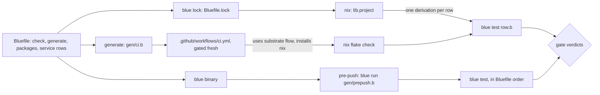
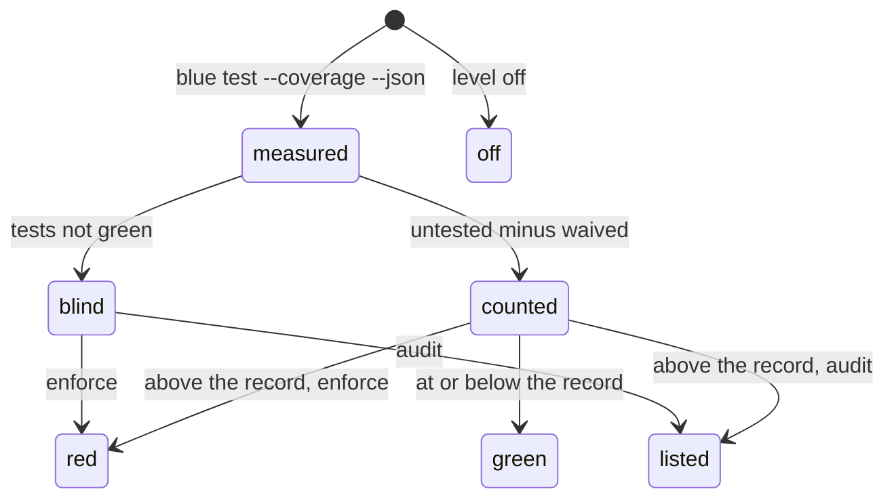

# Testing and the SDLC: one blue pipeline

Operator, 2026-10-24: *"just like we do test blocks in blue for tests could we
also do integration tests near integration points and have a deterministic
place for all kinds of testing ... all sdlc is from called blue binary and this
also feeds into actions and other cicd stuff"*, then *"essentially making a
fully bluelang pipeline"*, then *"give bluelang all the verbs for deep bdd and
tdd style testing and if possible hard block lack of tests ... make the hard
block and testing frameworks also highly configurable"*.

This document is the design. Section 16 is the tier ledger: what exists, what
is tested, what is live, and what is only design.

## 1. Destination

The whole pipeline is declared in blue and run by the blue binary: test,
check, build, gate, release and the deploy hooks. The Bluefile declares it.
Nix, the pre-push hook and GitHub Actions are renderings and runners of that
one declaration. They carry no logic of their own.

Every test lives in one deterministic place, beside the thing it tests: a
unit test beside its `def`, an integration test beside the integration point,
a rendering test beside the renderer, an end-to-end test beside the
`service(...)`. Blue sees every definition, every integration point and every
emitted rendering. So a definition, a point or a rendering with no test is a
gate finding. The finding is on by default, at enforce. A waiver is a blue
entry with a why and an until date, and it refuses that entry only.

A test is hermetic. It touches only the capabilities it declares. Its
fixtures and fakes are declared values, never ambient state. Its randomness
is seeded. It reads no wall clock: the runner passes `now` in.

World-facts that limit this destination:

- GitHub Actions reads YAML from `.github/workflows/` and nothing else. A
  workflow file must exist in the repository, so the rendering is committed
  and gated fresh. It cannot be computed at run time.
- A nix sandbox has no network and no clock it can trust
  (`SOURCE_DATE_EPOCH` is 1980). A test that needs either is not a nix check;
  it runs in a runner that grants the capability.
- A real external service (GitHub, a cloud API) changes without notice. A
  recorded fake is only as true as its last recording; a contract test
  against the live service is the only proof, and it needs the network.
- Dynamic coverage sees only the code a test ran. A definition that a test
  reaches through a caller counts as covered.

Every other limit below is phrased in blue's own abstractions, so it is ours
to dissolve.

## 2. Ground: what exists (measured 2026-10-24)

| Piece | Where | What it does |
|---|---|---|
| `test "…" … end` | `crates/blue-lang-syntax/src/parse.rs:620`, `crates/blue-lang-test/src/lib.rs:1` | a test block beside the code; each test runs in a forked interpreter, so order cannot matter (`lib.rs:30-48`) |
| `assert e` | `crates/blue-lang-test/src/lib.rs:13-28` | fails with the expression rendered by the formatter |
| `blue test FILE\|DIR [--filter P] [--coverage [--json]]` | `crates/blue-lang-cli/src/main.rs:265`, `observe.rs:223` | checks the file, runs its tests; `--coverage` counts calls per definition and lists the ones no test reached |
| `tesuto` | `bidamas/tesuto/tesuto.b` | `raises?`, `snapshot` (golden files), `scratch`, `caught`; since this slice also `uncovered`, `level`, `waive`, `settle`, `beside`, `stale` |
| verb graph rows for tests | `bidamas/mokuroku/graph/tesuto-provisional.b` (25 rows) | the planned words: `affected`, `calls`, `case`, `conforms?`, `contract`, `cover`, `fake`, `fixture`, `flaky?`, `freeze`, `fuzz`, `quarantine`, `rerun`, `shard`, `spy`, `uncovered`, `watch`, … |
| G11 untested | `bidamas/mokuroku/mokuroku.b:1710-1748`, `gen/verb-graph.b:151` | a verb-graph `exists` row whose name no test block mentions; held by `graph.baseline` (1 row of debt) |
| property laws | `bidamas/okite/okite.b:42-182`, `gen/okite-laws.b` | seeded generators over `ran`, and laws that must hold for every generated value |
| mutation testing | `bidamas/heni/heni.b`, `gen/heni-gate.b` | each mutation must make the package's tests fail; `BLUE_HENI_OFF=1` is its off switch |
| ratchet | `bidamas/hadome/hadome.b` | recorded debt may shrink or hold, never grow |
| Bluefile words | `crates/blue-lang-pkg/src/bluefile.rs:425` (`WORDS`) | `package`, `needs`, `posture`, `source`, `packages`, `run`, `tool`, `check`, `app`, `generate`, `rule`, `catalog`, `image`, `workload`, `service`, `frontend` |
| `check(name, file)` | `bluefile.rs:512`, `nix/project.nix:44`, `bidamas/mk-bidama.nix:405-411` | `checks.<name>` runs `blue test file`; a file with no tests fails |
| `packages(dir)` | `nix/project.nix:440` | `checks.bidama-test-<pkg>` per package, plus form, collision, lock and solver checks |
| `rule(code, file, def)` | `docs/DIAGNOSTICS.md` "Project rules" | a blue definition run by `blue check` on every top-level form, under a pure frame |
| `generate(name, out, program)` | `bluefile.rs:540` | a committed file and its program, gated fresh |
| `service(...)` | `nix/service.nix`, `docs/SERVICE-ARCHITECTURE.md` | chart, values schema, migrations; `checks.service-<name>-{fresh,chart,serves}` |
| pre-push gate | `.githooks/pre-push` (3 lines of sh), `gen/prepush.b:192` | an ordered gate list in blue; `BLUE_PREPUSH_OFF=1` skips it |
| CI | `.github/workflows/ci.yml` | one `uses:` of substrate's `cargo-ci.yml`; 0 lines of shell; no step calls blue |
| capabilities | `docs/SAFETY.md` row 8 | six host effects (process, filesystem, environment, clock, network, entropy); `blue run --allow` |
| absence | `docs/ABSENCE.md` (in flight, other owner) | `Option` and the nil checker rule |

Measured with `blue test --coverage --json` over every bidama on 2026-10-24:
77 packages, 4154 definitions, 3944 reached by a test (94.9%), 210 not
reached, in 42 packages. 35 packages reach every definition.

What does not exist (second probe: `rg --no-ignore` over `crates/`, `nix/`,
`bidamas/`, `gen/` and `pleme-io/actions`): no word or program that renders a
GitHub Actions workflow; no `describe`, `before`, `let`, `fake` or `spy`; no
test kind other than "a `test` block"; no capability declaration on a test;
no blue action in `pleme-io/actions` (its 439 run scripts are tatara-lisp
`run.tlisp`).

Prior pleme-io art: `theory/TESTING-SUBSTRATE.md` §IX (the seam is the whole
game: every side effect behind one injectable trait, then mock the trait) and
kensa's `kensa-profiles` matchers (`eq`, `cmp`, `include`, `match`, `be_in`,
`compare`). kensa's own integration tests hand-write an axum server that
plays GitHub (`kensa/tests/recorder_tests.rs:100-124`); no recorded fake
exists in the fleet.

## 3. Research

| Source | Shape | Verdict |
|---|---|---|
| RSpec ([rspec.info](https://rspec.info/documentation/)) | `describe`/`context`/`it`, `let`, `subject`, hooks, shared examples, matchers | adapt: one grouping word (`describe`), no `context` synonym; `let` is a binding; hooks are functions |
| Rust `#[test]`, `#[cfg(test)]` ([doc.rust-lang.org](https://doc.rust-lang.org/book/ch11-03-test-organization.html)) | unit tests in the same file, integration tests in `tests/` | adopt the "beside" half; skip the separate `tests/` tree for blue |
| cargo-nextest ([nexte.st](https://nexte.st/)) | process per test, retries, partitions, JUnit output | adopt: `shard`, `rerun`, reporters as config entries |
| proptest ([docs.rs/proptest](https://docs.rs/proptest)) | seeded generators, shrinking, persisted failures | adopt through okite + `ran`; shrinking is a phase |
| insta ([insta.rs](https://insta.rs/)) | snapshot files beside the test, review on change | exists as `tesuto::snapshot` |
| cargo-mutants ([mutants.rs](https://mutants.rs/)) | mutate, expect a red test | exists as heni |
| Pact ([docs.pact.io](https://docs.pact.io/)) | consumer-driven contracts, provider verification | adapt: `contract` and `conforms?` from the verb graph |
| VCR ([github.com/vcr/vcr](https://github.com/vcr/vcr)) | record real HTTP once, replay | adapt: a recorded fake is a fixture file beside the binding |
| Bazel test size and tags ([bazel.build](https://bazel.build/reference/test-encyclopedia)) | small/medium/large, network declared | adopt: capabilities declared per test, the runner picks by them |
| Cucumber/Gherkin ([cucumber.io](https://cucumber.io/docs/gherkin/)) | given/when/then in prose files | skip: a second language beside blue; given/when/then are bindings and `assert` |
| GitHub Actions `workflow_call` ([docs.github.com](https://docs.github.com/en/actions/using-workflows/reusing-workflows)) | reusable workflows | adopt: the rendered workflow `uses:` substrate's flows |

## 4. The taxonomy

Each kind has one place. The place is how blue finds it. "May touch" is the
capability frame the runner grants; anything else is refused.

| Kind | The one place | Named and found by | May touch | Runs in |
|---|---|---|---|---|
| unit | a `test` block in the file of the `def` | the file; `blue test FILE` | pure | `bidama-test-<pkg>`, pre-push, CI |
| property | a `test` block beside the `def`, over a seeded generator (okite, `ran`) | the file | pure; seed from the test, printed on failure | same as unit |
| snapshot | a `test` calling `tesuto::snapshot`; the golden file in `snapshots/` beside it | the file | filesystem, scoped to `snapshots/` | same as unit |
| mutation | `heni/mutations/<pkg>.json` | the package name | process (runs `blue test` on a copy) | `checks.heni-mutations` |
| contract | beside the integration point: a `contract(...)` value with the point's declared shape | the point's file | pure | same as unit |
| integration | a `test` with `kind: :integration` in the file that declares the point: the `use` of a host seam, a `cache`/`schema`/`http` binding, a `service` entry | the file and the kind | the capabilities it declares; the external side is a declared fake or recorded fixture | nix check when it needs no network; else the CI runner that grants it |
| rendering | a `test` beside the renderer (haibi, the `generate` program) that feeds the output to its consumer: `helm lint` and `helm template` for a chart, a JSON Schema validator for a schema, `nix eval` for nix, `actionlint` for a workflow | the renderer's file | process (the consumer tool, named by `tool(...)`) | `checks.service-<name>-chart` today; one check per rendering |
| end-to-end | a `test` with `kind: :e2e` beside the `service(...)` entry's program | the Bluefile's `service` row | process, network on loopback | `checks.service-<name>-serves` today |
| gate | a `check(name, file)` row in the Bluefile | the row | what its tests declare | nix, pre-push, CI, in the Bluefile's order |

A test's kind and capabilities are an options map after its title. The
default is `{kind: :unit, allow: []}`: a pure test. (Decision D6.)

```
test "the cache key carries the entity's key", {kind: :integration, allow: [:network], fakes: [:valkey]}
  ...
end
```

## 5. Integration points are first-class

An integration point is any place blue meets the world:

| Point | How blue sees it today | Its test beside it |
|---|---|---|
| a host seam | a `use` of a bidama that calls a host capability (`exec_*`, `http_*`, `pg_*`, files) | an integration test with the capability and a fake or fixture |
| a binding | a `service(...)` field: `cache`, `schema`, `config`, `port` | a contract test of the binding's shape, plus an integration test against a declared fake (a local valkey from `tool("valkey")`, a sqlite or pg fixture) |
| an emitted rendering | a `generate` row, a `service` tree, a `workload` | a rendering test that runs the consumer over the output |
| a service | a `service(...)` row | an end-to-end test against `packages.<name>` on loopback |

Blue already reads each of these as data: the lock lists every `generate`,
`service` and `check` row (`Bluefile.lock`, `manifest`), and the check stage
sees every `use` and every capability call. So "a point with no test beside
it" is computable, the same way "a definition no test reached" is. It is a
gate finding, on by default; `level(...)` and `waive(...)` entries configure
it (section 7).

## 6. The BDD and TDD vocabulary

The words live in `tesuto`, the test bidama, and in the verb graph's
`tesuto?` rows that already name them. No word is minted twice: a word that a
builtin or a bidama already has is used, not aliased.

| RSpec or Rust shape | blue word | State |
|---|---|---|
| `it "does x"`, `#[test]` | `test "does x" … end` | exists |
| `describe`, `context` | `describe "subject" … end` (one word; a context is a nested `describe`) | design (parser form, like `test`) |
| `let`, `subject` | a binding at the top of a `describe`, evaluated per test in the forked interpreter | design |
| `before`, `after`, `around` | `around(f)`: a function that receives the test body; `before` and `after` are `around` with one side | design |
| shared examples | a `def` that takes the subject and asserts; tests call it | exists (plain blue) |
| table-driven, parametric | `case(name, f)` over a list of rows, one test per row | verb graph row, design |
| `eq` | `assert a == b` (structural diff on failure) | exists |
| `include` | `member?`, `contains?` | exists (builtins) |
| `raise_error` | `tesuto::raises?(kind, f)` | exists |
| `change { }.by(n)` | `changes?(probe, f, by)` | design |
| `satisfy` | any predicate in `assert` | exists |
| match a shape or schema | `conforms?(value, contract)`; a contract is a kousei shape | verb graph row, design |
| stub, fake | `fake(target, impl, f)`: on a declared seam only | verb graph row, design |
| spy | `spy(target)`, `calls(spy)` | verb graph rows, design |
| snapshot, golden | `tesuto::snapshot(value, {name:})` | exists |
| property | okite laws over `ran` seeded generators | exists; shrinking is design |
| frozen time | `freeze(instant, f)` | verb graph row, design |
| fixture file | `fixture(name)`: a file kept beside the test | verb graph row, design |
| flaky handling | `quarantine(test, reason, until)`, `flaky?` | verb graph rows, design |
| coverage | `blue test --coverage`, `tesuto::uncovered` | exists |

A fake replaces a seam that a bidama declares. It never patches an arbitrary
name: that would make every definition a seam and hide what a test touches.

## 7. The hard block: no definition, point or rendering without a test

**Rule.** A definition no test reaches, an integration point with no test of
its kind beside it, and a rendering no consumer test reads are each a finding.
The finding is on by default, at `enforce`.

**Configuration is blue entries, each judged alone** (`tesuto::settle`):

```
level("*", :enforce, "a definition is reached by a test beside it")
level("kirikae", :audit, "switching a system is tested on a node, not in a sandbox")
waive("heni::main", "the process entry; gen/heni-gate.b runs it", "2026-12-31")
```

| Entry | Fields | Refused when |
|---|---|---|
| `level(scope, value, why)` | scope: a package or `"*"`; value: `:off`, `:audit`, `:enforce` | no why, no scope, an unknown level |
| `waive(name, why, until)` | a qualified definition, a reason, a `YYYY-MM-DD` date | no why, an unqualified name, no date, a date before `today` |

A refused entry is named and takes no effect; its siblings stand. A waiver
that covers nothing is stale and is a finding, because it would hide the next
real gap. `level("*", :off, why)` turns the gate off; the code, the entries
and the tests stay.

**Levels.** `off` measures nothing. `audit` reports and never fails.
`enforce` fails on growth past the recorded debt. Debt is a hadome baseline
(`untested: <pkg> <n>`): it may shrink or hold, never grow. A package with no
row holds at zero, so every new package starts fully tested.

**Absence.** A package whose tests do not run green has no coverage
evidence. It is `blind`, never green: at `enforce` it fails, at `audit` it is
listed.

**Destination of the configuration.** Today the entries live in the gate
file (`gen/test-beside.b`). Phase T2 moves the judge into `lib.project`, so
every project with `packages` gets `checks.test-beside` by default, and the
entries come from the project's own blue file. Kinds required per point type
(for example "a `cache` binding needs an integration test") are a third entry,
`require(point, kind, why)`, in phase T4.

## 8. The configurable framework

Every knob is a blue entry, judged alone, with a default:

| Knob | Entry | Default |
|---|---|---|
| reporter | `report(:text \| :json \| :junit \| :sarif)` | `:text`; JSON exists (`--coverage --json`) |
| order and seed | `order(:declared \| :random, seed)` | declared; tests are already order-free by fork |
| parallelism | `jobs(n)` | one process per file today (`blue test DIR` runs files in parallel) |
| kinds selected | `blue test --kind integration` | every kind the runner's capabilities allow |
| fixture providers | `provider(name, program)`: a run that brings up a fake (valkey, pg) for integration tests | none |
| shards | `shard(n, i)` | 1 of 1 |

Its renderings are the runners: the nix check, the pre-push gate and the CI
workflow read the same entries.

## 9. One SDLC entry: the Bluefile and the blue binary

**The pipeline is the Bluefile.** A gate is a `check(name, file)` row. A
rendering is a `generate` row. The order of rows is the order of gates. No
new Bluefile word is minted for the pipeline: `check` gains an options map
(`{stage: :push | :ci | :release, kind:}`) in phase T3.

**The runner verb is `blue test`.** `blue test FILE` runs one file today.
`blue test .` (a directory holding a Bluefile) runs the Bluefile's `check`
rows in order, then every package's tests: the whole gate list. `--stage` and
`--kind` select. No `blue sdlc` or `blue gate` verb: it would be a second
name for "run the declared tests".

**Who calls it:**

| Runner | Today | Destination |
|---|---|---|
| nix | `checks.<name>` = `blue test file`, one derivation per row, cached | unchanged: nix is the hermetic, cached executor of each row |
| pre-push | `gen/prepush.b`: a hand list of 9 gates in blue | `blue test . --stage push`; host gates (cargo fmt, gen tie) become `check` rows |
| CI | `ci.yml` uses substrate's `cargo-ci.yml` | a `generate("ci", ".github/workflows/ci.yml", "gen/ci.b")` row renders a workflow whose one job step is `nix flake check` or `blue test . --stage ci`; gated fresh |
| release | `auto-release.yml` uses substrate's `rust-auto-release.yml` | the same rendering, with `--stage release` gates before the substrate flow |

**No big bang with `pleme-io/actions` and substrate.** The rendered workflow
still `uses:` substrate's reusable workflows and the actions repo's
`nix-setup`. Those stay runners: they install nix and call the binary. Logic
moves out of them one step at a time, in the ledger order below. A blue
action (`action.yml` that calls `blue run run.b`) is a peer of the tatara-lisp
ones, added when an action is touched, never by mass rewrite.

### The ledger: non-blue steps in the pipeline today

| # | Step | Where | Language | Blue replacement | Phase |
|---|---|---|---|---|---|
| 1 | which checks exist, per word | `nix/project.nix`, `bidamas/mk-bidama.nix` | nix | stays nix (packaging is nix's job); it reads the lock, which blue wrote | none |
| 2 | each check's body | `mk-bidama.nix:405-411` (`runCommand` one-liners) | sh glue | one `blue test` call per check (exists) | done |
| 3 | freshness compare | `mkFreshCheck` (`cmp` in sh) | sh glue | `blue test` over a generated-vs-committed gate | T6 |
| 4 | pre-push hook | `.githooks/pre-push` | 3 lines of sh | stays as glue; it calls `gen/prepush.b` | none |
| 5 | pre-push gate list | `gen/prepush.b` | blue, hand list | derived from `check` rows with `stage: :push` | T3 |
| 6 | CI workflow | `.github/workflows/ci.yml` | YAML, no logic | rendered by `generate` from `gen/ci.b` | T5 |
| 7 | CI logic | substrate `cargo-ci.yml` + actions `run.tlisp` | YAML + tatara-lisp | `nix flake check` only; the logic is the Bluefile's checks | T5 |
| 8 | release | substrate `rust-auto-release.yml` | YAML + tatara-lisp | the same rendering with release-stage gates first | T7 |
| 9 | action renderer | actions `defaction-render` (curl + python `render.py`) | python | a blue renderer in the `generate` program | T7 |
| 10 | kensa delivery | kensa `ci.yml` `deliver-to-ryn` (`test -n`, `curl`) | 2 lines of sh | a blue step in the rendered workflow | T7 |

## 10. Determinism

- **Hermetic fixtures.** A fixture is a file beside the test, or a value in
  it. A test that reads outside its fixtures and `scratch` dir is refused by
  its capability frame (D6).
- **Seeded randomness.** A generator takes a seed (`ran`). The runner prints
  the seed of a failing property test, and `order(:random, seed)` reruns it.
- **No wall clock.** A test that needs time takes `now` as an argument or uses
  `freeze`. kensa's attestation plane already works this way: Rust passes
  `received_at` in and blue never reads a clock.
- **Recorded fakes.** An external service is a fixture recorded once from the
  real service (VCR shape), replayed by a fake on loopback. The recording is
  committed beside the binding's test, with the date it was taken; a contract
  test against the live service re-records it in a runner with the network
  capability.

## 11. States and trust

A test run is in exactly one state per package:

| State | Means | At enforce |
|---|---|---|
| green | tests passed, untested count at or below the record | pass |
| red | tests passed, untested count above the record | fail |
| blind | tests did not run green, so no coverage evidence | fail |
| off | configured off by a `level` entry | pass, listed as off |

A policy entry is `kept` or `refused` (with its reason). A waiver is
`covering` or `stale`.

**Trust.** The gate trusts the blue binary that runs it (`self_exe`) and the
committed entries. An entry is authored by a commit, so its why and date are
reviewed with the code. Coverage numbers come from the run, never from a
claim; a missing run is `blind`, never `green`.

## 12. Diagrams

The flow: one declaration, many runners.



Test placement: each kind sits beside what it tests.

```mermaid
flowchart TB
  subgraph pkg[bidama file]
    D[def f] --- U[test: unit, property, snapshot]
    S[use of a host seam] --- I[test kind integration, declared fakes]
  end
  subgraph proj[Bluefile]
    SV[service row] --- E[test kind e2e beside its program]
    GR[generate row] --- R[rendering test: consumer reads the output]
    CK[check row] --- GT[gate file]
  end
  U --> COV[blue test --coverage]
  I --> COV
  COV --> TB[gen/test-beside.b: settle, beside, hadome]
```



The gate's judgement for one package.



## 13. Decisions

| # | Question | Answer | Rejected, and why |
|---|---|---|---|
| D1 | Where is the pipeline declared? | the Bluefile; gates are `check` rows | a new `pipeline(...)` word (parallel to `check`); YAML (a rendering is not a source) |
| D2 | Which verb runs it? | `blue test`, over a file or a Bluefile directory | `blue sdlc`, `blue gate` (second names for one act) |
| D3 | Who executes CI? | nix, one cached derivation per row; the workflow is a rendering that calls it | logic in workflow YAML; a tatara-lisp `defworkflow` (blue is the higher rung) |
| D4 | What counts as tested? | reached by a test at run time (`blue test --coverage`) | text mention (G11's measure: misses indirect reach, and a name in a string counts); line coverage (finer than a definition, no stable key for a ratchet) |
| D5 | How is a missing test blocked? | a hadome ratchet per package at enforce, new packages at zero | a fleet-wide percentage threshold (one package's debt hides another's growth); enforce at zero now (210 rows of debt would block every push) |
| D6 | How does a test say its kind and reach? | an options map after the title, default pure unit | a kind from the file path (a second place to look); kind inferred from capabilities used (implicit, so a test silently changes kind) |
| D7 | Where do waivers live? | blue entries with why and until, judged alone | `# waive` comments (B0007 refuses an unregistered code, and a comment has no date); a waiver file in YAML |
| D8 | Where do BDD words live? | `tesuto`, plus parser forms only for `describe` (like `test`) | a separate BDD bidama (a parallel test vocabulary); Gherkin text files (a second language) |
| D9 | How are fakes scoped? | on a declared seam only | patching any name (every definition becomes a seam) |
| D10 | What turns the gate off? | `level("*", :off, why)` | an environment variable (not reviewed, not in the source); deleting the check (behaviour is configured off, never deleted) |

## 14. Open questions

| Question | Type |
|---|---|
| Can a nix check run integration tests that need a local valkey or pg? | ours: `tool(...)` already puts binaries on PATH in the sandbox; a fixture provider is a `run` |
| Can a workflow be computed at run time instead of committed? | world-fact: GitHub reads only committed YAML, so it is rendered and gated fresh |
| How long may the coverage gate take in pre-push? | ours: it runs every bidama's tests a second time (74 s on an M-series laptop, release build); phase T2 reads the coverage from the `bidama-test-<pkg>` outputs instead |
| Should a private helper need its own test? | ours: every `def` is exported today (`docs/STDLIB.md:774`); when `defp` lands, a private helper is covered through its callers |
| Are live contract tests against GitHub safe to run in CI? | world-fact: they need the network and a token; they run in a runner that grants both, never in a nix check |

## 15. Phases, ranked by value per effort

| Phase | What | Value | Effort |
|---|---|---|---|
| **T1** ✅ | coverage hard block on blue's own bidamas: `tesuto` policy words, `gen/test-beside.b`, `check("test-beside")`, pre-push gate | every new untested definition in blue is red | landed |
| T2 | the gate in `lib.project`: every project with `packages` gets it by default; read coverage from the `bidama-test-<pkg>` outputs (no second run) | fleet-wide block, half the time | medium |
| T3 | `check` options `{stage:, kind:}`; `blue test .` runs the Bluefile's rows; `gen/prepush.b` derived from them | one gate list for nix, pre-push and CI | medium |
| T4 | test options map (`kind`, `allow`, `fakes`) and the integration-point finding: a `service` binding, a `generate` row or a seam with no test of its kind | integration tests beside their points | medium (parser + check stage) |
| T5 | `gen/ci.b` renders blue's own CI workflow; the logic moves into `check` rows | CI is a rendering | small |
| T6 | BDD words: `describe`, `around`, `case`, `changes?`, `fake`, `spy`, `calls`, `freeze`, `fixture`, `conforms?` | RSpec-depth tests in blue | medium |
| T7 | release and delivery steps as blue (`defaction-render` in blue, kensa's delivery step) | the last non-blue logic leaves the pipeline | large |
| T8 | reporters (JUnit, SARIF), shards, quarantine with until, flaky detection | CI ergonomics | small each |

## 16. Tier ledger

| Item | Tier | Evidence |
|---|---|---|
| test blocks, `assert`, `--coverage` | live | `crates/blue-lang-test`, `blue test` |
| `tesuto::uncovered`, `level`, `waive`, `settle`, `level_of`, `beside`, `stale` | tested | `bidamas/tesuto/tesuto.b`, 15 tests, 18/18 definitions reached |
| coverage gate at enforce with a ratchet | tested, gated | `gen/test-beside.b` (7 tests: red then green on a fixture package; growth, waiver, stale, audit, off, blind); `checks.test-beside`; pre-push gate |
| recorded debt | live | 210 untested definitions in 42 packages, 2026-10-24; 35 packages at zero |
| integration-point finding, test options map | design | section 5, D6 |
| BDD words beyond `raises?` and `snapshot` | design | section 6 |
| rendered CI workflow, `blue test .` | design | section 9 |

Related: [`SAFETY.md`](SAFETY.md) (capabilities, row 8; scripts get project
checks, row 16), `ABSENCE.md` (absence as its own state; in flight),
[`SERVICE-ARCHITECTURE.md`](SERVICE-ARCHITECTURE.md) (the service and its
renderings), [`DIAGNOSTICS.md`](DIAGNOSTICS.md) (project rules, waivers),
`theory/BLUE-STRUCTURE.md` §6.7.
