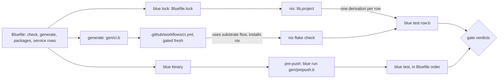
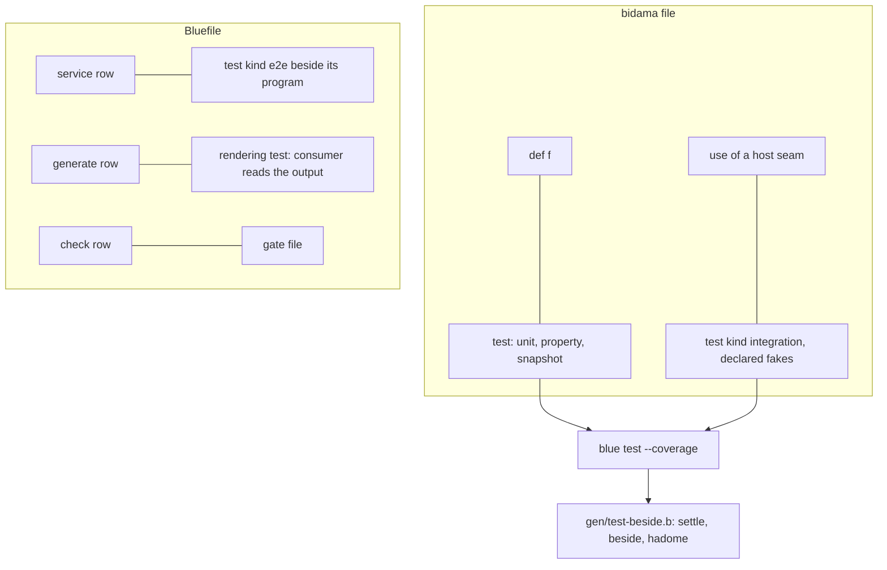
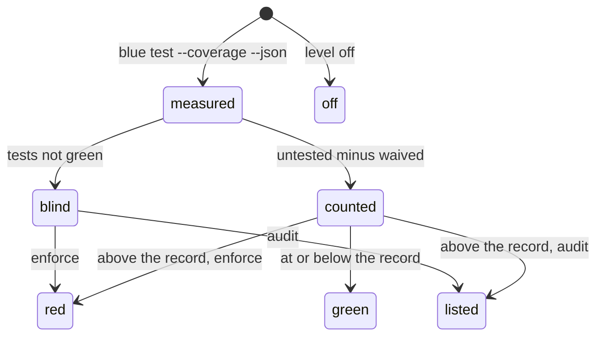

# Testing and the SDLC: one blue pipeline

Operator, 2026-10-24: *"just like we do test blocks in blue for tests could we
also do integration tests near integration points and have a deterministic
place for all kinds of testing ... all sdlc is from called blue binary and this
also feeds into actions and other cicd stuff"*, then *"essentially making a
fully bluelang pipeline"*, then *"give bluelang all the verbs for deep bdd and
tdd style testing and if possible hard block lack of tests ... make the hard
block and testing frameworks also highly configurable"*.

This document is the design. Section 16 is the ledger: the state of each
item.

## 1. Destination

The whole pipeline is declared in blue and run by the blue binary: test,
check, build, gate, release and the deploy hooks. The Bluefile declares it.
Nix, the pre-push hook and GitHub Actions are renderings and runners of that
one declaration. They carry no logic of their own.

Every test lives in one deterministic place, beside the thing it tests: a
unit test beside its `def`, an integration test beside the integration point,
a rendering test beside the renderer, an end-to-end test beside the
`service(...)`. Blue sees every definition, every integration point and every
emitted rendering. So a definition, a point or a rendering with no test is a
gate finding. The finding is on by default, at enforce. A waiver is a blue
entry with a why and an until date, and it refuses that entry only.

A test is hermetic. It touches only the capabilities it declares. Its
fixtures and fakes are declared values, never ambient state. Its randomness
is seeded. It reads no wall clock: the runner passes `now` in.

World-facts that limit this destination:

- GitHub Actions reads YAML from `.github/workflows/` and nothing else. A
  workflow file must exist in the repository, so the rendering is committed
  and gated fresh. It cannot be computed at run time.
- A nix sandbox has no network and no clock it can trust
  (`SOURCE_DATE_EPOCH` is 1980). A test that needs either is not a nix check;
  it runs in a runner that grants the capability.
- A real external service (GitHub, a cloud API) changes without notice. A
  recorded fake is only as true as its last recording; a contract test
  against the live service is the only proof, and it needs the network.
- Dynamic coverage sees only the code a test ran. A definition that a test
  reaches through a caller counts as covered.

Every other limit below is phrased in blue's own abstractions, so it is ours
to dissolve.

## 2. Ground: what exists (measured 2026-10-24)

| Piece | Where | What it does |
|---|---|---|
| `test "…" … end` | `crates/blue-lang-syntax/src/parse.rs:620`, `crates/blue-lang-test/src/lib.rs:1` | a test block beside the code; each test runs in a forked interpreter, so order cannot matter (`lib.rs:30-48`) |
| `assert e` | `crates/blue-lang-test/src/lib.rs:13-28` | fails with the expression rendered by the formatter |
| `blue test FILE\|DIR [--filter P] [--coverage [--json]]` | `crates/blue-lang-cli/src/main.rs:265`, `observe.rs:223` | checks the file, runs its tests; `--coverage` counts calls per definition and lists the ones no test reached |
| `tesuto` | `bidamas/tesuto/tesuto.b` | `raises?`, `snapshot` (golden files), `scratch`, `caught`; since this slice also `uncovered`, `level`, `waive`, `settle`, `beside`, `stale` |
| verb graph rows for tests | `bidamas/mokuroku/graph/tesuto-provisional.b` (25 rows) | the planned words: `affected`, `calls`, `case`, `conforms?`, `contract`, `cover`, `fake`, `fixture`, `flaky?`, `freeze`, `fuzz`, `quarantine`, `rerun`, `shard`, `spy`, `uncovered`, `watch`, … |
| G11 untested | `bidamas/mokuroku/mokuroku.b:1710-1748`, `gen/verb-graph.b:151` | a verb-graph `exists` row whose name no test block mentions; held by `graph.baseline` (1 row of debt) |
| property laws | `bidamas/okite/okite.b:42-182`, `gen/okite-laws.b` | seeded generators over `ran`, and laws that must hold for every generated value |
| generated properties | `crates/blue-lang-check/src/properties.rs`, `crates/blue-lang-runtime/src/pipeline.rs` (`generated_properties`), `crates/blue-lang-cli/tests/properties.rs` | each `@doc` example call of a typed definition gets a `@property` test: calls drawn around it (literal `Int`, `Float`, `Str`, `Bool` arguments moved by `ran`'s generator) must return the declared type or raise; `BLUE_PROPERTY_SEED` takes a seed (default 1) or `off` |
| solver-checked laws | `crates/blue-lang-check/src/lia.rs` (`Backend`), `crates/blue-lang-check/src/laws.rs`, `crates/blue-lang-runtime/src/pipeline.rs` (`generated_laws`), `crates/blue-lang-cli/tests/laws.rs` | each typed `law_…` returning `Bool` gets an `@law` test named by its tier: proved by the solver over linear integer arithmetic (`Int`, `Bool`, list lengths), refuted at its counterexample, tested by drawn calls, or unchecked; `blue test` prints `N law(s): …`; `BLUE_LAWS` takes `cooper` (default), `tested` or `off` |
| mutation testing | `bidamas/heni/heni.b`, `gen/heni-gate.b` | each mutation must make the package's tests fail; `BLUE_HENI_OFF=1` is its off switch. Before a push, the `heni-finds` pre-push gate (`blue gen/heni-gate.b finds PATH...`, `heni --finds`) runs no test and fails when a rewrite of a changed package leaves a mutation's `find` matching other than once; `BLUE_PREPUSH_SKIP=heni-finds` turns it off |
| ratchet | `bidamas/hadome/hadome.b` | recorded debt may shrink or hold, never grow |
| Bluefile words | `crates/blue-lang-pkg/src/bluefile.rs:425` (`WORDS`) | `package`, `needs`, `posture`, `source`, `packages`, `run`, `tool`, `check`, `app`, `generate`, `rule`, `catalog`, `image`, `workload`, `service`, `frontend` |
| `check(name, file[, inputs][, {stage:, kind:}])` | `crates/blue-lang-pkg/src/bluefile.rs` (`CHECK_STAGES`), `nix/project.nix`, `bidamas/mk-bidama.nix` | `checks.<name>` runs `blue test file`; a file with no tests fails; the row's `stage:` is the earliest runner that gates on it (T3) |
| `packages(dir)` | `nix/project.nix:440` | `checks.bidama-test-<pkg>` per package, plus form, collision, lock and solver checks |
| `rule(code, file, def)` | `docs/DIAGNOSTICS.md` "Project rules" | a blue definition run by `blue check` on every top-level form, under a pure frame |
| `generate(name, out, program)` | `bluefile.rs:540` | a committed file and its program, gated fresh |
| `service(...)` | `nix/service.nix`, `docs/SERVICE-ARCHITECTURE.md` | chart, values schema, migrations; `checks.service-<name>-{fresh,chart,serves}` |
| pre-push gate | `.githooks/pre-push` (4 lines of sh), `gen/prepush.b` `gate_table` | a gate table in blue, scoped to the pushed paths; light gates by default, `BLUE_PREPUSH_FULL=1` all, `BLUE_PREPUSH_OFF=1` none |
| CI | `.github/workflows/ci.yml` | a `blue` job builds blue once, reads the suite proof (`gen/proof.b --verify`) and exports the closure; substrate's `cargo-ci.yml`, `consumers` and, on a land, `stop-on-red` import it; flake-check runs as 6 parallel jobs (`flake-check-shards`, repository variable `BLUE_FLAKE_CHECK_SHARDS`, 1 is one job) |
| package fidelity | `nix/package-fidelity.nix`, `nix/package-gate.b`; `checks.package-fidelity`, so every land runs it | packages every crate as `cargo publish` would, runs blue-lang-pkg's `build.rs` walk over the checkout and the unpacked `.crate` and names each embedded file the package lacks; then a blue built from the tarballs alone must resolve `todokede/motenashi` and the deepest level of every tree |
| capabilities | `docs/SAFETY.md` row 8 | thirteen host effects (process, filesystem, environment, clock, network, entropy, comm-flash, comm-scavenger, mpc-threshold, storage-append, audio-out, audio-in, display); `blue run --allow` |
| absence | `docs/ABSENCE.md` (in flight, other owner) | `Option` and the nil checker rule |

Measured with `blue test --coverage --json` over every bidama on 2026-10-24:
77 packages, 4154 definitions, 3944 reached by a test (94.9%), 210 not
reached, in 42 packages. 35 packages reach every definition.

What does not exist (second probe: `rg --no-ignore` over `crates/`, `nix/`,
`bidamas/`, `gen/` and `pleme-io/actions`): no word or program that renders a
GitHub Actions workflow; no `describe`, `before`, `let`, `fake` or `spy`; no
test kind other than "a `test` block"; no capability declaration on a test;
no blue action in `pleme-io/actions` (its 439 run scripts are tatara-lisp
`run.tlisp`).

Prior pleme-io art: the seam is the whole game (every side effect behind one
injectable trait, then mock the trait), and kensa's `kensa-profiles` matchers (`eq`, `cmp`, `include`, `match`, `be_in`,
`compare`). kensa's own integration tests hand-write an axum server that
plays GitHub (`kensa/tests/recorder_tests.rs:100-124`); no recorded fake
exists in the fleet.

## 3. Research

| Source | Shape | Verdict |
|---|---|---|
| RSpec ([rspec.info](https://rspec.info/documentation/)) | `describe`/`context`/`it`, `let`, `subject`, hooks, shared examples, matchers | adapt: one grouping word (`describe`), no `context` synonym; `let` is a binding; hooks are functions |
| Rust `#[test]`, `#[cfg(test)]` ([doc.rust-lang.org](https://doc.rust-lang.org/book/ch11-03-test-organization.html)) | unit tests in the same file, integration tests in `tests/` | adopt the "beside" half; skip the separate `tests/` tree for blue |
| cargo-nextest ([nexte.st](https://nexte.st/)) | process per test, retries, partitions, JUnit output | adopt: `shard`, `rerun`, reporters as config entries |
| proptest ([docs.rs/proptest](https://docs.rs/proptest)) | seeded generators, shrinking, persisted failures | adopt through okite + `ran`; shrinking is a phase |
| insta ([insta.rs](https://insta.rs/)) | snapshot files beside the test, review on change | exists as `tesuto::snapshot` |
| cargo-mutants ([mutants.rs](https://mutants.rs/)) | mutate, expect a red test | exists as heni |
| Pact ([docs.pact.io](https://docs.pact.io/)) | consumer-driven contracts, provider verification | adapt: `contract` and `conforms?` from the verb graph |
| VCR ([github.com/vcr/vcr](https://github.com/vcr/vcr)) | record real HTTP once, replay | adapt: a recorded fake is a fixture file beside the binding |
| Bazel test size and tags ([bazel.build](https://bazel.build/reference/test-encyclopedia)) | small/medium/large, network declared | adopt: capabilities declared per test, the runner picks by them |
| Cucumber/Gherkin ([cucumber.io](https://cucumber.io/docs/gherkin/)) | given/when/then in prose files | skip: a second language beside blue; given/when/then are bindings and `assert` |
| GitHub Actions `workflow_call` ([docs.github.com](https://docs.github.com/en/actions/using-workflows/reusing-workflows)) | reusable workflows | adopt: the rendered workflow `uses:` substrate's flows |

## 4. The taxonomy

Each kind has one place. The place is how blue finds it. "May touch" is the
capability frame the runner grants; anything else is refused.

| Kind | The one place | Named and found by | May touch | Runs in |
|---|---|---|---|---|
| unit | a `test` block in the file of the `def` | the file; `blue test FILE` | pure | `bidama-test-<pkg>`, pre-push, CI |
| property | a `test` block beside the `def`, over a seeded generator (okite, `ran`) | the file | pure; seed from the test, printed on failure | same as unit |
| snapshot | a `test` calling `tesuto::snapshot`; the golden file in `snapshots/` beside it | the file | filesystem, scoped to `snapshots/` | same as unit |
| mutation | `heni/mutations/<pkg>.json` | the package name | process (runs `blue test` on a copy) | `checks.heni-mutations` |
| contract | beside the integration point: a `contract(...)` value with the point's declared shape | the point's file | pure | same as unit |
| integration | a `test` with `kind: :integration` in the file that declares the point: the `use` of a host seam, a `cache`/`schema`/`http` binding, a `service` entry | the file and the kind | the capabilities it declares; the external side is a declared fake or recorded fixture | nix check when it needs no network; else the CI runner that grants it |
| rendering | a `test` beside the renderer (haibi, the `generate` program) that feeds the output to its consumer: `helm lint` and `helm template` for a chart, a JSON Schema validator for a schema, `nix eval` for nix, `actionlint` for a workflow | the renderer's file | process (the consumer tool, named by `tool(...)`) | `checks.service-<name>-chart` today; one check per rendering |
| end-to-end | a `test` with `kind: :e2e` beside the `service(...)` entry's program | the Bluefile's `service` row | process, network on loopback | `checks.service-<name>-serves` today |
| gate | a `check(name, file)` row in the Bluefile | the row | what its tests declare | nix, pre-push, CI, in the Bluefile's order |

A test's kind and capabilities are an options map after its title. The
default is `{kind: :unit, allow: []}`: a pure test. (Decision D6.)

```
test "the cache key carries the entity's key", {kind: :integration, allow: [:network], fakes: [:valkey]}
  ...
end
```

### Declared controls (live, 2026-10-30)

The first two keys of the map are built: what a test verifies.

```
test "a token is parsed in isolation from the filesystem", {
  satisfies: [:nist_ac_6],
  target: parse_token
}
  assert_panics parse_token("/etc/hosts")
end
```

- `satisfies:` lists compliance controls as catalog keywords. `:nist_ac_6` is
  NIST SP 800-53 Rev. 5 AC-6, which tameshi and OSCAL name
  `NIST_SP_800_53R5_AC_6`; `:nist_ac_6_1` is the enhancement AC-6(1). The one
  mapping is `blue_lang_check::controls::oscal_id`, over the table
  `controls::CATALOGS`; a keyword it does not map is B0069.
- `target:` names the definition the test verifies. It resolves like any
  reference (`%root/parse_token`, `moji::split`), is never called, and must
  be a definition: a builtin or a local is B0069, an unbound name B0001.
- The map lowers to its own tree under the harness's head:
  `(deftest "…" (blue-test-meta (hash-map :satisfies (list :nist_ac_6)
  :target parse_token)) body)`. Every order is one tree, the controls sorted
  and the keys in order (B0068).
- `kind:` is one of `:unit` (the default), `:property`, `:snapshot`,
  `:contract`, `:integration`, `:rendering`, `:e2e`; any other word is refused
  at parse. `allow:` lists host capabilities by label (`:network`,
  `:comm_flash`); the harness runs that test held to exactly them, and a word
  that names none is B0069. A test that declares no `allow:` runs as before.
  `fakes:` names the fakes the test stands up; it is recorded, and judging it
  against declared seams is T6.
- `assert_panics expr` passes only when `expr`, moved into a child the way
  `spawn` moves a function (its helpers defined, its data copied, nothing
  shared) and run held to a pure frame, ends on a capability breach having
  made no host call. Any other end fails the test and says how it ended
  (`ended: returned 2`). A breach is fatal, so no `rescue` in the child
  hides one, and one reached outside `assert_panics` ends its test.
- `blue test --allow none` holds every test to a pure frame, as
  `blue run --allow` holds a program. Without `--allow` the tests are
  ambient, as before.
- `blue test --facts FILE` (or `TAMESHI_FACTS=FILE`, how tameshi's runner
  asks) writes two canonical JSON files. FILE is exactly tameshi's facts
  (`RunFacts`): `{"assertions":{"failed":0,"passed":1},"frame":{"granted":[],
  "host_io":0,"withheld":[…]},"steps":358}`. tameshi refuses any other field,
  so `blue-test-evidence.json` beside it (schema `blue-test-evidence.v1`)
  carries each test: `controls` as tameshi ids, `target` as a tameshi
  `Target` (`{"kind":"blue-def","hash":<def_hash>}`), `test` as a tameshi
  `TestRef` (`{"runner":"blue","hash":<the test's def_hash>}`), `status`,
  `assertions`, `steps` and `host_io`. A test's `def_hash` is the hash of its
  declaration and body as one definition
  (`blue_lang_mondou::def_hash::test_identities`): renaming it keeps it,
  changing its body, its declaration or anything it reaches changes it.
  With facts and no `--allow`, the run is held to the top so host calls are
  counted.

Tests: `crates/blue-lang-cli/tests/compliance.rs` (a facts run read by
tameshi 0.1.7's strict types, folded into an `EvidenceLedger` whose AC-6
leaf's inclusion proof verifies, and tameshi's own runner reading a passing
receipt), the harness's `assert_panics_*` and
`under_a_pure_frame_a_breach_outside_assert_panics_ends_its_test_past_a_rescue`,
`spec/rows/testing.b`.

## 5. Integration points are first-class

An integration point is any place blue meets the world:

| Point | How blue sees it today | Its test beside it |
|---|---|---|
| a host seam | a `use` of a bidama that calls a host capability (`exec_*`, `http_*`, `pg_*`, files) | an integration test with the capability and a fake or fixture |
| a binding | a `service(...)` field: `cache`, `schema`, `config`, `port` | a contract test of the binding's shape, plus an integration test against a declared fake (a local valkey from `tool("valkey")`, a sqlite or pg fixture) |
| an emitted rendering | a `generate` row, a `service` tree, a `workload` | a rendering test that runs the consumer over the output |
| a service | a `service(...)` row | an end-to-end test against `packages.<name>` on loopback |

**Built (T4):** the check stage finds every effect point (a definition that
names a host builtin outside the ambient set: network, process, entropy and
the other non-ambient capabilities; the filesystem, the environment and the
clock are ambient) and every seam point (a definition that calls an imported
word whose reach names one), in a bidama's file, on every door that checks
tests (`blue check`, `blue test`, the language server, pre-push, every
`bidama-test-*`). A point that no test of its file declared `kind:
:integration` (or `:e2e`) reaches is B0083 or B0084, the moment it is
written. Existing debt is one `# waive` per site; `blue census` holds the
count (`blue_lang_check::obligations`, rows `point/effect` and `point/seam`;
DIAGNOSTICS.md lists every obligation). The project points are found from
the lock above the file: the program of a `generate` row owes a test declared
`kind: :rendering` (B0085), the program of a `service` row one declared
`kind: :e2e` (B0086), and a service that binds a `cache` or a `schema` one
declared `kind: :contract` (B0087).

Blue already reads each of these as data: the lock lists every `generate`,
`service` and `check` row (`Bluefile.lock`, `manifest`), and the check stage
sees every `use` and every capability call. So "a point with no test beside
it" is computable, the same way "a definition no test reached" is. It is a
gate finding, on by default; `level(...)` and `waive(...)` entries configure
it (section 7).

## 6. The BDD and TDD vocabulary

The words live in `tesuto`, the test bidama, and in the verb graph's
`tesuto?` rows that already name them. No word is minted twice: a word that a
builtin or a bidama already has is used, not aliased.

| RSpec or Rust shape | blue word | State |
|---|---|---|
| `it "does x"`, `#[test]` | `test "does x" … end` | ✅ built |
| `describe`, `context` | `describe "subject" … end` (one word; a context is a nested `describe`) | ❌ not built (a parser form, like `test`) |
| `let`, `subject` | a binding at the top of a `describe`, evaluated per test in the forked interpreter | ❌ not built |
| `before`, `after`, `around` | `around(f)`: a function that receives the test body; `before` and `after` are `around` with one side | ❌ not built |
| shared examples | a `def` that takes the subject and asserts; tests call it | ✅ built (plain blue) |
| table-driven, parametric | `case(name, f)` over a list of rows, one test per row | ❌ not built (a verb graph row) |
| `eq` | `assert a == b` (structural diff on failure) | ✅ built |
| `include` | `member?`, `contains?` | ✅ built (builtins) |
| `raise_error` | `tesuto::raises?(kind, f)` | ✅ built |
| `change { }.by(n)` | `changes?(probe, f, by)` | ❌ not built |
| `satisfy` | any predicate in `assert` | ✅ built |
| match a shape or schema | `conforms?(value, contract)`; a contract is a kousei shape | ❌ not built (a verb graph row) |
| stub, fake | `fake(target, impl, f)`: on a declared seam only | ❌ not built (a verb graph row) |
| spy | `spy(target)`, `calls(spy)` | ❌ not built (verb graph rows) |
| snapshot, golden | `tesuto::snapshot(value, {name:})` | ✅ built |
| property | okite laws over `ran` seeded generators | ⏳ in progress: laws run; shrinking is not built |
| frozen time | `freeze(instant, f)` | ❌ not built (a verb graph row) |
| fixture file | `fixture(name)`: a file kept beside the test | ❌ not built (a verb graph row) |
| flaky handling | `quarantine(test, reason, until)`, `flaky?` | ❌ not built (verb graph rows) |
| coverage | `blue test --coverage`, `tesuto::uncovered` | ✅ built |

A fake replaces a seam that a bidama declares. It never patches an arbitrary
name: that would make every definition a seam and hide what a test touches.

## 7. The hard block: no definition, point or rendering without a test

**Rule.** A definition no test reaches, an integration point with no test of
its kind beside it, and a rendering no consumer test reads are each a finding.
The finding is on by default, at `enforce`.

**Configuration is blue entries, each judged alone** (`tesuto::settle`):

```
level("*", :enforce, "a definition is reached by a test beside it")
level("kirikae", :audit, "switching a system is tested on a node, not in a sandbox")
waive("heni::main", "the process entry; gen/heni-gate.b runs it", "2026-12-31")
```

| Entry | Fields | Refused when |
|---|---|---|
| `level(scope, value, why)` | scope: a package or `"*"`; value: `:off`, `:audit`, `:enforce` | no why, no scope, an unknown level |
| `waive(name, why, until)` | a qualified definition, a reason, a `YYYY-MM-DD` date | no why, an unqualified name, no date, a date before `today` |

A refused entry is named and takes no effect; its siblings stand. A waiver
that covers nothing is stale and is a finding, because it would hide the next
real gap. `level("*", :off, why)` turns the gate off; the code, the entries
and the tests stay.

**Levels.** `off` measures nothing. `audit` reports and never fails.
`enforce` fails on growth past the recorded debt. Debt is a hadome baseline
(`untested: <pkg> <n>`): it may shrink or hold, never grow. A package with no
row holds at zero, so every new package starts fully tested.

**Absence.** A package whose tests do not run green has no coverage
evidence. It is `blind`, never green: at `enforce` it fails, at `audit` it is
listed.

**Every project (T2, built).** Every project with `packages` gets
`checks.test-beside` from `lib.project`. Each `bidama-test-<pkg>` check runs
`blue test --coverage --json`, and the gate (`nix/test-beside.b`) judges the
coverage those outputs hold, so no test runs twice. The judge is tesuto's
(`judge_coverage`, `coverage_verdict`, `coverage_report`). The policy is the
program the Bluefile names with `coverage(file)`: `blue run file -- policy`
prints its entries and recorded debt. A project that names none holds every
package at enforce with no debt. The one way to configure the gate off is
`skip("test-beside", why)` in the Bluefile; the lock records the skip and its
reason. Blue's own policy is `gen/test-beside.b`; its judge tests run as
`checks.test-beside-judge`, and the pre-push gate still measures the corpus
there (`BLUE_TEST_BESIDE_CORPUS=on`), since a hook has no nix outputs to read. An arm one host takes and another does not (a branch on
the operating system) differs per platform, so a recorded `unbranched` row is
the larger of the counts measured on darwin and on Linux. Kinds required per point type
(for example "a `cache` binding needs an integration test") are a third entry,
`require(point, kind, why)`, in phase T4.

## 8. The configurable framework

Every knob is a blue entry, judged alone, with a default:

| Knob | Entry | Default |
|---|---|---|
| reporter | `blue test --junit FILE` (built, T8); SARIF is not built | text; JSON with `--coverage --json` |
| order and seed | `order(:declared \| :random, seed)` | declared; tests are already order-free by fork |
| parallelism | `jobs(n)` | one process per file today (`blue test DIR` runs files in parallel) |
| kinds selected | `blue test --kind integration` | every kind the runner's capabilities allow |
| fixture providers | `provider(name, program)`: a run that brings up a fake (valkey, pg) for integration tests | none |
| shards | `blue test DIR --shard I/N` (built, T8): every N-th file of the sorted tree from the I-th, so the shards are disjoint and together hold it | 1 of 1 |
| flaky | `blue test --rerun N` (built, T8): the tests run N times, the cache off after the first, and a test whose verdict differs fails the run | 1 run |
| quarantine | `quarantine("file.b::test", why, until)` in the Bluefile (built, T8): a failing test held out of the verdict while `until` stands, failing again after it; one that passes is named so its entry can go; the date is the runner's (`BLUE_TEST_TODAY`, else the UTC clock) | none |

Its renderings are the runners: the nix check, the pre-push gate and the CI
workflow read the same entries.

## 9. One SDLC entry: the Bluefile and the blue binary

**The pipeline is the Bluefile.** A gate is a `check(name, file)` row. A
rendering is a `generate` row. No new Bluefile word is minted for the
pipeline: `check` takes an options map, `{stage: :push | :ci | :release,
kind:}` (T3, built). The stage is the earliest runner that gates on the row:
every row is a nix check whatever its stage, a `:push` row also runs before
a push, a `:release` row before a release. `kind:` names the test kind the
row holds. A row that declares no stage is B0092 on its program, on every
door that checks tests.

```
check("merge-driver", "gen/merge.b", ["gen/merge.b", "gen/regen.b"], {stage: :push})
```

**The runner verb is `blue test`.** `blue test FILE` runs one file, and
`blue test DIR` every file under DIR that holds a test, as before.
`blue test DIR --stage S [--kind K]` runs instead the `check` rows of the
project in DIR whose row declares that stage (and kind), in the lock's
order, each held to its declared inputs as nix runs it; a stage with no row
says so and passes. No `blue sdlc` or `blue gate` verb: it would be a second
name for "run the declared tests".

**Who calls it:**

| Runner | Today | Destination |
|---|---|---|
| nix | `checks.<name>` = `blue test file`, one derivation per row, cached | unchanged: nix is the hermetic, cached executor of each row |
| pre-push | `gen/prepush.b`: the Bluefile's `:push` rows (`declared_gates`, from the lock) after the 18 host gates of `gate_table`, which hold at 18 and only fall | `blue test . --stage push`; each host gate (cargo fmt, gen tie) becomes a `check` row |
| CI | `.github/workflows/ci.yml`, rendered by `gen/ci.b` (`generate("ci", …)`, gated fresh); its `check` job is substrate's `cargo-ci.yml`, which runs `nix flake check`, every `check` row whatever its stage | unchanged; the logic of each job moves into a `check` row |
| release | `auto-release.yml` uses substrate's `rust-auto-release.yml` | the same rendering, with `--stage release` gates before the substrate flow |

**No big bang with `pleme-io/actions` and substrate.** The rendered workflow
still `uses:` substrate's reusable workflows and the actions repo's
`nix-setup`. Those stay runners: they install nix and call the binary. Logic
moves out of them one step at a time, in the ledger order below. A blue
action (`action.yml` that calls `blue run run.b`) is a peer of the tatara-lisp
ones, added when an action is touched, never by mass rewrite.

### Non-blue steps in the pipeline today

✅ built and tested · ⏳ in progress · ❌ not built

Each row is one step of the pipeline. The state says whether the step is blue,
or stays outside blue by design.

| Item | State | What makes it true |
|---|---|---|
| 1. which checks exist, per word | ✅ built | It stays nix by design: packaging is nix's job. `nix/project.nix` and `bidamas/mk-bidama.nix` read the lock, which blue wrote. |
| 2. each check's body | ✅ built | One `blue test` call per check (`bidamas/mk-bidama.nix`). |
| 3. freshness compare | ❌ not built | `mkFreshCheck` compares with `cmp` in sh (`bidamas/mk-bidama.nix`). Phase T6 moves it to a `blue test` gate. |
| 4. pre-push hook | ✅ built | It stays as glue by design: `.githooks/pre-push` is 4 lines of sh that call `gen/prepush.b`. |
| 5. pre-push gate list | ⏳ in progress | `gen/prepush.b` derives a gate from each `check` row with `stage: :push` (`declared_gates`, `pipeline_table`). 18 host gates (cargo fmt, the census, conformance) are still a hand list in `gate_table`; a test holds them at 18, so each one that becomes a row lowers it. |
| 6. CI workflow | ✅ built | `gen/ci.b` renders `.github/workflows/ci.yml` (T5); `checks.workflows` refuses a workflow no `generate` row renders. Seven workflows are still hand YAML, held in `hand_workflows`, which only shrinks. |
| 7. CI logic | ❌ not built | substrate `cargo-ci.yml` and the actions' `run.tlisp`. Phase T5 moves the logic into the Bluefile's checks. |
| 8. release | ❌ not built | substrate `rust-auto-release.yml`. Phase T7. |
| 9. action renderer | ❌ not built | actions `defaction-render` (curl and python `render.py`). Phase T7. |
| 10. kensa delivery | ❌ not built | kensa `ci.yml` `deliver-to-ryn` (2 lines of sh). Phase T7. |

### Pre-merge and post-merge

A check answers one of two questions, and the answer places it:

| Tier | The question | Where it runs | What it holds |
|---|---|---|---|
| pre-merge | is this change correct? | every land (`checks.<system>`) | tests, conformance, format, generated freshness, locks, check and lint gates, runnable docs |
| post-merge | are the tests and the system good enough? | every push to `main`, nightly (`.github/workflows/post-merge.yml`, `postMerge.<system>`) | mutation testing, performance baselines, VM and real-kernel boots, model evals |

The tier is data: `nix/check-tiers.nix` lists the post-merge checks, `checksAll`
holds every check, `checks` is `checksAll` without them. A check moves between
tiers by one line; nothing is deleted. The project engine takes the same list
(`projectFor { postMerge = …; }`), so `checks.project`, the one name CI builds,
aggregates only pre-merge checks; evaluation refuses a tier name that is no
check and a `project` that still names a post-merge one. A post-merge check is not a duplicate
of a pre-merge one: before moving a check, name the question it answers. The
land's runner is the repository variable `BLUE_LAND_RUNNER` (unset: hosted).

`git land --proven` runs the suite locally (`gen/proof.b --prove`) and pushes a proof under `refs/notes/blue-suite`; CI skips `cargo test` when the note names the commit's tree and locks.
The proof is trusted on push access alone: a note is not signed, so anyone who can push the notes ref can claim a green suite.

## 10. Determinism

- **Hermetic fixtures.** A fixture is a file beside the test, or a value in
  it. A test that reads outside its fixtures and `scratch` dir is refused by
  its capability frame (D6).
- **Seeded randomness.** A generator takes a seed (`ran`). The runner prints
  the seed of a failing property test, and `order(:random, seed)` reruns it.
- **No wall clock.** A test that needs time takes `now` as an argument or uses
  `freeze`. kensa's attestation plane already works this way: Rust passes
  `received_at` in and blue never reads a clock.
- **Recorded fakes.** An external service is a fixture recorded once from the
  real service (VCR shape), replayed by a fake on loopback. The recording is
  committed beside the binding's test, with the date it was taken; a contract
  test against the live service re-records it in a runner with the network
  capability.
- **A cached pass is a pass of the same test.** Unless `BLUE_TEST_CACHE=off`
  or `--no-cache`, `blue test` skips a test whose identity a passing run recorded under
  `$XDG_CACHE_HOME/blue/test/`, and the summary counts it as cached. The
  identity is the test's `def_hash` (its body, its declaration and every
  definition it reaches), the file's preamble hash (every value, expression
  and twice-bound name the tests fork from), the execution bounds, and the
  build of `blue`. A failed or skipped test, a test that made a host call,
  and every test of a file whose preamble made one are never recorded: what
  they read is not in the identity. `--coverage` and `--facts` always run
  every test. On by default.

## 11. States and trust

A test run is in exactly one state per package:

| State | Means | At enforce |
|---|---|---|
| green | tests passed, untested count at or below the record | pass |
| red | tests passed, untested count above the record | fail |
| blind | tests did not run green, so no coverage evidence | fail |
| off | configured off by a `level` entry | pass, listed as off |

A policy entry is `kept` or `refused` (with its reason). A waiver is
`covering` or `stale`.

**Trust.** The gate trusts the blue binary that runs it (`self_exe`) and the
committed entries. An entry is authored by a commit, so its why and date are
reviewed with the code. Coverage numbers come from the run, never from a
claim; a missing run is `blind`, never `green`.

## 12. Diagrams

The flow: one declaration, many runners.



Test placement: each kind sits beside what it tests.



The gate's judgement for one package.



## 13. Decisions

| # | Question | Answer | Rejected, and why |
|---|---|---|---|
| D1 | Where is the pipeline declared? | the Bluefile; gates are `check` rows | a new `pipeline(...)` word (parallel to `check`); YAML (a rendering is not a source) |
| D2 | Which verb runs it? | `blue test`, over a file or a Bluefile directory | `blue sdlc`, `blue gate` (second names for one act) |
| D3 | Who executes CI? | nix, one cached derivation per row; the workflow is a rendering that calls it | logic in workflow YAML; a tatara-lisp `defworkflow` (blue is the higher rung) |
| D4 | What counts as tested? | reached by a test at run time (`blue test --coverage`) | text mention (G11's measure: misses indirect reach, and a name in a string counts); line coverage (finer than a definition, no stable key for a ratchet) |
| D5 | How is a missing test blocked? | a hadome ratchet per package at enforce, new packages at zero | a fleet-wide percentage threshold (one package's debt hides another's growth); enforce at zero now (210 rows of debt would block every push) |
| D6 | How does a test say its kind and reach? | an options map after the title, default pure unit | a kind from the file path (a second place to look); kind inferred from capabilities used (implicit, so a test silently changes kind) |
| D7 | Where do waivers live? | blue entries with why and until, judged alone | `# waive` comments (B0007 refuses an unregistered code, and a comment has no date); a waiver file in YAML |
| D8 | Where do BDD words live? | `tesuto`, plus parser forms only for `describe` (like `test`) | a separate BDD bidama (a parallel test vocabulary); Gherkin text files (a second language) |
| D9 | How are fakes scoped? | on a declared seam only | patching any name (every definition becomes a seam) |
| D10 | What turns the gate off? | `level("*", :off, why)` | an environment variable (not reviewed, not in the source); deleting the check (behaviour is configured off, never deleted) |

## 14. Open questions

| Question | Type |
|---|---|
| Can a nix check run integration tests that need a local valkey or pg? | ours: `tool(...)` already puts binaries on PATH in the sandbox; a fixture provider is a `run` |
| Can a workflow be computed at run time instead of committed? | world-fact: GitHub reads only committed YAML, so it is rendered and gated fresh |
| How long may the coverage gate take in pre-push? | ours: it runs every bidama's tests a second time (74 s on an M-series laptop, release build); phase T2 reads the coverage from the `bidama-test-<pkg>` outputs instead |
| Should a private helper need its own test? | ours: every `def` is exported today (`docs/STDLIB.md:774`); when `defp` lands, a private helper is covered through its callers |
| Are live contract tests against GitHub safe to run in CI? | world-fact: they need the network and a token; they run in a runner that grants both, never in a nix check |

## 15. Phases, ranked by value per effort

| Phase | What | Value | Effort |
|---|---|---|---|
| T1 | coverage hard block on blue's own bidamas: `tesuto` policy words, `gen/test-beside.b`, `check("test-beside")`, pre-push gate | every new untested definition in blue is red | landed |
| T2 | the gate in `lib.project`: every project with `packages` gets it by default; read coverage from the `bidama-test-<pkg>` outputs (no second run) | fleet-wide block, half the time | landed |
| T3 | `check` options `{stage:, kind:}`; `blue test DIR --stage S` runs the Bluefile's rows; `gen/prepush.b` derived from them | one gate list for nix, pre-push and CI | landed |
| T4 | test options map (`kind`, `allow`, `fakes`) and the integration-point finding: a `service` binding, a `generate` row or a seam with no test of its kind | integration tests beside their points | effect and seam points built (B0083, B0084); project points next |
| T5 | `gen/ci.b` renders blue's own CI workflow; the logic moves into `check` rows | CI is a rendering | landed (the rendering and its gate); the logic moving into rows is ongoing |
| T6 | BDD words: `describe`, `around`, `case`, `changes?`, `fake`, `spy`, `calls`, `freeze`, `fixture`, `conforms?` | RSpec-depth tests in blue | medium |
| T7 | release and delivery steps as blue (`defaction-render` in blue, kensa's delivery step) | the last non-blue logic leaves the pipeline | large |
| T8 | reporters (JUnit, SARIF), shards, quarantine with until, flaky detection | CI ergonomics | JUnit, shards, quarantine and flaky detection landed; SARIF next |

## 16. Ledger

Every obligation blue forces, and its state, is one row of
`blue_lang_check::obligations`, rendered in DIAGNOSTICS.md "Obligations".

✅ built and tested · ⏳ in progress · ❌ not built

| Item | State | What makes it true |
|---|---|---|
| test blocks, `assert`, `blue test --coverage` | ✅ built | `crates/blue-lang-test`; `blue test`. |
| `tesuto::uncovered`, `level`, `waive`, `settle`, `level_of`, `beside`, `stale` | ✅ built | `bidamas/tesuto/tesuto.b`, 18 tests. |
| T1: the coverage gate at enforce, with a ratchet, on blue's own bidamas | ✅ built | `gen/test-beside.b`, 7 tests (red then green on a fixture package; growth, waiver, stale, audit, off, blind); `check("test-beside", …)` in the Bluefile; the pre-push gate. |
| recorded debt | ⏳ in progress | 210 untested definitions in 42 packages, measured 2026-10-24; 35 packages at zero. |
| test declarations: `satisfies:`, `target:`, `assert_panics`, `blue test --allow`, `--facts` | ✅ built | Section 4, "Declared controls"; `crates/blue-lang-cli/tests/compliance.rs` (4 tests), `spec/rows/testing.b` (12 rows). |
| a named skip: `tesuto::skip_for`, `SKIP name: why`, `BLUE_TEST_SKIP=refuse` | ✅ built | `crates/blue-lang-test/src/lib.rs` (a skip is never a pass), `crates/blue-lang-cli/tests/scripts.rs`, `gen/kernel-new.b`. |
| the test cache: on by default; `BLUE_TEST_CACHE=off` or `--no-cache` turns it off | ✅ built | Section 10; `crates/blue-lang-cli/tests/test_cache.rs`, 8 tests (among them `a_changed_callee_runs_its_test_again`, `a_test_that_reaches_the_host_is_never_cached`, `an_unknown_cache_value_is_refused`). |
| T2: the coverage gate in `lib.project` for every project with `packages` | ✅ built | `nix/project.nix` `coverageGate` and `testRuns`, `nix/test-beside.b` (its tests, red then green on a fixture project), tesuto's `judge_coverage`; Bluefile words `coverage(file)` and `skip(gate, why)` (`blue-lang-pkg` tests). |
| T3: `check` options `{stage:, kind:}`; `blue test DIR --stage S`; pre-push derived from the `:push` rows | ✅ built | `check` takes `{stage:, kind:}` (a stage or kind blue does not know refuses the Bluefile); the lock records both; B0092 refuses the program of a row with no stage on every door that checks tests (registry row `pipeline/stage`, held 0: every row of blue's 10 Bluefiles names its stage); `blue test DIR --stage S [--kind K]` runs a stage's rows; `gen/prepush.b` runs the 10 `:push` rows beside its 18 host gates, held at 18. Tests: `crates/blue-lang-cli/tests/stage.rs` (3), `crates/blue-lang-runtime/tests/rules.rs` `a_check_row_is_discharged_by_its_declared_stage`, `blue-lang-pkg` `check_records_its_stage_and_kind_with_or_without_inputs` and `a_check_program_s_role_carries_the_stage_its_row_declares`, `gen/prepush.b` (2 new). |
| T4: test options `kind:`, `allow:`, `fakes:`; the integration-point finding | ✅ built | The options (parser, B0068 order, B0069 for `allow:`, the harness holds a test to its `allow:`); B0083 (effect point), B0084 (seam point), B0085 (rendering), B0086 (service), B0087 (binding) on every door that checks tests. Held debt (waivers): 97 effect, 22 seam, 31 rendering, 2 service, 1 binding; paid: `shisutemu::run_capture`, `shisutemu::terminal?`, `shomei::random`, `gen/diagnostics.b`. Tests: `crates/blue-lang-runtime/tests/rules.rs` (each witness, `an_effect_point_is_discharged_only_by_a_test_of_its_kind`, `a_project_point_is_discharged_only_by_a_test_of_its_kind`), `blue-lang-syntax` `test_form`, `blue-lang-test` `a_test_runs_held_to_the_capabilities_it_declares`, `census::held`. Judging `fakes:` against declared seams is T6. |
| T5: `gen/ci.b` renders blue's own CI workflow | ✅ built | `generate("ci", ".github/workflows/ci.yml", "gen/ci.b", ["Bluefile.lock"])`, gated fresh; its rendering test reads the YAML back as the workflow it renders (and actionlint reads it clean). `check("workflows", "gen/ci.b", …, {stage: :push})` refuses a workflow no `generate` row renders (registry row `pipeline/ci`); the hand-written ones (auto-release, gen-spec, land, post-merge, registry-flakehub, registry-sui, runner-overflow) are held in `hand_workflows`, and one that becomes a rendering must leave it. Tests: `gen/ci.b` (6). |
| T6: BDD words (`describe`, `around`, `case`, `changes?`, `fake`, `spy`, `calls`, `freeze`, `fixture`, `conforms?`) | ❌ not built | `tesuto` has `raises?`, `snapshot` and `caught` only. The planned words are `absent` rows in `bidamas/mokuroku/graph/tesuto-provisional.b`. |
| T7: release and delivery steps as blue | ❌ not built | Rows 8 to 10 of section 9. |
| T8: reporters (JUnit, SARIF), shards, quarantine, flaky detection | ⏳ in progress | Built: `blue test --junit FILE`, `--shard I/N`, `--rerun N` (flaky), the Bluefile word `quarantine(test, why, until)` (no why, no date or no `file::test` refuses the entry; an expired one fails again). Tests: `crates/blue-lang-cli/tests/report.rs` (5). Not built: SARIF; no gate runs `--rerun` by default (registry row `strength/deterministic`, design). |

Related: [`SAFETY.md`](SAFETY.md) (capabilities, row 8; scripts get project
checks, row 16), [`ABSENCE.md`](ABSENCE.md) (absence as its own state),
[`SERVICE-ARCHITECTURE.md`](SERVICE-ARCHITECTURE.md) (the service and its
renderings), [`DIAGNOSTICS.md`](DIAGNOSTICS.md) (project rules, waivers).
