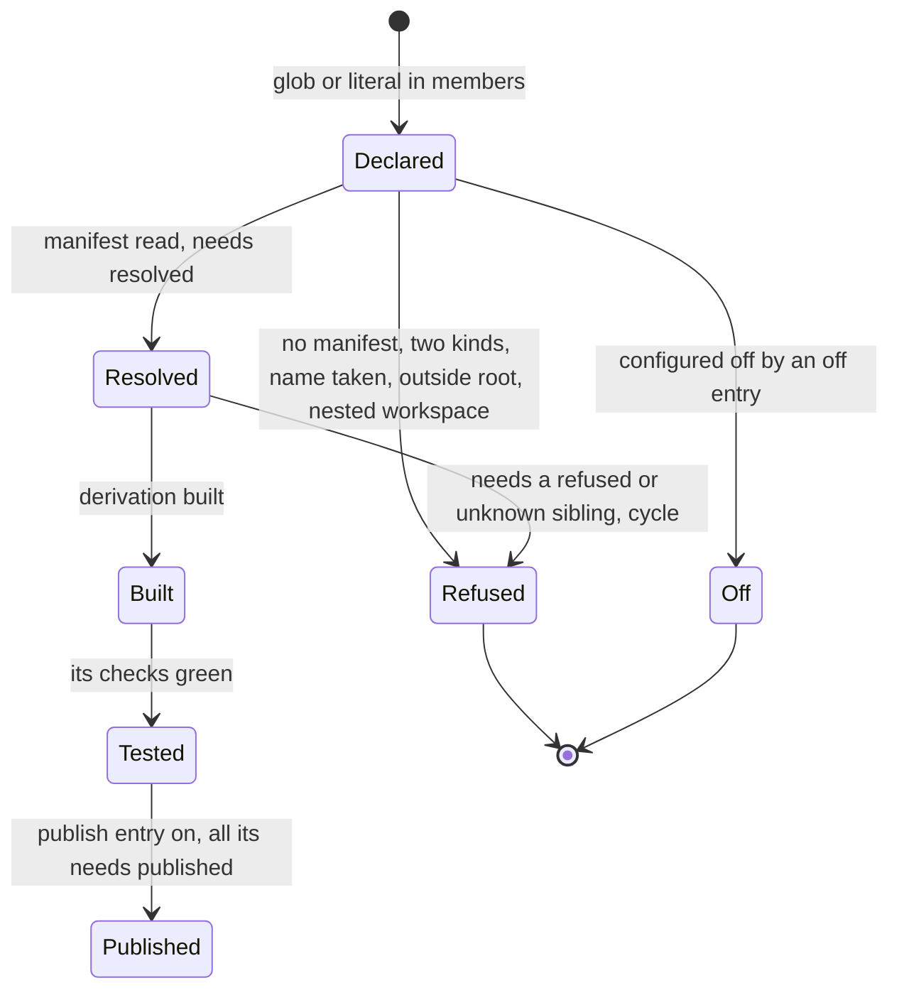
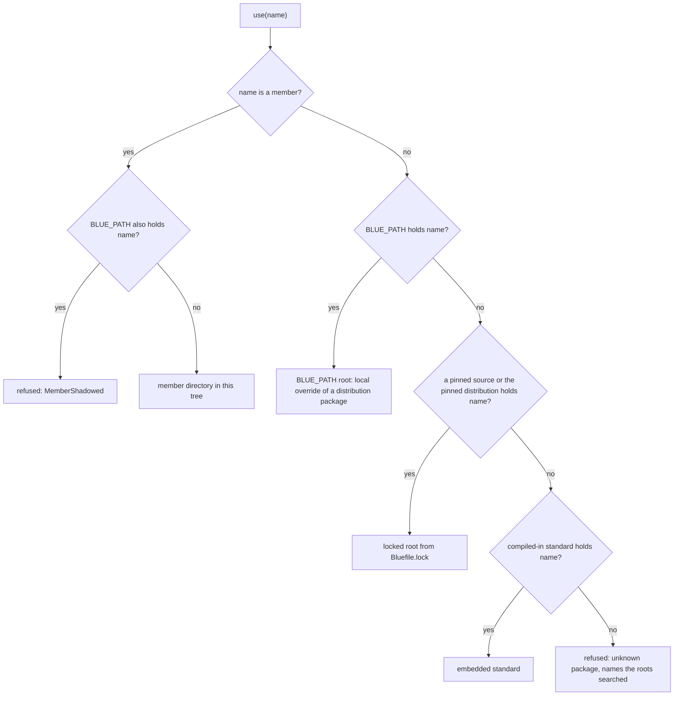
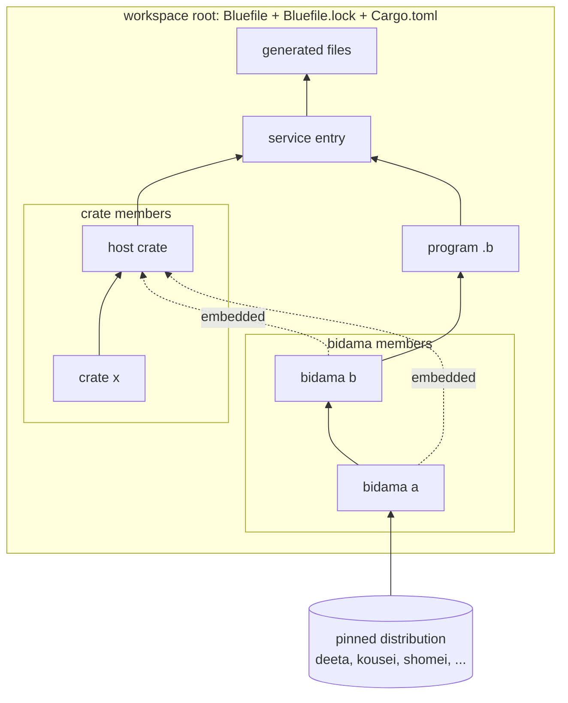
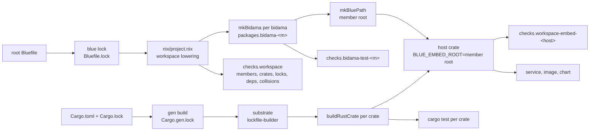

# WORKSPACES — one root, many bidamas and many crates

Status: DESIGN, 2026-10-23. Operator: *"bidama should have the concept of a
workspace like Rust does that can have many crates and many bidamas; I think we
have this but it should be an officially fully supported pattern."*

## 1. Destination

A blue workspace is one directory with one root `Bluefile`. It holds many
bidamas, many Rust crates and the Rust host seams that embed those bidamas. It
has one lock, one version, one dependency table and one build graph. Any member
builds, tests and publishes alone. A Cargo workspace has the same shape for
crates. Blue makes it the official shape for blue projects that grow past one
package.

The destination, stated as the rules an agent applies:

1. The root `Bluefile` declares the workspace once: members, version, blue pin
   and shared needs. Nothing else lists members.
2. A member says what it is by the manifest it holds. A `Bluefile` with
   `package` is a bidama. A `Cargo.toml` is a crate. A crate that embeds member
   bidamas is a host.
3. A member name resolves to the member, always. A sibling is never a version
   range and never fetched.
4. Nix builds one derivation per bidama and one per crate. `checks.workspace`
   proves that the members, the lock, the embeds and the Cargo table agree.
5. Each entry is judged alone. A bad member is refused with its reason, and its
   valid siblings build.

## 2. Ground: what exists today

Measured 2026-10-23 at blue `main`. Most of a workspace exists already, under
the name *project with `packages(dir)`*. It is not called a workspace, it holds
no crates, and its lock and versions are per member.

| Fact | State | Where |
|---|---|---|
| Bluefile vocabulary: `package`, `needs`, `posture`, `source`, `packages`, `run`, `tool`, `check`, `app`, `generate`, `rule`, `catalog`, `image`, `workload`, `service` | SHIPPED, closed table | `crates/blue-lang-pkg/src/bluefile.rs:423` (`WORDS`) |
| `packages(dir)`: every subdirectory of `dir` is a bidama, built, tested and gated for collisions | SHIPPED. This is the de facto workspace | `bluefile.rs:475`, `nix/project.nix:39` |
| `library()`, `binary()` (gabarito) | PROPOSED, not in `WORDS` | `theory/BLUE-STRUCTURE.md` §3.4 |
| `bidama(...)` as a Bluefile word | ABSENT. A bidama is a directory, not a word | `bluefile.rs:423` |
| `workspace(...)`, a member list, member globs | ABSENT | `bluefile.rs:423` |
| Sibling resolution | by layout. Walking up from a file, a bidama's Bluefile adds its parent dir, a project's adds its `packages` roots and stops | `crates/blue-lang-pkg/src/load_path.rs:183-210` |
| Resolution order | `BLUE_PATH`, then project roots, then the compiled-in standard. First match wins, so `BLUE_PATH` shadows a project package | `load_path.rs:33-48` |
| Version choice | not in the loader; nix picks the version when it builds a root | `load_path.rs:50-59` |
| Version solver | SHIPPED, backtracking with conflict chains; `checks.bidama-deps-resolve` | `src/solve.rs:1-27`, `bidamas/mk-bidama.nix:551` |
| Lock | one `Bluefile.lock` per Bluefile: the project's, and one per member bidama. `bidama-locks-fresh` checks every member lock | `src/lock.rs:24-29`, `mk-bidama.nix:610`, `project.nix:419` |
| One derivation per bidama, the graph tied with `lib.fix` | SHIPPED | `mk-bidama.nix:159` (`mkBidama`), `:503` (`mkDistribution`) |
| Versions and needs ranges | written per member: `package("joutai", "0.2.0")`, `needs("ronri", "^0.1")` | `arnes/bidamas/joutai/Bluefile:1-3` |
| Compiled-in bidamas for a Rust host | SHIPPED for the standard distribution only: `build.rs` embeds `bidamas/` | `crates/blue-lang-pkg/build.rs:1-30`, `src/embedded.rs:1-12` |
| A host embedding its own bidama | hand-written: `include_str!` of one file and a one-name `Loader` | `kensa/src/attestation.rs:25`, `:61-71` |
| Crates in a blue project | not a blue concept. Cargo owns them, substrate builds them through gen | `blue/Cargo.toml:1-25`, `kensa/flake.nix:23-26` |
| Rust workspace inheritance | SHIPPED in Cargo: `[workspace.package]` and `[workspace.dependencies]` | `blue/Cargo.toml:5-30` |
| Rust per-crate derivations | SHIPPED: `Cargo.gen.lock` read by substrate's lockfile-builder, one `buildRustCrate` per crate | `substrate/lib/build/rust/mk-rust-workspace.nix:1-40`, `docs/CARGO-GEN-LOCK.md` |
| `blue test -p <member>` | ABSENT. `blue test <file>` only | `crates/blue-lang-cli/src/` (no `-p` flag) |
| Publish one member alone | ABSENT as a verb. Distribution members are published by being in `bidamas/` of a pinned blue | `project.nix:184` |

Repos that already hold several bidamas in one tree:

| Repo | Members | Root Bluefile | Gated by nix |
|---|---|---|---|
| `blue` | 71 in `bidamas/`, 2 in `native/bidamas/` (a nested project) | `packages("bidamas")` | yes |
| `arnes` | 7 bidamas + 11 Rust crates | `packages("bidamas")` | yes; crates through substrate |
| `nupastel` | 7 | `packages("bidamas")` | yes |
| `makoto` | 10 | none | no: no root Bluefile, so no `bidama-test-*` |
| `kensa` | 1 (`blue/kensa`) + 5 Rust crates | `package` + `service`, no `packages` | no: the bidama is tested only by hand and through `cargo test` |

So: the bidama half of a workspace is shipped and in use by three repos. The
crate half, the shared lock, inheritance, member-first resolution, `-p`, the host
embed and single-member publish do not exist.

## 3. Research: what Cargo does, and what we take

| Cargo | Take | Adapted how |
|---|---|---|
| `[workspace] members` with globs, `exclude` | yes | `members:` globs in `workspace(...)`. A literal entry that matches nothing is refused alone |
| virtual manifest (root has no package) | yes | a root with `workspace(...)` and no `package` is virtual |
| one `Cargo.lock` at the root | yes | one `Bluefile.lock` at the root, with a `members` table |
| path dependencies | yes, by name | a sibling is named, never pathed; the workspace knows the path |
| `[workspace.package]` inheritance (`version.workspace = true`) | yes | `package("x")` with one argument inherits the version |
| `[workspace.dependencies]` | yes | `needs:` in `workspace(...)`; `needs("deeta")` with one argument inherits the range |
| `-p <crate>`, `--workspace` | yes | `blue test -p`, `blue check -p`, `--workspace` |
| `[patch]` to override a dependency | partly | `BLUE_PATH` still overrides a distribution package, but never a member |
| publish needs a version on each path dep | yes | at publish a sibling need renders as `^<workspace version>` |
| default-members | no | every member builds; selection is `-p` |
| features | no | blue has entries configured off, not features |

Nix today builds Rust workspaces through gen: `Cargo.lock` plus the committed
`Cargo.gen.lock` let substrate's lockfile-builder make one derivation per crate
with no IFD. A `Cargo.lock` change ships with `gen build .` in the same commit,
or the D2 freshness gate fails. The workspace reuses this path unchanged.

## 4. Members and states

### 4.1 Member kinds

| Kind | Holds | Built by | Tested by |
|---|---|---|---|
| bidama | `Bluefile` with `package`, `*.b` | `mkBidama` | `checks.bidama-test-<m>` (`blue test`) |
| crate | `Cargo.toml`, Rust | substrate, one derivation per crate (gen) | `cargo test -p <m>` inside substrate's check |
| host | a crate with `host:` in the workspace entry, which names the bidamas it embeds | substrate, with the embed root on the build env | cargo tests, plus `checks.workspace-embed-<m>` |
| service | the root `service(...)` entry, naming a host (or blue's own host) and a program | `nix/service.nix` | `checks.service-<n>-*` |
| generated | a `generate(...)` output; a graph node, not a member | `mkGenerated` | `checks.generated-<n>-fresh` |
| program | an entry `.b` (`run`, `app`, a service `program`) | the runner | `check(...)` |

A directory that holds both a `Bluefile` with `package` and a `Cargo.toml` is
refused: one directory, one kind. A host is a crate; the bidamas it embeds are
siblings.

### 4.2 The states of one member entry



A refused member names its reason. Its siblings that do not need it go on. A
sibling that needs it is refused with the chain (`a needs b, b refused: two
kinds`).

### 4.3 Bad states, refused per entry

| Bad state | Refusal | Tier |
|---|---|---|
| a literal member path with no directory | `MemberMissing(path)` at `blue lock` | parse-time-rejected |
| a glob that matches nothing | warning, not refused (an empty `crates/*` is a legal start) | only-mitigated |
| two members with one name | `MemberNameTaken(name, a, b)`, both refused | parse-time-rejected |
| a member path outside the root (`../x`) | `MemberOutsideRoot` | parse-time-rejected |
| a member that is itself a workspace | `NestedWorkspace`; a nested project stays a separate workspace | parse-time-rejected |
| a directory with two kinds | `TwoKinds(path)` | parse-time-rejected |
| a sibling need with a range | `SiblingRange(name)`: the workspace version is the range | parse-time-rejected |
| a sibling cycle | `Cycle([..])`, every member on it refused | parse-time-rejected |
| `BLUE_PATH` holding a member's name | `MemberShadowed(name, root)` at load | parse-time-rejected (at the loader door) |
| a host embedding a name that is not a member | `EmbedNotMember(name)` | build-time-rejected |
| a Cargo `[workspace] members` that differs from the Bluefile's crates | `checks.workspace-crates` red | CI-caught |
| a member lock out of step with the root lock | `checks.bidama-locks-fresh` red | CI-caught |

## 5. Shape

### 5.1 The manifest

The root `Bluefile` gains one word, `workspace(spec)`. It is set once.

```ruby
workspace({
  members: ["bidamas/*", "crates/*", "kensa-transport"],
  version: "0.1.0",
  blue: "^0.0.99",
  needs: {deeta: "^0.1", kousei: "^0.1", shomei: "^0.1"},
  hosts: {kensa: ["kensa", "kensa_ledger"]},
  publish: ["kensa_ledger"]
})
service("kensa", {program: "examples/attestations.b", host: "kensa", port: 8080})
```

A member bidama's own `Bluefile`:

```ruby
package("kensa_ledger")
needs("shomei")
needs("kensa_control")
```

`package` with one argument inherits the workspace version. `needs` with one
argument takes the workspace range for a distribution package, and means the
sibling for a member. Outside a workspace both one-argument forms are refused.

`packages(dir)` stays valid, configured, never deleted. Inside a workspace it is
sugar for `members: ["<dir>/*"]`. Outside one it keeps today's semantics,
including today's resolution order (§5.2), so blue, arnes and nupastel keep
working on the first commit.

### 5.2 Resolution order



Member-first is the change. Today `BLUE_PATH` wins over a project package
(`load_path.rs:33-48`). In a workspace a member is source in this tree. An
override of it from outside is a second copy, and a second copy that silently
wins is the bad state. The old order stays for a `packages(dir)` project that
declares no `workspace`.

### 5.3 The workspace graph



### 5.4 The lock

One `Bluefile.lock` at the root. It holds the workspace manifest, every member's
evaluated manifest under `members`, and every `source` pin. Members hold no
lock.

```json
{ "schema": 2,
  "bluefile_b3": "b3:...",
  "workspace": { "version": "0.1.0", "blue": "^0.0.99", "needs": {} },
  "members": {
    "kensa_ledger": { "kind": "bidama", "path": "bidamas/kensa_ledger",
                      "bluefile_b3": "b3:...", "needs": {"shomei": "^0.1.0"},
                      "siblings": ["kensa_control"] },
    "kensa": { "kind": "host", "path": ".", "embeds": ["kensa", "kensa_ledger"] }
  },
  "sources": {} }
```

Schema 1 locks stay readable (`lock.rs` already refuses an unknown schema by
number). A per-member lock that exists is checked against the root and never
read for resolution. A member published alone gets its own lock rendered at
publish (§5.7).

Cargo keeps `Cargo.lock` and `Cargo.gen.lock`. Two locks for two ecosystems is a
fact about cargo, which reads only its own files. The root lock records the
`Cargo.lock` hash so `blue lock` notices a cargo change.

### 5.5 The build graph



- **One derivation per bidama.** `mkBidama` as today, over the member root.
  A member's derivation sees only its `needs`, so an undeclared sibling `use`
  fails in the sandbox.
- **One derivation per crate.** gen and lockfile-builder, unchanged.
- **The host embed.** blue's `build.rs` embed of `bidamas/`
  (`crates/blue-lang-pkg/build.rs`) becomes a library function in
  `blue-lang-host` that embeds any root named by `BLUE_EMBED_ROOT`, filtered to
  the names the host lists. Nix sets the variable to the member root's store
  path. Under plain `cargo`, the function reads the members from the workspace
  tree. A host then uses one generated `Loader` for members and `Standard` for
  the rest. kensa's hand-written `KensaLoader` (`attestation.rs:61-71`) is the
  first one this retires.
- **`checks.workspace`.** One aggregate check: every member declared resolves;
  Cargo `[workspace] members` equals the Bluefile's crate members; the root lock
  is fresh; `bidama-deps-resolve`; `bidama-collisions` over the members; every
  host embed holds exactly its listed members.

### 5.6 The CLI

| Verb | Meaning |
|---|---|
| `blue lock` at the root | evaluates every member, writes the one lock |
| `blue test -p <m>` | tests one bidama member; an unknown name is refused with the member list |
| `blue test --workspace` | every bidama member, in dependency order |
| `blue check -p <m>`, `--workspace` | the same for `blue check` |
| `blue members` | the member table: name, kind, path, state (resolved, off, refused and why) |
| `blue publish -p <m>` | §5.7 |

`-p` on a crate name prints the cargo command and does not run cargo. Blue does
not wrap cargo.

### 5.7 Publishing one member alone

A member is published only when `publish:` lists it. Publish is off by default.
`blue publish -p <m>` renders the member as a standalone bidama: its `Bluefile`
with the inherited version written out, each sibling need written as
`^<workspace version>`, and its own `Bluefile.lock`. The result is a directory
that a distribution root can hold, so `mkDistribution` reads it with no change.
It is refused, alone, if a sibling it needs is not also published.

Crates publish through cargo and the existing release tooling. The workspace
does not change that.

### 5.8 With a batteries-included service

A service (`SERVICE-ARCHITECTURE.md`) is one `service(...)` entry at the root.
Its `host:` names a host member, or blue's own host when it names none. Its
`program:` `use`s member bidamas and distribution bidamas the same way. Each
battery (haibi, settei, kyuuji, bougyo, ...) is a distribution bidama, on by
default and turned off with one entry. A workspace adds no battery. It gives a
service room for its own bidamas beside its handlers, so policy that grows past
one file becomes a member, not a longer file.

## 6. Phases, each ending green

| Phase | Work | Gate |
|---|---|---|
| W0 | this doc | the operator approves the destination |
| W1 | `workspace(...)` in `WORDS`; schema 2 lock with `members`; `packages(dir)` lowers to a members glob | arnes moves to `workspace(...)`; its nix outputs are byte-identical to before; a seeded `TwoKinds` member is refused alone and its siblings build |
| W2 | member-first resolution; `MemberShadowed` | red-then-green test: `BLUE_PATH` holding a member name is refused; a distribution override still works |
| W3 | one-argument `package` and `needs` | a member with no version inherits it; the same Bluefile outside a workspace is refused |
| W4 | `blue test -p`, `--workspace`, `blue members` | `blue test --workspace` over arnes equals the set of `bidama-test-*` checks |
| W5 | the `blue-lang-host` embed function; `checks.workspace-embed-<host>` | kensa replaces `KensaLoader`; `cargo test` green; an embed of a non-member fails the build |
| W6 | crate members; `checks.workspace-crates` | a seeded drift between Cargo members and Bluefile crates is red |
| W7 | `blue publish -p` | a published member loads from a distribution root in a clean sandbox |
| W8 | render the Cargo `[workspace]` table (members, `workspace.package`) from `workspace(...)`, gated fresh | kensa's rendered table equals today's; per-crate `Cargo.toml` stays hand-written |

## 7. Decisions

| Decision | Chosen | Rejected, and why |
|---|---|---|
| How members are declared | explicit globs in one `workspace(...)` entry | **Discovery by layout alone** (any dir with a manifest): a stray directory silently becomes a member, and deleting one is a silent change of kind. This is the argument `BLUE-STRUCTURE.md` §3.4 makes for declared `library()`. **One entry per member**: a second list to keep in step with the tree. Globs are what `packages(dir)` already means, so the old form is sugar, not a second mechanism |
| One lock or one per member | one root lock; per-member locks only rendered at publish | **Per-member locks** (today): N files that can disagree about one shared need, and N freshness checks for one fact. Cargo learned this; we take it |
| Sibling resolution | by name, member-first, no range | **Path deps in `needs`**: the workspace already knows the path; writing it twice drifts. **Version ranges between siblings**: siblings move together at one version, so a range can only be wrong |
| `BLUE_PATH` over a member | refused | **First match wins** (today): a checkout on `BLUE_PATH` silently replaces code that is in this tree. It stays for distribution packages and for plain `packages(dir)` projects |
| Who owns crate membership | Cargo reads `Cargo.toml`; the Bluefile is the source, and W8 renders the `[workspace]` table | **Blue wraps cargo**: a second build tool around cargo. **Cargo stays the only source**: then the Bluefile is not the source of the workspace, against blue-is-the-source |
| The host embed | one function in `blue-lang-host`, fed a root by nix | **`include_str!` per file** (kensa today): one hand list per host. **A proc macro over paths**: cannot see a nix store root |
| Nested projects (`blue/native`) | stay separate workspaces | **Members of the outer one**: two roots would claim one directory |

## 8. Open questions

| Question | Type |
|---|---|
| cargo reads only `Cargo.toml`, so two lock files and a rendered `[workspace]` table are the floor | world-fact: typed in §5.4 and W8 |
| crates.io refuses a path dependency with no version, so a published crate member needs versions on sibling deps | world-fact: cargo already handles it with `version` beside `path` |
| `builtins.fetchTree` fetches a whole repository, so a member published from a git source still fetches the repo | world-fact: publish renders a standalone directory; a registry that repackages it is a later word |
| does blue's own repo (71 members, 71 committed locks) become a `workspace`? | ours: yes after W1–W3, when the locks are renderings; it is the biggest migration |
| member names: one global namespace with the distribution, or a workspace prefix (`kensa_*`)? | ours: the collision gate is namespace-scoped today; the naming check decides per repo |
| does gabarito (`lib.b`, `main.b`, `bin/`) apply inside members? | ours: yes, per member, when gabarito ships; this design does not need it |
| makoto has bidamas and no root Bluefile | ours: a W1 adoption, one file |

## 9. Tier ledger

| Claim | Tier | Evidence |
|---|---|---|
| a directory of bidamas, each built, tested and gated | SHIPPED | `project.nix:39`, used by blue, arnes, nupastel |
| one derivation per bidama | SHIPPED | `mk-bidama.nix:159` |
| version solver with conflict chains | SHIPPED | `solve.rs`, `bidama-deps-resolve` |
| per-crate Rust derivations through gen | SHIPPED | `mk-rust-workspace.nix`, `Cargo.gen.lock` |
| compiled-in bidamas for a host | SHIPPED for the standard only | `blue-lang-pkg/build.rs` |
| `workspace(...)` word | DESIGN | this doc §5.1 |
| one root lock with `members` | DESIGN | §5.4 |
| member-first resolution, `MemberShadowed` | DESIGN | §5.2 |
| version and needs inheritance | DESIGN | §5.1 |
| `blue test -p`, `--workspace`, `blue members` | DESIGN | §5.6 |
| host embed function, `checks.workspace-embed-*` | DESIGN | §5.5 |
| `checks.workspace`, `checks.workspace-crates` | DESIGN | §5.5 |
| `blue publish -p` | DESIGN | §5.7 |
| rendered Cargo `[workspace]` table | DESIGN | W8 |

## 10. Related

- `theory/BLUE-STRUCTURE.md` §1 (layout), §3 (gabarito), §5.5 (no nix in a
  project), §6.5–6.6 (one model, batteries-included service)
- `docs/SERVICE-ARCHITECTURE.md` (the default service, its bidamas, the host
  surface)
- `docs/CARGO-GEN-LOCK.md` (why `Cargo.gen.lock` is committed)
- `bidamas/CATALOG.md`, `bidamas/NAMES.md` (the distribution and its name
  ledger)
- `kensa/docs/LANDSCAPE.md` (the first full workspace: kensa)
